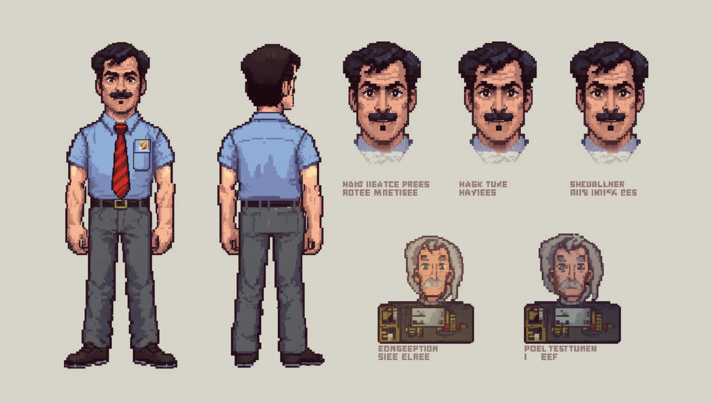
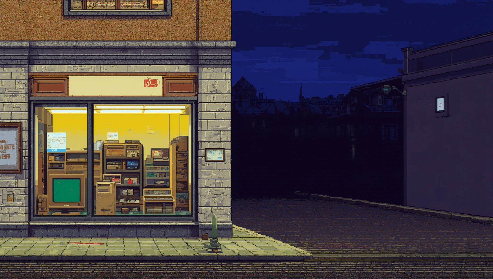
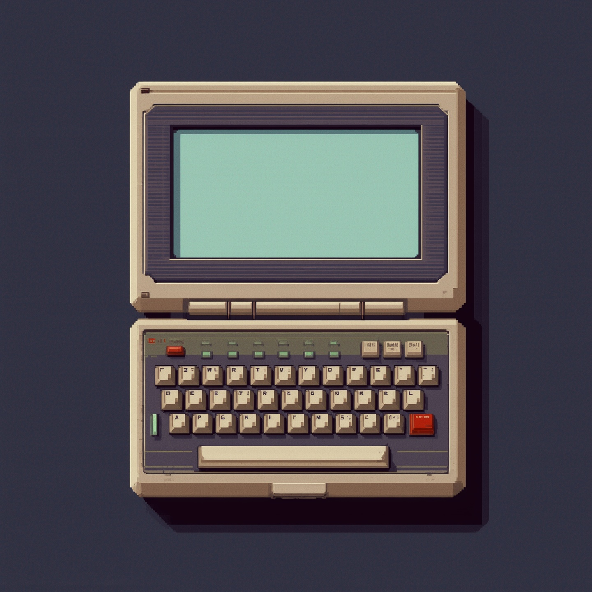
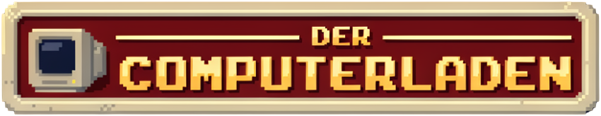
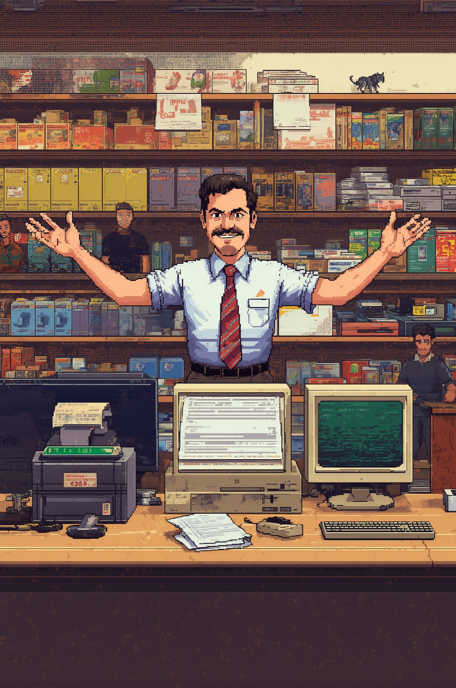

# Bildkatalog

Alle Bilder des Spiels nach Inhalt: wer oder was zu sehen ist, wie es aussieht und mit welchem
festen Baustein es im Prompt steht. Der Katalog ist zum Wiederverwenden da: Kommt der
Ladenbesitzer in eine neue Szene, steht er dort mit demselben Wortlaut wie bisher.

- **Protokoll:** [leonardo/prompt-log.md](leonardo/prompt-log.md) bleibt die Chronik jedes
  freigegebenen Bilds mit Durchgang, Seed, Einstellungen, Rasterfassung und Prompt im Wortlaut.
  Der Katalog wiederholt das nicht, er nennt nur die Kennung.
- **Regeln:** Stilblock, Modelle, Formate und Nachbearbeitung stehen im
  [Leonardo-Workflow](../style-guide/leonardo-workflow.md) des Style-Guides, Aussehen der Figuren
  und Szenen in seinem Abschnitt [Szenen und Figuren](../style-guide/README.md#szenen-und-figuren).
  Widerspricht der Katalog dem Style-Guide, gilt der Style-Guide.
- **Pflege:** Der Skill `dcl-grafik` ergänzt den Katalog bei jedem freigegebenen Bild, zusammen
  mit dem Prompt-Log.

Kennungen: S- Stilanker und Szene, F- Figur, T- Titel, G- Gerät, C- Cover, L- Logo. Ein fester
Baustein steht englisch im Wortlaut, wie er in den Prompt kommt; ändert er sich, ändert er sich
hier zuerst.

## Übersicht

| Kennung | Inhalt | Original in `docs/art/leonardo/` | Ergebnis im Spiel | Stand |
|---|---|---|---|---|
| S-C | [Laden innen](#laden-innen-theke-und-regale), [Ladenbesitzer](#ladenbesitzer) | `stilanker-c2.jpg` | – | Stilanker |
| F-01 | [Ladenbesitzer](#ladenbesitzer) | `f-01-figurenblatt.jpg` | – | Basis, Nacharbeit offen |
| T-01 | [Laden außen](#laden-außen-straßenecke-in-der-abenddämmerung) | `t-01-titelbild.jpg` | `src/assets/images/title_t01.png` | seit Feature 005 nicht mehr im Spiel |
| T-02 | [Laden außen](#laden-außen-straßenecke-in-der-abenddämmerung) | `t-02-titelbild.jpg` | `src/assets/images/title_t02.png` | im Spiel |
| L-01 | [Logo](#logo-ladenschild) | `logo-ladenschild-original.jpg`, `logo-ladenschild.png` | `src/assets/images/logo_ladenschild.png`, `src/assets/icon/` | im Spiel |
| C-01 | [Cover](#cover), [Ladenbesitzer](#ladenbesitzer), [Laden innen](#laden-innen-theke-und-regale) | `c-01-cover.jpg` | – | freigegeben, nicht gerastert |
| G-01 | [Gehäuse des Communicators](#gehäuse-des-communicators) | `g-01-organizer.jpg` | – | Spike, nicht freigegeben |
| G-02 | [Gehäuse des Communicators](#gehäuse-des-communicators) | `g-02-organizer.jpg` | – | abgelöst durch G-03 |
| G-03 | [Gehäuse des Communicators](#gehäuse-des-communicators) | `g-03-notizbuch.jpg` | `src/assets/images/organizer_1991.png` | im Spiel |

## Figuren

### Ladenbesitzer

- **Wer:** die Hauptfigur, der Spieler als Besitzer des Ladens. Überall dieselbe Figur
  (Style-Guide, Szenen und Figuren); maßgeblich ist sein Figurenblatt F-01.
- **Aussehen:** Ende dreißig, dunkles Haar, Schnurrbart, hellblaues Kurzarmhemd mit kleinem
  Namensschild, rot gestreifte Krawatte, dunkle Hose. Freundlich, ein wenig verschmitzt.
- **Fester Baustein:**

  > a man in his late thirties with dark hair, a moustache, a short-sleeved light blue shirt with a small name badge, a red striped tie and dark trousers

- **Mienen auf dem Figurenblatt:** „a friendly smile“, „a skeptical raised eyebrow“, „a shocked
  look“.
- **Referenzen beim Erzeugen:** C2 als Style Reference (High), dazu F-01 als zweite Referenz oder
  FLUX.1 Kontext für Varianten (Leonardo-Workflow, Stimmigkeit).
- **Bilder:** S-C (hinter der Theke, vorgebeugt), F-01 (Figurenblatt), C-01 (mit ausgebreiteten
  Armen).
- **Im Spiel:** noch nicht. Porträt für die Bedienleiste (24 × 28) und Figur in Szenen (etwa 60
  hoch) stehen aus.
- **Offen:** F-01 braucht Nacharbeit: Kritzel-Beschriftungen und zwei grauhaarige Köpfe
  entfernen, die Seitenansicht fehlt (Prompt-Log, F-01).

## Orte und Szenen

### Laden außen: Straßenecke in der Abenddämmerung

- **Was:** der Laden von der Straße aus, als Titelbild. Altes verputztes Stadthaus an einer
  Straßenecke, großes Schaufenster in warmem Gelb, darin beige PCs, Softwareschachteln und
  Disketten; leerer Leuchtkasten über dem Fenster, leeres Plakat im Fenster; nasses Kopfsteinpflaster,
  alte Straßenlaterne; tiefblauer Abendhimmel mit letztem Licht am Horizont, Dächer und Kirchturm.
- **Fester Baustein:**

  > A small German computer shop on a street corner at dusk in the early 1990s. Old plastered town house with a big shop window glowing warm yellow; inside, beige desktop PCs with chunky CRT monitors showing green and blue screens, stacks of software boxes and floppy disks. A blank illuminated sign box above the window, a blank poster in the window. Wet cobblestone street reflecting the window light, an old street lamp. Deep blue evening sky with the last light at the horizon, rooftops and a church tower in the distance.

- **Platz für die Oberfläche:** Was die Oberfläche darüber legt, kommt als ruhige, leere Fläche in
  den Prompt, etwa „Calm, empty dark sky in the upper left corner for the game title“ (T-01, T-02).
- **Bilder:** T-01 (Laden mittig, mit Auto und Fahrrad; Platz rechts für ein Menü), T-02 (Laden
  im linken Drittel, rechts zwei Drittel dunkel für den Communicator).
- **Im Spiel:** T-02 als `src/assets/images/title_t02.png`, 320 × 180. `title_t01.png` liegt noch
  im Repo, ist aber seit Feature 005 nicht mehr im Spiel.

### Laden innen: Theke und Regale

- **Was:** der Verkaufsraum, eng und voll. Holztheke, darauf PC, Nadeldrucker und Kasse; dahinter
  Regale voller bunter Softwareschachteln und Disketten; warmes Licht von oben links. Das Bild ist
  zugleich der Stilanker, an dem jedes neue Bild gemessen wird.
- **Fester Baustein:**

  > Interior of a small, cramped German computer shop in the early 1990s. A wooden counter with a beige desktop PC with a CRT monitor, a dot-matrix printer with continuous form paper with pale green stripes, and a cash register with a green glowing display. Shelves full of colorful software boxes and floppy disks. Warm interior light from the upper left.

  Der Baustein ist aus S-C und C-01 zusammengezogen; mit Figur steht der Ladenbesitzer davor
  („stands behind a wooden counter …“).
- **Bilder:** S-C, C-01 (als Hintergrund des Covers).
- **Im Spiel:** noch nicht. Als Spielszene im Rahmen wäre es 312 × 144 (Leonardo-Workflow,
  Formate).

## Gegenstände und Geräte

### Gehäuse des Communicators

- **Was:** das Taschengerät, auf dessen LCD die Seiten des Titels stehen (Baustein Communicator).
  Heute ein elektronisches Notizbuch nach dem Olivetti D2000 von 1990, nur in Worten beschrieben,
  ohne Foto und ohne Logo. Helles Gehäuse wie die Geräte im Stilanker.
- **Aussehen:** warmes hellgraues Kunststoffgehäuse mit runden Ecken, dicke runde Scharnierwalze
  über die ganze Breite; oben ein leeres LCD genau 2 : 1 in schmaler dunkler Blende; unten eine
  Schreibmaschinentastatur mit hellen Tasten auf dunklerem Feld, darüber acht mintgrüne
  Funktionstasten und eine rote Taste rechts.
- **Fester Baustein:**

  > An open electronic notebook organizer from 1990, a small clamshell pocket computer, seen straight from the front, perfectly symmetrical, centered, opened flat. Warm light grey plastic housing with rounded corners. A thick round cylindrical hinge bar runs across the whole width between the lid and the base. The upper lid holds one wide, completely blank rectangular LCD screen, exactly twice as wide as it is high, plain flat pale grey-green and empty, inside a thin dark bezel

  Den vollständigen Prompt mit Tastatur und Hintergrund hat das Prompt-Log unter G-03.
- **Bilder:** G-01 (Organizer, Spike), G-02 (Organizer, abgelöst), G-03 (Notizbuch, im Spiel).
- **Im Spiel:** `src/assets/images/organizer_1991.png`, 196 × 134, LCD bei 18/14 mit 160 × 80
  Bildpixeln, im Spiel ×2; die Oberfläche malt das LCD in `lcd` darüber. Der Dateiname stammt
  noch von G-01.

### Geräte der Zeit im Laden

- **Was:** was in jedem Ladenbild herumsteht, passend zum Spieljahr (Style-Guide, Szenen und
  Figuren): 1985 Heimcomputer und Monochrom-Monitore, um 1990 beige Desktops mit 14-Zoll-Röhren,
  1999 Tower und 17-Zoll-Röhren. Keine echten Markenlogos.
- **Feste Bausteine** für die frühen Neunziger, wie in S-C, T-01, T-02 und C-01:

  > a beige desktop PC with a CRT monitor

  > beige desktop PCs with chunky CRT monitors showing green and blue screens

  > a dot-matrix printer with continuous form paper with pale green stripes

  > a cash register with a green glowing display

  > shelves full of colorful software boxes and floppy disks

- **Bilder:** S-C, T-01, T-02, C-01; ein eigenes Bild gibt es noch nicht.

## Logo und Cover

### Logo: Ladenschild

- **Was:** das Logo als Ladenschild in Pixel-Art: beiger Kunststoffrahmen, dunkelrotes
  Schildfeld, „DER“ klein zwischen zwei Zierlinien, darunter „COMPUTERLADEN“ in gelben
  Pixelbuchstaben mit oranger Schattierung, links ein kleiner beiger Monitor. Verwendung regelt
  der Style-Guide, Abschnitt Logo.
- **Erzeugt:** mit Ideogram 4.5 statt Lucid Origin, weil es Schrift braucht; Prompt und Ablauf im
  Prompt-Log unter L-01.
- **Original:** `logo-ladenschild-original.jpg` (1280 × 720), freigestellt
  `logo-ladenschild.png` (850 × 164).
- **Im Spiel:** `src/assets/images/logo_ladenschild.png`, 141 × 27, im Spiel ×2. Aus dem Monitor
  links entsteht das App-Symbol: `src/assets/icon/app_icon.png`, `app_icon.icon`, `app_icon.ico`,
  Ebenen unter `docs/art/app_icon/` (Style-Guide, App-Symbol).

### Cover

- **Was:** Packung und Shop-Bild, 2 : 3 hochkant. Der Ladenbesitzer mit ausgebreiteten Armen
  hinter der Theke, vorn ein Nadeldrucker, dessen Endlospapier über die Thekenkante hängt; links
  ein skeptisches Kundenpaar, eine Katze schläft auf einem Monitor. Oben ein ruhiges Viertel für
  das Logo.
- **Feste Bausteine:** Ladenbesitzer und Laden innen wie oben; dazu

  > Keep the top quarter calm and uncluttered for the title logo.

- **Entwurf mit Logo und Texten:** [entwuerfe/cover.md](entwuerfe/cover.md).
- **Im Spiel:** keins. Fürs fertige Cover kommt C-01 aufs Raster 300 × 450 und wird ganzzahlig
  hochskaliert.
