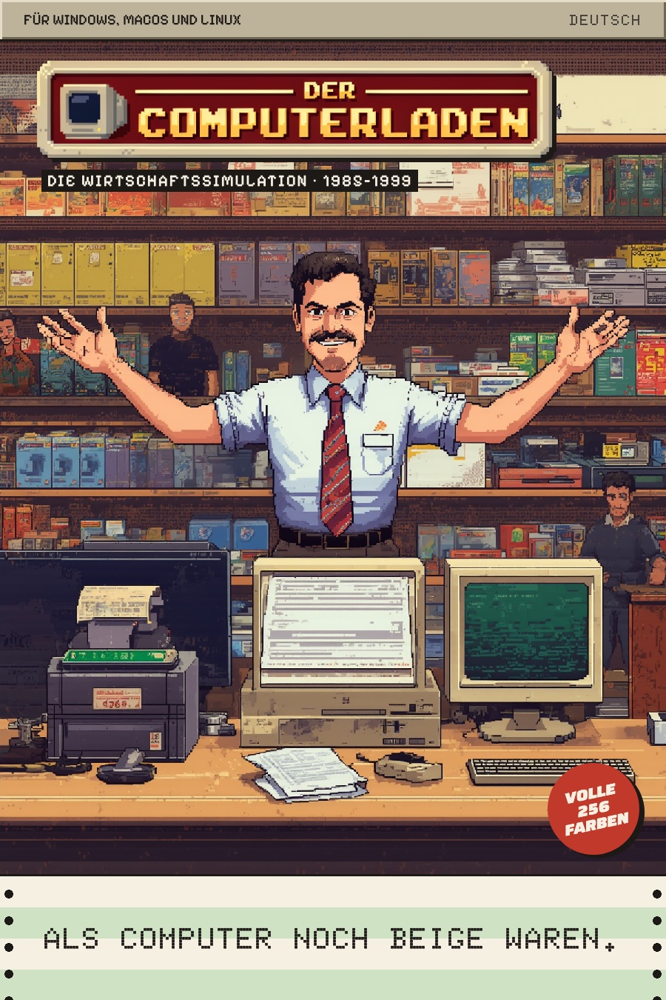

# Cover-Entwurf

Entwurf für Packung und Shop-Bild vom 2026-10-19, übernommen aus dem Claude-Design-Artifact
„Computerladen Titelscreen & Cover“ (https://claude.ai/artifact/RHKxpTb6JfWFQdNnPYEWHH, Board
„Cover“). Das Artifact bleibt bestehen; maßgeblich ist ab 2026-10-29 diese Datei. Noch nicht
freigegeben und noch nicht ans Raster angepasst: Der Entwurf zeigt das Leonardo-Original von C-01,
nicht das gerasterte Bild.

Zum Ansehen im Browser: [cover.html](cover.html). Sie nutzt die Bilder aus `../leonardo/`; das
Bild oben ist ein Bildschirmfoto davon.

## Motiv

- **Bild:** C-01 Nr. 4 aus Leonardo (Lucid Origin, Stil-Referenz C2, Seed 1638136522), Datei
  `docs/art/leonardo/c-01-cover.jpg`. Fürs fertige Cover kommt es noch aufs Raster 300 × 450 und
  wird dann ganzzahlig hochskaliert (Leonardo-Workflow, Formate).
- **Logo:** L-01 Ladenschild (Ideogram 4.5, freigestellt), `docs/art/leonardo/logo-ladenschild.png`.

## Aufbau

Fläche 900 × 1350 Pixel, also 2 : 3 hochkant, das Dreifache von 300 × 450. Grund `holz-dunkel`,
darauf das Motiv über die ganze Fläche. Von oben nach unten:

| Teil | Lage und Maß | Gestaltung | Text |
|---|---|---|---|
| Kopfleiste | oben, 900 × 56, Innenabstand 32 seitlich | `gehaeuse` mit Relief 3 Pixel (`gehaeuse-hell` oben links, `gehaeuse-dunkel` unten rechts), unten 3 Pixel `tusche`; links Pixelify Sans 20/24 in `tusche`, rechts Doto 700 mit 2 Pixel Laufweite | „FÜR WINDOWS, MACOS UND LINUX“ links, „DEUTSCH“ rechts |
| Logo | links 48, oben 80, 700 breit | Ladenschild als Bild, harter Schatten 6 Pixel in `tusche` | – |
| Untertitel | 14 unter dem Logo, 8 eingerückt | Pixelify Sans 22/26, 2 Pixel Laufweite, `papier` auf einem Streifen `tusche` | „DIE WIRTSCHAFTSSIMULATION · 1985–1999“ |
| Störer | rechts 36, oben 1030, Kreis 124 | `kassenrot`, um −12° gedreht, harter Schatten 6 Pixel in `tusche`; Saira 900 kursiv, Breite 125 %, 20 Pixel, Zeilenhöhe 1,05, in `papier`, mittig | „VOLLE / 256 / FARBEN“ in drei Zeilen |
| Fußzeile | ab 1180, 900 × 170, Innenabstand 40 seitlich | Endlospapier: Streifen `papier` und `endlos-gruen` je 42 Pixel, oben 3 Pixel `tusche`; Lochränder 24 breit, Löcher Durchmesser 12 in `tusche` alle 36 Pixel; Doto 800, 40/48, 2 Pixel Laufweite, `tusche`, mittig | „ALS COMPUTER NOCH BEIGE WAREN.“ |

## Offen

- Kopfleiste und Untertitel stehen in Pixelify Sans. Die nimmt das Spiel nicht mehr (Style-Guide,
  Schrift); vor der Freigabe auf Ark Pixel oder Doto umstellen.
- Der Untertitel lautet hier „DIE WIRTSCHAFTSSIMULATION · 1985–1999“, im Spiel „WIRTSCHAFTSSIMULATION
  · 1985–1999“ ohne Artikel (Style-Guide, Logo).
- Störer und Lochrand sind nicht aufs Raster 300 × 450 gelegt; der Störer ist gedreht, das
  verträgt sich nicht mit „kein Bild wird gedreht“ (Style-Guide, Raster und Auflösung). Ob das für
  Packung und Shop gilt, entscheidet Klaus, wenn das Cover dran ist.

## Titelscreen im selben Artifact

Das Board „Titelscreen“ zeigte T-01 (Nr. 3, Seed 907617441) als Vollbild mit Logo links oben, ein
Hauptmenü auf Endlospapier rechts (Neues Spiel, Spiel laden, Einstellungen, Beenden) und die
Versionszeile „V0.1 · PROTOTYP“ links unten. Er ist überholt: Seit Feature 005 zeigt der Titel T-02
mit dem Communicator (Style-Guide, Bildaufbau, und Baustein Communicator). Er wurde deshalb nicht
übernommen.
