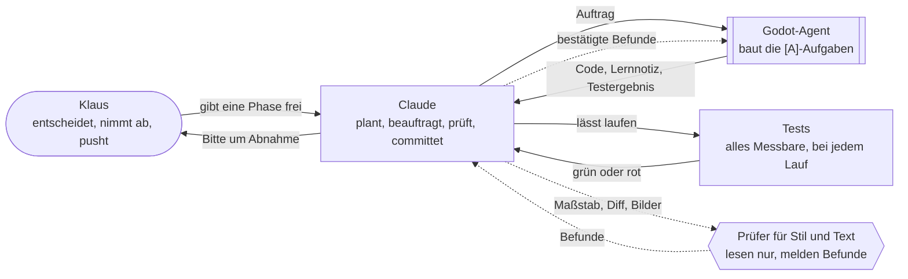

# KI-Workflow

Wie Klaus, Claude und die Agents bei „Der Computerladen“ zusammenarbeiten: Abläufe und Regeln, die
sich bewährt haben, jeweils mit Grund. Die Dokumente in diesem Ordner gelten für Claude in diesem
Projekt (`CLAUDE.md`, „Arbeitsweise“). Gedacht sind sie als Vorlage, die sich auf spätere Projekte
übertragen lässt.

## Wer macht was

Gestrichelt ist, was noch eingeführt wird: die Prüfer, siehe [ki_pruefung.md](ki_pruefung.md). Die
Rollen im Einzelnen stehen in [ki_dev.md](ki_dev.md), „Rollen“.

## Was steht wo

| Datei | Inhalt |
|---|---|
| [ki_dev.md](ki_dev.md) | Entwickeln mit KI: Rollen, Ablauf je Feature, Git, Aufträge an den Agent, Prüfen und Abnahme, Tests, Dokumentation, Zusammenarbeit, Werkzeuge, Grafik |
| [ki_pruefung.md](ki_pruefung.md) | Prüfen mit KI: Grundsätze, Prüfer und ihre Maßstäbe, Ablauf einer Phasenprüfung, Tests, Stand der Einführung |
| `CLAUDE.md` | die verbindliche Arbeitsanweisung für Claude Code in diesem Projekt |
| `.specify/memory/constitution.md` | die Verfassung: verbindliche Grundsätze für die Spec-Kit-Abläufe |
| `docs/offene-punkte.md` | offene Fragen, Lücken und Claudes eigene Entscheidungen, bis Klaus sie entschieden oder bestätigt hat |
| `docs/Ideensammlung.md` | lose Ideen, auch zur Arbeitsweise |
| `.claude/agents/` | die Agents, etwa `godot-entwickler` |
| `.claude/skills/` | die Skills: eigene mit `dcl-`, die von Spec Kit mit `speckit-` |

**Abgrenzung:** `CLAUDE.md` und die Verfassung sind verbindlich. Dieser Ordner ist die Blaupause
dahinter: das Warum, die Erfahrungen, die Vorlage. `CLAUDE.md` verweist auf ihn, seine Regeln gelten
also für Claude in diesem Projekt (Klaus, 2026-10-21). Wird eine Praxis grundsätzlich, wandert sie
nach `CLAUDE.md` bzw. in die Verfassung.

## Schaubilder

Die Schaubilder sind in Mermaid geschrieben, einer Schreibweise für Schaubilder als Text: Aus der
Zeile `Claude --> Agent` zeichnet GitHub zwei Kästen mit einem Pfeil dazwischen.
- Sie stehen als Text in der Datei. Git zeigt jede Änderung, und Claude pflegt sie wie den Text
  daneben.
- GitHub und Obsidian zeichnen sie. Ein Editor ohne Mermaid zeigt den Text: lesbar, aber ohne Bild.
- Eigene Farben gibt es nicht, denn sie sähen im hellen und im dunklen Modus verschieden aus. Wer
  handelt, steht im Kasten; gestrichelt ist, was noch eingeführt wird.

## Pflege

Erkennt Claude ein Muster, das die Arbeitsweise allgemein betrifft und nicht nur das aktuelle
Feature, fragt Claude nach, ob es in diesen Ordner aufgenommen wird, mit einem Vorschlag für den
Wortlaut und dem Anlass. Beispiele: eine Prüfung, die zum zweiten Mal einen Fehler gefunden hat;
eine Korrektur, die Klaus wiederholt. Eingetragen wird erst nach Klaus' OK (Klaus, 2026-10-21).

## Kein lokales Gedächtnis

Nichts wird in einem lokalen Memory-Verzeichnis abgelegt (Klaus, 2026-10-21). Was dauerhaft gelten
soll, wird in eine Repo-Datei geschrieben und committet: `CLAUDE.md`, die Verfassung, die Dokumente
dieses Ordners, die Feature-Dokumente, `docs/Ideensammlung.md` oder `docs/offene-punkte.md`. Dann
steht es allen Sitzungen und allen Beteiligten zur Verfügung und ist versioniert. Fällt etwas an, das
nirgends passt, gehört es nach [ki_dev.md](ki_dev.md). Bis 2026-10-21 hielt Claudes lokales Memory
Vorlieben und Stand fest; der Inhalt ist nach `ki_dev.md` und `docs/offene-punkte.md` umgezogen.
