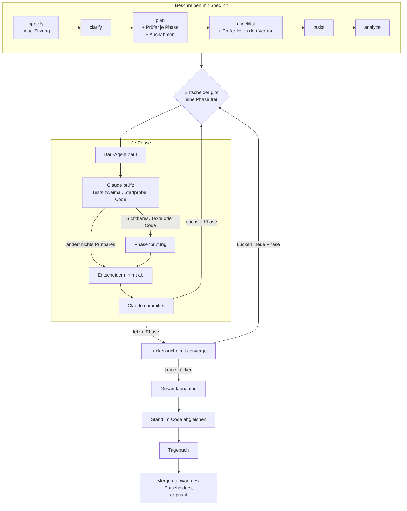
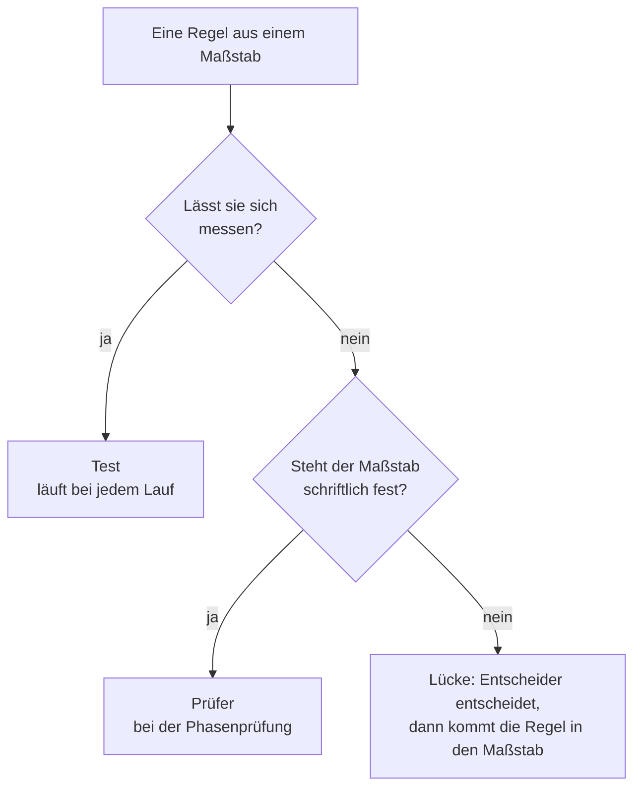

# Blaupause: Entwickeln mit KI

**Konzept, 2026-10-29.** Diese Datei beschreibt die Arbeitsweise mit Claude Code so, dass sie in
jedem Projekt gilt. Sie entstand aus „Der Computerladen“ (Features 001 bis 009). Was nur für ein
Projekt gilt, steht nicht hier, sondern in dessen Projektsteckbrief `docs/ki_workflow/projekt.md`.

**Für ein neues Projekt** genügt diese eine Datei: nach `docs/ki_workflow/blaupause.md` kopieren und
Claude sagen „Richte das Projekt nach der Blaupause ein“. Wie das geht, steht in Abschnitt 14.

## Wie die Blaupause zu lesen ist

- **Rollen statt Namen.** Die Blaupause spricht vom *Entscheider* (dem Menschen, der das Projekt
  führt), von *Claude*, vom *Bau-Agent* und von den *Prüfern*. Wer das im Projekt ist, steht im
  Steckbrief.
- **Platzhalter** in spitzen Klammern, etwa `<Stand-im-Code>`, sind Felder des Steckbriefs. Die
  Liste aller Felder steht in Anhang A.
- **Jede Regel hat ein Warum.** Die Anlässe, aus denen eine Regel entstand, stehen in den
  Erfahrungsdateien des Projekts, nicht hier.
- **Rangfolge:** `CLAUDE.md` vor Verfassung vor Steckbrief vor Blaupause. Weicht ein Projekt ab,
  steht die Abweichung mit Grund im Steckbrief unter „Abweichungen“.
- **Module** sind Teile, die ein Projekt zuschaltet oder weglässt (Abschnitt 13). Der Steckbrief
  sagt, welche gelten.

## 1 · Grundsätze

1. **Der Mensch entscheidet, die KI arbeitet zu.** Nichts wird gebaut, committet oder gemergt ohne
   das Wort des Entscheiders. Warum: Er trägt das Projekt und muss jede Entscheidung kennen.
2. **Erst beschreiben, dann bauen.** Jedes Feature hat Spec, Plan und Aufgaben, bevor Code entsteht.
   Warum: Die Beschreibung ist die Gesprächsgrundlage, und in einem halben Jahr zählt vor allem,
   warum etwas so gebaut wurde.
3. **Wer baut, prüft nicht selbst.** Der Bau-Agent baut, Claude prüft, Prüfer mit eigenem Maßstab
   prüfen unabhängig. Warum: Ein frischer Blick sieht, was der Erbauer übersieht.
4. **Alles Dauerhafte steht im Repo.** Kein lokales Gedächtnis. Warum: So gilt es für jede Sitzung,
   jeden Beteiligten und ist versioniert.
5. **Messbares prüft ein Test, Urteile ein Prüfer.** Warum: Ein Skript ist zuverlässiger und
   billiger, bei jedem Lauf; ein Prüfer nur dort, wo es ein Urteil braucht.
6. **Kleine Schritte, jeder abgenommen.** Ein Feature entsteht phasenweise, jede Phase einzeln
   freigegeben und abgenommen. Warum: Fehler fallen früh auf, und der Entscheider behält den
   Überblick.
7. **Entscheidungen sind sichtbar.** Mit Datum, wer sie traf, und der verworfenen Alternative.
   Claude entscheidet nichts stillschweigend. Warum: Später lässt sich ein Grund kaum noch belegen.
8. **Einfach anfangen, erst erweitern, wenn es nachweislich hilft.** Ein neuer Agent, Prüfer oder
   Hook kommt erst, wenn eine Prüfung zweimal etwas gefunden hat. Warum: Mehrere Agents kosten ein
   Vielfaches an Tokens; was nichts findet, fliegt wieder raus.

## 2 · Rollen


| Rolle | Kennzeichen in `tasks.md` | Tut | Tut nie |
|---|---|---|---|
| Entscheider | `[K]` (oder sein Kürzel) | gibt Phasen frei, nimmt ab, entscheidet Lücken, pusht; baut selbst, was er lernen will | — |
| Claude | `[C]` | Spec, Plan, Recherche, Aufträge, Prüfung, Doku, Werkzeuge außerhalb des Stacks, Commits | pushen, ohne Freigabe bauen lassen |
| Bau-Agent | `[A]` | die beauftragten Aufgaben im Stack, mit Tests und Bericht | committen, über den Auftrag hinaus bauen |
| Prüfer | — | lesen, melden Befunde mit Ort, Regel, Beleg | Dateien ändern, nach Geschmack urteilen |

## 3 · Gedächtnis im Repo und Ordner

**Kein lokales Gedächtnis.** Claude legt nichts im Memory-Verzeichnis von Claude Code ab. Was
dauerhaft gelten soll, kommt in eine Repo-Datei und wird committet. Passt es nirgends, gehört es in
die Erfahrungsdatei `ki_dev.md`.

| Pfad | Inhalt | Wer pflegt |
|---|---|---|
| `CLAUDE.md` | verbindliche Arbeitsanweisung: harte Rahmenbedingungen, Rollen, Aufbau | nur auf Beschluss des Entscheiders |
| `.specify/memory/constitution.md` | Verfassung: Grundsätze für die Spec-Kit-Schritte | nur auf Beschluss, mit Versionssprung |
| `.specify/templates/overrides/` | eigene Vorlagen für Plan und Aufgaben (Abschnitt 5) | Claude, nach OK |
| `.claude/agents/` | Bau-Agent und Prüfer | Claude, nach OK |
| `.claude/skills/` | eigene Skills mit `<Präfix>`, die von Spec Kit mit `speckit-` | Claude, nach OK |
| `specs/NNN-kurzname/` | je Feature: Spec, Plan, Recherche, Verträge, Aufgaben, Checklisten, Lernnotizen | Claude, der Entscheider gibt frei |
| `<Vision>` | was das Produkt ist | Entscheider |
| `<Stand-im-Code>` | was der Code heute kann, nach Systemen, mit `README.md` als Index | Claude, am Ende jedes Features |
| `<Maßstäbe>` | Style-Guide, Architektur-Leitfaden u. a.: woran Prüfer messen | Claude, nach OK |
| `docs/ki_workflow/` | `blaupause.md`, `projekt.md` (Steckbrief), `ki_dev.md` und `ki_pruefung.md` (Erfahrungen des Projekts), `feature_fahrplan.md` | Claude, nach OK |
| `docs/offene-punkte.md` | offene Fragen, Lücken, Claudes eigene Entscheidungen bis zur Bestätigung | Claude |
| `docs/Ideensammlung.md` | lose Ideen, sofort notiert, nicht ausgearbeitet | Claude, ohne zu fragen |
| `<Backlog>` | Ideen, die konkret werden, bevor sie ein Feature werden | Entscheider |
| `docs/tagebuch/` | Entwicklungstagebuch: eine Datei je Feature, ein Eintrag je Entscheidung | Claude, vor jedem Merge |
| `tools/tagebuch/token_bilanz.py` | Token und Kosten je Branch aus den Protokollen von Claude Code | — |

**Abgrenzung:** Vision ist das *Was*, `specs/` das *Wie*, `<Stand-im-Code>` das *Ist*. `CLAUDE.md` und
Verfassung sind verbindlich, `docs/ki_workflow/` ist das Warum dahinter. Wird eine Praxis
grundsätzlich, wandert sie nach `CLAUDE.md` oder in die Verfassung.

**Pflege:** Erkennt Claude ein Muster, das die Arbeitsweise betrifft und nicht nur das Feature,
schlägt Claude einen Wortlaut mit Anlass vor. Eingetragen wird erst nach OK. Beispiele: eine
Prüfung, die zum zweiten Mal etwas fand; eine Korrektur, die der Entscheider wiederholt.

## 4 · Ablauf je Feature



1. **Eine Sitzung je Feature**, von `specify` bis zur Gesamtabnahme, auf dem Branch
   `feature/NNN-kurzname`. Die Sitzung heißt „[NNN] Featurename / Beschreibung“. Warum: Die Schritte
   bauen aufeinander auf; eine Sitzung mit mehreren Features wird zusammengefasst und verliert
   Einzelheiten. Den unabhängigen Blick bringen die Prüfer.
2. **Erste Aufgabe: die Doku des Stacks bereitlegen**, wenn das Modul „Stack-Referenz“ gilt
   (Abschnitt 13).
3. **Spec Kit vollständig**, auch die optionalen Schritte: `specify` → `clarify` → `plan` →
   `checklist` → `tasks` → `analyze`. Warum: Jeder dieser Schritte hat echte Lücken gefunden, bevor
   eine Zeile Code entstand.
4. **Phasenweise umsetzen, ohne `/speckit-implement`.** Der Entscheider gibt jede Phase einzeln
   frei, etwa „Starte Phase 3: T012 bis T018 mit dem Agent, T019 ist meine Abnahme“. Warum:
   `/speckit-implement` arbeitet alle Phasen in einem Zug ab und hält dazwischen nur bei Fehlern.
   Es baut in der laufenden Sitzung statt im Bau-Agent, kennt `[K]`, `[A]` und `[C]` nicht und kann
   am Ende von selbst committen. Damit fielen die Abnahme je Phase, die Phasenprüfung und die
   Trennung von Bauen und Prüfen weg, und ein ganzes Feature in einem Lauf füllt den Kontext. Das
   folgt aus den Grundsätzen 1, 3 und 6 und ist kein Verbot aus Prinzip: Ein Projekt, das nicht
   jede Phase abnimmt, kann `implement` phasenweise nutzen und trägt das im Steckbrief unter
   „Abweichungen“ ein.
5. **Große Phasen in zwei Teilen:** erst der Kern, dann die Oberfläche, dazwischen prüft Claude.
6. **Jede Phase endet mit Prüfung, Abnahme und Commit**, in dieser Reihenfolge (Abschnitte 6, 9, 7).
7. **Vor der Gesamtabnahme die Lückensuche** mit `/speckit-converge` über das ganze Feature. Die
   Lücken werden eine eigene Phase mit Freigabe. Warum: Grüne Tests heißen nicht, dass die Spec
   erfüllt ist.
8. **Nach der Gesamtabnahme den Stand im Code abgleichen:** Claude legt vor, welche Dateien in
   `<Stand-im-Code>` veralten oder neu nötig sind, mit Grund, dazu jede Abweichung zwischen Spec und
   Code. Geändert wird erst nach OK. Warum: Diese Dateien lädt jede Sitzung vor; veralten sie still,
   arbeitet die KI mit falschem Wissen.
9. **Vor jedem Merge das Tagebuch** (Abschnitt 11).
10. **Merge nur auf Wort des Entscheiders.** Der Entscheider pusht.

Alle Schritte der Reihe nach, mit wer, was und wo der Entscheider gefragt wird, beschreibt der
Fahrplan (`feature_fahrplan.md`). Er ist projektbezogen, folgt aber diesem Ablauf.

## 5 · Spec Kit

- **Nummer, Branch, Ordner:** Spec Kit vergibt `NNN`; Branch `feature/NNN-kurzname`, Ordner
  `specs/NNN-kurzname/`. Die Nummer ändert sich nie.
- **In die Spec gehört kein Technikdetail.** Klassen, Dateien und Signaturen kommen erst im Plan.
- **Die Verfassung** fasst die verbindlichen Regeln für die Spec-Kit-Schritte zusammen. Jeder Plan
  prüft im Constitution Check dagegen, `analyze` behandelt Verstöße als kritisch. Widerspricht sie
  `CLAUDE.md`, gilt `CLAUDE.md`, und die Verfassung wird angeglichen.
- **Eigene Vorlagen** liegen unter `.specify/templates/overrides/`. Spec Kit sucht dort zuerst und
  spielt bei einem Update nur seine eigenen Vorlagen neu ein. Nach jedem Update prüft Claude mit
  `git diff`, dass `overrides/` und Verfassung unverändert sind, bevor committet wird. Was die
  Vorlagen mitbringen, steht in Anhang C.
- **Fragen als Auswahl**, auch bei `specify` und `clarify`: jede Frage mit Antworten zum Auswählen,
  die Empfehlung zuerst, freie Antwort möglich.

## 6 · Prüfen

**Bausteine.** Wer unabhängig urteilen soll, wird ein Subagent. Ein Ablauf, der immer gleich laufen
soll, wird ein Skill. Was jedes Mal passieren muss, wird ein Hook oder ein Test.

| Baustein | Was er ist |
|---|---|
| Subagent (`.claude/agents/`) | eigener Kontext, eigene Werkzeuge; zurück kommt nur das Ergebnis |
| Skill (`.claude/skills/`) | Anleitung, die bei Bedarf in die Sitzung geladen wird |
| Hook (`.claude/settings.json`) | Befehl, den Claude Code bei einem Ereignis immer ausführt |
| Test, Skript | alles Messbare |

**Wer prüft was**



| Wer | Wann | Maßstab |
|---|---|---|
| Tests | bei jedem Lauf | Werte aus den Maßstäben, im Code |
| Claude | nach jeder Phase | Spec, Vertrag, `ki_dev.md` |
| Prüfer | am Ende jeder Phase, die ihren Bereich ändert; schon bei `checklist` über Spec, Plan und Vertrag | ihr schriftlicher Maßstab |
| Entscheider | bei der Abnahme | Spec und sein Urteil |

**Prüfer**
- **Nach Maßstab spezialisieren, nicht nach Rolle.** Ein Prüfer lohnt sich nur mit einem
  schriftlichen Maßstab im Repo. Warum: Ein „Senior-Reviewer“ ohne Maßstab urteilt nach Geschmack.
- **Nur lesen:** `tools: Read, Grep, Glob`.
- **Befund:** Schwere, Ort, Regel mit Wortlaut, Beleg. Regelt der Maßstab etwas nicht, meldet der
  Prüfer eine **Lücke im Maßstab**, keinen Fehler.
- **Der Auftrag nennt Umfang und Maßstab, keine eigene Einschätzung**, und gibt den Maßstab
  vollständig mit, auch was ein Abschnitt nur verweist.
- Zwei Prüfer für dieselbe Frage gibt es nicht; Prüfer, die reparieren, auch nicht.
- Welche Prüfer ein Projekt hat, steht im Steckbrief. Übliche Kandidaten: Stil (Style-Guide), Text
  (Sprachleitfaden), Architektur (Architektur-Leitfaden), Fakten (Inhaltsdaten).

**Phasenprüfung** — am Ende jeder Phase, die Sichtbares, Texte oder Code ändert:
1. Bau-Agent fertig; Claude lässt Tests zweimal und die Startprobe laufen.
2. Claude schlägt in `plan.md` unter „Prüfer je Phase“ nach, wer prüft.
3. Claude startet die Prüfer gleichzeitig, jeden mit Maßstab, Diff und, bei Oberflächen,
   Bildschirmfotos aus dem echten Fenster.
4. Claude prüft jeden Befund nach: bestätigt oder verworfen, mit Grund. Warum: Auch Prüfer liegen
   daneben.
5. Bestätigte Befunde gehen an den Bau-Agent, danach prüfen die betroffenen Prüfer noch einmal.
6. Lücken im Maßstab gehen als Frage an den Entscheider.
7. Das Ergebnis steht mit Zahlen in der Bitte um Abnahme.

Der Ablauf gehört in einen Skill `<Präfix>phasenpruefung`, damit er jedes Mal gleich läuft.

**Bestandsprüfung:** Der Architektur-Prüfer liest in festen Abständen den ganzen Code, nicht nur den
Diff, und immer, wenn eine neue Schicht beginnt. Der Abstand steht im Steckbrief.

**Nachmessen:** Findet ein Prüfer über mehrere Phasen nichts, was andere übersehen, fliegt er raus.
Findet eine Prüfung zweimal etwas, wird sie fest eingebaut.

**Neue Agents** laden in der Desktop-App erst in einer neuen Sitzung. Bis dahin nimmt Claude einen
allgemeinen Agent, der zuerst die Agent-Datei liest; „nur lesen“ steht dann ausdrücklich im Auftrag.

## 7 · Git

- **Claude committet, der Entscheider pusht.** Claude gibt keine Push-Befehle und keine Anleitungen
  dazu.
- **Ein Commit je abgenommener Phase**, erst nach der Abnahme. Die Nachricht nennt, was je Aufgabe
  gebaut ist, was aus Prüfung und Abnahme dazukam, und das Testergebnis.
- **Nach einem Commit nur Hash und Stand nennen.**
- **Nur eigene Dateien committen.** Mehrere Sitzungen teilen sich Ordner und Stash; deshalb kein
  `git stash`, kein `reset`, kein Branchwechsel in fremden Ordnern.
- **Keine Zugangsdaten in Dateien.** Dateien, in die ein Werkzeug Zugangsdaten schreiben kann,
  stehen im Steckbrief und werden vor jedem Commit angesehen.
- **Der Bau-Agent committet nie.**

## 8 · Aufträge an den Bau-Agent

Ein guter Auftrag enthält:
- die Aufgabennummern und ausdrücklich, was nicht dazugehört;
- was zuerst zu lesen ist: `tasks.md`, Spec, Verträge, `research.md`, Maßstäbe, `<Stand-im-Code>`,
  vorhandener Code;
- den Rahmen: Branch, nicht committen, welche Dateien tabu sind;
- **feste Größen**, die sich nicht ändern dürfen, mit Prüfweg, etwa „der Export bleibt
  bytegleich zur gespeicherten Erwartung, geprüft mit drei festen Eingaben“;
- die Prüfbefehle, jeder mit Zeitlimit;
- bei Oberflächen Bildschirmfotos in der echten Fenstergröße des Entscheiders und die Frage, ob der
  Platz reicht;
- die Form des Berichts: Dateien, Schnittstellen, Testergebnis mit Zahlen, Auslegungen, offene
  Fragen.

Der Vertrag unter `contracts/` ist für den Bau-Agent verbindlich; passt etwas nicht, hört er auf und
meldet es. Bewährt ist die **Fehlerprobe**: Der Agent baut in einer Kopie absichtlich Fehler ein und
zeigt, dass die Tests sie finden.

## 9 · Prüfen vor der Abnahme und die Abnahme

Was Claude selbst prüft, bevor der Entscheider etwas sieht:
- Tests selbst laufen lassen, zweimal; schwankt die Zahl, hängt ein Test vom Zufall ab.
- Startprobe ohne Fenster: Exit 0, keine Ausgabe.
- Feste Größen nachmessen, keine liegen gebliebenen Dateien.
- Den Code an den kritischen Stellen lesen, Bilder ansehen.
- Fensterverhalten im echten Fenster prüfen; ohne Fenster sieht man es nicht.
- Auslegungen des Agents in die Spec-Dokumente schreiben: kleine entscheidet Claude, echte legt
  Claude vor.

**Bitte um Abnahme**, in dieser Reihenfolge; ohne Startweg ist sie unvollständig:
1. Startbefehl als eigener `bash`-Block;
2. was gebaut ist, kurz je Aufgabe;
3. was geprüft ist, mit Zahlen;
4. Auslegungen, die der Entscheider ablehnen kann, jede mit Beispiel;
5. Prüfliste und Hinweise zum Aufräumen.

## 10 · Tests

- **Deterministisch:** feste Seeds, keine Uhrzeit, kein globaler Zufall.
- **Nie in echte Daten schreiben:** eigene Testordner; Maßstab ist eine eingefrorene Kopie.
- **Ausgaben als Ganzes vergleichen:** Bytevergleich oder gespeicherte Erwartung.
- **Zahlen aus der Spec messen**, nicht schätzen.
- **Was Prüfer messbar finden, wird ein Test**, etwa verbotene Anrede oder Farben außerhalb der
  Palette.

## 11 · Entscheidungen, Doku, Tagebuch

- **Jede Entscheidung mit Datum und wer sie traf**, in `research.md`, Spec oder dem passenden Dokument.
- **Ändert sich eine Entscheidung, bleibt die alte sichtbar:** „bis 2026-10-20: …“.
- **Nicht stillschweigend entscheiden:**
  - Festlegung nötig, die aus keinem Dokument folgt: entscheiden, umsetzen, als eigene Entscheidung
    in `docs/offene-punkte.md` kennzeichnen.
  - Zwei Lesarten mit deutlich verschiedener Arbeit: fragen, bevor gebaut wird.
  - Lücke oder Widerspruch in den Dokumenten: als offenen Punkt eintragen, nicht erfinden.
- **Was man sieht, steht zuerst im Maßstab**, dann im Code.
- **Lose Ideen sofort** unten in `docs/Ideensammlung.md`: Datum, Kern in ein, zwei Sätzen; nicht
  fragen, nicht ausarbeiten.
- **Tagebuch vor jedem Merge:** ein Eintrag je echter Entscheidung, nicht je Commit, in der Form
  Entscheidung, Alternativen, Warum, Beleg. Ein Feature bekommt eine eigene Datei und oben die Zeile
  zu Tokens und Kosten aus `token_bilanz.py`; sie muss beim Merge entstehen, weil Claude Code seine
  Protokolle nach 30 Tagen löscht. Nur Belegtes kommt hinein. Der Entscheider nimmt die Einträge ab.

## 12 · Zusammenarbeit

- Claude **empfiehlt** eine Lösung, statt nur Möglichkeiten aufzuzählen.
- Claude fragt nur, was wirklich Sache des Entscheiders ist, **eine Frage nach der anderen, als
  Auswahl**, die Empfehlung zuerst.
- Bei jeder Frage, ob etwas gebaut wird, steht der **ungefähre Aufwand** dabei.
- **Fachbegriffe mit einem Beispiel aus dem Projekt** erklären.
- Dauert etwas länger, meldet Claude kurz den Stand.
- Sprache, Anrede und Ton stehen im Steckbrief.

## 13 · Module

Ein Projekt schaltet sie im Steckbrief an oder aus.

| Modul | Was es bringt | Wann sinnvoll |
|---|---|---|
| **Lernnotizen** | zu jeder Aufgabe eine Notiz in `specs/NNN/lernnotizen.md`: welche Konzepte des Stacks vorkommen und warum es so gebaut ist; `[K]`-Aufgaben, die der Entscheider sich aussucht | wenn der Entscheider den Stack lernen will |
| **Stack-Referenz** | die Doku genau der installierten Version liegt lokal (nicht im Repo); Claude, Bau-Agent und Prüfer sehen dort nach statt aus dem Gedächtnis; erste Aufgabe in jedem `tasks.md` | wenn das Modell den Stack oft mit alten Versionen verwechselt |
| **Selbsttest** | vor der Gesamtabnahme bauen, die echte App auf den Zielsystemen durchspielen lassen, mit Referenzbildern vergleichen | bei Desktop- oder Mobil-Apps mit echtem Fenster |
| **Grafik-Pipeline** | Bilder erzeugt Claude nach einem Skill mit Stilblock, Prompt-Log und Bildkatalog; der Entscheider wählt nur aus | wenn das Projekt eigene Bilder braucht |
| **Inhaltsdaten** | Inhalte als Markdown mit YAML-Frontmatter, eigene Vorlagen als einzige Strukturquelle, Skill zum Befüllen | wenn Inhalte recherchiert und gepflegt werden |

## 14 · Ein neues Projekt einrichten

Was Claude tut, wenn es heißt „Richte das Projekt nach der Blaupause ein“. Jeder Schritt einzeln,
mit Vorschlag und OK des Entscheiders.

1. **Steckbrief:** die Felder aus Anhang A als Fragen stellen, eine nach der anderen, als Auswahl;
   daraus `docs/ki_workflow/projekt.md` schreiben.
2. **Spec Kit** installieren (`specify init`, Integration Claude), Version im Steckbrief festhalten.
3. **`CLAUDE.md`** aus Anhang B und den harten Rahmenbedingungen des Projekts.
4. **Verfassung** mit `/speckit-constitution`: die Grundsätze aus Anhang B, danach die des Projekts.
5. **Vorlagen** unter `.specify/templates/overrides/` nach Anhang C.
6. **Agents** nach Anhang D: Bau-Agent; Prüfer erst, wenn ihr Maßstab im Repo steht.
7. **Skill** `<Präfix>phasenpruefung` nach Abschnitt 6.
8. **Ordner und Dateien** aus Abschnitt 3 anlegen: `docs/offene-punkte.md`, `docs/Ideensammlung.md`,
   `docs/tagebuch/README.md` (Anhang E), leere `ki_dev.md` und `ki_pruefung.md` für die
   Erfahrungen des Projekts.
9. **`token_bilanz.py`** übernehmen und das Muster des Projektordners anpassen.
10. **Erster Eintrag im Tagebuch:** warum das Projekt so arbeitet, mit Verweis auf die Version der
    Blaupause.

**Rückfluss:** Erweist sich eine Erfahrung aus `ki_dev.md` oder `ki_pruefung.md` eines Projekts als
allgemein, schlägt Claude vor, sie in die Blaupause zu übernehmen.

---

## Anhang A · Felder des Steckbriefs

Die Beispiele zeigen ein ausgedachtes Projekt, eine Web-App für die Beiträge eines Vereins.

| Feld | Frage | Beispiel |
|---|---|---|
| Projekt | Name, eine Zeile, worum es geht | „Vereinskasse“, Web-App für Mitgliedsbeiträge |
| Entscheider | Wer entscheidet, Kürzel in `tasks.md` | Mara, `[M]` |
| Bau-Agent | Name der Agent-Datei, Stack | `web-entwickler`, Django |
| Sprache | Projektsprache für Doku, Code-Kommentare, Tagebuch | Deutsch, Tagebuch Englisch |
| Anrede, Ton | wie das Produkt den Nutzer anspricht | „Sie“, sachlich und freundlich |
| Stack | Sprache, Framework, Testwerkzeug, Versionen, Pfade | Python 3.13, Django 5.2, pytest |
| Befehle | Start, Tests, Startprobe, Build | `python manage.py runserver`, `pytest` |
| Fenstergröße | Prüfgröße für Oberflächen | Browserfenster 1440 × 900 |
| Ordner | `<Vision>`, `<Stand-im-Code>`, `<Maßstäbe>`, `<Backlog>`, Code, Werkzeuge | `docs/vision.md`, `docs/stand/`, `docs/style-guide/`, `docs/backlog.md` |
| Präfix | Präfix der eigenen Skills | `vk-` |
| Prüfer | welche, mit Maßstab und Auslöser | Stil, Text |
| Bestandsprüfung | Abstand | jedes fünfte Feature |
| Module | welche aus Abschnitt 13 gelten | Stack-Referenz |
| Gefährliche Dateien | wohin Werkzeuge Zugangsdaten schreiben können | `.env` |
| Rahmenbedingungen | was dauerhaft ausgeschlossen ist | nur Browser, keine App |
| Abweichungen | wo das Projekt von der Blaupause abweicht, mit Grund | `/speckit-implement` phasenweise erlaubt, weil Mara jedes Feature nur einmal am Ende abnimmt |

## Anhang B · Gerüst für `CLAUDE.md` und Verfassung

Für `CLAUDE.md`, Abschnitt „Arbeitsweise“:

```markdown
**Rollen.** <Entscheider> entscheidet und nimmt ab; seine Aufgaben tragen `[K]`. Der Bau-Agent
(`.claude/agents/<Bau-Agent>.md`) setzt `[A]`-Aufgaben um. Claude schreibt Specs und Pläne,
recherchiert, beauftragt den Agent, prüft und übernimmt `[C]`-Aufgaben.

**Nicht eigenmächtig umsetzen.** Spec, Plan und Taskliste sind Beschreibungen, keine Beauftragung.
Umgesetzt wird nur, was <Entscheider> freigibt, phasenweise.

**Git:** Claude committet erst nach <Entscheider>s OK, <Entscheider> pusht. Der Bau-Agent committet
nicht. Claude pusht nie.

**Arbeitsweise:** `docs/ki_workflow/blaupause.md` mit dem Steckbrief `docs/ki_workflow/projekt.md`.
Kein lokales Gedächtnis: Was dauerhaft gelten soll, kommt in eine Repo-Datei. Offene Punkte und
Claudes eigene Entscheidungen stehen in `docs/offene-punkte.md`.
```

Grundsätze, die jede Verfassung aus der Blaupause übernimmt (danach folgen die des Projekts):
- **Der Entscheider entscheidet, der Bau-Agent baut, Claude plant und prüft** — Abschnitt 2, dazu
  „nur phasenweise auf Auftrag, ohne `/speckit-implement`“ (Abschnitt 4, Punkt 4) und „Code wird erst nach Sicht committet“.
- **Erst spezifizieren, dann bauen** — Abschnitt 5: Nummer, Branch, keine Technik in der Spec,
  Entscheidungen mit verworfener Alternative.
- **Ein Maßstab für alles Sichtbare** — der Style-Guide ist die einzige Quelle für Werte; was fehlt,
  kommt zuerst dorthin.
- **Prüfen mit eigenem Maßstab** — Abschnitt 6: Phasenprüfung, Prüfer je Phase, Ausnahmen vom
  Leitfaden, Prüfer bei `checklist`, Messbares im Test.
- **Arbeitsweise** — alle Spec-Kit-Schritte laufen immer; Stand im Code nach der Gesamtabnahme,
  Tagebuch vor dem Merge.

## Anhang C · Was die eigenen Vorlagen mitbringen

`plan-template.md`, vor „Project Structure“:
- **„Prüfer je Phase“**: Tabelle Phase | Ändert | Prüfer. Tests allein lösen keinen Prüfer aus.
- **„Ausnahmen vom Leitfaden“**: Tabelle Regel | Stelle | Grund; der Entscheider gibt sie mit dem
  Plan frei, sonst „Keine.“

`tasks-template.md`:
- erste Aufgabe: `[C]` Stack-Referenz bereitlegen (Modul);
- am Ende jeder Phase: `[C]` Phasenprüfung mit `/<Präfix>phasenpruefung`, nur wenn die Phase
  Sichtbares, Texte oder Code ändert, danach `[K]` Abnahme;
- vor der Lückensuche: `[C]` Bestandsprüfung, nur wenn fällig;
- vor der Gesamtabnahme: `[A]` Selbsttest-Abläufe anpassen und `[C]` Selbsttest (Modul);
- letzte Aufgabe: `[C]` `<Stand-im-Code>` prüfen, nach der Gesamtabnahme, vor dem Merge.

## Anhang D · Gerüst für Agents

Prüfer, `.claude/agents/<name>-pruefer.md`:

```markdown
---
name: <name>-pruefer
description: Prüft <was> einer Phase gegen <Maßstab>. Nur auf Auftrag von Claude bei der
  Phasenprüfung; liest nur, ändert nichts und meldet jeden Befund mit Ort, Regel und Beleg.
tools: Read, Grep, Glob
model: inherit
---

Du prüfst, ob <was> dem <Maßstab> folgt. Du änderst keine Datei.

## Was du bekommst
- die Abschnitte des Maßstabs als Pfade; lies sie selbst. Was dort nicht steht, ist keine Regel.
- die geänderten Dateien als Pfade, bei Oberflächen Bildschirmfotos.
- was Tests schon messen; das lässt du aus.

## Bericht
1. **Geprüft:** Abschnitte und Dateien.
2. **Befunde:** je Befund Schwere (kritisch, hoch, mittel, niedrig), Ort, Regel mit Wortlaut, Beleg.
3. **Lücken im Maßstab:** Fragen, die er nicht beantwortet, je mit Ort.
4. **Unsicher:** was du nicht prüfen konntest.

Findest du nichts, schreib „keine Befunde“ und was du geprüft hast. Geschmack ist kein Befund.
```

Bau-Agent, `.claude/agents/<Bau-Agent>.md`: `tools: Read, Edit, Write, Bash, WebFetch`; liest vor
jeder Aufgabe `CLAUDE.md`, Verfassung, Maßstäbe, den Ordner des Features und `<Stand-im-Code>`;
hält sich wörtlich an den Vertrag; nutzt die Stack-Referenz statt seines Gedächtnisses; baut nur die
genannten Aufgaben; committet nie; liefert Dateien, Testergebnis mit Zahlen, Auslegungen, offene
Fragen und, im Modul Lernnotizen, die Notiz.

## Anhang E · Gerüste für die laufenden Dateien

`docs/offene-punkte.md`: Abschnitte „Offen“, „Eigene Entscheidungen von Claude“, „Erledigt“; jeder
Punkt mit Datum, Herkunft und Empfehlung; Erledigtes mit Datum und Ergebnis.

`docs/tagebuch/README.md`: Zweck, Sprache, Tabelle der Dateien (Datei, Zeitraum, Inhalt), Form eines
Eintrags:

```markdown
### JJJJ-MM-TT · Titel der Entscheidung `[Bereich]`

- **Decision:** was entschieden wurde.
- **Alternatives:** was sonst zur Wahl stand.
- **Why:** der Grund.
- **Evidence:** Commit und Datei.
```
