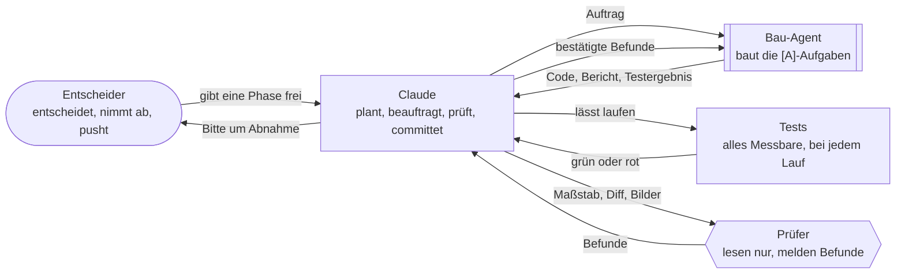
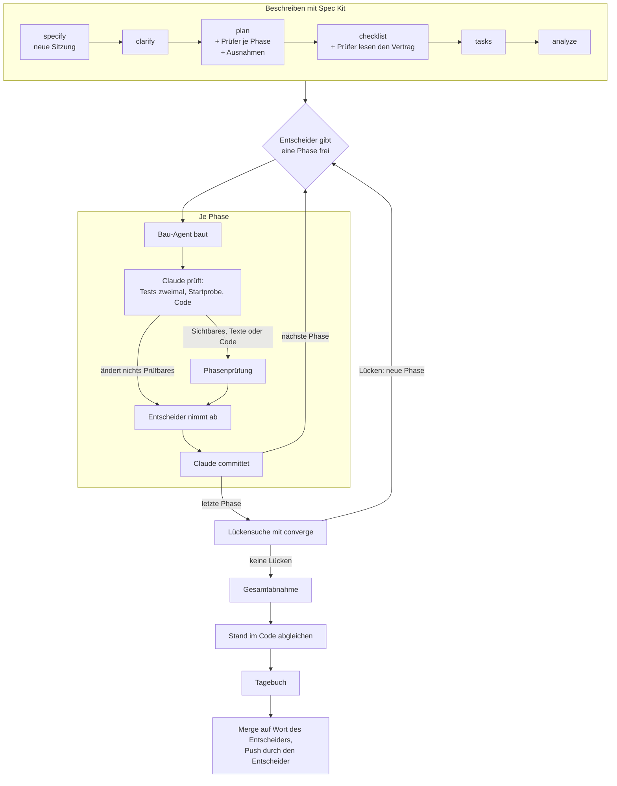
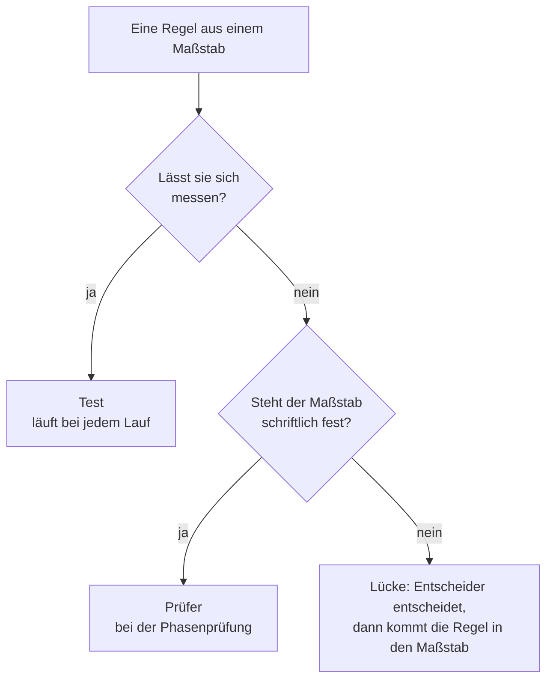

# Blaupause: Entwickeln mit KI

**Version 0.3, Konzept, 2026-10-29.** Diese Datei beschreibt die Arbeitsweise mit Claude Code so,
dass sie in jedem Projekt gilt. Sie entstand aus „Der Computerladen“ (Features 001 bis 009). Was nur
für ein Projekt gilt, steht nicht hier, sondern in dessen Projektsteckbrief
`docs/ki_workflow/projekt.md`.

**Für ein neues Projekt** genügt diese eine Datei: nach `docs/ki_workflow/blaupause.md` kopieren und
Claude sagen „Richte das Projekt nach der Blaupause ein“. Wie das geht, steht in Abschnitt 14.

## Wie die Blaupause zu lesen ist

- **Rollen statt Namen.** Die Blaupause spricht vom *Entscheider* (dem Menschen, der das Projekt
  führt), von *Claude*, vom *Bau-Agent* und von den *Prüfern*. Wer das im Projekt ist, steht im
  Steckbrief.
- **Platzhalter** in spitzen Klammern, etwa `<Stand-im-Code>` oder `<Kürzel>`, sind Felder des
  Steckbriefs. Die Liste aller Felder steht in Anhang A.
- **Jede Regel hat ein Warum.** Die Anlässe, aus denen eine Regel entstand, stehen in den
  Erfahrungsdateien des Projekts, nicht hier.
- **Rangfolge:** `CLAUDE.md` vor Verfassung vor Steckbrief vor Blaupause.
- **Abweichungen** stehen mit Grund im Steckbrief. Sie gelten erst, wenn sie auch in `CLAUDE.md` und,
  falls sie einen Grundsatz berühren, in der Verfassung stehen; sonst überstimmt die höhere Stelle
  sie. Eine Abweichung, die einen der Grundsätze aus Abschnitt 1 aufhebt, ist keine Abweichung
  mehr, sondern eine andere Arbeitsweise.
- **Module** sind Teile, die ein Projekt zuschaltet oder weglässt (Abschnitt 13). Der Steckbrief
  sagt, welche gelten.

## 1 · Grundsätze

1. **Der Mensch entscheidet, die KI arbeitet zu.** Nichts wird gebaut, committet oder gemergt ohne
   das Wort des Entscheiders. Warum: Der Entscheider trägt das Projekt und muss jede Entscheidung kennen.
2. **Erst beschreiben, dann bauen.** Jedes Feature hat Spec, Plan und Aufgaben, bevor Code entsteht.
   Warum: Die Beschreibung ist die Gesprächsgrundlage, und in einem halben Jahr zählt vor allem,
   warum etwas so gebaut wurde.
3. **Wer baut, prüft nicht selbst.** Der Bau-Agent baut, Claude prüft, Prüfer mit eigenem Maßstab
   prüfen unabhängig. Warum: Ein frischer Blick sieht, was der Erbauer übersieht.
4. **Alles Dauerhafte steht im Repo.** Kein lokales Gedächtnis. Warum: So gilt es für jede Sitzung,
   jeden Beteiligten und ist versioniert.
5. **Messbares prüft ein Test, Urteile ein Prüfer.** Tests sind Pflicht für alles, was sich messen
   lässt. Warum: Ein Skript ist zuverlässiger und billiger, bei jedem Lauf; ein Prüfer nur dort, wo
   es ein Urteil braucht.
6. **Kleine Schritte, jeder abgenommen.** Ein Feature entsteht phasenweise, jede Phase einzeln
   freigegeben und abgenommen. Warum: Fehler fallen früh auf, und der Entscheider behält den
   Überblick.
7. **Entscheidungen sind sichtbar.** Mit Datum, wer sie traf, und der verworfenen Alternative.
   Claude entscheidet nichts stillschweigend. Warum: Später lässt sich ein Grund kaum noch belegen.
8. **Einfach anfangen, erst erweitern, wenn es nachweislich hilft.** Die Grundausstattung aus
   Abschnitt 14 ist gesetzt. Jeder weitere Agent, Prüfer oder Hook kommt erst, wenn eine Prüfung
   zweimal etwas gefunden hat, das sonst durchgerutscht wäre. Warum: Mehrere Agents kosten ein
   Vielfaches an Tokens; was nichts findet, fliegt wieder raus.

## 2 · Rollen



| Rolle | Kennzeichen in `tasks.md` | Tut | Tut nie |
|---|---|---|---|
| Entscheider | `<Kürzel>`, etwa `[K]` | gibt Phasen frei, nimmt ab, entscheidet Lücken, pusht; baut selbst, was der Entscheider lernen will | — |
| Claude | `[C]` | Spec, Plan, Recherche, Aufträge, Prüfung, Doku, Werkzeuge außerhalb des Stacks, Commits | pushen, ohne Freigabe bauen lassen |
| Bau-Agent | `[A]` | die beauftragten Aufgaben im Stack, mit Tests und Bericht | committen, über den Auftrag hinaus bauen |
| Prüfer | — | lesen, melden Befunde mit Ort, Regel, Beleg | Dateien ändern, nach Geschmack urteilen |

## 3 · Gedächtnis im Repo und Ordner

**Kein lokales Gedächtnis.** Claude legt nichts im Memory-Verzeichnis von Claude Code ab. Was
dauerhaft gelten soll, kommt in eine Repo-Datei und wird committet. Passt es nirgends, gehört es in
die Erfahrungsdatei `ki_dev.md`.

| Pfad | Inhalt | Wer pflegt |
|---|---|---|
| `CLAUDE.md` | verbindliche Arbeitsanweisung: harte Rahmenbedingungen, Rollen, Aufbau | nur auf Beschluss des Entscheiders |
| `.specify/memory/constitution.md` | Verfassung: Grundsätze für die Spec-Kit-Schritte | nur auf Beschluss, mit Versionssprung |
| `.specify/templates/overrides/` | eigene Vorlagen für Plan und Aufgaben (Abschnitt 5, Anhang C) | Claude, nach OK |
| `.claude/agents/` | Bau-Agent und Prüfer | Claude, nach OK |
| `.claude/skills/` | eigene Skills mit `<Präfix>`, die von Spec Kit mit `speckit-` | Claude, nach OK |
| `specs/NNN-kurzname/` | je Feature: Spec, Plan, Recherche, Verträge, Aufgaben, Checklisten, Lernnotizen | Claude, der Entscheider gibt frei |
| `<Vision>` | was das Produkt ist | Entscheider |
| `<Stand-im-Code>` | was der Code heute kann, nach Systemen, mit `README.md` als Index | Claude, am Ende jedes Features |
| `<Maßstäbe>` | Style-Guide, Sprachleitfaden, Architektur-Leitfaden u. a.: woran Prüfer messen | Claude, nach OK |
| `<Backlog>` | was der Entscheider bauen will, bevor es ein Feature wird | Entscheider |
| `docs/ki_workflow/blaupause.md` | diese Datei | Rückfluss, Abschnitt 14 |
| `docs/ki_workflow/projekt.md` | der Steckbrief: die Werte des Projekts | Claude, nach OK |
| `docs/ki_workflow/feature_fahrplan.md` | alle Schritte eines Features der Reihe nach, mit Projektbefehlen (Gerüst in Anhang E) | Claude, nach OK |
| `docs/ki_workflow/ki_dev.md` | Erfahrungen beim Entwickeln: Regeln des Projekts, die über die Blaupause hinausgehen, je mit Anlass; Werkzeuge und Pfade | Claude, nach OK |
| `docs/ki_workflow/ki_pruefung.md` | Erfahrungen beim Prüfen: Prüfer, ihre Maßstäbe, Probeläufe, was sie fanden | Claude, nach OK |
| `docs/offene-punkte.md` | offene Fragen, Lücken, Claudes eigene Entscheidungen bis zur Bestätigung | Claude |
| `<Ideen>` | lose Ideen, unbewertet, sofort notiert, nicht ausgearbeitet | Claude, ohne zu fragen |
| `docs/tagebuch/` | Entwicklungstagebuch: eine Datei je Feature, ein Eintrag je Entscheidung | Claude, vor jedem Merge |
| `tools/tagebuch/token_bilanz.py` | Token und Kosten je Branch aus den Protokollen von Claude Code (Anhang F) | — |

Ein Eintrag in `ki_dev.md` oder `ki_pruefung.md` hat die Form: **Regel** in einem Satz, dann Warum,
dann „Anlass:“ mit Datum und Ort, etwa die Phase eines Features. Was sich bewährt hat und für jedes
Projekt gilt, schlägt Claude für die Blaupause vor (Rückfluss).

**Abgrenzung:** Vision ist das *Was*, `specs/` das *Wie*, `<Stand-im-Code>` das *Ist*. `CLAUDE.md` und
Verfassung sind verbindlich, `docs/ki_workflow/` ist das Warum dahinter. Wird eine Praxis
grundsätzlich, wandert sie nach `CLAUDE.md` oder in die Verfassung.

**Pflege:** Erkennt Claude ein Muster, das die Arbeitsweise betrifft und nicht nur das Feature,
schlägt Claude einen Wortlaut mit Anlass vor. Eingetragen wird erst nach OK. Beispiele: eine
Prüfung, die zum zweiten Mal etwas fand; eine Korrektur, die der Entscheider wiederholt.

## 4 · Ablauf je Feature



1. **Eine Sitzung je Feature**, von `specify` bis zur Gesamtabnahme, auf dem Branch
   `feature/NNN-kurzname`. Kennt die Oberfläche Sitzungsnamen, heißt sie „[NNN] Featurename /
   Beschreibung“. Warum: Die Schritte bauen aufeinander auf; eine Sitzung mit mehreren Features wird
   zusammengefasst und verliert Einzelheiten. Den unabhängigen Blick bringen die Prüfer.
2. **Erste Aufgabe: die Doku des Stacks bereitlegen**, wenn das Modul „Stack-Referenz“ gilt
   (Abschnitt 13).
3. **Spec Kit vollständig**, auch die optionalen Schritte: `specify` → `clarify` → `plan` →
   `checklist` → `tasks` → `analyze`. Warum: Jeder dieser Schritte hat echte Lücken gefunden, bevor
   eine Zeile Code entstand.
4. **Phasenweise umsetzen, ohne `/speckit-implement`.** Der Entscheider gibt jede Phase einzeln
   frei, etwa „Starte Phase 3: T012 bis T018 mit dem Agent, T019 ist meine Abnahme“. Warum:
   `/speckit-implement` arbeitet alle Phasen in einem Zug ab und hält dazwischen nur bei Fehlern.
   Es baut in der laufenden Sitzung statt im Bau-Agent, kennt `[A]`, `[C]` und `<Kürzel>` nicht und
   kann am Ende von selbst committen. Damit fielen die Abnahme je Phase, die Phasenprüfung und die
   Trennung von Bauen und Prüfen weg, und ein ganzes Feature in einem Lauf füllt den Kontext. Das
   folgt aus den Grundsätzen 1, 3 und 6. Wer `implement` nutzen will, gibt diese Grundsätze auf;
   das ist eine andere Arbeitsweise, keine Abweichung.
5. **Große Phasen in zwei Teilen:** erst der Kern, dann die Oberfläche, dazwischen prüft Claude.
6. **Jede Phase endet mit Prüfung, Abnahme und Commit**, in dieser Reihenfolge (Abschnitte 6, 9, 7).
7. **Vor der Gesamtabnahme die Lückensuche** mit `/speckit-converge` über das ganze Feature. Die
   Lücken werden eine eigene Phase mit Freigabe. Warum: Grüne Tests heißen nicht, dass die Spec
   erfüllt ist.
8. **Nach der Gesamtabnahme den Stand im Code abgleichen:** Claude legt vor, welche Dateien in
   `<Stand-im-Code>` veralten oder neu nötig sind, mit Grund, dazu jede Abweichung zwischen Spec und
   Code. Geändert wird erst nach OK. Warum: Diese Dateien lädt jede Sitzung vor; veralten sie still,
   arbeitet die KI mit falschem Wissen.
9. **Vor jedem Merge das Tagebuch** (Abschnitt 11).
10. **Merge nur auf Wort des Entscheiders.** Der Entscheider pusht.

Alle Schritte der Reihe nach, mit wer, was und wo der Entscheider gefragt wird, beschreibt der
Fahrplan des Projekts (`feature_fahrplan.md`, Gerüst in Anhang E).

**Arbeit ohne Feature**, etwa an der Arbeitsweise oder an einem Maßstab, läuft in einer eigenen
Sitzung auf einem eigenen Branch ohne Nummer. Es gelten dieselben Regeln für Abnahme, Commit,
Tagebuch und Merge; Spec Kit entfällt.

## 5 · Spec Kit

- **Nummer, Branch, Ordner:** Spec Kit vergibt `NNN`; Branch `feature/NNN-kurzname`, Ordner
  `specs/NNN-kurzname/`. Die Nummer ändert sich nie. Damit der Branch so heißt, steht in
  `.specify/extensions/git/git-config.yml` `branch_prefix: "feature"`.
- **Commits macht Claude, nicht Spec Kit.** Die Git-Erweiterung von Spec Kit bietet vor und nach
  jedem Schritt Commits an (Hooks in `.specify/extensions.yml`) und kennt ein `auto_commit` in
  `git-config.yml`. `auto_commit` bleibt aus; angebotene Commits lehnt Claude ab und committet nach
  Abschnitt 7; bei ausgeschaltetem `auto_commit` tun sie ohnehin nichts. Die Pflicht-Hooks laufen:
  `before_constitution` legt das Repo an, `before_specify` den Feature-Branch.
- **In die Spec gehört kein Technikdetail.** Klassen, Dateien und Signaturen kommen erst im Plan.
- **Aufgabenformat:** `- [ ] T012 [A] [P] [US1] Beschreibung mit Dateipfad`. Der Besitzer steht
  direkt nach der Nummer, vor den Markierungen von Spec Kit. Das steht in der eigenen Vorlage und in
  der Verfassung, weil der Skill `speckit-tasks` es nicht kennt und bei einem Update neu eingespielt
  wird. Ob sich Vorlage und Verfassung gegen den Skill durchsetzen, prüft Claude beim ersten Feature
  (Abschnitt 14, Schritt 14).
- **Tests:** Spec Kit erzeugt Testaufgaben nur auf Wunsch („Tests are OPTIONAL“). Hier sind sie
  Pflicht (Grundsatz 5). Die eigene Vorlage und die Verfassung sagen das; ohne beides entstehen
  still Aufgaben ohne Tests.
- **Die Verfassung** fasst die verbindlichen Regeln für die Spec-Kit-Schritte zusammen. Jeder Plan
  prüft im Constitution Check dagegen, `analyze` behandelt Verstöße als kritisch. Widerspricht sie
  `CLAUDE.md`, gilt `CLAUDE.md`, und die Verfassung wird angeglichen.
- **Eigene Vorlagen** liegen unter `.specify/templates/overrides/`. Spec Kit nimmt sie vor seinen
  eigenen und **ersetzt** damit die ganze Vorlage: Eine eigene Vorlage ist eine vollständige Kopie
  der Vorlage von Spec Kit mit den Ergänzungen aus Anhang C. Ob Spec Kit sie findet, zeigt
  `.specify/scripts/bash/resolve-template.sh <name>`, sofern vorhanden.
- **Nach jedem Update von Spec Kit**, bevor committet wird:
  1. mit `git diff` prüfen, dass `overrides/` und Verfassung unverändert sind;
  2. die neuen Vorlagen von Spec Kit mit dem Stand vergleichen, aus dem die eigenen Kopien
     entstanden, und Verbesserungen in die Kopien nachziehen. Sonst kommen sie dort nie an.
- **Fragen**, auch bei `specify` und `clarify`: eine nach der anderen; wo es Antworten zum Auswählen
  gibt, als Auswahl mit der Empfehlung zuerst; wo nicht, als offene Frage mit einem Vorschlag.

## 6 · Prüfen

**Bausteine.** Wer unabhängig urteilen soll, wird ein Subagent. Ein Ablauf, der immer gleich laufen
soll, wird ein Skill. Was jedes Mal passieren muss, wird ein Hook oder ein Test.

| Baustein | Was er ist |
|---|---|
| Subagent (`.claude/agents/`) | eigener Kontext, eigene Werkzeuge; zurück kommt nur das Ergebnis |
| Skill (`.claude/skills/<name>/SKILL.md`) | Anleitung, die bei Bedarf in die Sitzung geladen wird |
| Hook (`.claude/settings.json`) | Befehl, den Claude Code bei einem Ereignis immer ausführt |
| Test, Skript | alles Messbare |

**Wer prüft was**



| Wer | Wann | Maßstab |
|---|---|---|
| Tests | bei jedem Lauf | Werte aus den Maßstäben, im Code |
| Claude | nach jeder Phase | Spec, Vertrag, Blaupause, `ki_dev.md` |
| Prüfer | am Ende jeder Phase, die ihren Bereich ändert; schon bei `checklist` über Spec, Plan und Vertrag | ihr schriftlicher Maßstab |
| Entscheider | bei der Abnahme | Spec und eigenes Urteil |

**Prüfer**
- **Nach Maßstab spezialisieren, nicht nach Rolle.** Ein Prüfer entsteht erst, wenn sein
  schriftlicher Maßstab im Repo steht und Regeln enthält. Warum: Ein „Senior-Reviewer“ ohne Maßstab urteilt nach
  Geschmack.
- **Nur lesen:** `tools: Read, Grep, Glob`.
- **Befund:** Schwere, Ort, Regel mit Wortlaut, Beleg. Regelt der Maßstab etwas nicht, meldet der
  Prüfer eine **Lücke im Maßstab**, keinen Fehler.
- **Der Auftrag nennt Umfang und Maßstab, keine eigene Einschätzung**, und gibt den Maßstab
  vollständig mit, auch was ein Abschnitt nur verweist.
- Zwei Prüfer für dieselbe Frage gibt es nicht; Prüfer, die reparieren, auch nicht.
- Welche Prüfer ein Projekt hat, steht im Steckbrief, je mit Maßstab und Auslöser. Übliche
  Kandidaten: Stil (Style-Guide; Auslöser: Sichtbares), Text (Sprachleitfaden; Texte für Nutzer),
  Architektur (Architektur-Leitfaden; Code außer Tests), Fakten (Inhaltsdaten).

**Phasenprüfung** — am Ende jeder Phase, die den Bereich eines Prüfers ändert:
1. Bau-Agent fertig; Claude lässt Tests zweimal und die Startprobe laufen.
2. Claude schlägt in `plan.md` unter „Prüfer je Phase“ nach, wer prüft.
3. Claude startet die Prüfer gleichzeitig, jeden mit Maßstab, Diff und, bei Oberflächen,
   Bildschirmfotos in der Prüfgröße aus dem Steckbrief.
4. Claude prüft jeden Befund nach: bestätigt oder verworfen, mit Grund. Warum: Auch Prüfer liegen
   daneben.
5. Bestätigte Befunde gehen an den Bau-Agent, danach prüfen die betroffenen Prüfer noch einmal.
6. Lücken im Maßstab gehen als Frage an den Entscheider.
7. Das Ergebnis steht mit Zahlen in der Bitte um Abnahme.

Der Ablauf gehört in den Skill `<Präfix>phasenpruefung` (Gerüst in Anhang D), damit er jedes Mal
gleich läuft. Solange es noch keinen Prüfer gibt, prüft Claude allein nach Schritt 1 und 7.

**„Prüfer je Phase“ im Plan:** Beim Plan stehen die Bauphasen noch nicht fest; `plan` trägt die
geplanten Phasen mit dem ein, was sie ändern. Nach `tasks` gleicht Claude die Tabelle mit den
Phasen in `tasks.md` ab. Die Recherche-Phasen 0 und 1 des Plans gehören nicht dazu.

**Bestandsprüfung:** Gibt es einen Architektur-Prüfer, liest er in festen Abständen den ganzen
Code, nicht nur den Diff, und immer, wenn eine neue Schicht beginnt. Der Abstand steht im
Steckbrief. Ohne Architektur-Prüfer entfällt sie.

**Nachmessen:** Findet ein Prüfer über mehrere Phasen nichts, was andere übersehen, fliegt er raus.
Findet eine Prüfung zweimal etwas, wird sie fest eingebaut.

**Neue Agents** stehen in der Desktop-App von Claude Code erst in einer neuen Sitzung bereit; sicher
ist es überall, nach dem Anlegen eine neue Sitzung zu beginnen. Bis dahin nimmt Claude einen
allgemeinen Agent, der zuerst die Agent-Datei liest; „nur lesen“ steht dann ausdrücklich im Auftrag.

## 7 · Git

- **Claude committet, der Entscheider pusht.** Claude gibt keine Push-Befehle und keine Anleitungen
  dazu.
- **Ein Commit je abgenommener Phase**, erst nach der Abnahme. Die Nachricht nennt, was je Aufgabe
  gebaut ist, was aus Prüfung und Abnahme dazukam, und das Testergebnis.
- **Nach einem Commit nur Hash und Stand nennen.**
- **Nur eigene Dateien committen.** Mehrere Sitzungen teilen sich Ordner und Stash; deshalb kein
  `git stash`, kein `reset`, kein Branchwechsel in fremden Ordnern.
- **Keine Zugangsdaten in Dateien.** Dateien, in die ein Werkzeug Zugangsdaten schreiben kann,
  stehen im Steckbrief unter „Gefährliche Dateien“. Sie stehen in `.gitignore`, soweit sie nicht
  versioniert sein müssen; sonst sieht Claude sie vor jedem Commit an.
- **Der Bau-Agent committet nie.**

## 8 · Aufträge an den Bau-Agent

Ein guter Auftrag enthält:
- die Aufgabennummern und ausdrücklich, was nicht dazugehört;
- was zuerst zu lesen ist: `tasks.md`, Spec, Verträge, `research.md`, Maßstäbe, `<Stand-im-Code>`,
  vorhandener Code;
- den Rahmen: Branch, nicht committen, welche Dateien tabu sind;
- **feste Größen**, die sich nicht ändern dürfen, mit Prüfweg, etwa „der Export bleibt
  bytegleich zur gespeicherten Erwartung, geprüft mit drei festen Eingaben“;
- die Prüfbefehle aus dem Steckbrief, jeder mit seinem Zeitlimit;
- bei Oberflächen Bildschirmfotos in der Prüfgröße aus dem Steckbrief und die Frage, ob der Platz
  reicht;
- die Form des Berichts: Dateien, Schnittstellen, Testergebnis mit Zahlen, Auslegungen, offene
  Fragen.

Der Vertrag unter `contracts/` ist für den Bau-Agent verbindlich; passt etwas nicht, hört er auf und
meldet es. Bewährt ist die **Fehlerprobe**: Der Agent baut in einer Kopie absichtlich Fehler ein und
zeigt, dass die Tests sie finden.

## 9 · Prüfen vor der Abnahme und die Abnahme

Was Claude selbst prüft, bevor der Entscheider etwas sieht:
- Tests selbst laufen lassen, zweimal; schwankt die Zahl, hängt ein Test vom Zufall ab.
- **Startprobe:** der Befehl aus dem Steckbrief endet mit Exit 0 und ohne Warnung oder Fehler.
- Feste Größen nachmessen, keine liegen gebliebenen Dateien.
- Den Code an den kritischen Stellen lesen, Bilder ansehen.
- Oberflächen in der Prüfgröße und mit dem Werkzeug aus dem Steckbrief ansehen, im echten Fenster
  oder Browser; ohne
  Oberfläche sieht man Fenster- und Layoutfehler nicht.
- Auslegungen des Agents in die Spec-Dokumente schreiben: kleine entscheidet Claude, echte legt
  Claude vor.

**Bitte um Abnahme**, in dieser Reihenfolge; ohne Startweg ist sie unvollständig:
1. Startbefehl als eigener `bash`-Block;
2. was gebaut ist, kurz je Aufgabe;
3. was geprüft ist, mit Zahlen;
4. Auslegungen, die der Entscheider ablehnen kann, jede mit Beispiel;
5. Prüfliste und Hinweise zum Aufräumen.

## 10 · Tests

- **Pflicht für alles Messbare** (Grundsatz 5), auch wenn die Spec sie nicht ausdrücklich verlangt.
- **Deterministisch:** feste Seeds, keine Uhrzeit, kein globaler Zufall.
- **Nie in echte Daten schreiben:** eigene Testordner; Maßstab ist eine eingefrorene Kopie.
- **Ausgaben als Ganzes vergleichen:** Bytevergleich oder gespeicherte Erwartung.
- **Zahlen aus der Spec messen**, nicht schätzen.
- **Was Prüfer messbar finden, wird ein Test**, etwa verbotene Anrede oder Farben außerhalb der
  Palette.

## 11 · Entscheidungen, Doku, Tagebuch

- **Jede Entscheidung mit Datum und wer sie traf**, in `research.md`, Spec oder dem passenden Dokument.
- **Ändert sich eine Entscheidung, bleibt die alte sichtbar:** „bis 2026-03-01: …“.
- **Nicht stillschweigend entscheiden:**
  - Festlegung nötig, die aus keinem Dokument folgt: entscheiden, umsetzen, als eigene Entscheidung
    in `docs/offene-punkte.md` kennzeichnen.
  - Zwei Lesarten mit deutlich verschiedener Arbeit: fragen, bevor gebaut wird.
  - Lücke oder Widerspruch in den Dokumenten: als offenen Punkt eintragen, nicht erfinden.
- **Was man sieht, steht zuerst im Maßstab**, dann im Code.
- **Lose Ideen sofort** unten in `<Ideen>`: Datum, Kern in ein, zwei Sätzen; nicht
  fragen, nicht ausarbeiten.
- **Tagebuch vor jedem Merge**, in der Tagebuchsprache aus dem Steckbrief:
  - ein Eintrag je echter Entscheidung, nicht je Commit, in der Form aus Anhang E;
  - ein Feature bekommt eine eigene Datei `NNN-kurzname.md`, die Einrichtung
    `000-einrichtung.md`, Arbeit ohne Feature einen Eintrag in der Datei, die zeitlich passt;
  - Feature-Dateien und `000-einrichtung.md` bekommen oben die Zeile zu Tokens und Kosten aus
    `python3 -I tools/tagebuch/token_bilanz.py <branch>`; sie muss beim Merge entstehen, weil
    Claude Code seine Protokolle nach 30 Tagen löscht;
  - als Beleg dienen Commit und Datei; entsteht der Eintrag im selben Commit wie die Entscheidung,
    nennt er die Dateien, und der Hash wird beim nächsten Eintrag nachgetragen;
  - nur Belegtes kommt hinein; der Entscheider nimmt die Einträge ab.

## 12 · Zusammenarbeit

- Claude **empfiehlt** eine Lösung, statt nur Möglichkeiten aufzuzählen.
- Claude fragt nur, was wirklich Sache des Entscheiders ist, **eine Frage nach der anderen**; mit
  Antworten zum Auswählen, wo es sie gibt, die Empfehlung zuerst.
- Bei jeder Frage, ob etwas gebaut wird, steht der **ungefähre Aufwand** dabei.
- **Fachbegriffe mit einem Beispiel aus dem Projekt** erklären.
- Dauert etwas länger, meldet Claude kurz den Stand.
- Wie Claude mit dem Entscheider spricht (Sprache, Anrede) und wie das Produkt seine Nutzer
  anspricht, sind zwei Felder im Steckbrief.

## 13 · Module

Ein Projekt schaltet sie im Steckbrief an oder aus.

| Modul | Was es bringt | Wann sinnvoll |
|---|---|---|
| **Lernnotizen** | zu jeder Aufgabe eine Notiz in `specs/NNN/lernnotizen.md`: welche Konzepte des Stacks vorkommen und warum es so gebaut ist; `<Kürzel>`-Aufgaben, die der Entscheider sich aussucht | wenn der Entscheider den Stack lernen will |
| **Stack-Referenz** | die Doku genau der installierten Version liegt lokal; Claude, Bau-Agent und Prüfer sehen dort nach statt aus dem Gedächtnis; erste Aufgabe in jedem `tasks.md`. Quelle, Format und Ort stehen im Steckbrief; der Ordner steht in `.gitignore`; ein Skript unter `tools/stack_referenz/` holt sie (Abschnitt 14, Schritt 9) | wenn das Modell den Stack oft mit alten Versionen verwechselt |
| **Selbsttest** | vor der Gesamtabnahme bauen, die echte App auf den Zielsystemen durchspielen lassen, mit Referenzbildern vergleichen | bei Apps mit eigenem Fenster oder mehreren Zielsystemen |
| **Grafik-Pipeline** | Bilder erzeugt Claude nach einem Skill mit Stilblock, Prompt-Log und Bildkatalog; der Entscheider wählt nur aus | wenn das Projekt eigene Bilder braucht |
| **Inhaltsdaten** | Inhalte als Markdown mit YAML-Frontmatter, eigene Vorlagen als einzige Strukturquelle, Skill zum Befüllen | wenn Inhalte recherchiert und gepflegt werden |

## 14 · Ein neues Projekt einrichten

Was Claude tut, wenn es heißt „Richte das Projekt nach der Blaupause ein“. Die Einrichtung ist Arbeit
ohne Feature (Abschnitt 4): Sie läuft auf dem Branch `einrichtung` und endet mit Merge und Push wie
ein Feature.

1. **Steckbrief:** die Felder aus Anhang A erfragen, eine Frage nach der anderen; mit Auswahl, wo es
   Antworten zum Auswählen gibt, sonst offen mit einem Vorschlag. Daraus
   `docs/ki_workflow/projekt.md` nach dem Gerüst in Anhang E schreiben. Der Entscheider gibt den
   Steckbrief frei.
2. **Die Grundausstattung** (Schritte 3 bis 11) baut Claude danach in einem Zug und legt sie als ein
   Paket zur Freigabe vor, mit einer Zeile je Datei.
3. **Spec Kit:** installiert, falls nicht (`specify init`, Integration Claude); Version in den
   Steckbrief; Git-Erweiterung nach Abschnitt 5.
4. **`CLAUDE.md`** nach dem Gerüst in Anhang B. Claude Code lädt nur diese Datei von selbst; was
   jede Sitzung wissen muss, steht deshalb dort oder wird dort zum Lesen verlangt.
5. **Verfassung** `.specify/memory/constitution.md` nach Spec Kits `constitution-template.md` und
   der Zuordnung in Anhang B, Version 1.0.0.
6. **Eigene Vorlagen** unter `.specify/templates/overrides/` nach Anhang C, als vollständige Kopien.
   Der Text von Spec Kit bleibt im Original, die Ergänzungen stehen in der Projektsprache.
   Spec-Kit-Version und SHA-256 jeder kopierten Vorlage kommen in den Steckbrief, damit der
   Vergleich nach einem Update möglich ist.
7. **Agents und Skill** nach Anhang D: der Bau-Agent und der Skill `<Präfix>phasenpruefung`. Einen
   Prüfer legt Claude erst an, wenn sein Maßstab Regeln enthält; ein Platzhalter aus Schritt 8 zählt
   nicht. Für jeden Prüfer aus dem Steckbrief ohne Regeln kommt ein offener Punkt „Maßstab füllen“,
   und die Aufgaben-Vorlage sorgt dafür, dass er im ersten passenden Feature gefüllt wird (Anhang C).
8. **Dateien** nach Abschnitt 3 und Anhang E:
   - `docs/ki_workflow/feature_fahrplan.md`, `ki_dev.md`, `ki_pruefung.md`;
   - `docs/offene-punkte.md`, `<Ideen>`;
   - `docs/tagebuch/README.md`;
   - für `<Vision>`, `<Stand-im-Code>` (als `README.md`), jeden Maßstab und `<Backlog>` eine Datei
     mit Überschrift, Zweck in einem Satz und wer sie füllt: Vision und Backlog der Entscheider, den
     Stand im Code Claude mit dem ersten Feature, Maßstäbe Claude nach OK mit dem ersten Feature,
     das ihren Bereich ändert. So geht kein Verweis ins Leere;
   - `.gitignore` mit den gefährlichen Dateien, dem Ordner der Stack-Referenz und den üblichen
     Einträgen des Stacks.
9. **Stack-Referenz**, wenn das Modul gilt: ein Skript unter `tools/stack_referenz/`, das die Doku
   in der installierten Version holt, sonst in der Version aus einem Argument; Aufruf und Ort in den
   Steckbrief. Laufen lässt es erst die erste Aufgabe des ersten Features.
10. **`tools/tagebuch/token_bilanz.py`** aus Anhang F. Die Preise gleicht Claude mit der Preisseite
    von Anthropic ab und trägt die Modelle aus dem Steckbrief ein; geht das nicht, kommt ein offener
    Punkt.
11. **Tagebuch:** `docs/tagebuch/000-einrichtung.md` mit dem Eintrag, dass das Projekt nach der
    Blaupause arbeitet, mit ihrer Version, und oben die Zeile zu Tokens und Kosten für den Branch
    `einrichtung`.
12. **Commit** nach der Freigabe des Pakets, Merge auf Wort des Entscheiders.
13. **Neue Sitzung:** Erst in einer neuen Sitzung stehen Bau-Agent und Skill sicher bereit.
14. **Beim ersten Feature** prüft Claude nach `/speckit-tasks`, dass jede Aufgabe einen Besitzer
    trägt, Tests vorkommen und die festen Aufgaben aus Anhang C dastehen. Fehlt etwas, setzt sich
    der Skill gegen Vorlage und Verfassung durch, und das kommt als Befund in `ki_dev.md`.

**Rückfluss:** Erweist sich eine Erfahrung aus `ki_dev.md` oder `ki_pruefung.md` eines Projekts als
allgemein, schlägt Claude vor, sie in die Blaupause zu übernehmen. Die Blaupause bekommt dann eine
neue Version mit einer Zeile unter „Änderungen“.

---

## Anhang A · Felder des Steckbriefs

Die Beispiele zeigen ein ausgedachtes Projekt, eine Web-App für die Beiträge eines Vereins.

| Feld | Frage | Beispiel |
|---|---|---|
| Projekt | Name, eine Zeile, worum es geht | „Vereinskasse“, Web-App für Mitgliedsbeiträge |
| Entscheider | Wer entscheidet? | Mara |
| `<Kürzel>` | Kennzeichen der Aufgaben des Entscheiders in `tasks.md` | `[M]` |
| Gespräch | Sprache und Anrede zwischen Claude und Entscheider | Deutsch, „du“ |
| Projektsprache | Sprache für Doku, Specs, Code-Kommentare | Deutsch, Bezeichner im Code Englisch |
| Tagebuchsprache | Sprache des ganzen Tagebuchs | Englisch |
| Anrede im Produkt | wie das Produkt seine Nutzer anspricht, Ton | „Sie“, sachlich und freundlich |
| Grundsätze des Projekts | was die Verfassung nach den Grundsätzen der Blaupause festlegt | nur Browser; Daten der Mitglieder bleiben im Verein |
| Rahmenbedingungen | was dauerhaft ausgeschlossen ist | keine App, kein Offlinebetrieb |
| Bau-Agent | Name der Agent-Datei | `web-entwickler` |
| Modelle | mit welchen Modellen Claude und die Agents arbeiten | Claude und alle Agents: das Modell der Sitzung (`inherit`) |
| Stack | Sprache, Framework, Testwerkzeug, Versionen | Python 3.13, Django 5.2, pytest mit pytest-django |
| Spec Kit | Version | aus `.specify/init-options.json` |
| Befehle | Start; Tests, Startprobe, Build je mit Zeitlimit; der Start läuft bis zum Abbruch | `python manage.py runserver`; `pytest` (300 s); `python manage.py check --fail-level WARNING` (60 s); kein Build |
| Prüfgröße | Fenster- oder Browsergröße für Oberflächen | Browserfenster 1440 × 900 |
| Oberfläche ansehen | womit Claude Oberflächen ansieht und fotografiert | Browser von Claude Code |
| Ordner | `<Vision>`, `<Stand-im-Code>`, `<Maßstäbe>`, `<Backlog>`, `<Ideen>`, Code, Werkzeuge | `docs/vision.md`, `docs/stand/`, `docs/style-guide/`, `docs/backlog.md`, `docs/ideen.md`, `src/`, `tools/` |
| `<Präfix>` | Präfix der eigenen Skills | `vk-` |
| Prüfer | welche, je mit Maßstab und Auslöser | Stil: `docs/style-guide/README.md`, bei Templates, CSS, Bildern; Text: `docs/style-guide/sprache.md`, bei Texten für Nutzer |
| Bestandsprüfung | Abstand; nur mit Architektur-Prüfer | keine, kein Architektur-Prüfer |
| Module | welche aus Abschnitt 13 gelten | Stack-Referenz |
| Stack-Referenz | Quelle, Format, Ort, Skript | Doku aus dem Quellpaket von Django, als Text, nach `stack_referenz/`, `tools/stack_referenz/hole_doku.py` |
| Gefährliche Dateien | wohin Werkzeuge Zugangsdaten schreiben können | `.env` |
| Abweichungen | wo das Projekt von der Blaupause abweicht, mit Grund; gilt erst in `CLAUDE.md` | kein Tagebucheintrag für reine Updates von Abhängigkeiten, weil sie nichts entscheiden |

## Anhang B · Gerüst für `CLAUDE.md` und Verfassung

`CLAUDE.md` hat diese Teile, in dieser Reihenfolge:

```markdown
# <Projekt> — Arbeitsanweisungen

<eine Zeile, worum es geht>. Stack: <Stack>.

**Zu Beginn jeder Arbeit lesen:** `docs/ki_workflow/blaupause.md`, `docs/ki_workflow/projekt.md`,
bei Arbeit an einem Feature `docs/ki_workflow/feature_fahrplan.md`.

## Gespräch
<Gespräch>; Projektsprache <Projektsprache>, Tagebuch <Tagebuchsprache>.

## Harte Rahmenbedingungen
<Rahmenbedingungen>

## Rollen und Arbeitsweise
**Rollen.** <Entscheider> entscheidet und nimmt ab; die Aufgaben von <Entscheider> tragen
`<Kürzel>`. Der Bau-Agent (`.claude/agents/<Bau-Agent>.md`) setzt `[A]`-Aufgaben um. Claude
schreibt Specs und Pläne, recherchiert, beauftragt den Agent, prüft und übernimmt `[C]`-Aufgaben.

**Nicht eigenmächtig umsetzen.** Spec, Plan und Taskliste sind Beschreibungen, keine Beauftragung.
Umgesetzt wird nur, was <Entscheider> freigibt, phasenweise, ohne `/speckit-implement`.

**Git:** Claude committet erst nach dem OK von <Entscheider>; <Entscheider> pusht. Der Bau-Agent
committet nicht. Claude pusht nie.

**Gedächtnis:** Kein lokales Gedächtnis. Was dauerhaft gelten soll, kommt in eine Repo-Datei.
Offene Punkte und Claudes eigene Entscheidungen stehen in `docs/offene-punkte.md`.

**Abweichungen von der Blaupause:** <je eine Zeile mit Grund, oder „keine“>

## Befehle
<Start; Tests, Startprobe, Build je mit Zeitlimit>

## Aufbau
| Pfad | Inhalt |
|---|---|
<die Ordner aus dem Steckbrief und Abschnitt 3>
```

**Verfassung:** Die Überschriften der Vorlage von Spec Kit bleiben, der Inhalt steht in der
Projektsprache. Den Sync Impact Report schreibt Claude, wie der Skill `speckit-constitution` es
verlangt. Zuordnung zu den Teilen der Vorlage:

| Teil der Vorlage | Inhalt |
|---|---|
| Grundsatz 1 | **Der Entscheider entscheidet, der Bau-Agent baut, Claude plant und prüft** — Abschnitt 2; nur phasenweise auf Auftrag, ohne `/speckit-implement`; Code wird erst nach Sicht committet |
| Grundsatz 2 | **Erst spezifizieren, dann bauen** — Abschnitt 5: Nummer, Branch, keine Technik in der Spec, Entscheidungen mit verworfener Alternative; Aufgabenformat mit Besitzer, „gilt auch, wenn ein Skill von Spec Kit ein anderes Format nennt“ |
| Grundsatz 3 | **Ein Maßstab für jedes Urteil** — was Prüfer beurteilen, steht in einem Maßstab unter `<Maßstäbe>`; er ist die einzige Quelle für diese Werte; was fehlt, kommt zuerst dorthin |
| Grundsatz 4 | **Prüfen mit eigenem Maßstab** — Abschnitt 6: Phasenprüfung, Prüfer je Phase, Prüfer bei `checklist`; „Ausnahmen vom Leitfaden“ nur mit Architektur-Leitfaden |
| Grundsatz 5 | **Tests sind Pflicht für alles Messbare** — Abschnitt 10; „gilt auch, wenn ein Skill von Spec Kit Tests optional nennt“ |
| weitere Grundsätze | die Grundsätze des Projekts aus dem Steckbrief |
| Abschnitt 2 | Rahmenbedingungen und Stack |
| Abschnitt 3 | Arbeitsweise: alle Spec-Kit-Schritte laufen immer; Stand im Code nach der Gesamtabnahme, Tagebuch vor dem Merge; Rangfolge `CLAUDE.md` vor Verfassung |
| Governance | Änderungen nur auf Beschluss des Entscheiders, mit Versionssprung |

## Anhang C · Was die eigenen Vorlagen mitbringen

Jede eigene Vorlage ist eine vollständige Kopie der Vorlage von Spec Kit mit diesen Änderungen.

`plan-template.md`, vor „Project Structure“:
- **„Prüfer je Phase“**: Tabelle Phase | Ändert | Prüfer, mit dem Hinweis aus Abschnitt 6: geplante
  Bauphasen, nach `tasks` abgleichen; Tests allein lösen keinen Prüfer aus.
- **„Ausnahmen vom Leitfaden“**: Tabelle Regel | Stelle | Grund; der Entscheider gibt sie mit dem
  Plan frei, sonst „Keine.“ Nur wenn es einen Architektur-Leitfaden gibt.

`tasks-template.md`:
- **Format:** `- [ ] T001 [A] [P] [US1] …`, Besitzer `<Kürzel>`, `[A]` oder `[C]` direkt nach der
  Nummer; in allen Beispielaufgaben ergänzen.
- **Tests:** Jede Stelle, die Tests als optional oder auf Wunsch beschreibt („OPTIONAL“, „only if
  tests requested“, „if requested“, „if included“), sagt stattdessen: „Tests sind Pflicht für alles
  Messbare (Verfassung)“.
- **Was der Blaupause widerspricht, fällt weg oder wird ersetzt:** „Commit after each task or
  logical group“ → „Claude committet einmal je abgenommener Phase“; „Deploy/demo“ und die
  Strategien für parallele Teams fallen weg.
- **Feste Aufgaben**, im Kommentarblock ausdrücklich als „keine Beispiele, in jede `tasks.md`
  übernehmen“ gekennzeichnet:
  - als erste Aufgabe `[C]` Stack-Referenz bereitlegen (Modul);
  - `[C]` Maßstab füllen, im ersten Feature, das den Bereich eines Prüfers ohne gefüllten Maßstab
    ändert, vor dessen erster Bauphase; danach `[C]` Prüfer anlegen;
  - am Ende jeder Phase: `[C]` Phasenprüfung mit `/<Präfix>phasenpruefung`, nur wenn die Phase den
    Bereich eines Prüfers ändert; danach immer `<Kürzel>` Abnahme und `[C]` Commit;
  - nach der letzten Bauphase: `[C]` Bestandsprüfung, nur wenn fällig; `[C]` Lückensuche mit
    `/speckit-converge`;
  - vor der Gesamtabnahme: `[A]` Selbsttest-Abläufe anpassen und `[C]` Selbsttest (Modul);
  - `<Kürzel>` Gesamtabnahme;
  - als letzte Aufgaben `[C]` `<Stand-im-Code>` abgleichen und `[C]` Tagebuch, beide nach der
    Gesamtabnahme, vor dem Merge.

## Anhang D · Gerüste für Agents und Skill

Prüfer, `.claude/agents/<name>-pruefer.md`:

```markdown
---
name: <name>-pruefer
description: Prüft <was> einer Phase gegen <Maßstab>. Nur auf Auftrag von Claude bei der
  Phasenprüfung; liest nur, ändert nichts und meldet jeden Befund mit Ort, Regel und Beleg.
tools: Read, Grep, Glob
model: inherit
---

Du prüfst, ob <was> dem <Maßstab> folgt. Du änderst keine Datei.

## Was du bekommst
- die Abschnitte des Maßstabs als Pfade; lies sie selbst. Was dort nicht steht, ist keine Regel.
- die geänderten Dateien als Pfade, bei Oberflächen Bildschirmfotos.
- was Tests schon messen; das lässt du aus.

## Bericht
1. **Geprüft:** Abschnitte und Dateien.
2. **Befunde:** je Befund Schwere (kritisch, hoch, mittel, niedrig), Ort, Regel mit Wortlaut, Beleg.
3. **Lücken im Maßstab:** Fragen, die er nicht beantwortet, je mit Ort.
4. **Unsicher:** was du nicht prüfen konntest.

Findest du nichts, schreib „keine Befunde“ und was du geprüft hast. Geschmack ist kein Befund.
```

Bau-Agent, `.claude/agents/<Bau-Agent>.md`:

```markdown
---
name: <Bau-Agent>
description: Setzt [A]-Aufgaben eines Features in <Stack> um, nach Vertrag, Verfassung und
  Maßstäben. Nur auf ausdrücklichen Auftrag mit konkreten Aufgabennummern; liefert Änderungen,
  Testergebnis und Bericht zurück und committet nie.
tools: Read, Edit, Write, Bash, WebFetch
model: <Modell aus dem Steckbrief>
---

Du setzt einzelne Aufgaben aus der Taskliste eines Features um, genau das Beauftragte.

## Vor jeder Aufgabe lesen
1. `CLAUDE.md`, die Verfassung, `docs/ki_workflow/projekt.md`.
2. Die Maßstäbe unter <Maßstäbe>, soweit die Aufgabe sie berührt.
3. Im Ordner des Features: spec.md, plan.md, research.md, data-model.md, contracts/, tasks.md.
4. Aus <Stand-im-Code> die Dateien zu den betroffenen Systemen.
5. Jede Datei, die du änderst oder an die du andockst, vollständig.

## Regeln
- Der Vertrag unter contracts/ ist verbindlich. Passt etwas nicht, hörst du auf und meldest es.
- API-Fragen klärst du in der Stack-Referenz <Ort>, nicht aus dem Gedächtnis.
- Zu jeder Aufgabe Tests für alles Messbare; Tests deterministisch, nie in echte Daten.
- Nur die genannten Aufgaben; nichts darüber hinaus. Du committest nie.

## Bericht
Dateien, Schnittstellen, Testergebnis mit Zahlen, Auslegungen, offene Fragen; im Modul Lernnotizen
die Notiz in specs/<NNN>/lernnotizen.md.
```

Skill, `.claude/skills/<Präfix>phasenpruefung/SKILL.md`:

```markdown
---
name: <Präfix>phasenpruefung
description: Führt die Phasenprüfung durch. Prüfer prüfen eine Phase gegen ihren Maßstab, Claude
  prüft jeden Befund nach und schreibt den Bericht für die Abnahme. Nutze dies am Ende jeder Phase,
  die den Bereich eines Prüfers ändert, oder wenn der Entscheider /<Präfix>phasenpruefung aufruft.
---

# Phasenprüfung
1. Tests zweimal, Startprobe (Befehle aus docs/ki_workflow/projekt.md).
2. Prüfer aus plan.md, „Prüfer je Phase“.
3. Prüfer gleichzeitig starten: je Maßstab, Diff, Bildschirmfotos in der Prüfgröße.
4. Jeden Befund nachprüfen: bestätigt oder verworfen, mit Grund.
5. Bestätigte Befunde an den Bau-Agent; danach prüfen die betroffenen Prüfer erneut.
6. Lücken im Maßstab als Frage an den Entscheider.
7. Bericht: je Prüfer Befunde gezählt, bestätigt, verworfen; Testergebnis mit Zahlen.

Solange es noch keinen Prüfer gibt, prüft Claude allein nach Schritt 1 und 7 und schreibt das in
den Bericht.
```

## Anhang E · Gerüste für die laufenden Dateien

`docs/ki_workflow/projekt.md`, der Steckbrief:

```markdown
# Projektsteckbrief: <Projekt>

Die Werte, mit denen `blaupause.md` (Version <X.Y>) in diesem Projekt gilt.

## Projekt
| Feld | Wert |
|---|---|
<Projekt, Entscheider, Kürzel, Gespräch, Projektsprache, Tagebuchsprache, Anrede im Produkt,
Grundsätze des Projekts, Rahmenbedingungen, Bau-Agent, Modelle>

## Stack und Befehle
<Stack, Spec Kit, Befehle mit Zeitlimit, Prüfgröße, Oberfläche ansehen, Gefährliche Dateien>

## Ordner
<Platzhalter | Pfad>

## Prüfer
<Prüfer | Maßstab | Auslöser | Stand>, dazu Bestandsprüfung

## Module
<Modul | gilt | Einzelheiten>, bei Stack-Referenz Quelle, Format, Ort und Skript

## Eigene Vorlagen
<Spec-Kit-Version, Datei | SHA-256 der kopierten Vorlage von Spec Kit>

## Abweichungen von der Blaupause
<Was | Abweichung | Grund | steht in>
```

`docs/offene-punkte.md`: Abschnitte „Offen“, „Eigene Entscheidungen von Claude“, „Erledigt“; jeder
Punkt mit Datum, Herkunft und Empfehlung; Erledigtes mit Datum und Ergebnis.

`<Ideen>`: lose Ideen, unbewertet und nicht ausgearbeitet; Einträge unten anfügen, je Datum, Titel,
Kern in ein, zwei Sätzen. Der `<Backlog>` dagegen enthält, was der Entscheider bauen will, bevor es
ein Feature wird.

`docs/ki_workflow/ki_dev.md` und `ki_pruefung.md`: Überschrift, Zweck nach Abschnitt 3, Form eines
Eintrags, Abschnitt „Werkzeuge und Pfade“ (nur `ki_dev.md`), sonst leer.

`docs/ki_workflow/feature_fahrplan.md`: diese Tabelle mit den Befehlen und Namen des Projekts.

```markdown
| Nr. | Schritt | Wer | Ergebnis | Entscheider | Regel |
|---|---|---|---|---|---|
| A1 | Feature ansagen | Entscheider | Thema | sagt an | 4.1 |
| A2 | neue Sitzung „[NNN] …“ auf `feature/NNN-kurzname` | Claude | Sitzung, Branch | — | 4.1, 5 |
| A3 | Stack-Referenz bereitlegen (Modul) | Claude | Doku lokal | — | 4.2, 13 |
| B1 | `/speckit-specify` | Claude | spec.md | beantwortet Fragen | 5 |
| B2 | `/speckit-clarify` | Claude | Klärungen in spec.md | beantwortet Fragen | 4.3 |
| B3 | `/speckit-plan` mit „Prüfer je Phase“ und „Ausnahmen vom Leitfaden“ | Claude | plan.md, research.md, data-model.md, contracts/ | gibt Plan und Ausnahmen frei | 5, 6 |
| B4 | `/speckit-checklist`, Prüfer lesen Spec, Plan, Vertrag | Claude, Prüfer | checklists/ | entscheidet Lücken im Maßstab | 6 |
| B5 | `/speckit-tasks`, danach Prüfer je Phase abgleichen | Claude | tasks.md | — | 5, 6 |
| B6 | `/speckit-analyze` | Claude | Befunde, behoben | entscheidet, was Claude nicht kann | 4.3 |
| C1 | Phase freigeben | Entscheider | Auftrag | gibt frei | 4.4 |
| C2 | Bau-Agent baut | Bau-Agent | Code, Tests, Bericht | — | 8 |
| C3 | Claude prüft: Tests zweimal, Startprobe, Code, Oberfläche | Claude | geprüfter Stand | — | 9 |
| C4 | Phasenprüfung, wenn fällig | Claude, Prüfer | Bericht | beantwortet Lücken | 6 |
| C5 | Bitte um Abnahme | Claude | Startbefehl, Bericht | nimmt ab | 9 |
| C6 | Commit | Claude | Commit der Phase | — | 7 |
| D1 | Bestandsprüfung, wenn fällig; Lückensuche mit `/speckit-converge` | Claude, Prüfer | neue Phase oder keine Lücken | gibt neue Phase frei | 4.7, 6 |
| D2 | Selbsttest (Modul) | Claude | Ergebnis | — | 13 |
| D3 | Gesamtabnahme | Entscheider | — | nimmt ab | 4.7, 9 |
| D4 | Stand im Code abgleichen | Claude | Liste, nach OK geändert | gibt Änderungen frei | 4.8 |
| D5 | Tagebuch mit Tokens und Kosten | Claude | Einträge | nimmt ab | 11 |
| D6 | Merge | Claude | Merge nach `main` | sagt das Wort, pusht | 4.10 |
```

`docs/tagebuch/README.md`, in der Tagebuchsprache: Zweck, Tabelle der Dateien (Datei, Zeitraum,
Inhalt), Form eines Eintrags. Bereiche sind `[Workflow]`, `[Spec]`, `[Code]`, `[Test]`, `[UI]`,
`[Data]` und weitere, die das Projekt braucht. Auf Deutsch heißen die Felder Entscheidung,
Alternativen, Warum, Beleg, auf Englisch:

```markdown
### JJJJ-MM-TT · Titel der Entscheidung `[Bereich]`

- **Decision:** was entschieden wurde.
- **Alternatives:** was sonst zur Wahl stand.
- **Why:** der Grund.
- **Evidence:** Commit und Datei.
```

## Anhang F · `tools/tagebuch/token_bilanz.py`

Läuft mit Python 3 ohne weitere Pakete, aus dem Repo oder einem seiner Worktrees.

```python
"""Zählt Token und geschätzte Kosten je Branch aus den Sitzungsprotokollen von Claude Code.

Liest alle Protokolle unter ~/.claude/projects/ zu diesem Repo, auch die der Worktrees und der
Sub-Agents, und ordnet jede Antwort dem Branch zu, auf dem ihre Sitzung lief. Gezählt wird jede
Antwort nur einmal, auch wenn sie im Protokoll über mehrere Zeilen verteilt ist. Die Kosten sind
eine Schätzung nach API-Listenpreis; bei einem Abo zahlt man anders.

Claude Code löscht Protokolle nach 30 Tagen. Die Zahlen gehören deshalb beim Merge ins Tagebuch.

Aufruf vom Repo-Root:
  python3 -I tools/tagebuch/token_bilanz.py                       # alle Branches als Tabelle
  python3 -I tools/tagebuch/token_bilanz.py feature/001-kurzname   # Zeile fürs Tagebuch

Den Projektordner findet das Skript selbst: Claude Code legt die Protokolle unter einem Ordner ab,
dessen Name der Pfad des Repos ist, jedes Zeichen außer Buchstaben und Ziffern durch „-“ ersetzt.
Worktrees liegen im Repo und tragen seinen Namen deshalb mit.
"""
import argparse
import collections
import glob
import json
import os
import re
import subprocess

PROJEKTE = os.path.expanduser("~/.claude/projects")


def repo_name():
    """Name des Haupt-Repos, auch aus einem Worktree heraus."""
    git_dir = subprocess.run(
        ["git", "rev-parse", "--path-format=absolute", "--git-common-dir"],
        capture_output=True, text=True, check=True,
    ).stdout.strip()
    return os.path.basename(os.path.dirname(git_dir))


# Der Ordner endet auf den Namen des Repos, die Ordner der Worktrees setzen ihn mit „-“ fort. So
# findet „kasse“ nicht auch die Protokolle von „kasse2“.
NAME = re.sub(r"[^A-Za-z0-9]", "-", repo_name())
MUSTER = ("*-" + NAME, "*-" + NAME + "-*")

# Dollar je Million Token, API-Listenpreis, Stand 2026-10-06. Vor dem Einsatz prüfen und die
# Modelle ergänzen, mit denen das Projekt arbeitet; ohne Preis zählt ein Modell nicht in die Kosten.
# Cache-Schreiben kostet 1,25 × Input bei 5 Minuten Lebensdauer und 2 × Input bei einer Stunde.
PREISE = {
    "claude-opus-5-5": {"input": 4.00, "output": 20.00, "cw_5m": 5.00, "cw_1h": 8.00, "cr": 0.20},
    "claude-haiku-5-5": {"input": 0.10, "output": 0.50, "cw_5m": 0.125, "cw_1h": 0.20, "cr": 0.01},
}
FELDER = ("input", "output", "cw_5m", "cw_1h", "cr")


def lies_protokolle():
    """Liefert je Branch die Summen, die Tage und die Modelle ohne Preis."""
    summen = collections.defaultdict(collections.Counter)
    tage = collections.defaultdict(set)
    ohne_preis = collections.Counter()
    gesehen = set()
    dateien = sorted({
        datei
        for muster in MUSTER
        for datei in glob.glob(os.path.join(PROJEKTE, muster, "**", "*.jsonl"), recursive=True)
    })
    for datei in dateien:
        sub_agent = os.sep + "subagents" + os.sep in datei
        with open(datei, encoding="utf-8", errors="replace") as f:
            for zeile in f:
                try:
                    eintrag = json.loads(zeile)
                except json.JSONDecodeError:
                    continue
                nachricht = eintrag.get("message")
                if not isinstance(nachricht, dict) or "usage" not in nachricht:
                    continue
                schluessel = (nachricht.get("id"), eintrag.get("requestId"))
                if schluessel in gesehen:
                    continue
                gesehen.add(schluessel)
                modell = nachricht.get("model")
                if modell == "<synthetic>":
                    continue
                branch = eintrag.get("gitBranch") or "?"
                u = nachricht["usage"]
                cache = u.get("cache_creation") or {}
                cw = u.get("cache_creation_input_tokens") or 0
                cw_1h = cache.get("ephemeral_1h_input_tokens") or 0
                werte = {
                    "input": u.get("input_tokens") or 0,
                    "output": u.get("output_tokens") or 0,
                    "cw_5m": cw - cw_1h,
                    "cw_1h": cw_1h,
                    "cr": u.get("cache_read_input_tokens") or 0,
                }
                s = summen[branch]
                for feld in FELDER:
                    s[feld] += werte[feld]
                preis = PREISE.get(modell)
                if preis is None:
                    ohne_preis[modell] += 1
                else:
                    s["kosten"] += sum(werte[f] * preis[f] for f in FELDER) / 1e6
                s["sub_agents" if sub_agent else "claude"] += 1
                tag = (eintrag.get("timestamp") or "")[:10]
                if tag:
                    tage[branch].add(tag)
    return summen, tage, ohne_preis


def mio(n):
    return f"{n / 1e6:,.1f} M"


def zeitraum(tage):
    t = sorted(tage)
    if not t:
        return "?"
    return t[0] if t[0] == t[-1] else f"{t[0]} to {t[-1]}"


# Die Zeile ist englisch; bei einer anderen Tagebuchsprache die Wörter hier anpassen.
def tagebuchzeile(branch, s, tage):
    cw = s["cw_5m"] + s["cw_1h"]
    return (
        f"- **Tokens and cost:** {zeitraum(tage)} on `{branch}`: {mio(s['output'])} output, "
        f"{s['input']:,} input, {mio(cw)} cache write, {mio(s['cr'])} cache read; "
        f"{s['claude']:,} responses from Claude, {s['sub_agents']:,} from sub-agents; "
        f"about ${s['kosten']:,.0f} at API list price."
    )


def main():
    parser = argparse.ArgumentParser(description=__doc__.split("\n")[0])
    parser.add_argument("branches", nargs="*", help="nur diese Branches, als Zeile fürs Tagebuch")
    args = parser.parse_args()
    summen, tage, ohne_preis = lies_protokolle()
    if args.branches:
        for branch in args.branches:
            if branch not in summen:
                print(f"{branch}: keine Protokolle gefunden")
                continue
            print(tagebuchzeile(branch, summen[branch], tage[branch]))
    else:
        print("| Branch | Zeitraum | Output | Input | Cache-Schreiben | Cache-Lesen | Antworten | Kosten |")
        print("|---|---|---:|---:|---:|---:|---:|---:|")
        for branch, s in sorted(summen.items()):
            print(
                f"| {branch} | {zeitraum(tage[branch])} | {mio(s['output'])} | {s['input']:,} | "
                f"{mio(s['cw_5m'] + s['cw_1h'])} | {mio(s['cr'])} | "
                f"{s['claude']:,} / {s['sub_agents']:,} | ${s['kosten']:,.0f} |"
            )
    for modell, anzahl in ohne_preis.items():
        print(f"Hinweis: {anzahl} Antworten von {modell} ohne Preis, nicht in den Kosten.")


if __name__ == "__main__":
    main()
```

## Änderungen

- **0.3, 2026-10-29:** nach der zweiten Probe: `CLAUDE.md` verlangt, Blaupause, Steckbrief und
  Fahrplan zu lesen; Prüfer entstehen erst mit gefülltem Maßstab, eine feste Aufgabe füllt ihn;
  alle Stellen der Aufgaben-Vorlage, die Tests optional nennen oder der Blaupause widersprechen;
  Pflicht-Hooks richtig benannt; Zuordnung der Verfassung zur Vorlage; Gerüste für Steckbrief und
  vollständigen Fahrplan; Felder Grundsätze, Modelle, Oberfläche ansehen, Ideen; Einrichtung auf
  eigenem Branch, mit Stack-Referenz, Prüfsummen der Vorlagen, neuer Sitzung und Kontrolle beim
  ersten Feature; Entscheider ohne Pronomen; Suchmuster des Skripts an den Rändern verankert.

- **0.2, 2026-10-29:** nach der ersten Probe mit einem leeren Projekt: Abweichungen gelten erst in
  `CLAUDE.md`; Aufgabenformat und Tests als Pflicht gegen die Vorgaben von Spec Kit; eigene Vorlagen
  sind vollständige Kopien, nach Updates nachziehen; Git-Erweiterung von Spec Kit; Felder und
  Beispiele in Anhang A vollständig; Einrichtung abschließend und als ein Paket; Gerüste für
  Bau-Agent, Skill und Fahrplan; `token_bilanz.py` liegt bei; Startprobe und Prüfgröße ohne Bezug
  auf eine Engine.
- **0.1, 2026-10-29:** erstes Konzept.
