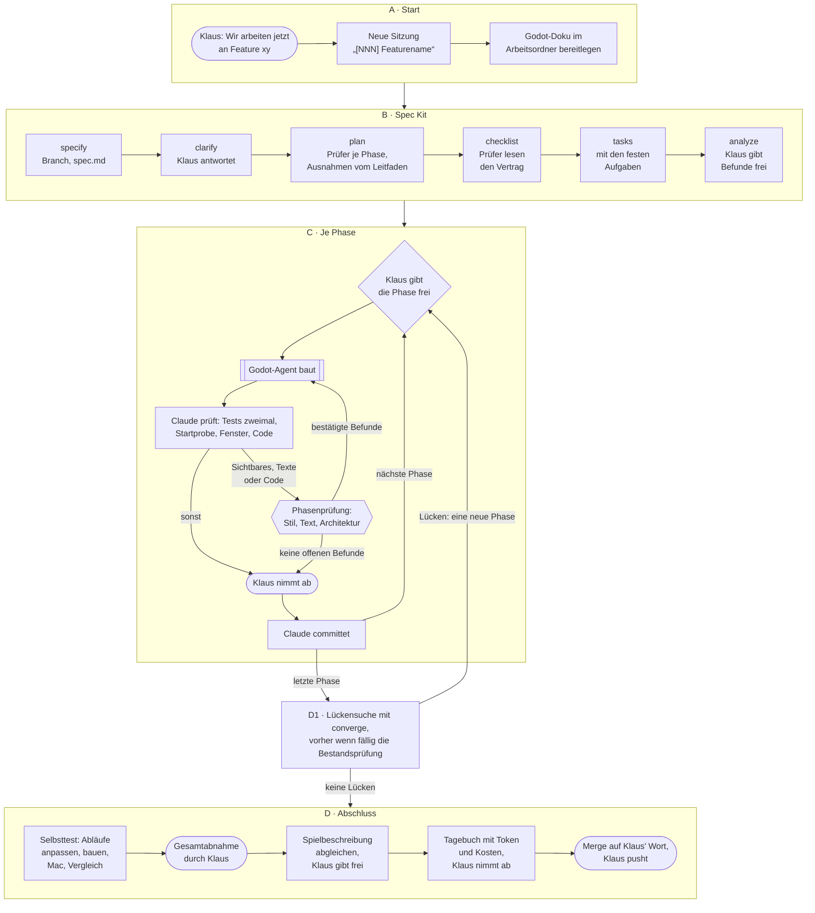

# Fahrplan: ein Feature von A bis Z

**Stand:** Konzept vom 2026-10-29, noch nicht von Klaus freigegeben. Es fasst zusammen, was in
`ki_dev.md`, `ki_pruefung.md`, der Verfassung und der Aufgaben-Vorlage schon gilt, und erfindet
keine neue Regel. Wo etwas fehlt, steht es unter „Noch nicht geregelt“.

Wozu: An einer Stelle nachlesen, wie ein Feature abläuft, der Reihe nach. Je Schritt steht, wer
handelt, was dabei entsteht, wo Klaus gefragt wird und wo die Regel mit ihrem Grund steht.
- `ki_dev.md` und `ki_pruefung.md` bleiben das **Warum**: die Regeln mit Anlass und Datum.
- Dieser Fahrplan ist das **Wie, der Reihe nach**. Ändert sich eine Regel, ändert sich der Schritt
  hier mit.
- Die Aufgaben-Vorlage `.specify/templates/overrides/tasks-template.md` bringt die festen Aufgaben
  in jedes `tasks.md`; sie folgt diesem Fahrplan.

## Auf einen Blick

Runde Kästen sind Klaus' Schritte, der Kasten mit Doppelrand ist der Godot-Agent, das Sechseck die
Prüfer. Alles andere macht Claude.

## A · Start

| Nr. | Schritt | Wer | Ergebnis | Klaus | Regel |
|---|---|---|---|---|---|
| A1 | „Wir arbeiten jetzt an Feature xy“, meist ein Eintrag aus `docs/features/Feature_Ideas.md` | Klaus | Auftrag | sagt es | `CLAUDE.md`, „Featureweise arbeiten“ |
| A2 | Eine eigene Sitzung für das Feature, im selben Ordner, auf seinem Branch; sie trägt das Feature bis zum Merge | Claude | Sitzung „[NNN] Featurename / Beschreibung“ | – | `ki_dev.md`, Punkt 7 |
| A3 | Godot-Doku im Arbeitsordner bereitlegen: Fehlt `godot_referenz/`, `tools/godot_referenz/erzeuge.sh --texte --handbuch` laufen lassen. Claude, Agent und Prüfer schlagen die API dort nach statt aus dem Gedächtnis | Claude | Klassenreferenz und Handbuch der installierten Godot | nur bei neuer Godot-Version: Erlaubnis zum Laden | `ki_dev.md`, „Werkzeuge und Pfade“; erste Aufgabe in `tasks.md` |

## B · Beschreiben mit Spec Kit

Alle sechs Schritte laufen immer, auch die optionalen. Gebaut wird hier noch nichts.

| Nr. | Schritt | Wer | Ergebnis | Klaus | Regel |
|---|---|---|---|---|---|
| B1 | `/speckit-specify`: was das Feature tut und woran man erkennt, dass es fertig ist, ohne Godot-Details | Claude | Branch `feature/NNN-kurzname`, `specs/NNN-kurzname/spec.md` | beantwortet Fragen, je als Auswahl mit Empfehlung | Verfassung III; `ki_dev.md`, Punkt 1 und 2 |
| B2 | `/speckit-clarify`: bis zu fünf gezielte Fragen | Claude | Antworten in der Spec | entscheidet jede Frage | `ki_dev.md`, „Zusammenarbeit“ |
| B3 | `/speckit-plan`: technischer Vertrag, Recherche in der Godot-Referenz | Claude | `plan.md` mit „Prüfer je Phase“ und „Ausnahmen vom Leitfaden“, beide aus der Plan-Vorlage; `research.md`, `data-model.md`, `contracts/`, `quickstart.md` | gibt Ausnahmen vom Leitfaden mit dem Plan frei | Verfassung VI; `ki_pruefung.md`, „Anbindung an Spec Kit“ |
| B4 | `/speckit-checklist`; dazu lesen Text- und Stil-Prüfer Wortlaute und Zustände aus Spec und Vertrag, der Architektur-Prüfer Plan und Vertrag | Claude, Prüfer | Checkliste unter `checklists/`; Befunde, nachgeprüft | gibt die Vorschläge frei; Befunde ändern den Vertrag nur mit seinem OK | `ki_dev.md`, Punkt 8; Skill `dcl-phasenpruefung`, „Vorab“ |
| B5 | `/speckit-tasks`: Aufgaben je Phase mit Besitzer `[K]`, `[A]`, `[C]` | Claude | `tasks.md`, mit den festen Aufgaben aus der Vorlage: Phasenprüfung je Phase, Selbsttest, Spielbeschreibung | – | Vorlage unter `.specify/templates/overrides/` |
| B6 | `/speckit-analyze`: Spec, Plan und Aufgaben gegeneinander und gegen die Verfassung | Claude | Bericht mit Befunden, eingearbeitet | gibt die Befunde frei, meist nach Empfehlung | `ki_dev.md`, Punkt 2 |

## C · Je Phase

Eine Phase nach der anderen, nie alles in einem Zug (`/speckit-implement` wird nicht benutzt).

| Nr. | Schritt | Wer | Ergebnis | Klaus | Regel |
|---|---|---|---|---|---|
| C1 | Die Phase freigeben, etwa „Starte Phase 4: T031 bis T039 mit dem Agent“ | Klaus | Auftrag | gibt frei | `ki_dev.md`, Punkt 3 |
| C2 | Auftrag an den Godot-Agent: Aufgabennummern, was zuerst zu lesen ist, Rahmen, feste Größen, Prüfbefehle, Form des Berichts; große Phasen in zwei Teilen, erst Kern, dann Oberfläche | Claude, Agent | Code, Szenen, Tests; Lernnotiz in `lernnotizen.md`; Bericht | – | Blaupause 8; `ki_dev.md`, „Aufträge an den Agent“ |
| C3 | Claude prüft: Tests zweimal, Startprobe, feste Größen, Bilder, Fenster in Klaus' Fenstergröße, Code an den kritischen Stellen; Auslegungen des Agents in die Spec | Claude | geprüfter Stand | echte Entscheidungen werden ihm vorgelegt | `ki_dev.md`, „Prüfen, bevor Klaus es sieht“ |
| C4 | Phasenprüfung, wenn die Phase Sichtbares, Texte oder Code ändert: Prüfer laut „Prüfer je Phase“ gleichzeitig, Claude prüft jeden Befund nach; bestätigte repariert der Agent, danach Nachprüfung | Claude, Prüfer, Agent | Bericht „was geprüft ist“; Zeilen unter „Nachmessen“; Lücken in `docs/offene-punkte.md` | entscheidet Widersprüche zum Vertrag und Lücken im Maßstab | Verfassung VI; Skill `dcl-phasenpruefung` |
| C5 | Bitte um Abnahme: Startbefehl als `bash`-Block, was gebaut ist, was geprüft ist mit Zahlen, Auslegungen mit Beispiel, Prüfliste | Claude | Bitte um Abnahme | nimmt ab, die `[K]`-Aufgabe der Phase | Blaupause 9; `ki_dev.md`, „Abnahme durch Klaus“ |
| C6 | Ein Commit je abgenommener Phase, danach nur Hash und Stand | Claude | Commit | pusht, wann er will | `ki_dev.md`, „Git“ |

## D · Abschluss

| Nr. | Schritt | Wer | Ergebnis | Klaus | Regel |
|---|---|---|---|---|---|
| D0 | Bestandsprüfung: der Architektur-Prüfer über ganz `src/`, nur wenn mit dem Feature eine neue Schicht beginnt oder seine Nummer auf 3 oder 8 endet (013, 018, …) | Claude, Architektur-Prüfer | Bericht; Befunde und Lücken in `docs/offene-punkte.md` | entscheidet, was behoben wird | `ki_pruefung.md`, „Wer prüft was“ |
| D1 | `/speckit-converge`: Spec, Plan, Verträge und Aufgaben gegen den Code; die Prüfer einmal über das ganze Feature; jede neue Seite, jeder Weg, Text und jede Eingabe braucht einen Schritt im Selbsttest | Claude, Prüfer | Lücken als neue Aufgaben in `tasks.md` | gibt die Lücken-Phase frei; sie läuft wie C | `ki_dev.md`, Punkt 6; `ki_pruefung.md`, „Anbindung an Spec Kit“ |
| D2 | Selbsttest: Abläufe unter `src/tools/selbsttest/ablaeufe/` anpassen, wenn das Feature Seiten, Wege, Texte oder Eingaben ändert; dann bauen mit `tools/build/baue_alles.sh`, auf dem Mac laufen lassen, mit `tools/selbsttest/vergleich.py` vergleichen | Agent, Claude | Ergebnis des Selbsttests | startet ihn auf Windows und Linux, wenn das Feature Fenster, Eingabe, Grafik, Dateien oder Export ändert, sonst spätestens jedes dritte Feature; neue Referenzbilder nur nach seiner Abnahme | `ki_dev.md`, Punkt 11 |
| D3 | Gesamtabnahme nach dem ganzen Quickstart, mit Startweg und Ergebnis des Selbsttests | Klaus | Abnahme des Features | nimmt ab | `ki_dev.md`, Punkt 5 und 11 |
| D4 | Spielbeschreibung mit dem Code abgleichen: was veraltet, was neu dazukommt, Abweichungen zwischen Spec und Code | Claude | Liste mit Gründen; nach OK die Änderungen in `docs/spielbeschreibung/` | gibt frei, was geändert wird | `ki_dev.md`, Punkt 9 |
| D5 | Tagebuch: je echter Entscheidung ein Eintrag auf Englisch in einer eigenen Datei des Features, oben Token und Kosten aus `tools/tagebuch/token_bilanz.py` | Claude | Einträge in `docs/tagebuch/` | nimmt sie ab | `ki_dev.md`, Punkt 10 |
| D6 | Merge nach `main` | Claude | Merge-Commit | gibt das Wort dazu und pusht | `ki_dev.md`, „Git“ |

## Was die ganze Zeit gilt

- **Fragen** kommen einzeln, als Auswahl, die Empfehlung zuerst; bei jeder Frage, ob etwas gebaut
  wird, steht der ungefähre Aufwand dabei (`ki_dev.md`, „Zusammenarbeit“).
- **Entscheidungen** stehen mit Datum und wer sie traf in Spec, Plan oder `research.md`; Claudes
  eigene Festlegungen und offene Fragen in `docs/offene-punkte.md` (`ki_dev.md`, „Dokumentation
  und Entscheidungen“).
- **Lose Ideen** kommen sofort unten in `docs/Ideensammlung.md`, ohne die Arbeit zu unterbrechen.
- **Was man sieht**, steht zuerst im Style-Guide, **wie gebaut wird**, im Architektur-Leitfaden;
  fehlt dort etwas, entscheidet Klaus, dann wird gebaut (Verfassung IV und VI).
- **Neue Regeln** zur Arbeitsweise kommen erst nach Klaus' OK hinein (Pflege, `README.md`).

## Entschieden am 2026-10-29

Die vier Fragen aus dem Konzept hat Klaus nach Empfehlung entschieden:
1. **Bestandsprüfung:** wenn eine neue Schicht beginnt und jedes fünfte Feature nach 008, also 013,
   018, …; als Aufgabe vor der Lückensuche (Schritt D0).
2. **Plan-Vorlage:** `.specify/templates/overrides/plan-template.md` bringt „Prüfer je Phase“ und
   „Ausnahmen vom Leitfaden“ mit (Schritt B3).
3. **Godot-Doku:** die erste Aufgabe in jedem `tasks.md` (Schritt A3).
4. **Skill `/dcl-fahrplan`:** später, wenn sich dieser Fahrplan in einem Feature bewährt hat; steht
   in `docs/Ideensammlung.md`.
