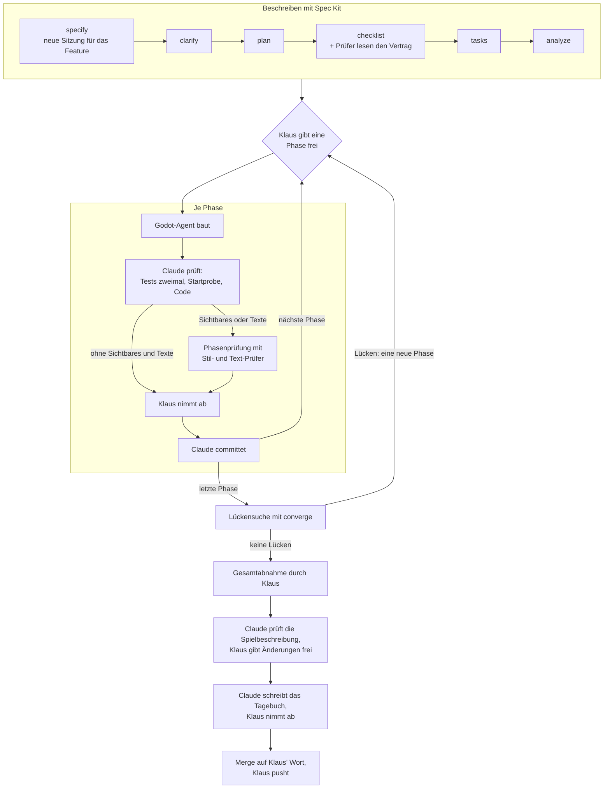

# Entwickeln mit KI – Blaupause

Wie Klaus, Claude und der Godot-Agent bei „Der Computerladen“ zusammenarbeiten: Abläufe und
Regeln, die sich bewährt haben, jeweils mit Grund. Die Datei wächst mit dem Projekt. Neue
Erfahrungen kommen als Punkt dazu, mit dem Anlass, aus dem sie entstanden sind. Gedacht ist sie
als Vorlage, die sich auf spätere Projekte übertragen lässt.

Was für den ganzen Ordner `docs/ki_workflow/` gilt, steht im [Einstieg](README.md): Pflege,
Abgrenzung und „Kein lokales Gedächtnis“. Wie geprüft wird, steht in
[ki_pruefung.md](ki_pruefung.md).

## Rollen

- **Klaus** entscheidet und nimmt ab: Er gibt jede Phase frei, nimmt sie ab und pusht. Was er
  selbst bauen will, um es zu lernen, trägt `[K]`.
- **Claude** plant und prüft: Specs, Pläne, Aufträge an den Agent, Review, Doku, Commits (`[C]`).
- **Der Godot-Agent** (`.claude/agents/godot-entwickler.md`) macht die eigentliche Programmierung:
  Szenen, GDScript, Tests (`[A]`). Er committet nie.

Warum: Wer baut, prüft nicht selbst. Klaus bekommt nur zu sehen, was Claude schon geprüft hat, und
Claude bleibt frei für Planung und Review.

## Ablauf je Feature

Wann die Phasenprüfung läuft, sagt Punkt 8.

1. **Ein Branch pro Feature:** `feature/NNN-kurzname`, Ordner `specs/NNN-kurzname/`.
2. **Spec Kit vollständig, auch die optionalen Schritte:**
   `/speckit-specify` → `/speckit-clarify` → `/speckit-plan` → `/speckit-checklist` →
   `/speckit-tasks` → `/speckit-analyze`. Clarify, Checklist und Analyze laufen immer.
   Warum: Jeder dieser Schritte hat bisher echte Lücken gefunden, etwa die 40 Befunde der Analyse
   von Feature 002, bevor eine Zeile Code entstand.
3. **Phasenweise umsetzen, nie `/speckit-implement` für alles:** Klaus gibt jede Phase einzeln
   frei, etwa „Starte Phase 4: T031 bis T039 mit dem Agent, T040 ist meine Abnahme“.
4. **Große Phasen in zwei Teilen:** erst der Kern, dann die Oberfläche, dazwischen prüft Claude.
   So baut Teil 2 auf geprüftem Grund.
5. **Jede Phase endet mit Klaus' Abnahme**, einer `[K]`-Aufgabe, und erst danach mit einem Commit.
6. **Vor der Gesamtabnahme die Lückensuche:** Nach der letzten Umsetzungsphase läuft
   `/speckit-converge` über das ganze Feature. Prüfer lesen Spec, Plan, Verträge und Aufgaben
   gegen den Code, Claude prüft jeden Befund selbst nach. Die Lücken werden eine eigene Phase mit
   Klaus' Freigabe, erst danach folgt die Gesamtabnahme. Warum: Bei Feature 002 fand die
   Lückensuche 14 Lücken, darunter zwei Widersprüche zur Spec, obwohl alle Tests grün waren
   (Klaus, 2026-10-21).
7. **Eine Claude-Sitzung je Feature, von `/speckit-specify` bis zur Gesamtabnahme** (Klaus,
   2026-10-26): Sobald es heißt „wir arbeiten jetzt an Feature xy“, bekommt das Feature eine
   eigene Sitzung, im selben Ordner und auf seinem Branch. Darin laufen alle Schritte von Spec
   Kit und alle Phasen der Umsetzung. Eine eigene Sitzung je Schritt, etwa ab dem Plan, bietet
   Claude nicht an. Was über die Sitzung hinaus gelten soll, steht in Repo-Dateien. Die Sitzung
   heißt „[NNN] Featurename / Beschreibung“ mit der Nummer aus Spec Kit, etwa „[004] Neues
   Spiel“ (Klaus, 2026-10-22). Warum: Die Schritte bauen aufeinander auf; eine neue Sitzung
   müsste jedes Mal alles neu lesen. Einen unabhängigen Blick bringen die Prüf-Agents und die
   Prüfer bei Analyse und Lückensuche. Eine Sitzung, die mehrere Features trägt, wird
   zusammengefasst und verliert dabei Einzelheiten; Anlass war eine Sitzung mit Feature 001,
   dem Start von 002 und der Spec von 003. Bis 2026-10-26 begann die eigene Sitzung erst mit
   dem Plan, besprochen und spezifiziert wurde dort, wo die Idee aufkam (Klaus, 2026-10-21).
8. **Phasenprüfung vor der Abnahme** (Klaus, 2026-10-22, fest seit dem Pilot in Feature 004,
   Klaus, 2026-10-26): Ändert eine Phase Sichtbares oder Texte, auch in Werkzeugen, prüfen
   Stil- und Text-Prüfer sie gegen den Style-Guide, bevor Klaus abnimmt. Wie, steht in
   [ki_pruefung.md](ki_pruefung.md). Schon bei `/speckit-checklist` lesen die Prüfer die Wortlaute
   und Zustände aus Spec und Vertrag, damit ein Fehler im Vertrag gar nicht erst gebaut wird
   (Klaus, 2026-10-27). Bis zum Pilot prüfte Claude allein.
9. **Als letzte Aufgabe die Spielbeschreibung prüfen** (Klaus, 2026-10-27): Nach der
   Gesamtabnahme und vor dem Merge gleicht Claude `docs/spielbeschreibung/` mit dem Code ab. Claude
   legt Klaus vor, welche Dateien veralten und welche neu angelegt werden sollten, je mit Grund,
   dazu jede Abweichung zwischen Spec und Code. Geändert wird nie ungefragt, sondern erst nach
   Klaus' OK; es ist ein Schritt wie jeder andere. In `tasks.md` steht er als `[C]`-Aufgabe, die
   das Template unter `.specify/templates/overrides/` mitbringt. Warum: Die Spielbeschreibung ist
   der Kontext, den jede Sitzung vorlädt. Veraltet sie still, arbeitet die KI mit falschem Wissen.
10. **Vor jedem Merge nach `main` das Tagebuch fortschreiben** (Klaus, 2026-10-27): Claude schreibt
    in `docs/tagebuch/` die Einträge zu dem, was der Branch entschieden hat, ein Eintrag je echter
    Entscheidung, nicht je Commit, in der Form aus dem [README](../tagebuch/README.md) und auf
    Englisch; übersetzt wird nicht während der Entwicklung (Klaus, 2026-10-27). Ein Feature
    bekommt eine eigene Datei, ein kleiner Branch, etwa zur Arbeitsweise, Einträge in der Datei,
    die zeitlich passt. Bei Grafik kommt das Bild dazu. Ein Feature bekommt oben die Zeile
    „Tokens and cost“ aus `python3 -I tools/tagebuch/token_bilanz.py feature/NNN-kurzname`
    (Klaus, 2026-10-27); sie muss beim Merge entstehen, weil Claude Code die Protokolle nach 30
    Tagen löscht. Nur Belegtes kommt hinein; wo der Grund fehlt, fragt Claude Klaus. Klaus nimmt
    die Einträge ab, sie gehen mit in den Merge. Warum: Das Tagebuch hält fest, wie das Spiel mit
    KI entsteht, vor allem die Entscheidungen zu Arbeitsweise und Grafik. Nachträglich lassen sich
    Gründe kaum noch belegen.
11. **Selbsttest zur Gesamtabnahme** (Klaus, 2026-10-28, Feature 007): Nicht nach jeder Phase, dort
    reichen Tests und Startprobe. Ändert ein Feature Seiten, Wege, Texte oder Eingaben, die der
    Selbsttest durchspielt, passt vor der Gesamtabnahme die Aufgabe „[A] Selbsttest-Abläufe
    anpassen“ die Abläufe unter `src/tools/selbsttest/ablaeufe/` an. Dann baut Claude mit
    `tools/build/baue_alles.sh`, lässt den Selbsttest auf dem Mac laufen, vergleicht mit
    `tools/selbsttest/vergleich.py` und nennt das Ergebnis in der Bitte um Gesamtabnahme. Neue
    Referenzbilder gibt es nur nach Klaus' Abnahme. Auf Windows und Linux startet Klaus ihn, wenn
    das Feature Fenster, Eingabe, Grafik, Dateien oder Export ändert, sonst spätestens jedes dritte
    Feature. Warum: Tests ohne Fenster sehen weder Treiber noch echtes Fenster; in 007 fand der
    Selbsttest die falsche Fenstermitte und einen Windows-Rechner, auf dem Forward+ nicht startet.

## Git

- **Claude committet, Klaus pusht.** Claude gibt keine Push-Befehle und keine Anleitungen dazu.
- **Ein Commit je abgenommener Phase.** Die Nachricht nennt, was je Aufgabe gebaut ist, was aus
  Prüfung und Abnahme dazukam, und das Testergebnis.
- **Nach einem Commit nur Hash und Stand nennen**, ohne Hinweis aufs Pushen. Anlass: Nach einem
  gescheiterten Push kam einmal eine SSH-Anleitung, die Klaus nicht wollte (2026-10-19).
- **Nur eigene Dateien committen.** Im geteilten Ordner arbeiten mehrere Sitzungen; deshalb nie
  `stash`, `reset` oder Branchwechsel.
- **Vor dem Commit `export_presets.cfg` ansehen**, denn dort können Zugangsdaten im Klartext
  landen. Keine Zugangsdaten in Dateien.

## Aufträge an den Agent

Ein guter Auftrag enthält:
- die Aufgabennummern und ausdrücklich, was nicht dazugehört, etwa „T061 kommt in Teil 2“;
- was zuerst zu lesen ist: tasks.md, Spec, Verträge, research.md, Style-Guide, vorhandener Code;
- den Rahmen: Branch, nicht committen, welche Dateien tabu sind, etwa der echte Katalog;
- **feste Größen**, die nicht wackeln dürfen, etwa „ohne Eingriffe bleibt der Fahrplan
  bytegleich, geprüft für die Seeds 1, 4711 und 99999“;
- die Prüfbefehle, jeder mit Zeitlimit;
- bei Oberflächen Bildschirmfotos aus einem echten Fenster in Klaus' Fenstergröße, dazu eine
  Aussage, ob der Platz reicht;
- die Form des Berichts: Dateien, API, Testergebnis mit Zahlen, Auslegungen, offene Fragen.

Steht der Agent-Typ `godot-entwickler` in einer Sitzung nicht bereit (Agents laden nur beim
Start), nimmt Claude einen allgemeinen Agent, der zuerst `.claude/agents/godot-entwickler.md`
liest.

Bewährt: die **Fehlerprobe**. Der Agent baut in einer Kopie absichtlich Fehler ein und zeigt, dass
die Tests sie finden. Fällt ein Fehler durch, kommt ein Test dazu.

## Prüfen, bevor Klaus es sieht

Wie Tests, Claude und Prüf-Agents zusammen prüfen, steht in [ki_pruefung.md](ki_pruefung.md). Was
Claude selbst prüft:

- Die Tests selbst laufen lassen, zweimal: Schwankt die Zahl der Prüfungen, ist ein Test vom
  Zufall abhängig.
- Die Startprobe headless mit `-d`: Exit 0 und keine Ausgabe.
- Feste Größen nachmessen: Bytevergleich der Ausgaben, Daten unverändert, keine liegen gebliebenen
  Dateien.
- Die Bilder ansehen und den Code an den kritischen Stellen lesen.
- **Fensterverhalten im echten Fenster prüfen.** Headless sieht man es nicht. Anlass: In Phase 4
  startete die Werkstatt im Vollbild statt maximiert, alle Tests waren grün.
- **Neue Oberflächen bei Klaus' echter Fenstergröße prüfen**, derzeit 1920 × 925 logisch, und den
  Platz schon im Auftrag an den Agent abfragen. Anlass: In den Phasen 7 bis 9 zeigte erst der
  Bericht des Agents, dass eine Tabelle unter dem Zeitstrahl nur drei, vier Zeilen hat (Klaus,
  2026-10-21).
- Auslegungen des Agents in die Spec-Dokumente schreiben. Kleine entscheidet Claude, echte
  Entscheidungen legt Claude Klaus vor.
- Funde aus früheren Phasen gleich mit beheben lassen, etwa das fehlende Zebra in Liste und
  Prüfung aus Phase 4.

## Abnahme durch Klaus

Jede Bitte um Abnahme, auch die Gesamtabnahme am Ende und jede Ankündigung „danach folgt deine
Abnahme“, enthält den Startweg; ohne ihn ist sie unvollständig (Klaus, 2026-10-28; Anlass: Bitte um
die Gesamtabnahme von Feature 006 ohne Startbefehl). Die Bitte enthält, in dieser Reihenfolge:
1. den Startbefehl als eigenen `bash`-Block, damit Klaus ihn mit dem Play-Knopf startet;
2. was gebaut ist, kurz je Aufgabe;
3. was geprüft ist, mit Zahlen;
4. die Auslegungen, die Klaus ablehnen kann, jede mit einem Beispiel;
5. die Prüfliste im Quickstart und Hinweise zum Aufräumen, etwa `git restore` für den Katalog.

## Tests

- **Deterministisch:** feste Seeds. Anlass: Ein Test ohne festen Seed prüfte mal 0, mal 1 Termin.
- **Tests schreiben nie in echte Daten:** eigene Ordner unter `user://`; der echte Katalog gehört
  nicht in Tests, Maßstab ist eine eingefrorene Kopie.
- **Ausgaben als Ganzes vergleichen:** Bytevergleich oder gespeicherte Erwartung, nicht nur
  Stichproben.
- **Zahlen aus der Spec messen**, statt sie zu schätzen, etwa „Bis zum Ende“ in 21 ms bei einem
  Ziel von unter 1 Sekunde.

## Dokumentation und Entscheidungen

- **Jede Entscheidung mit Datum und wer sie traf**, in research.md oder der Spec.
- **Ändert sich eine Entscheidung, bleibt die alte sichtbar:** „bis 2026-10-20: im Vollbild“, wie
  bei FR-004 von Feature 001.
- **Lernnotizen** zu jeder Aufgabe, an der konkreten Stelle im Projekt, kein Tutorial.
- **Lose Ideen sofort festhalten**, unten in `docs/Ideensammlung.md`, ohne die Arbeit zu
  unterbrechen: Datum, Kern in ein, zwei Sätzen, bei Bedarf Bezug und offene Fragen. Nicht erst
  fragen und nicht ausarbeiten; wird eine Idee konkret, wandert sie nach
  `docs/features/Feature_Ideas.md` oder ins GDD.
- **Entscheidungen nicht stillschweigend treffen** (Klaus, 2026-10-21):
  - Wo eine Festlegung nötig ist, die nicht aus den Dokumenten folgt: entscheiden, umsetzen und
    die Entscheidung sichtbar als eigene kennzeichnen, in `docs/offene-punkte.md` und, wo sie
    hingehört, in Spec oder Verfassung.
  - Wo zwei Lesarten zu deutlich verschiedener Arbeit führen: fragen, bevor gebaut wird.
  - Wo etwas in den Dokumenten fehlt oder sich widerspricht: als offenen Punkt in
    `docs/offene-punkte.md` eintragen, statt es im Vorbeigehen zu erfinden.
- **Verfassung und `CLAUDE.md` ändern sich nur auf Klaus' Beschluss**, die Verfassung mit
  Versionssprung über `/speckit-constitution`.
- **Was man sieht, steht zuerst im Style-Guide:** Eine neue Farbrolle oder Darstellung kommt erst
  in den Style-Guide, dann in den Code, etwa Raster und Achse des Zeitstrahls.

## Zusammenarbeit

- Deutsch; Fachbegriffe mit einem Beispiel aus dem Spiel erklären. Anlass: Im Review von Feature
  002 verstand Klaus „Eingriffe aus dem Simulator“ erst mit dem Beispiel „Was wäre, wenn der
  Spieler ab 1990 beim windigen Händler kauft? Dann stellst du von Hand ein: Reklamationswelle +5
  Prozentpunkte“ (2026-10-20).
- Alle Texte im Spiel und in den Werkzeugen duzen den Spieler, etwa „Bald kannst du ihn
  eröffnen.“ (Klaus, 2026-10-19, im Review von Feature 001, gegen die Empfehlung „Sie“).
- Claude empfiehlt eine Lösung, statt nur Möglichkeiten aufzuzählen, und fragt nur, was wirklich
  Klaus' Entscheidung ist, eine Frage nach der anderen.
- **Fragen immer als Auswahl** (Klaus, 2026-10-21): Jede Frage an Klaus kommt mit Antworten zum
  Auswählen, die Empfehlung zuerst; eine freie Antwort bleibt möglich. Das gilt auch für die Fragen
  von `/speckit-specify` und `/speckit-clarify`, die Spec Kit sonst als Kurzantwort zulässt.
  Anlass: die Klärungsfragen zu Feature 003.
- Dauert etwas länger, meldet Claude kurz den Stand.
- **Eingedeutschte Fachwörter bleiben, wie sie sind** (Klaus, 2026-10-27): „scrollen“, nicht
  „rollen“. Im Deutschen übersetzen wir solche Wörter nicht. Anlass: eine Frage mit „rollen“.
- **Bei jeder Frage, ob etwas gebaut wird, steht der ungefähre Aufwand dabei** (Klaus,
  2026-10-27), etwa „Aufwand: klein, eine Aufgabe für den Agent“ oder „Aufwand: eine eigene Phase
  mit Abnahme“. So sieht Klaus Nutzen und Arbeit zusammen. Anlass: T044 in Feature 004. Bis
  2026-10-27 stand die Regel unter den Erfahrungen in `ki_pruefung.md`.

## Werkzeuge und Pfade

- Godot liegt unter `/Applications/Godot.app/Contents/MacOS/Godot`, Version 4.7.2 stable, nicht
  .NET; den Pfad direkt nutzen statt zu suchen. Kommt eine zweite Version dazu, hier nachtragen.
- Claude darf Prozesse selbst mit `kill` beenden, etwa ein hängendes Godot oder eine offene
  Werkstatt nach einem Test (Klaus, 2026-10-27, im Spike zum Communicator). Die Erlaubnis steht als
  `Bash(kill *)` in Klaus' `~/.claude/settings.json`.
- **Spec Kit aktualisieren** (Klaus, 2026-10-27): Eigene Vorlagen liegen unter
  `.specify/templates/overrides/`. Spec Kit sucht dort zuerst und spielt bei einem Update nur seine
  eigenen Vorlagen ein. Nach jedem Update prüft Claude mit `git diff`, dass `overrides/` und die
  Verfassung unverändert sind, bevor committet wird. Anlass: Klaus' Frage, ob ein Update die
  Aufgaben „Phasenprüfung“ und „Spielbeschreibung prüfen“ löschen kann.
- Projekt-Root ist `src/`, also immer `--path src`. Startbefehle vom Repo-Ordner aus:
  - Spiel: `/Applications/Godot.app/Contents/MacOS/Godot --path src`
  - Werkstatt:
    `/Applications/Godot.app/Contents/MacOS/Godot --path src res://tools/werkstatt/werkstatt.tscn`
  - Tests:
    `/Applications/Godot.app/Contents/MacOS/Godot --headless --path src -s res://addons/gut/gut_cmdln.gd`

## Grafik

- Grafik läuft über Artifacts, nicht über Dateien im Repo (seit 2026-10-19):
  - Style-Guide, verbindlich: https://claude.ai/artifact/Hc5aS78T3fAzufkKnjrKRX, mit Leitbild,
    Tokens, Bausteinen, dem Abschnitt „Werkzeuge“ und dem Leonardo-Workflow samt
    Prompt-Bibliothek.
  - Claude Design „Computerladen Titelscreen & Cover“:
    https://claude.ai/artifact/RHKxpTb6JfWFQdNnPYEWHH, noch mit den alten Platzhalter-Skizzen
    vor der Pixel-Umstellung.
- Entscheidungen von Klaus: Vorbild für Aufbau und Humor sind die deutschen
  Wirtschaftssimulationen der 90er wie „Das Amt“. Grundstil ist VGA-Pixel-Art, Stilanker ist Bild
  C2 aus der Leonardo-Stilprobe vom 2026-10-19 (Ladenbesitzer hinter der Theke). Zwei Raster:
  Szenen 320 × 180 Bildpixel, Oberfläche 640 × 360, ganzzahlig skaliert. „Cooler Retro-Style, der
  trotzdem als modernes Spiel durchgeht“; Konsistenz ist oberstes Ziel.
- Die Bilder erzeugt Claude selbst in Leonardo.ai, über Claude in Chrome im Konto des Projekts;
  Klaus wählt nur das Bild aus und gibt es frei. Claude fragt nicht, ob Klaus erzeugen will, und
  liefert keine Anleitung zum Selbermachen (Klaus, 2026-10-27; bis dahin erzeugte Klaus selbst).
  Den Prompt schreibt Claude auf Englisch mit dem Stilblock aus dem Style-Guide und trägt ihn
  vorher in die Prompt-Bibliothek ein. Ist Claude in Chrome nicht erreichbar, sagt Claude das
  sofort und nennt den Grund, statt auf einen anderen Weg auszuweichen. Den ganzen Ablauf vom
  Prompt bis zum Prompt-Log beschreibt der Skill `dcl-grafik`
  (`.claude/skills/dcl-grafik/SKILL.md`); er wird bei jeder Grafikaufgabe geladen. Anlass: Die
  Regeln lagen auf drei Dateien verteilt, und Claude bat Klaus zweimal, selbst in Leonardo zu
  erzeugen (2026-10-27). Bisher: Lucid Origin mit
  C2 als Style Reference (Stärke High), Prompt Enhance aus, Style None. Die Modellliste von
  Leonardo ändert sich, also vorher prüfen.
- Leonardo bedient Claude über Claude in Chrome. Chrome startet auf Klaus' Rechner nur mit
  `--user-data-dir="$HOME/Library/Application Support/Google/Chrome-Profil"`, weil macOS den
  Standard-Profilordner sperrt; ohne das schließt Chrome sich sofort wieder. Claude startet es
  selbst mit `open -na "Google Chrome" --args --user-data-dir="$HOME/Library/Application
  Support/Google/Chrome-Profil"`, wenn Claude in Chrome nicht erreichbar ist (2026-10-27).
- Die Grafikstil-Zeile im GDD ändert Claude nur mit Klaus' OK.

## Offen

- Szenario-Tests aus gespeicherten Proben, siehe Ideensammlung vom 2026-10-21.
