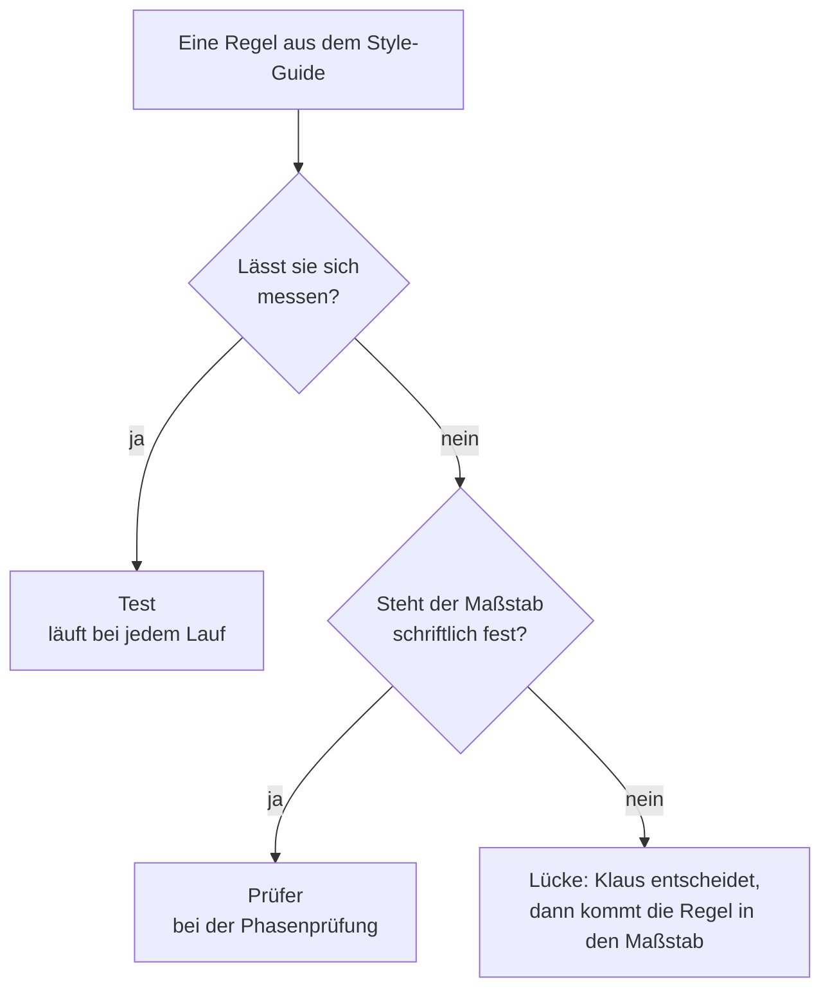
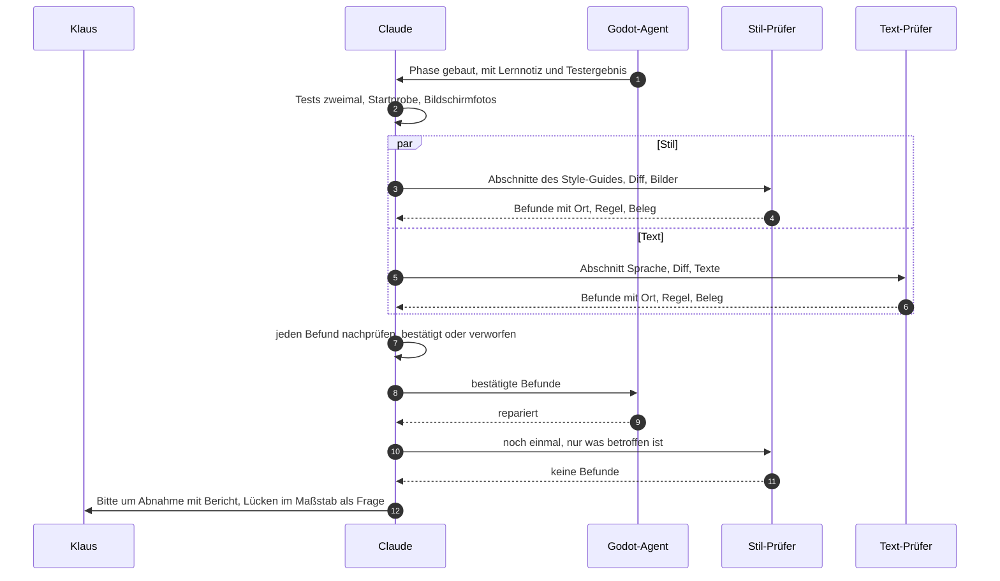
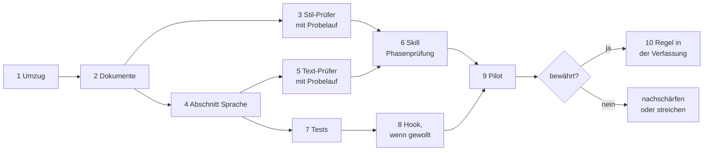

# Prüfen mit KI – Blaupause

Wie bei „Der Computerladen“ geprüft wird, bevor Klaus abnimmt: von Tests, von Claude und von
Prüf-Agents, die nur lesen. Wie [ki_dev.md](ki_dev.md) wächst die Datei mit dem Projekt: Regeln
stehen mit Grund da, Erfahrungen mit ihrem Anlass, Entscheidungen mit Datum und wer sie traf. Pflege
und Abgrenzung stehen im [Einstieg](README.md).

**Stand:** in Einführung seit 2026-10-22, Schritt für Schritt nach „Stand der Einführung“ unten. Bis
die Prüfer eingeführt sind, prüft Claude allein, wie in `ki_dev.md`, „Prüfen, bevor Klaus es sieht“.
Die Datei ist aus zwei Konzepten vom 2026-10-22 entstanden, die in ihr aufgegangen sind; die
Git-Geschichte behält sie (`docs/konzept-pruef-agents.md`, `docs/konzept-ki-workflow.md`).

## Grundsätze

1. **Einfach anfangen, erst erweitern, wenn es nachweislich hilft.** Warum: Das ist der Kern von
   Anthropics Artikel „Building effective agents“. Mehrere Agents sind teuer: Nach Anthropics
   Bericht über ihr Recherche-System mit mehreren Agents brauchen solche Systeme rund 15-mal so viele
   Tokens wie ein Chat, und Programmieren lässt sich schlechter aufteilen als Recherche.
2. **Nach Maßstab spezialisieren, nicht nach Rolle.** Ein Prüfer lohnt sich, wenn er etwas Eigenes
   mitbringt: einen schriftlichen Maßstab wie den Style-Guide und einen frischen Blick, unabhängig
   von dem, der gebaut hat. Warum: Ein „Senior-Reviewer“ ohne eigenen Maßstab urteilt nach
   Geschmack.
3. **Prüfer prüfen, der Godot-Agent baut.** Prüfer lesen nur und melden jeden Befund mit Ort, Regel
   und Beleg. Der Godot-Agent repariert, und Claude prüft jeden Befund nach, bevor Klaus ihn sieht.
   Warum: Wer baut, prüft nicht selbst, und auch Prüfer liegen mal daneben.
4. **Messbares prüft ein Test.** Ob ein Bild nur Farben der Palette nutzt, ob irgendwo „Sie“ steht
   oder ein Text zu lang ist, erkennt ein Skript zuverlässiger und billiger, bei jedem Lauf.
   KI-Prüfer urteilen nur, wo es ein Urteil braucht: Ton, Humor, Stimmigkeit, Treue zur Epoche.
5. **Feste Zeitpunkte statt Dauerprüfung:** am Ende jeder Phase, die Sichtbares oder Texte ändert,
   alle Prüfer gleichzeitig, ein gemeinsamer Bericht. Warum: So kostet die Prüfung wenig und liegt
   genau vor Klaus' Abnahme.
6. **Nachmessen.** Findet ein Prüfer über mehrere Phasen nichts, was die anderen übersehen, fliegt
   er raus. Findet eine Prüfung zweimal etwas, wird sie fest eingebaut (Pflege im
   [Einstieg](README.md)).

## Bausteine

| Baustein | Was er ist | Hier |
|---|---|---|
| Subagent (`.claude/agents/`) | eigener Kontext, eigene Werkzeuge, eigenes Modell; zurück kommt nur das Ergebnis | `godot-entwickler`, die Prüfer |
| Skill (`.claude/skills/`) | Anleitung, die bei Bedarf in die laufende Sitzung geladen wird | `dcl-komponente`, Spec Kit, die Phasenprüfung |
| Hook (`.claude/settings.json`) | Befehl, den Claude Code bei einem Ereignis immer ausführt, auch wenn niemand daran denkt | denkbar: Tests, sobald der Godot-Agent fertig ist |
| Tests und Skripte | Code | alles Messbare |

Faustregel: Wer unabhängig urteilen soll, wird ein Subagent. Ein Ablauf, der immer gleich laufen
soll, wird ein Skill. Was jedes Mal passieren muss, wird ein Hook oder ein Test.

Was Claude Code dafür bietet, laut seiner Doku (Stand 2026-10-22:
[Subagents](https://code.claude.com/docs/en/sub-agents), [Hooks](https://code.claude.com/docs/en/hooks),
[Skills](https://code.claude.com/docs/en/skills)):
- **Werkzeuge:** `tools` in der Agent-Datei ist eine Positivliste. Ohne `Bash`, `Edit` und `Write`
  kann ein Agent nichts ändern, ohne `Agent` keine weiteren Agents starten. `model: inherit` nimmt
  das Modell der Sitzung.
- **Neue Dateien:** Neue oder geänderte Agents und Skills greifen nach wenigen Sekunden, ohne neue
  Sitzung, außer ihr Ordner fehlte beim Start der Sitzung. In der Desktop-App stimmt das für
  Agents nicht: Im Probelauf von Schritt 3 stand `stil-pruefer` in der laufenden Sitzung nicht
  bereit, wie `ki_dev.md` aus Erfahrung festhält (2026-10-22).
- **Gleichzeitig:** Mehrere Agents aus einer Nachricht laufen nebeneinander im Hintergrund. Ihre
  Ergebnisse kommen einzeln zurück.
- **Hook nach einem Agent:** `SubagentStop` mit dem Namen des Agents als Matcher, etwa
  `godot-entwickler`. Endet der Befehl mit Exit-Code 2, arbeitet der Agent weiter, und die
  Fehlermeldung wird seine nächste Anweisung. Zeitlimit 600 s, einstellbar.
- **Skill:** Klaus ruft ihn mit `/name` auf, Claude von selbst. Mit
  `disable-model-invocation: true` wird er ein Befehl nur für Klaus.

## Wer prüft was

| Wer | Wann | Was | Maßstab |
|---|---|---|---|
| Tests | bei jedem Lauf | alles Messbare, etwa Farben aus der Palette, Abstände aus dem Raster, kein „Sie“ | Werte aus dem Style-Guide, im Code |
| Claude | nach jeder Phase | Code, Tests zweimal, Startprobe, Bilder, feste Größen | Spec, Vertrag, `ki_dev.md` |
| Prüfer | am Ende einer Phase mit Sichtbarem oder Texten | was ein Urteil braucht, etwa ob der Ton zu „Das Amt“ passt | Style-Guide mit dem Abschnitt „Sprache“, später die game_bible |
| Klaus | bei der Abnahme | alles; er entscheidet, wo ein Maßstab eine Lücke hat | Spec und sein Urteil |

Ob eine Regel ein Test prüft oder ein Prüfer, entscheidet sich so:



Messbar ist etwa „nur Farben der Palette“ oder „kein Sie“. Ein Urteil braucht etwa die Frage, ob
eine Meldung so klingt wie in „Das Amt“.

## Die Prüfer

| Prüfer | Maßstab | Findet zum Beispiel | Messbares als Test | Stand |
|---|---|---|---|---|
| Stil | Style-Guide | weicher Schatten, der den VGA-Look bricht; Symbol in falscher Pixelgröße; Knopf ohne Hover-Zustand | nur Farben der Palette, ganzzahlige Skalierung, Schrift 10 oder 12 px | Schritt 3 |
| Text | Style-Guide, Abschnitt „Sprache“ | „Geben Sie …“; Preise in Euro im Jahr 1994; „googeln“, das es bis 1999 noch nicht gab; ein Ton, der nicht zu „Das Amt“ passt | kein „Sie“ oder „Ihnen“ in Bedienung, Hinweisen und Meldungen; jeder Text passt in sein Feld | Schritt 5 |
| Fakten | game_bible und Quellen | Pentium im Katalog schon 1991, obwohl er 1993 kam; Ereignis zu Windows 95 im Jahr 1994 | Daten im Ereigniskatalog stimmen mit der game_bible überein | später, wenn Katalog und game_bible wachsen |

Jeder Prüfer ist ein Subagent in `.claude/agents/`, etwa `stil-pruefer.md`:
- **Nur lesen:** `tools: Read, Grep, Glob`. So kann der Prüfer nichts kaputt machen.
- **Befund:** Ort (Datei und Node oder Bildausschnitt), Regel (Abschnitt im Maßstab), Beleg (was er
  sieht und was die Regel verlangt) und Schwere (kritisch, hoch, mittel, niedrig).
- **Lücke statt Fehler:** Regelt der Maßstab etwas nicht, meldet der Prüfer eine Lücke im Maßstab,
  keinen Fehler.
- **Keine Befunde:** Dann schreibt er das und welche Abschnitte er geprüft hat.
- **Steht ein Prüfer nicht bereit**, nimmt Claude einen allgemeinen Agent, der zuerst die Datei des
  Prüfers liest (`ki_dev.md`, „Aufträge an den Agent“).

Nicht vorgesehen:
- ein eigener Code-Prüfer, denn Code prüft Claude, und `/code-review` gibt es schon;
- Prüfer, die selbst reparieren;
- zwei Prüfer für dieselbe Frage, etwa einer für UX und einer für Stil, die beide das Layout
  beurteilen.

## Maßstäbe

- **Style-Guide:** Er liegt als Artifact vor, das ein Prüfer nicht selbst lesen kann. Claude gibt
  ihm die passenden Abschnitte mit. So bleibt der Style-Guide die einzige Quelle (Verfassung,
  Grundsatz IV).
- **Sprache:** ein Abschnitt im Style-Guide seit Schritt 4: Leitsätze zum Ton, Anrede, Zahlen und
  Geld, Wortschatz von 1985 bis 1999 mit Jahreszahlen, Beispiele. Klaus hat den Ort und den Ton
  entschieden (2026-10-22). Claude gibt den Abschnitt dem Text-Prüfer mit, wie dem Stil-Prüfer
  die seinen.
- **game_bible:** liegt im Repo, der Fakten-Prüfer liest sie selbst.
- **Lücken:** Regelt ein Maßstab etwas nicht, entscheidet Klaus. Erst kommt die Regel in den
  Maßstab, dann wird gebaut, wie es Grundsatz IV der Verfassung für den Style-Guide verlangt.

## Ablauf einer Phasenprüfung



1. Der Godot-Agent baut die Phase. Danach laufen Tests und Startprobe, zweimal.
2. Claude schlägt in `plan.md` unter „Prüfer je Phase“ nach, welche Prüfer für die Phase gelten.
3. Claude startet die Prüfer gleichzeitig, jeden mit seinem Maßstab, dem Diff und den
   Bildschirmfotos aus dem echten Fenster.
4. Claude prüft jeden Befund nach: bestätigt oder verworfen, mit Grund.
5. Bestätigte Befunde gehen an den Godot-Agent. Danach prüfen die betroffenen Prüfer noch einmal.
6. Lücken im Maßstab, etwa eine Frage, die der Style-Guide nicht regelt, gehen an Klaus.
7. Das Ergebnis steht in der Bitte um Abnahme unter „was geprüft ist“.

Der Skill `dcl-phasenpruefung` hält diesen Ablauf fest (Schritt 6). Klaus kann ihn auch selbst mit
`/dcl-phasenpruefung` aufrufen.

So sieht der Bericht aus, hier ausgedacht für ein späteres Feature „Ladenansicht“:

```
Phasenprüfung Phase 4, Ladenansicht (T031–T037)
Tests: 512 grün, zweimal gleich; Startprobe still
Stil-Prüfer: 3 Befunde, 2 bestätigt
  hoch       Knopf „Bestellen“ ohne Hover-Zustand (Oberfläche)
  niedrig    Preisschild 3 px vom Rand, kein Wert aus dem Raster (Oberfläche)
  verworfen  Schatten unter dem Tresen: in wenigen Stufen gesetzt, nicht weich (Szenen und Figuren)
Text-Prüfer: 2 Befunde, 2 bestätigt
  hoch       „Bitte wählen Sie eine Ware“ → „Wähl eine Ware“ (du-Form)
  mittel     „Das kostet 499 Euro“ im Jahr 1987 → „Das kostet 499,00 DM“ (Wortschatz, Zahlen)
Für dich: Der Style-Guide regelt Preisschilder noch nicht. Wie sollen sie aussehen?
```

Der verworfene Befund zeigt, warum Claude nachprüft: Auch Prüfer liegen mal daneben.

## Anbindung an Spec Kit

Spec Kit bleibt, wie es ist. Die Prüfer kommen an fünf Stellen dazu:

| Schritt | Was dazukommt |
|---|---|
| `/speckit-plan` | `plan.md` legt unter „Prüfer je Phase“ fest, welche Prüfer für welche Phase gelten. |
| `/speckit-checklist` | Checklisten für Stil und Texte prüfen, ob die Spec Sichtbares und Texte genau genug beschreibt. |
| `/speckit-tasks` | Jede Phase mit Sichtbarem oder Texten endet mit der [C]-Aufgabe „Phasenprüfung“ vor Klaus' Abnahme. |
| `/speckit-analyze` | Eine fehlende Phasenprüfung ist kritisch, sobald die Regel in der Verfassung steht. |
| `/speckit-converge` | Die Prüfer laufen bei der Lückensuche einmal über das ganze Feature. |

- Eine neue Rolle in `tasks.md` gibt es nicht. Die Prüfer arbeiten Claude zu, und die
  Phasenprüfung ist eine [C]-Aufgabe.
- Die Vorlagen unter `.specify/templates/` bleiben, wie Spec Kit 1.2.0 sie mitbringt, denn ein
  Update kann sie überschreiben. Den Abschnitt „Prüfer je Phase“ und die Aufgabe schreibt Claude
  nach dieser Datei. Nach dem Pilot kommt die Regel in die Verfassung, die alle fünf Schritte lesen
  (Klaus, 2026-10-22, mit dem Konzept).

Beispiel, ein gedachtes Feature „Ladenansicht“ als erster echter Spielbildschirm. In `plan.md`:

| Phase | Ändert | Prüfer |
|---|---|---|
| 3: Kern der Ladenansicht | Daten, keine Oberfläche | keine |
| 4: Oberfläche der Ladenansicht | Szene, Knöpfe, Texte | Stil, Text |

In `tasks.md`:

```
- [ ] T037 [A] [US2] Texte der Ladenansicht in src/scenes/laden/laden_texte.gd
- [ ] T038 [C] Phasenprüfung Phase 4 mit /dcl-phasenpruefung: Stil- und Text-Prüfer, Befunde nachprüfen
- [ ] T039 [K] Abnahme Phase 4
```

## Tests

Schon gemessen wird:
- in `test_werkstatt_theme.gd`: Farben nur aus der Palette, Farbrollen wie im Style-Guide, eckige
  Kästen ohne Verlauf und Transparenz, Symbole in Farben der Palette, Abstände aus dem Raster,
  Relief, Fehlerkontur, Fokuslinie, Pixelschatten;
- in `test_ui_palette.gd`: die 15 Farben und die Kategorienfarben mit genug Kontrast.

Dazu kommen in Schritt 7, gebaut vom Godot-Agent, jeder mit Fehlerprobe:
- `test_bilder.gd`: Bilder in `src/assets/images/` nur in Farben der Hauptpalette
  (`docs/art/hauptpalette.gpl`). Er heißt nicht `test_palette.gd`, damit ihn niemand mit
  `test_ui_palette.gd` verwechselt.
- `test_texte.gd`: kein „Sie“ oder „Ihnen“ als Anrede in den Texten von Spiel und Werkzeugen; später
  auch: Jeder Text passt in sein Feld.

Es gelten die Regeln aus `ki_dev.md`, „Tests“. Dazu kommt: Alle Arbeitsordner teilen sich `user://`
von „Der Computerladen“, und die Tests schreiben in feste Unterordner wie `user://test_simulator/`.
Zwei Testläufe zur selben Zeit, etwa in zwei Sitzungen, können sich deshalb stören (erkannt am
2026-10-22, offen in `docs/offene-punkte.md`).

## Nachmessen

Ab dem ersten Probelauf zählt Claude je Prüfer und Phase: gemeldete, bestätigte und verworfene
Befunde, und wie viele davon nur dieser Prüfer fand. Die Zahlen kommen hierher. Nach dem Pilot
entscheidet Klaus, ob ein Prüfer bleibt, nachgeschärft oder gestrichen wird.

| Lauf | Prüfer | Befunde | bestätigt | verworfen | Lücken im Maßstab | nur er fand |
|---|---|---|---|---|---|---|
| Probelauf Feature 001, Titelbildschirm (2026-10-22) | Stil | 4 | 3 | 1 | 6, davon 1 verworfen | 3 |
| Probelauf Feature 001 und Werkstatt, rund 740 Texte und der Ereigniskatalog (2026-10-22) | Text | 13 | 10 | 3 | 7 | 10 |

„Nur er fand“ heißt hier: Die Prüfung von Feature 001 hatte es übersehen, das Feature war
abgenommen. Die Befunde und Lücken stehen in `docs/offene-punkte.md`.

Jede Phasenprüfung kostet zwei bis drei Prüfer-Läufe und läuft nur in Phasen, die Sichtbares oder
Texte ändern. Sitzt der Ablauf, lässt er sich als gespeicherter Workflow fest einrichten.

## Stand der Einführung



Jeder Schritt endet mit Klaus' Abnahme und einem Commit.

| Nr. | Schritt | Wer | Stand |
|---|---|---|---|
| 1 | Umzug nach `docs/ki_workflow/` | [C] | erledigt, 2026-10-22 |
| 2 | Einstieg und diese Datei, mit Schaubildern | [C] | erledigt, 2026-10-22 |
| 3 | Stil-Prüfer mit Probelauf an Titelbildschirm, Hauptmenü und Hinweis aus Feature 001; dabei klärt sich, ob ein neuer Agent ohne neue Sitzung bereitsteht und Bildschirmfotos lesen kann | [C] | erledigt, 2026-10-22 |
| 4 | Abschnitt „Sprache“ im Style-Guide | [C] schreibt, [K] entscheidet den Ton | erledigt, 2026-10-22 |
| 5 | Text-Prüfer mit Probelauf an den Texten von Feature 001 und der Werkstatt | [C] | erledigt, 2026-10-22 |
| 6 | Skill `dcl-phasenpruefung` | [C] | |
| 7 | Tests `test_bilder.gd` und `test_texte.gd` | [A] | |
| 8 | Hook, wenn gewollt: Tests laufen von selbst, sobald der Godot-Agent fertig ist | [C] | |
| 9 | Pilot in einer echten Phase mit Sichtbarem oder Texten, mit Zählung | [C] | |
| 10 | Regel in die Verfassung über `/speckit-constitution` | [K] beschließt | |

## Erfahrungen

Jeder Punkt kommt mit seinem Anlass dazu, etwa aus einem Probelauf oder dem Pilot.

- **Ein neuer Prüfer braucht eine neue Sitzung.** Bis dahin liest ein allgemeiner Agent die Datei
  des Prüfers und hält sich daran. Er hat dabei alle Werkzeuge; „nur lesen“ steht deshalb
  ausdrücklich im Auftrag. Bildschirmfotos konnte er sehen. Anlass: Probelauf in Schritt 3
  (2026-10-22).
- **Den Maßstab vollständig mitgeben, auch was ein Abschnitt nur verweist.** Der Baustein Menü
  sagt „Lochränder wie beim Bildrahmen“; ohne den Baustein Bildrahmen meldete der Prüfer eine
  Lücke, die keine war. Anlass: Probelauf in Schritt 3 (2026-10-22).
- **Was im Vertrag steht, aber nicht im Style-Guide, findet der Prüfer.** Zwei der drei
  bestätigten Befunde standen so im Vertrag von Feature 001: Ränder nach dem Titelscreen-Entwurf
  und ein Textschatten von 1 px. Claudes Prüfung hatte gegen den Vertrag geprüft, der Prüfer prüft
  gegen den Style-Guide. Anlass: Probelauf in Schritt 3 (2026-10-22).
- **Viele Texte als Liste übergeben.** Für den Text-Prüfer zog ein Skript die sichtbaren Texte
  mit Datei und Zeile aus rund 9.300 Zeilen Code; den Zusammenhang las er an der Stelle nach. So
  schaffte er rund 740 Texte in einem Lauf. Anlass: Probelauf in Schritt 5 (2026-10-22).
- **Ein Teil der Textbefunde ist messbar.** „1 Tage“ und „1 Spiele“, „-30%“ statt „−30 %“: Das
  findet auch ein Test, der Texte mit Zahlen erzeugt. Kandidaten für `test_texte.gd`. Anlass:
  Probelauf in Schritt 5 (2026-10-22).

## Offen

Die Fragen stehen mit Empfehlung in `docs/offene-punkte.md` und kommen einzeln, wenn ihr Schritt
dran ist:
- vor Schritt 8: Startet ein Hook die Tests, sobald der Godot-Agent fertig ist?
- vor Schritt 9: Ab wann gelten die Prüfer?
