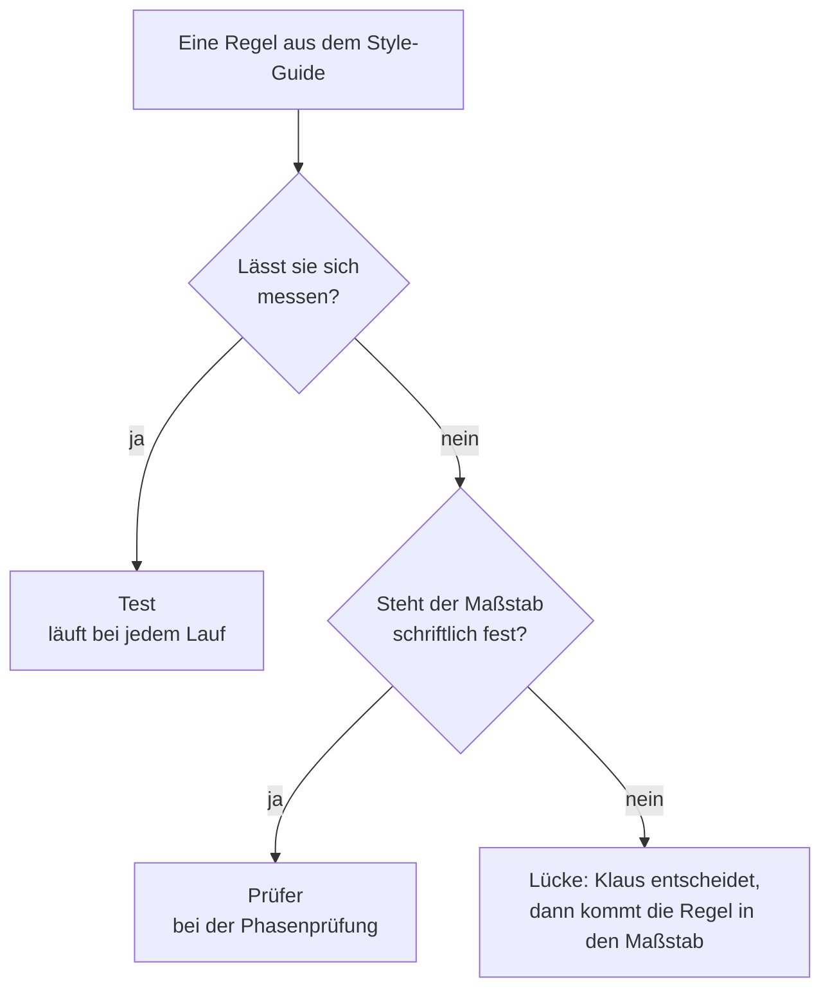
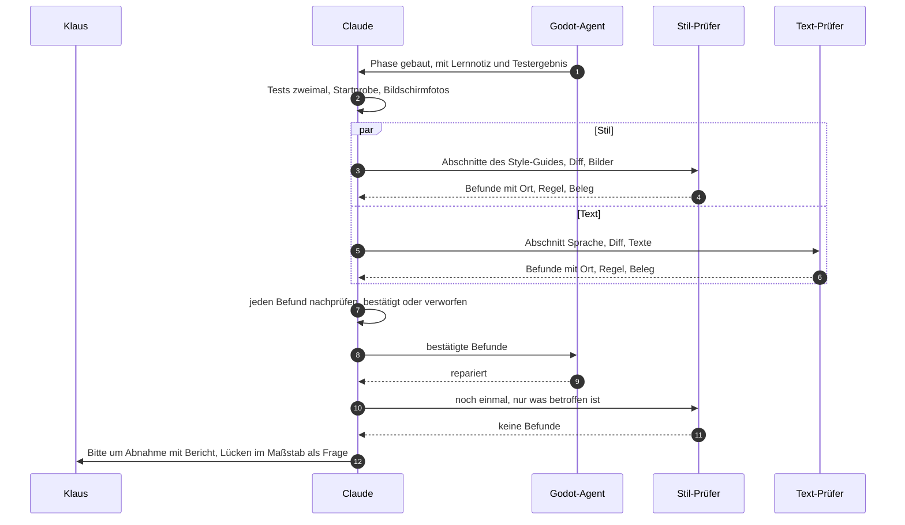
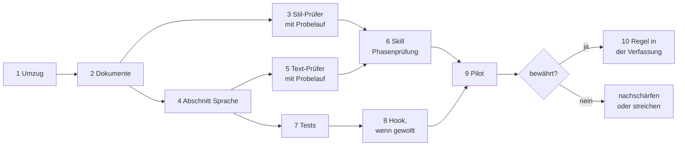

# Prüfen mit KI – Blaupause

Wie bei „Der Computerladen“ geprüft wird, bevor Klaus abnimmt: von Tests, von Claude und von
Prüf-Agents, die nur lesen. Wie [ki_dev.md](ki_dev.md) wächst die Datei mit dem Projekt: Regeln
stehen mit Grund da, Erfahrungen mit ihrem Anlass, Entscheidungen mit Datum und wer sie traf. Pflege
und Abgrenzung stehen im [Einstieg](README.md).

**Stand:** eingeführt. Begonnen am 2026-10-22, Pilot in Feature 004 am 2026-10-26; beide Prüfer
bleiben (Klaus). Offen ist nur die Regel in der Verfassung, siehe „Stand der Einführung“ unten.
Die Datei ist aus zwei Konzepten vom 2026-10-22 entstanden, die in ihr aufgegangen sind; die
Git-Geschichte behält sie (`docs/konzept-pruef-agents.md`, `docs/konzept-ki-workflow.md`).

## Grundsätze

1. **Einfach anfangen, erst erweitern, wenn es nachweislich hilft.** Warum: Das ist der Kern von
   Anthropics Artikel „Building effective agents“. Mehrere Agents sind teuer: Nach Anthropics
   Bericht über ihr Recherche-System mit mehreren Agents brauchen solche Systeme rund 15-mal so viele
   Tokens wie ein Chat, und Programmieren lässt sich schlechter aufteilen als Recherche.
2. **Nach Maßstab spezialisieren, nicht nach Rolle.** Ein Prüfer lohnt sich, wenn er etwas Eigenes
   mitbringt: einen schriftlichen Maßstab wie den Style-Guide und einen frischen Blick, unabhängig
   von dem, der gebaut hat. Warum: Ein „Senior-Reviewer“ ohne eigenen Maßstab urteilt nach
   Geschmack.
3. **Prüfer prüfen, der Godot-Agent baut.** Prüfer lesen nur und melden jeden Befund mit Ort, Regel
   und Beleg. Der Godot-Agent repariert, und Claude prüft jeden Befund nach, bevor Klaus ihn sieht.
   Warum: Wer baut, prüft nicht selbst, und auch Prüfer liegen mal daneben.
4. **Messbares prüft ein Test.** Ob ein Bild nur Farben der Palette nutzt, ob irgendwo „Sie“ steht
   oder ein Text zu lang ist, erkennt ein Skript zuverlässiger und billiger, bei jedem Lauf.
   KI-Prüfer urteilen nur, wo es ein Urteil braucht: Ton, Humor, Stimmigkeit, Treue zur Epoche.
5. **Feste Zeitpunkte statt Dauerprüfung:** am Ende jeder Phase, die Sichtbares oder Texte ändert,
   alle Prüfer gleichzeitig, ein gemeinsamer Bericht. Warum: So kostet die Prüfung wenig und liegt
   genau vor Klaus' Abnahme.
6. **Nachmessen.** Findet ein Prüfer über mehrere Phasen nichts, was die anderen übersehen, fliegt
   er raus. Findet eine Prüfung zweimal etwas, wird sie fest eingebaut (Pflege im
   [Einstieg](README.md)).

## Bausteine

| Baustein | Was er ist | Hier |
|---|---|---|
| Subagent (`.claude/agents/`) | eigener Kontext, eigene Werkzeuge, eigenes Modell; zurück kommt nur das Ergebnis | `godot-entwickler`, die Prüfer |
| Skill (`.claude/skills/`) | Anleitung, die bei Bedarf in die laufende Sitzung geladen wird | `dcl-komponente`, Spec Kit, die Phasenprüfung |
| Hook (`.claude/settings.json`) | Befehl, den Claude Code bei einem Ereignis immer ausführt, auch wenn niemand daran denkt | vorerst keiner; vorgemerkt: Tests, sobald der Godot-Agent fertig ist (Schritt 8) |
| Tests und Skripte | Code | alles Messbare |

Faustregel: Wer unabhängig urteilen soll, wird ein Subagent. Ein Ablauf, der immer gleich laufen
soll, wird ein Skill. Was jedes Mal passieren muss, wird ein Hook oder ein Test.

Was Claude Code dafür bietet, laut seiner Doku (Stand 2026-10-22:
[Subagents](https://code.claude.com/docs/en/sub-agents), [Hooks](https://code.claude.com/docs/en/hooks),
[Skills](https://code.claude.com/docs/en/skills)):
- **Werkzeuge:** `tools` in der Agent-Datei ist eine Positivliste. Ohne `Bash`, `Edit` und `Write`
  kann ein Agent nichts ändern, ohne `Agent` keine weiteren Agents starten. `model: inherit` nimmt
  das Modell der Sitzung.
- **Neue Dateien:** Neue oder geänderte Agents und Skills greifen nach wenigen Sekunden, ohne neue
  Sitzung, außer ihr Ordner fehlte beim Start der Sitzung. In der Desktop-App stimmt das für
  Agents nicht: Im Probelauf von Schritt 3 stand `stil-pruefer` in der laufenden Sitzung nicht
  bereit, wie `ki_dev.md` aus Erfahrung festhält (2026-10-22).
- **Gleichzeitig:** Mehrere Agents aus einer Nachricht laufen nebeneinander im Hintergrund. Ihre
  Ergebnisse kommen einzeln zurück.
- **Hook nach einem Agent:** `SubagentStop` mit dem Namen des Agents als Matcher, etwa
  `godot-entwickler`. Endet der Befehl mit Exit-Code 2, arbeitet der Agent weiter, und die
  Fehlermeldung wird seine nächste Anweisung. Zeitlimit 600 s, einstellbar.
- **Skill:** Klaus ruft ihn mit `/name` auf, Claude von selbst. Mit
  `disable-model-invocation: true` wird er ein Befehl nur für Klaus.

## Wer prüft was

| Wer | Wann | Was | Maßstab |
|---|---|---|---|
| Tests | bei jedem Lauf | alles Messbare, etwa Farben aus der Palette, Abstände aus dem Raster, kein „Sie“ | Werte aus dem Style-Guide, im Code |
| Claude | nach jeder Phase | Code, Tests zweimal, Startprobe, Bilder, feste Größen | Spec, Vertrag, `ki_dev.md` |
| Prüfer | am Ende einer Phase mit Sichtbarem oder Texten | was ein Urteil braucht, etwa ob der Ton zu „Das Amt“ passt | Style-Guide mit dem Abschnitt „Sprache“, später die game_bible |
| Klaus | bei der Abnahme | alles; er entscheidet, wo ein Maßstab eine Lücke hat | Spec und sein Urteil |

Ob eine Regel ein Test prüft oder ein Prüfer, entscheidet sich so:



Messbar ist etwa „nur Farben der Palette“ oder „kein Sie“. Ein Urteil braucht etwa die Frage, ob
eine Meldung so klingt wie in „Das Amt“.

## Die Prüfer

| Prüfer | Maßstab | Findet zum Beispiel | Messbares als Test | Stand |
|---|---|---|---|---|
| Stil | Style-Guide | weicher Schatten, der den VGA-Look bricht; Symbol in falscher Pixelgröße; Knopf ohne Hover-Zustand | nur Farben der Palette, ganzzahlige Skalierung, Schrift 10 oder 12 px | Schritt 3 |
| Text | Style-Guide, Abschnitt „Sprache“ | „Geben Sie …“; Preise in Euro im Jahr 1994; „googeln“, das es bis 1999 noch nicht gab; ein Ton, der nicht zu „Das Amt“ passt | kein „Sie“ oder „Ihnen“ in Bedienung, Hinweisen und Meldungen; jeder Text passt in sein Feld | Schritt 5 |
| Fakten | game_bible und Quellen | Pentium im Katalog schon 1991, obwohl er 1993 kam; Ereignis zu Windows 95 im Jahr 1994 | Daten im Ereigniskatalog stimmen mit der game_bible überein | später, wenn Katalog und game_bible wachsen |

Jeder Prüfer ist ein Subagent in `.claude/agents/`, etwa `stil-pruefer.md`:
- **Nur lesen:** `tools: Read, Grep, Glob`. So kann der Prüfer nichts kaputt machen.
- **Befund:** Ort (Datei und Node oder Bildausschnitt), Regel (Abschnitt im Maßstab), Beleg (was er
  sieht und was die Regel verlangt) und Schwere (kritisch, hoch, mittel, niedrig).
- **Lücke statt Fehler:** Regelt der Maßstab etwas nicht, meldet der Prüfer eine Lücke im Maßstab,
  keinen Fehler.
- **Keine Befunde:** Dann schreibt er das und welche Abschnitte er geprüft hat.
- **Steht ein Prüfer nicht bereit**, nimmt Claude einen allgemeinen Agent, der zuerst die Datei des
  Prüfers liest (`ki_dev.md`, „Aufträge an den Agent“).

Nicht vorgesehen:
- ein eigener Code-Prüfer, denn Code prüft Claude, und `/code-review` gibt es schon;
- Prüfer, die selbst reparieren;
- zwei Prüfer für dieselbe Frage, etwa einer für UX und einer für Stil, die beide das Layout
  beurteilen.

## Maßstäbe

- **Style-Guide:** Er liegt als Artifact vor, das ein Prüfer nicht selbst lesen kann. Claude gibt
  ihm die passenden Abschnitte mit. So bleibt der Style-Guide die einzige Quelle (Verfassung,
  Grundsatz IV).
- **Sprache:** ein Abschnitt im Style-Guide seit Schritt 4: Leitsätze zum Ton, Anrede, Zahlen und
  Geld, Wortschatz von 1985 bis 1999 mit Jahreszahlen, Beispiele. Klaus hat den Ort und den Ton
  entschieden (2026-10-22). Claude gibt den Abschnitt dem Text-Prüfer mit, wie dem Stil-Prüfer
  die seinen.
- **game_bible:** liegt im Repo, der Fakten-Prüfer liest sie selbst.
- **Lücken:** Regelt ein Maßstab etwas nicht, entscheidet Klaus. Erst kommt die Regel in den
  Maßstab, dann wird gebaut, wie es Grundsatz IV der Verfassung für den Style-Guide verlangt.

## Ablauf einer Phasenprüfung



1. Der Godot-Agent baut die Phase. Danach laufen Tests und Startprobe, zweimal.
2. Claude schlägt in `plan.md` unter „Prüfer je Phase“ nach, welche Prüfer für die Phase gelten.
3. Claude startet die Prüfer gleichzeitig, jeden mit seinem Maßstab, dem Diff und den
   Bildschirmfotos aus dem echten Fenster.
4. Claude prüft jeden Befund nach: bestätigt oder verworfen, mit Grund.
5. Bestätigte Befunde gehen an den Godot-Agent. Danach prüfen die betroffenen Prüfer noch einmal.
6. Lücken im Maßstab, etwa eine Frage, die der Style-Guide nicht regelt, gehen an Klaus.
7. Das Ergebnis steht in der Bitte um Abnahme unter „was geprüft ist“.

Der Skill `dcl-phasenpruefung` hält diesen Ablauf fest (Schritt 6). Klaus kann ihn auch selbst mit
`/dcl-phasenpruefung` aufrufen.

So sieht der Bericht aus, hier ausgedacht für ein späteres Feature „Ladenansicht“:

```
Phasenprüfung Phase 4, Ladenansicht (T031–T037)
Tests: 512 grün, zweimal gleich; Startprobe still
Stil-Prüfer: 3 Befunde, 2 bestätigt
  hoch       Knopf „Bestellen“ ohne Hover-Zustand (Oberfläche)
  niedrig    Preisschild 3 px vom Rand, kein Wert aus dem Raster (Oberfläche)
  verworfen  Schatten unter dem Tresen: in wenigen Stufen gesetzt, nicht weich (Szenen und Figuren)
Text-Prüfer: 2 Befunde, 2 bestätigt
  hoch       „Bitte wählen Sie eine Ware“ → „Wähl eine Ware“ (du-Form)
  mittel     „Das kostet 499 Euro“ im Jahr 1987 → „Das kostet 499,00 DM“ (Wortschatz, Zahlen)
Für dich: Der Style-Guide regelt Preisschilder noch nicht. Wie sollen sie aussehen?
```

Der verworfene Befund zeigt, warum Claude nachprüft: Auch Prüfer liegen mal daneben.

## Anbindung an Spec Kit

Spec Kit bleibt, wie es ist. Die Prüfer kommen an fünf Stellen dazu:

| Schritt | Was dazukommt |
|---|---|
| `/speckit-plan` | `plan.md` legt unter „Prüfer je Phase“ fest, welche Prüfer für welche Phase gelten. |
| `/speckit-checklist` | Text- und Stil-Prüfer lesen die Wortlaute und Zustände aus Spec und Vertrag gegen den Style-Guide, bevor gebaut wird (Klaus, 2026-10-27). Checklisten für Stil und Texte prüfen, ob die Spec Sichtbares und Texte genau genug beschreibt. |
| `/speckit-tasks` | Jede Phase mit Sichtbarem oder Texten endet mit der [C]-Aufgabe „Phasenprüfung“ vor Klaus' Abnahme. |
| `/speckit-analyze` | Eine fehlende Phasenprüfung ist kritisch, denn sie verstößt gegen Grundsatz VI der Verfassung. |
| `/speckit-converge` | Die Prüfer laufen bei der Lückensuche einmal über das ganze Feature. |

- Eine neue Rolle in `tasks.md` gibt es nicht. Die Prüfer arbeiten Claude zu, und die
  Phasenprüfung ist eine [C]-Aufgabe.
- Spec Kit steht auf 1.2.3 (2026-10-27). Seine eigenen Vorlagen unter `.specify/templates/`
  bleiben unverändert. Eigene Vorlagen liegen unter `.specify/templates/overrides/`: Die
  Aufgaben-Vorlage dort bringt die Aufgabe „Spielbeschreibung prüfen“ mit (`ki_dev.md`, Punkt 9)
  und ans Ende jeder Phase die Aufgabe „Phasenprüfung“ (Klaus, 2026-10-27); `/speckit-tasks` lässt
  sie weg, wo eine Phase nichts Sichtbares und keine Texte ändert. Den Abschnitt „Prüfer je Phase“
  schreibt Claude nach dieser Datei in den Plan. Die Regel steht in der Verfassung, Grundsatz VI,
  die alle fünf Schritte lesen (seit 2026-10-27). Ein Update von Spec Kit lässt `overrides/` stehen; geprüft wird das
  trotzdem (`ki_dev.md`, „Werkzeuge und Pfade“). Bis 2026-10-27 stand hier, die Vorlagen von Spec Kit 1.2.0 blieben
  unangetastet, weil ein Update sie überschreiben kann.

Beispiel, ein gedachtes Feature „Ladenansicht“ als erster echter Spielbildschirm. In `plan.md`:

| Phase | Ändert | Prüfer |
|---|---|---|
| 3: Kern der Ladenansicht | Daten, keine Oberfläche | keine |
| 4: Oberfläche der Ladenansicht | Szene, Knöpfe, Texte | Stil, Text |

In `tasks.md`:

```
- [ ] T037 [A] [US2] Texte der Ladenansicht in src/scenes/laden/laden_texte.gd
- [ ] T038 [C] Phasenprüfung Phase 4 mit /dcl-phasenpruefung: Stil- und Text-Prüfer, Befunde nachprüfen
- [ ] T039 [K] Abnahme Phase 4
```

## Tests

Schon gemessen wird:
- in `test_werkstatt_theme.gd`: Farben nur aus der Palette, Farbrollen wie im Style-Guide, eckige
  Kästen ohne Verlauf und Transparenz, Symbole in Farben der Palette, Abstände aus dem Raster,
  Relief, Fehlerkontur, Fokuslinie, Pixelschatten;
- in `test_ui_palette.gd`: die 15 Farben und die Kategorienfarben mit genug Kontrast.

Seit Schritt 7 dazu, gebaut vom Godot-Agent, jeder mit Fehlerprobe (2026-10-22):
- `test_bilder.gd`: Jede PNG-Datei in `src/assets/images/` ist Pixel für Pixel ganz durchsichtig
  oder ganz deckend in einer Farbe der Hauptpalette (`docs/art/hauptpalette.gpl`). Dazu: Die
  Palette hat 256 Farben, Index 0 ist Magenta für die Transparenz, Index 1 bis 15 sind die Farben
  aus `UiPalette`. Er heißt nicht `test_palette.gd`, damit ihn niemand mit `test_ui_palette.gd`
  verwechselt.
- `test_texte.gd`: kein „Sie“, „Ihnen“ oder „Ihr“ als Anrede in Szenen und Skripten unter
  `scenes/`, `tools/werkstatt/` und `core/`. Stellen, an denen „Sie“ die Mehrzahl meint, stehen
  mit Grund in der Liste `ERLAUBT`; ein eigener Test meldet Einträge, die es nicht mehr gibt.
  Später, mit der Reparatur nach Feature 003: Einzahl bei 1 („1 Tag“), Prozent mit Leerzeichen,
  jeder Text passt in sein Feld (Klaus, 2026-10-22).

Lernnotiz zu Schritt 7, Einzelheiten in den Doc-Kommentaren der beiden Tests:
- **Datei statt Resource:** `load("res://…png")` liefert die importierte Textur, die der Import
  verändert haben kann. `Image.load_from_file(ProjectSettings.globalize_path(…))` liest die
  PNG-Datei selbst; nur so prüft der Test, was wirklich im Repo liegt.
- **Rohdaten statt `get_pixel()`:** Das Bild wird nach `FORMAT_RGBA8` umgerechnet und mit
  `get_data()` als Bytes gelesen; die Farben der Palette stehen als Zahl in einem `Dictionary`.
  So kostet die Frage „gehört die Farbe dazu?“ einen `has()`-Aufruf je Pixel.
- **`\p{L}` statt `\b`:** Godots `RegEx` zählt bei `\b` Umlaute nicht als Buchstaben. Die
  Abgrenzung „kein Buchstabe davor und danach“ steht deshalb mit `\p{L}` da, damit „Ihringen“ kein
  Treffer ist.
- **Kleiner Leser statt Regex für Skripte:** Ein Regex allein hält `"#Farbe"` und `# "Sie"` nicht
  auseinander. Der Test geht den Quelltext Zeichen für Zeichen durch: `#` außerhalb einer
  Zeichenkette beendet die Zeile, `"` beginnt eine Zeichenkette.
- **Prüffunktionen mit Pfad:** Sie nehmen einen Pfad oder Text. So lief die Fehlerprobe mit
  denselben Funktionen an Kopien außerhalb des Repos, und die Tests brauchen keine Fixture-Dateien.

Es gelten die Regeln aus `ki_dev.md`, „Tests“. Dazu kommt: Alle Arbeitsordner teilen sich `user://`
von „Der Computerladen“, und die Tests schreiben in feste Unterordner wie `user://test_simulator/`.
Zwei Testläufe zur selben Zeit, etwa in zwei Sitzungen, können sich deshalb stören (erkannt am
2026-10-22, offen in `docs/offene-punkte.md`).

## Nachmessen

Ab dem ersten Probelauf zählt Claude je Prüfer und Phase: gemeldete, bestätigte und verworfene
Befunde, und wie viele davon nur dieser Prüfer fand. Die Zahlen kommen hierher. Nach dem Pilot
entscheidet Klaus, ob ein Prüfer bleibt, nachgeschärft oder gestrichen wird.

| Lauf | Prüfer | Befunde | bestätigt | verworfen | Lücken im Maßstab | nur er fand |
|---|---|---|---|---|---|---|
| Probelauf Feature 001, Titelbildschirm (2026-10-22) | Stil | 4 | 3 | 1 | 6, davon 1 verworfen | 3 |
| Probelauf Feature 001 und Werkstatt, rund 740 Texte und der Ereigniskatalog (2026-10-22) | Text | 13 | 10 | 3 | 7 | 10 |
| Pilot Feature 004, Phase 2, Kern Spielstand, 49 Texte (2026-10-26) | Text | 7 | 7, davon 1 als Widerspruch zum Vertrag | 0 | 6, davon 1 verworfen | 7 |
| Pilot Feature 004, Phase 2, Nachprüfung der 9 geänderten Texte (2026-10-26) | Text | 0 | 0 | 0 | 3, davon 1 schon bekannt | 0 |
| Pilot Feature 004, Phase 3, Spielablauf, 3 Meldungen und 9 Protokolltexte (2026-10-26) | Text | 1 | 1 | 0 | 4, davon 1 schon bekannt | 1 |
| Pilot Feature 004, Phase 3, Nachprüfung nach Klaus' Entscheidung zur Meldung (2026-10-26) | Text | 1 | 1 | 0 | 2, davon 1 schon bekannt | 1 |
| Pilot Feature 004, Phase 4, Hauptmenü, Gradwahl, Spielbildschirm, Knopf, Meldung (2026-10-26) | Stil | 0 | 0 | 0 | 2, dazu 2 schon bekannte bestätigt | 0 |
| Pilot Feature 004, Phase 4, 40 Texte der Blätter (2026-10-26) | Text | 1 | 1, durch Phase 5 erledigt | 0 | 4, davon 1 schon bekannt | 1 |
| Pilot Feature 004, Phase 4, Nachprüfung Lochrand und Abstand am Knopf (2026-10-26) | Stil | 0 | 0 | 0 | 0 | 0 |
| Pilot Feature 004, Phase 5, Liste, Löschmodus, Rückfrage, Meldung (2026-10-26) | Stil | 2 | 2, davon 1 als Widerspruch zum Vertrag | 0 | 5, davon 2 verworfen, 1 schon bekannt | 2 |
| Feature 005, Phase 2, Baustein Communicator und Probeszene (2026-10-27) | Stil | 2 | 2, davon 1 erst mit G-02 wirksam (T027) | 0 | 2 | 2 |
| Feature 005, Phase 3, Menü und Liste auf der Anzeige (2026-10-27) | Stil | 0 | 0 | 0 | 2 | 0 |
| Feature 005, Phase 4, Bilder G-02 und T-02 (2026-10-27) | Stil | 7 | 7, davon 3 von Klaus entschieden (Tastatur, Logo, Farbe) und 1 als seine Wahl bestätigt (Fenster unter dem Gerät) | 0 | 6 | 7 |
| Feature 005, Phase 5, Titel auf dem Communicator (2026-10-27) | Stil | 1 | 1, schon bekannt seit Feature 001 (Rand der Versionszeile) | 0 | 3, davon 1 von Klaus entschieden (Versionszeile oben rechts) | 1 |
| Feature 005, Phase 5, 43 Texte des Titels (2026-10-27) | Text | 0 | 0 | 0 | 0, 1 schon bekannt | 0 |
| Feature 005, Phase 5, Nachprüfung Versionszeile oben rechts (2026-10-27) | Stil | 0 | 0 | 0 | 3 | 0 |
| Feature 005, Phase 5, Nachprüfung Anzeige 320 × 160 und Gehäuse G-03 (2026-10-27) | Stil | 2 | 2 (Funktionstasten oliv statt mint, Tastensplitter an der Naht) | 0 | 4, davon 2 behoben (Rahmen ums LCD ungleich, Kontur in der Vorschau) | 2 |
| Feature 005, Abschluss T036 über das ganze Feature (2026-10-27) | Stil | 0 | 0 | 0 | 2, davon 1 verworfen (Lage des Hinweises in der Vorschau stimmt, 1 px Rahmen), 1 behoben | 0 |
| Pilot Feature 004, Phase 5, 23 Texte der Liste und Rückfrage (2026-10-26) | Text | 1 | 1 als Widerspruch zum Vertrag | 0 | 3, davon 1 verworfen, 1 schon bekannt | 1 |
| Pilot Feature 004, Phase 5, Nachprüfung nach der Reparatur (2026-10-26) | Stil | 0 | 0 | 0 | 1 | 0 |
| Pilot Feature 004, Phase 5, Nachprüfung der 6 geänderten Vorlagen (2026-10-26) | Text | 0 | 0 | 0 | 1, verworfen | 0 |
| Feature 004, Lückensuche über das ganze Feature (2026-10-26) | Stil | 1 | 1 als Widerspruch zum Vertrag | 0 | 4 | 1 |
| Feature 004, Lückensuche, 52 Texte (2026-10-26) | Text | 3 | 2 | 1 | 4, davon 1 verworfen | 2 |
| Feature 004, Phase 7, 2 neue Texte (2026-10-26) | Text | 0 | 0 | 0 | 0 | 0 |
| Feature 006, Checkliste, Vertrag Gehäusetasten und Spiel auf der Anzeige (2026-10-27) | Stil | 6 | 6, davon 3 schon von Claude gefunden | 0 | 9, davon 1 verworfen | 3 |
| Feature 006, Checkliste, 6 Wortlaute der Ergebnisanzeige (2026-10-27) | Text | 3 | 3 | 0 | 5, davon 1 nicht übernommen | 3 |
| Feature 006, Phase 4, Spielseite und Probeszene, 4 Fotos (2026-10-27) | Stil | 0 | 0 | 0 | 3 | 0 |
| Feature 006, Phase 4, 5 Texte der Spielseite (2026-10-27) | Text | 0 | 0 | 0 | 2 | 0 |
| Feature 006, Phase 5, Gehäusetasten und Easter Egg im Titel, 22 Fotos (2026-10-27) | Stil | 0 | 0 | 0 | 4, davon 1 verworfen (Pfad im Auftrag) | 0 |
| Feature 006, Lückensuche über das ganze Feature (2026-10-27) | Stil | 2 | 2 | 0 | 3 | 2 |
| Feature 006, Lückensuche, 14 Texte (2026-10-27) | Text | 0 | 0 | 0 | 4, davon 3 nicht übernommen | 0 |
| Feature 007, Checkliste, Vertrag der Zusammenfassung (2026-10-28) | Stil | 11 | 11 | 0 | 11, davon 1 ohne Folgen (Fenstertitel) | 11 |
| Feature 007, Checkliste, 31 Wortlaute der App, Protokoll und Abläufe (2026-10-28) | Text | 18 | 18 | 0 | 6 | 16 (2 meldete auch der Stil-Prüfer am Rande) |
| Feature 007, Phase 1, rund 115 Texte des Selbsttests und drei erwartete Protokolle (2026-10-28) | Text | 1 (im Vertrag, nicht im Code) | 1 | 0 | 4 | 1 |
| Feature 007, Phase 2, Fenstertitel, 7 Wortlaute der Schritte, Zustände des Fahrers, zwei echte Protokolle (2026-10-28) | Text | 6 | 6, davon 3 im Vertrag (Klaus: angleichen) | 0 | 4, davon 2 verworfen | 6 |
| Feature 007, Phase 2, Nachprüfung des Geänderten (2026-10-28) | Text | 1 | 1 (Vertrag ergänzt, im Sinn von Klaus' Angleichen) | 0 | 0 | 1 |
| Feature 007, Phase 3, 31 Schritte (93 Werte), rund 85 neue Texte, Literale der Abläufe (2026-10-28) | Text | 19 | 19, davon 8 mit Änderung am Vertrag (Klaus: angleichen) | 0 | 7 | 19 |
| Feature 007, Phase 3, Nachprüfung des Geänderten (2026-10-28) | Text | 7 | 7, davon 3 im Vertrag oder Datenmodell | 0 | 1 (Form der Beschreibung, von Claude in den Vertrag) | 7 |
| Feature 006, Phase 7, Nachprüfung des Geänderten (2026-10-28) | Stil | 1 | 1 | 0 | 3 | 1 |
| Feature 006, Phase 7, 24 Testmeldungen und 6 Stellen Doku (2026-10-28) | Text | 0 | 0 | 0 | 1 | 0 |

„Nur er fand“ heißt: Claudes eigene Prüfung hatte es nicht gefunden. Bei den Probeläufen an
Feature 001 war das Feature schon abgenommen. Die Befunde und Lücken stehen in `docs/offene-punkte.md`.

**Auswertung des Pilots in Feature 004** (Phasen 2 bis 5, 2026-10-26), ohne die Lückensuche:

| Prüfer | Läufe | Befunde | bestätigt | davon Widerspruch zum Vertrag | verworfen | nur er fand | Lücken gemeldet |
|---|---|---|---|---|---|---|---|
| Text | 7 | 11 | 11 | 2 | 0 | 11 | 23 |
| Stil | 4 | 2 | 2 | 1 | 0 | 2 | 8 |

Jeder bestätigte Befund war einer, den Claudes eigene Prüfung nicht gefunden hatte. Kein Befund war
falsch. Drei standen so im Vertrag, den Claude geschrieben hatte. Die Lücken wiederholen sich:
„schon bekannt“ kam in fünf Läufen vor.

Jede Phasenprüfung kostet zwei bis drei Prüfer-Läufe und läuft nur in Phasen, die Sichtbares oder
Texte ändern. Sitzt der Ablauf, lässt er sich als gespeicherter Workflow fest einrichten.

## Stand der Einführung



Jeder Schritt endet mit Klaus' Abnahme und einem Commit.

| Nr. | Schritt | Wer | Stand |
|---|---|---|---|
| 1 | Umzug nach `docs/ki_workflow/` | [C] | erledigt, 2026-10-22 |
| 2 | Einstieg und diese Datei, mit Schaubildern | [C] | erledigt, 2026-10-22 |
| 3 | Stil-Prüfer mit Probelauf an Titelbildschirm, Hauptmenü und Hinweis aus Feature 001; dabei klärt sich, ob ein neuer Agent ohne neue Sitzung bereitsteht und Bildschirmfotos lesen kann | [C] | erledigt, 2026-10-22 |
| 4 | Abschnitt „Sprache“ im Style-Guide | [C] schreibt, [K] entscheidet den Ton | erledigt, 2026-10-22 |
| 5 | Text-Prüfer mit Probelauf an den Texten von Feature 001 und der Werkstatt | [C] | erledigt, 2026-10-22 |
| 6 | Skill `dcl-phasenpruefung` mit den Hilfsskripten für Bildschirmfotos und Textliste | [C] | erledigt, 2026-10-22 |
| 7 | Tests `test_bilder.gd` und `test_texte.gd` | [A] | erledigt, 2026-10-22 |
| 8 | Hook, wenn gewollt: Tests laufen von selbst, sobald der Godot-Agent fertig ist | [C] | entfällt vorerst (Klaus, 2026-10-22); kommt, wenn der Agent zweimal rote Tests abliefert, ohne es zu melden |
| 9 | Pilot in einer echten Phase mit Sichtbarem oder Texten, mit Zählung | [C] | erledigt in Feature 004, Phasen 2 bis 5, 2026-10-26; die Prüfer bleiben (Klaus) |
| 10 | Regel in die Verfassung über `/speckit-constitution` | [K] beschließt | erledigt: Grundsatz VI, Verfassung 2.2.0, Klaus, 2026-10-27 |

## Erfahrungen

Jeder Punkt kommt mit seinem Anlass dazu, etwa aus einem Probelauf oder dem Pilot.

- **Ein neuer Prüfer braucht eine neue Sitzung.** Bis dahin liest ein allgemeiner Agent die Datei
  des Prüfers und hält sich daran. Er hat dabei alle Werkzeuge; „nur lesen“ steht deshalb
  ausdrücklich im Auftrag. Bildschirmfotos konnte er sehen. Anlass: Probelauf in Schritt 3
  (2026-10-22).
- **Den Maßstab vollständig mitgeben, auch was ein Abschnitt nur verweist.** Der Baustein Menü
  sagt „Lochränder wie beim Bildrahmen“; ohne den Baustein Bildrahmen meldete der Prüfer eine
  Lücke, die keine war. Anlass: Probelauf in Schritt 3 (2026-10-22).
- **Was im Vertrag steht, aber nicht im Style-Guide, findet der Prüfer.** Zwei der drei
  bestätigten Befunde standen so im Vertrag von Feature 001: Ränder nach dem Titelscreen-Entwurf
  und ein Textschatten von 1 px. Claudes Prüfung hatte gegen den Vertrag geprüft, der Prüfer prüft
  gegen den Style-Guide. Anlass: Probelauf in Schritt 3 (2026-10-22).
- **Viele Texte als Liste übergeben.** Für den Text-Prüfer zog ein Skript die sichtbaren Texte
  mit Datei und Zeile aus rund 9.300 Zeilen Code; den Zusammenhang las er an der Stelle nach. So
  schaffte er rund 740 Texte in einem Lauf. Anlass: Probelauf in Schritt 5 (2026-10-22).
- **Ein Teil der Textbefunde ist messbar.** „1 Tage“ und „1 Spiele“, „-30%“ statt „−30 %“: Das
  findet auch ein Test, der Texte mit Zahlen erzeugt. Kandidaten für `test_texte.gd`. Anlass:
  Probelauf in Schritt 5 (2026-10-22).
- **Die Prüfer finden, was Claude übersieht.** Im Pilot waren alle 13 bestätigten Befunde neu für
  Claude, keiner war falsch. Anlass: Pilot Feature 004 (2026-10-26).
- **Verträge enthalten Stilfehler.** 3 der 13 Befunde standen so im Vertrag, den Claude geschrieben
  hatte. Wortlaute und Zustände im Vertrag schon vor dem Bau gegen den Style-Guide lesen lassen,
  etwa mit dem Text-Prüfer über den Abschnitt „Texte“ bei der Checkliste. Anlass: Pilot Feature
  004, Phasen 2 und 5 (2026-10-26). Seit 2026-10-27 eine Regel, siehe „Anbindung an Spec Kit“
  (Klaus).
- **Der Auftrag nennt Umfang und Maßstab, keine eigene Einschätzung.** In Phase 2 stand „Seed
  eingeführt“ im Auftrag, und der Prüfer übernahm diese Sicht. Anlass: Pilot Feature 004, Phase 2
  (2026-10-26).
- **Der Stil-Prüfer findet auch Verhalten, nicht nur Pixel.** Die Meldung, die beim Scrollen neben
  dem falschen Spielstand stand, las er aus dem Code. Maße messen die Tests, Zustände sieht der
  Prüfer. Anlass: Pilot Feature 004, Phase 5 (2026-10-26).
- **Lücken gleich vorlegen.** 31 Lücken kamen im Pilot, fünfmal „schon bekannt“. Eine Lücke geht
  mit Empfehlung gleich an Klaus, statt bis zur Lückensuche liegen zu bleiben. Anlass: Pilot
  Feature 004 (2026-10-26).

## Offen

Der Pilot ist ausgewertet: Beide Prüfer bleiben, für jede Phase mit Sichtbarem oder Texten, auch
in Werkzeugen (Klaus, 2026-10-26). Seit 2026-10-27 steht die Regel in der Verfassung, Grundsatz
VI. Zur Einführung ist nichts mehr offen.
