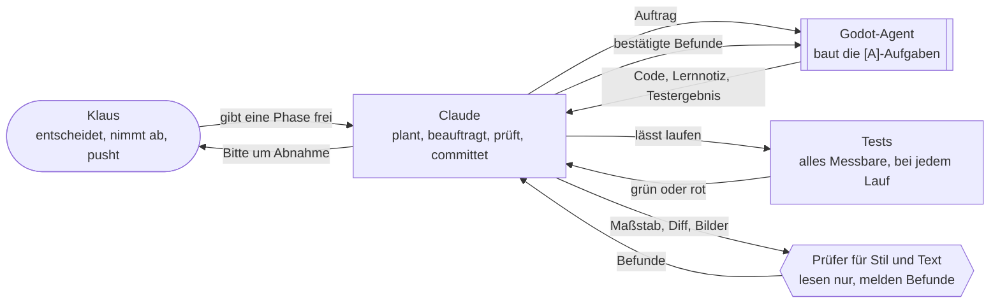
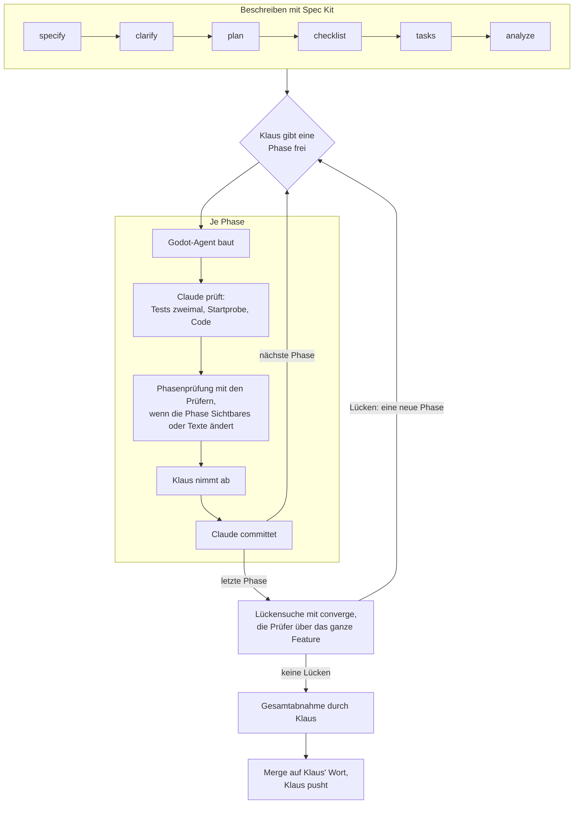
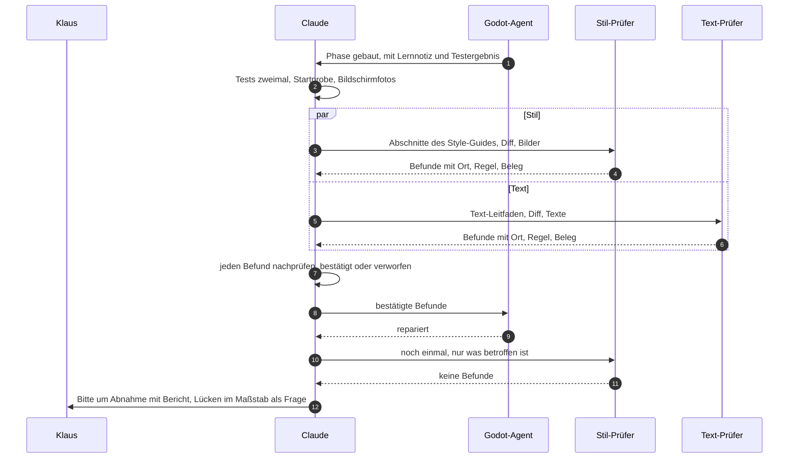
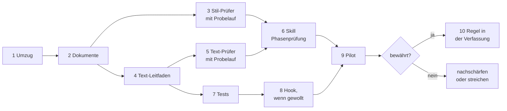

# Konzept: KI-Workflow in einem eigenen Ordner

**Stand:** 2026-10-22, Konzept, nicht umgesetzt. Am Tag des
[Konzepts für Prüf-Agents](konzept-pruef-agents.md) wünscht sich Klaus dreierlei:
- den ganzen Ablauf der Prüfung in einem sauberen Dokument wie `ki_dev.md`;
- Schaubilder, gern mit Mermaid;
- `ki_dev.md` und alles, was zur Arbeitsweise gehört, in einem eigenen Ordner.

Das Konzept für Prüf-Agents gilt weiter, mit seinen Grundsätzen, Prüfern und Beispielen. Dieses
Konzept ergänzt, wie alles dokumentiert wird und in welcher Reihenfolge es entsteht. Was sich
gegenüber dem ersten Konzept ändert, steht in einem eigenen Abschnitt.

**Kurz:** Alles zur Arbeitsweise kommt nach `docs/ki_workflow/`: ein kurzer Einstieg, `ki_dev.md`
wie bisher und neu `ki_pruefung.md` für die Prüfung. Fünf Schaubilder in Mermaid zeigen die
Abläufe. Gebaut wird in zehn kleinen Schritten, jeder mit Klaus' Abnahme und einem Commit.

## Der Ordner

```
docs/ki_workflow/
├── README.md        Einstieg: wer was macht, was wo steht, Pflege
├── ki_dev.md        Entwickeln mit KI: umgezogen, Inhalt wie bisher, dazu ein Schaubild
└── ki_pruefung.md   Prüfen mit KI, neu: Phasenprüfung, Prüfer, Maßstäbe, Tests, Einführung
```

- Den Namen `ki_workflow` hat Klaus vorgeschlagen; er passt zu `ki_dev.md`. Die Datei `ki_dev.md`
  behält ihren Namen, `ki_pruefung.md` ist ihr Gegenstück.
- `README.md` zeigt GitHub gleich unter der Dateiliste des Ordners. Der Einstieg übernimmt aus
  `ki_dev.md` die Teile, die für den ganzen Ordner gelten: Pflege, Abgrenzung und „Kein lokales
  Gedächtnis“.
- Die beiden Konzepte gehen in `ki_pruefung.md` auf und werden danach gelöscht. Die
  Git-Geschichte behält sie.

Draußen bleiben:

| Was | Warum |
|---|---|
| `docs/offene-punkte.md` | Arbeitsliste des ganzen Projekts, in die jede Feature-Sitzung schreibt, gerade auch die von Feature 003. Ein Umzug käme ihr in die Quere. |
| `docs/Ideensammlung.md` | vor allem Ideen fürs Spiel |
| Text-Leitfaden | Maßstab für die Texte des Spiels, so wie der Style-Guide für die Bilder. Er gehört zum Spiel, nicht zur Arbeitsweise. |
| `.claude/agents/`, `.claude/skills/` | Dort sucht Claude Code sie. Die Dokumente beschreiben sie und verlinken dorthin. |

### Verweise auf `ki_dev.md`

| Wo | Was geschieht |
|---|---|
| `CLAUDE.md`, „Arbeitsweise“ und Tabelle „Aufbau“ | neuer Pfad `docs/ki_workflow/`. `CLAUDE.md` ändert sich nur auf Klaus' Beschluss. Gibt er dieses Konzept frei, beschließt er genau diese zwei Stellen. |
| `docs/offene-punkte.md`, Kopf | neuer Pfad. Ältere Einträge bleiben, wie sie sind: Sie halten fest, was damals galt. |
| `docs/Ideensammlung.md`, Eintrag vom 2026-10-22 | neuer Pfad, Link auf `ki_pruefung.md` statt aufs Konzept |
| `specs/002-zeitleisten-werkstatt/` | bleibt: Das Feature ist abgeschlossen. |
| `specs/003-schwierigkeitsgrade/` | sieben Stellen in vier Dateien. Sie gehören der Sitzung von Feature 003, diese Sitzung fasst sie nicht an. Nach dem Merge zieht jene Sitzung die Pfade nach, oder sie bleiben wie bei 002 als Stand von damals. |

Der Umzug kommt als eigener Commit, in dem sich am Inhalt von `ki_dev.md` nichts ändert. So zeigt
der Diff klar, was Umzug ist und was neu. Auch danach ändert sich `ki_dev.md` nur wenig. Dann
erkennt Git den Umzug auch beim Merge, selbst wenn die Sitzung von Feature 003 inzwischen etwas in
`ki_dev.md` ergänzt hat.

## Die Dokumente

### `README.md`: der Einstieg

- Wozu der Ordner da ist: wie Klaus, Claude und die Agents zusammenarbeiten, gedacht als Vorlage
  für spätere Projekte.
- Schaubild „Wer macht was“.
- Tabelle „Was steht wo“: die Dateien im Ordner, `CLAUDE.md`, die Verfassung, `offene-punkte.md`,
  die Ideensammlung, die Agents und die Skills.
- Pflege und „Kein lokales Gedächtnis“ aus `ki_dev.md`, weil sie für den ganzen Ordner gelten.

### `ki_dev.md`: Entwickeln mit KI

Der Inhalt bleibt. Dazu kommen:
- in „Ablauf je Feature“ das Schaubild „Der Weg eines Features“;
- in „Prüfen, bevor Klaus es sieht“ ein Verweis auf `ki_pruefung.md`.

### `ki_pruefung.md`: Prüfen mit KI

Aufgebaut wie `ki_dev.md`: Regeln mit Grund, Erfahrungen mit Anlass, Entscheidungen mit Datum und
wer sie traf. Der Inhalt kommt aus den beiden Konzepten.

| Abschnitt | Inhalt | Schaubild |
|---|---|---|
| Grundsätze | die sechs aus dem ersten Konzept, jeder mit Warum | |
| Wer prüft was | Tests, Prüfer, Claude und Klaus | „Test oder Prüfer?“ |
| Die Prüfer | Stil, Text, später Fakten: Maßstab, Datei, Form der Befunde | |
| Maßstäbe | Style-Guide, Text-Leitfaden, game_bible; wie ein Prüfer sie bekommt | |
| Ablauf einer Phasenprüfung | die sieben Schritte und der Bericht | „Ablauf einer Phasenprüfung“ |
| Anbindung an Spec Kit | was bei Plan, Checkliste, Tasks, Analyse und Lückensuche dazukommt | |
| Tests | was schon gemessen wird, was dazukommt | |
| Nachmessen | bestätigte und verworfene Befunde je Prüfer; wann ein Prüfer geht | |
| Stand der Einführung | die zehn Schritte unten, abgehakt | „Einführung in Stufen“ |
| Erfahrungen | wächst mit, jeder Punkt mit Anlass | |
| Offen | | |

## Schaubilder mit Mermaid

Mermaid ist eine Schreibweise für Schaubilder als Text. Aus der Zeile `Claude --> Agent` zeichnet
GitHub zwei Kästen mit einem Pfeil dazwischen.
- Die Schaubilder stehen als Text in der Datei. Git zeigt jede Änderung, und Claude pflegt sie wie
  den Text daneben.
- GitHub und Obsidian zeichnen sie. Ein Editor ohne Mermaid zeigt den Text: lesbar, aber ohne Bild.
- Eigene Farben gibt es nicht, denn sie sähen im hellen und im dunklen Modus verschieden aus. Wer
  handelt, steht im Kasten.

| Schaubild | Wo | Art |
|---|---|---|
| Wer macht was | `README.md` | Kästen und Pfeile |
| Der Weg eines Features | `ki_dev.md`, „Ablauf je Feature“ | Ablauf |
| Ablauf einer Phasenprüfung | `ki_pruefung.md` | Sequenz: wer wem was übergibt, von oben nach unten |
| Test oder Prüfer? | `ki_pruefung.md` | Entscheidung |
| Einführung in Stufen | `ki_pruefung.md` | Ablauf, wie unten unter „Reihenfolge“ |

Drei davon als Entwurf:

### Wer macht was



### Der Weg eines Features



### Ablauf einer Phasenprüfung



## Reihenfolge

Jeder Schritt endet mit Klaus' Abnahme und einem Commit. Die Schritte 1 und 2 legt Claude
zusammen vor, als zwei Commits.



| Nr. | Schritt | Wer | Ergebnis | Abnahme |
|---|---|---|---|---|
| 1 | Umzug | [C] | `docs/ki_workflow/ki_dev.md`, Verweise angepasst | Diff; die Suche nach dem alten Pfad findet nur, was bleiben soll |
| 2 | Dokumente | [C] | `README.md` und `ki_pruefung.md` mit den fünf Schaubildern; die Konzepte gehen darin auf | lesen, die Schaubilder gezeichnet ansehen |
| 3 | Stil-Prüfer mit Probelauf | [C] | `.claude/agents/stil-pruefer.md` und ein Bericht über Titelbildschirm, Hauptmenü und Hinweis aus Feature 001 | Bericht mit bestätigten und verworfenen Befunden. Was davon repariert wird, entscheidet Klaus, in einem eigenen Schritt. |
| 4 | Text-Leitfaden | [C] schreibt, [K] entscheidet den Ton | du-Form, Ton, Wortschatz 1985–1999, Glossar | Ton und Beispiele |
| 5 | Text-Prüfer mit Probelauf | [C] | `.claude/agents/text-pruefer.md` und ein Bericht über die Texte von Feature 001 und der Werkstatt | Bericht |
| 6 | Skill Phasenprüfung | [C] | `.claude/skills/dcl-phasenpruefung/` | `/dcl-phasenpruefung` einmal selbst aufrufen |
| 7 | Tests | [A] | Bilder in `src/assets/images/` nur in der Hauptpalette; kein „Sie“ in Texten; beides mit Fehlerprobe | Testlauf, Lernnotiz |
| 8 | Hook, wenn gewollt | [C] | Tests laufen von selbst, sobald der Godot-Agent fertig ist | ein Lauf, der mit Absicht rot ist |
| 9 | Pilot | [C] | eine echte Phase mit Sichtbarem oder Texten, mit Zählung der Befunde | behalten, nachschärfen oder streichen |
| 10 | Regel in die Verfassung | [K] beschließt | über `/speckit-constitution`, Version 2.2.0 | Beschluss |

## Gegenüber dem ersten Konzept

- **Dokumentation:** Die Regeln stehen in `ki_pruefung.md` im Ordner `docs/ki_workflow/`, mit
  Schaubildern, statt in einem Konzept (Klaus, 2026-10-22).
- **Stil-Prüfer zuerst, mit Probelauf:** Sein Maßstab, der Style-Guide, steht schon, der des
  Text-Prüfers noch nicht. Ein Probelauf am fertigen Feature 001 zeigt mit wenig Aufwand, ob ein
  Prüfer etwas findet, das Claudes Prüfung übersehen hat. Das kommt vor der Arbeit an Leitfaden
  und Skill und folgt dem ersten Grundsatz: einfach anfangen, erst erweitern, wenn es nachweislich
  hilft.
- **Spec Kit ohne Eingriff in die Vorlagen:** Die Vorlagen unter `.specify/templates/` stammen
  unverändert aus Spec Kit 1.2.0, und ein Update kann sie überschreiben. Die Phasenprüfung steht
  deshalb erst im Ablauf von `ki_dev.md` und nach dem Pilot als Regel in der Verfassung. Die
  Verfassung lesen `/speckit-plan`, `/speckit-checklist`, `/speckit-tasks`, `/speckit-analyze` und
  `/speckit-converge` ohnehin, und die Analyse stuft jeden Verstoß als kritisch ein. Den Abschnitt
  „Prüfer je Phase“ schreibt Claude in jeden Plan, ohne dass die Vorlage ihn vorgibt.
- **Messbares wird zum Teil schon gemessen:** `test_werkstatt_theme.gd` prüft Farben, Raster,
  Relief, Fokus und Schatten der Werkstatt, `test_ui_palette.gd` die 15 Farben. Neu braucht es nur
  Tests für die Bilder und die Texte. Der Bildertest heißt besser `test_bilder.gd` statt
  `test_palette.gd`, damit er nicht mit `test_ui_palette.gd` verwechselt wird.

## Offene Fragen

In der Reihenfolge, in der sie dran sind. Jede kommt einzeln, mit Empfehlung.

| Vor Schritt | Frage | Empfehlung |
|---|---|---|
| 4 | Steht der Text-Leitfaden als Abschnitt im Style-Guide oder als eigene Datei? | Abschnitt „Sprache“ im Style-Guide. Dort stehen schon die du-Form, kurze Sätze und Begriffe der Zeit, und nach Grundsatz IV der Verfassung ist der Style-Guide die einzige Quelle für alles Sichtbare. Den Abschnitt gibt Claude dem Text-Prüfer mit, wie dem Stil-Prüfer den seinen. |
| 8 | Startet ein Hook die Tests, sobald der Godot-Agent fertig ist? | Die Empfehlung folgt, wenn geklärt ist, was Hooks in Claude Code genau können. Zu bedenken: Alle Arbeitsordner teilen sich `user://` von „Der Computerladen“, und die Tests schreiben in feste Unterordner wie `user://test_simulator/`. Zwei Testläufe zur selben Zeit, etwa hier und in der Sitzung von Feature 003, können sich stören, und ein Hook, der von selbst testet, macht das wahrscheinlicher. |
| 9 | Ab wann gelten die Prüfer? | Ab dem Pilot für jede Phase mit Sichtbarem oder Texten, auch in Werkzeugen. Bis zum ersten Spielbildschirm dauert es noch, und für Werkzeuge hat der Style-Guide einen eigenen Abschnitt als Maßstab. |
| erstem Merge | Wohin wird gemergt? | nach `main`, sobald Feature 003 dort angekommen ist. So ändert sich für die Sitzung von Feature 003 mitten in der Arbeit nichts. |
