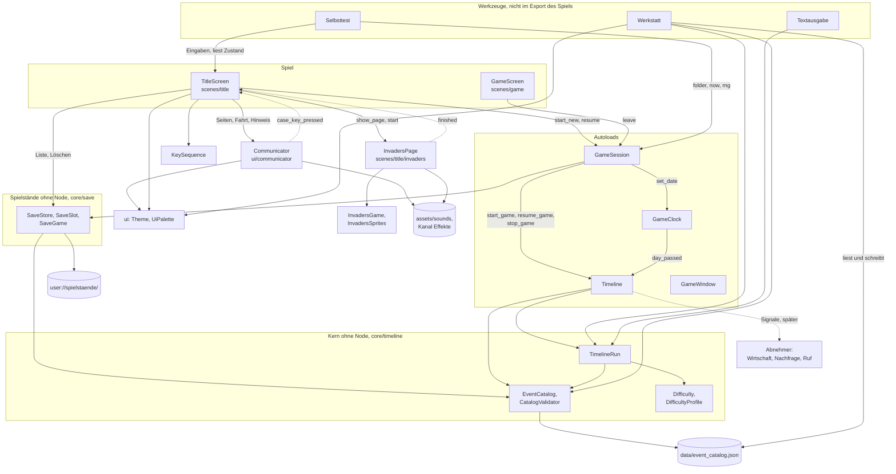

# Architektur

- **Worum es geht:** wie das Godot-Projekt aufgebaut ist, welche Teile es gibt und wer wen kennt.
- **Laden, wenn:** eine Arbeit mehrere Systeme berührt, neue Dateien, Autoloads oder Systeme
  dazukommen, oder ein System an ein anderes angebunden wird.
- **Code:** `src/project.godot`, `src/core/`, `src/scenes/`, `src/ui/`, `src/tools/`
- **Herkunft:** Pläne von `specs/001-hauptmenue/` bis `specs/009-renderer-compatibility/`,
  Verfassung `.specify/memory/constitution.md`, Architektur-Leitfaden
  `docs/architektur-leitfaden.md`
- **Stand:** Feature 009, 2026-10-29

## Das Spiel in einem Absatz

„Der Computerladen“ ist eine Wirtschaftssimulation mit Point-and-Click-Adventure: Der Spieler
betreibt von 1985 bis 1999 einen Computerladen in Deutschland. Die Vision steht in
`docs/game_design.md`. Gebaut sind bisher der Start bis zum Hauptmenü (Feature 001), die
Zeitleiste mit ihrer Werkstatt (002), die Schwierigkeitsgrade der Zeitleiste (003), das
Beginnen, Speichern und Fortsetzen von Spielen (004) und der Communicator, ein Taschengerät als
Steuerelement, auf dem heute das Menü des Titels läuft (005). Feature 006 brachte die ersten Töne
und ein Easter Egg: Drei Gehäusetasten des Communicators starten im Titel ein verstecktes Spiel auf
seiner Anzeige. Feature 007 brachte die Exporte für Windows und Linux und den Selbsttest, eine
eigene App, die den Titel von selbst durchspielt. Feature 008 brachte keine Spielfunktion, sondern
den Architektur-Leitfaden mit Prüfer und Tests und baute den Bestand danach um. Feature 009 stellte
den Renderer auf Compatibility um, damit das Spiel auch auf älteren Windows-Rechnern startet. Der Spielbildschirm
ist noch leer: Die Uhr steht, Wirtschaft und Laden gibt es noch nicht.

## Ordner

| Pfad | Inhalt |
|---|---|
| `src/` | Godot-Projekt; Projekt-Root ist `src/`, nicht das Repo-Root |
| `src/core/` | Systeme mit Autoloads: `game_date`, `game_clock`, `timeline`, `game_window`, `game_session` |
| `src/core/save/` | Spielstände ohne Node: `SaveGame`, `SaveSlot`, `SaveStore` |
| `src/core/timeline/` | Kern der Zeitleiste ohne Node: Datenklassen, Katalog, Prüfung, Lauf, Vergleich, Statistik, Grade |
| `src/data/` | Spieldaten: `event_catalog.json` |
| `src/scenes/` | Szenen des Spiels: `title/` (Titelbildschirm und seine Seiten), `game/` (Spielbildschirm) |
| `src/scenes/title/invaders/` | das versteckte Spiel: Kern `InvadersGame`, Muster `InvadersSprites`, Seite `InvadersPage` |
| `src/ui/` | für alle Szenen: Theme, Farben, Baustein Knopf, Baustein Communicator mit Gehäusetasten (`communicator/`) |
| `src/assets/` | Schriften, gerasterte Bilder, App-Symbol, Töne (`sounds/`) |
| `src/default_bus_layout.tres` | Tonkanäle `Master` und `Effekte`; Godot lädt die Datei von selbst |
| `src/tools/werkstatt/` | Zeitleisten-Werkstatt; nicht im Export des Spiels |
| `src/tools/selbsttest/` | Selbsttest-App: Startszene, Läufer, Fahrer, Eingabe, Protokoll, Zusammenfassung, `ablaeufe/`, `szenarien/`; nur im Export des Selbsttests |
| `src/test/` | GUT-Tests und `fixtures/` |
| `tools/raster/` | Python-Werkzeuge für Bilder, außerhalb von Godot |
| `tools/ton/` | `make_sounds.py`: erzeugt alle Töne, außerhalb von Godot |
| `tools/selbsttest/` | `vergleich.py`: Fotos eines Selbsttest-Laufs gegen die Referenzbilder in `referenz/macos/` |
| `tools/build/` | `baue_alles.sh`: baut alle sechs Presets, prüft auf Testcode, packt je System ein Zip |
| `tools/godot_referenz/` | `erzeuge.sh`: Klassenreferenz der installierten Godot nach `godot_referenz/klassen/`, nicht im Repo |
| `docs/` | Vision (`game_design.md`), Spielinhalt (`game_bible/`), Bauplan (`features/`), Architektur-Leitfaden (`architektur-leitfaden.md`), diese Beschreibung, Arbeitsweise (`ki_workflow/`) |
| `specs/NNN-*/` | Spec Kit je Feature: Spec, Plan, Datenmodell, Verträge, Recherche, Aufgaben, Lernnotizen |

## Wer wen kennt

Gestrichelt sind Signale. Der Communicator kennt weder den Titel noch die Seite des Spiels; er
meldet nur Gehäusetasten. Das Spiel kennt weder `GameSession` noch Spielstände.

Autoloads in `project.godot`, in dieser Reihenfolge: `GameClock`, `Timeline`, `GameWindow`,
`GameSession`.
Hauptszene ist `res://scenes/title/title_screen.tscn`. Mit dem Feature-Tag `selbsttest`, den nur die
Selbsttest-Presets setzen, ersetzen Overrides mit Punkt (`run/main_scene.selbsttest`,
`config/name.selbsttest`) Hauptszene und Namen; so startet die gebaute App in
`tools/selbsttest/selbsttest_start.tscn` mit eigenem Datenordner, ohne dass das Spiel davon weiß
(siehe [selbsttest.md](selbsttest.md)).

## Grundsätze

Verbindlich stehen sie im Architektur-Leitfaden `docs/architektur-leitfaden.md`: Regeln AR-01 bis
AR-20, je mit Grund, Beispiel aus dem Code, Prüfweise und Stand, dazu die Muster und die Tabelle
der begründeten Ausnahmen. Hier die Kurzfassung mit den Nummern:

- **Kern ohne Node, Hülle als Autoload (AR-01).** Logik steckt in `RefCounted`-Klassen, die weder
  Szenenbaum noch Uhr brauchen. So laufen sie gleich im Spiel, in Werkzeugen und in Tests. Das
  Autoload verbindet nur und macht Signale daraus. Ebenso `KeySequence` und `InvadersGame`: Die
  Hülle ist dort der Titel und die Seite `InvadersPage`.
- **Melden statt anwenden (AR-06, AR-02).** Die Zeitleiste meldet Ereignisse und Wirkungen; was
  daraus folgt, entscheidet das System, das zuhört. Systeme sind über Signale entkoppelt, nicht über
  direkte Aufrufe. Ein Baustein meldet nach oben per Signal, wer ihn einsetzt, ruft ihn direkt auf;
  kein Skript greift über `get_parent()`, `../` oder `/root/` nach oben.
- **Wiederholbar (AR-08).** Katalog, Seed, Grad und Eingriffe legen ein Spiel vollständig fest.
  Jeder Zufall kommt aus einem eigenen `RandomNumberGenerator`, nie aus Godots globalem Würfel.
  Spielstände bauen darauf, statt den ganzen Zustand zu speichern (siehe
  [spielstaende.md](spielstaende.md)).
- **Daten statt Code (AR-04).** Ereignisse und Profile stehen in der Katalogdatei und werden in der
  Werkstatt gepflegt; Menüeinträge sind `MenuEntry`-Resources; Texte des Titels stehen an einer
  Stelle (`TitleTexts`); Farben heißen über Tokens; Töne entstehen aus einem Skript, nicht aus
  fremden Quellen.
- **Ein Look (Style-Guide).** Der Style-Guide ist die einzige Quelle für Farben, Raster, Schriften
  und Sprache. Texte duzen den Spieler.
- **Nur Desktop (Verfassung, Grundsatz I).** Maus und Tastatur, Renderer Compatibility (bis
  2026-10-29 Forward+).

**Kern, Hülle und Helfer der Hülle.** Der Kern rechnet und hält den Zustand; er kennt weder
Szenenbaum noch Autoloads noch den globalen Zufall. Die Hülle, eine Szene oder ein Autoload, reicht
ihm Zeit, Seed und Daten hinein und macht aus seinen Ergebnissen Signale und Bilder. Ein
`RefCounted`, das auf den Baum zugreift, ist kein Kern, sondern ein Helfer der Hülle und sagt das
im Doku-Kommentar am Kopf, etwa `SelbsttestFahrer` und `SelbsttestEingabe`.

**Nähte (AR-12).** Wer ein Autoload nutzt, nutzt es über eine Variable, die ein Test oder ein
Werkzeug vorher setzen kann; leer heißt das Autoload, etwa
`session if session != null else GameSession` im Titel. So gibt es `session` in Titel,
Spielbildschirm und Selbsttest, `clock` in `Timeline` und `game_window` in `Werkstatt` und
`SelbsttestErgebnis`. Ebenso für Zufall: `GameSession.rng`, `Timeline.rng` und `SimulatorPanel.rng`
sind eigene Würfel, die Tests mit festem Seed setzen.

**Zustände als `enum` (AR-11).** Hat etwas mehr als zwei Zustände mit eigenem Verhalten, steht der
Zustand als `enum` mit `match`, nicht als Sammlung von Schaltern: `GameClock.State`,
`TitleScreen.Phase` und `TitleScreen.Layer`, `InvadersPage.State`, `StatisticsPanel.State`,
`SelbsttestLaeufer.Zustand`. Einen Zustand, den ein anderer Baustein besitzt, fragt man dort, statt
ihn doppelt zu speichern, etwa den Löschmodus der Liste (`TitleScreen._current_layer()`).

**Wer den Leitfaden durchsetzt.** Der Architektur-Prüfer (`.claude/agents/architektur-pruefer.md`)
liest Pläne, Code und Szenen gegen den Leitfaden, bei der Phasenprüfung und der Bestandsprüfung.
Was sich messen lässt, misst `src/test/test_architektur.gd` bei jedem Testlauf (siehe
[build-und-tests.md](build-und-tests.md)). Eine Stelle, die eine Regel bewusst verletzt, trägt
`# Ausnahme AR-NN: <Grund> (Klaus, Datum)` und steht in der Tabelle „Ausnahmen“ des Leitfadens.

## Code-Stil

GDScript typisiert. `class_name` für Klassen, die andere benutzen; Autoloads ohne `class_name`.
Doku-Kommentare mit `##` auf Deutsch, mit Verweisen auf FR-, R- und T-Nummern der Specs.
Zeichenketten der Oberfläche auf Deutsch, Bezeichner auf Englisch. Der Start mit `-d` muss still
sein, deshalb stehen nötige `@warning_ignore` mit Grund im Code.

## Was als Nächstes andockt

Feature-Ideen, die auf diesem Stand aufsetzen, stehen in `docs/features/Feature_Ideas.md`: etwa
die Produktdatenbank (System 02) und die Wirtschaft (03) als erster Abnehmer der Zeitleiste. Was
ein neues System im Spiel hält, muss in den Spielstand (siehe [spielstaende.md](spielstaende.md)),
und es muss beim Fortsetzen aus Seed, Grad und Eingriffen wieder entstehen oder eigene Daten
mitspeichern.
