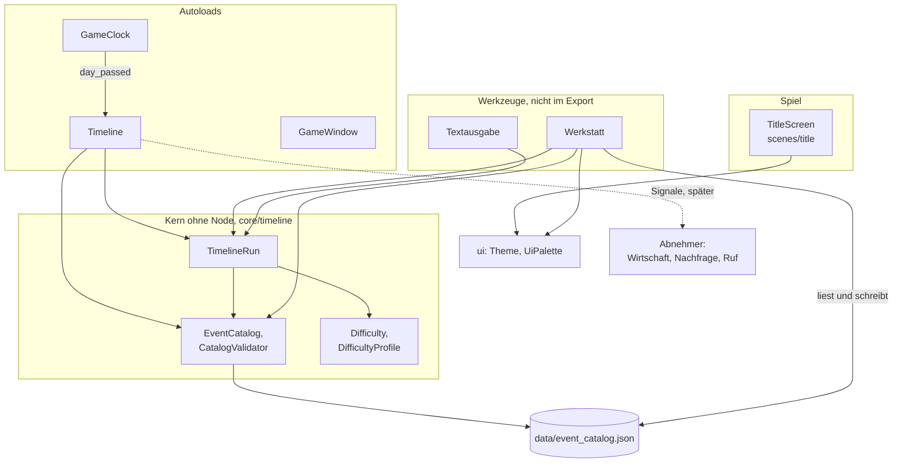

# Architektur

- **Worum es geht:** wie das Godot-Projekt aufgebaut ist, welche Teile es gibt und wer wen kennt.
- **Laden, wenn:** eine Arbeit mehrere Systeme berührt, neue Dateien, Autoloads oder Systeme
  dazukommen, oder ein System an ein anderes angebunden wird.
- **Code:** `src/project.godot`, `src/core/`, `src/scenes/`, `src/ui/`, `src/tools/`
- **Herkunft:** Pläne von `specs/001-hauptmenue/` bis `specs/003-schwierigkeitsgrade/`,
  Verfassung `.specify/memory/constitution.md`
- **Stand:** Feature 003, 2026-10-27

## Das Spiel in einem Absatz

„Der Computerladen“ ist eine Wirtschaftssimulation mit Point-and-Click-Adventure: Der Spieler
betreibt von 1985 bis 1999 einen Computerladen in Deutschland. Die Vision steht in
`docs/game_design.md`. Gebaut sind bisher der Start bis zum Hauptmenü (Feature 001), die
Zeitleiste mit ihrer Werkstatt (002) und die Schwierigkeitsgrade der Zeitleiste (003). Spielen
lässt sich noch nichts: „Neues Spiel“ ist gesperrt, Wirtschaft und Laden gibt es noch nicht.

## Ordner

| Pfad | Inhalt |
|---|---|
| `src/` | Godot-Projekt; Projekt-Root ist `src/`, nicht das Repo-Root |
| `src/core/` | Systeme mit Autoloads: `game_date`, `game_clock`, `timeline`, `game_window` |
| `src/core/timeline/` | Kern der Zeitleiste ohne Node: Datenklassen, Katalog, Prüfung, Lauf, Vergleich, Statistik, Grade |
| `src/data/` | Spieldaten: `event_catalog.json` |
| `src/scenes/` | Szenen des Spiels, bisher `title/` |
| `src/ui/` | Theme und Farben, für alle Szenen |
| `src/assets/` | Schriften, gerasterte Bilder, App-Symbol |
| `src/tools/werkstatt/` | Zeitleisten-Werkstatt; nicht im Export |
| `src/test/` | GUT-Tests und `fixtures/` |
| `tools/raster/` | Python-Werkzeuge für Bilder, außerhalb von Godot |
| `docs/` | Vision (`game_design.md`), Spielinhalt (`game_bible/`), Bauplan (`features/`), diese Beschreibung, Arbeitsweise (`ki_workflow/`) |
| `specs/NNN-*/` | Spec Kit je Feature: Spec, Plan, Datenmodell, Verträge, Recherche, Aufgaben, Lernnotizen |

## Wer wen kennt

Autoloads in `project.godot`, in dieser Reihenfolge: `GameClock`, `Timeline`, `GameWindow`.
Hauptszene ist `res://scenes/title/title_screen.tscn`.

## Grundsätze

- **Kern ohne Node, Hülle als Autoload.** Logik steckt in `RefCounted`-Klassen, die weder
  Szenenbaum noch Uhr brauchen. So laufen sie gleich im Spiel, in Werkzeugen und in Tests. Das
  Autoload verbindet nur und macht Signale daraus.
- **Melden statt anwenden.** Die Zeitleiste meldet Ereignisse und Wirkungen; was daraus folgt,
  entscheidet das System, das zuhört. Systeme sind über Signale entkoppelt, nicht über direkte
  Aufrufe.
- **Wiederholbar.** Katalog, Seed, Grad und Eingriffe legen ein Spiel vollständig fest. Spielstände
  können darauf bauen, statt den ganzen Zustand zu speichern.
- **Daten statt Code.** Ereignisse und Profile stehen in der Katalogdatei und werden in der
  Werkstatt gepflegt; Menüeinträge sind Resources in der Szene; Farben heißen über Tokens.
- **Ein Look.** Der Style-Guide ist die einzige Quelle für Farben, Raster, Schriften und Sprache.
  Texte duzen den Spieler.
- **Nur Desktop.** Maus und Tastatur, Forward+.

## Code-Stil

GDScript typisiert. `class_name` für Klassen, die andere benutzen; Autoloads ohne `class_name`.
Doku-Kommentare mit `##` auf Deutsch, mit Verweisen auf FR-, R- und T-Nummern der Specs.
Zeichenketten der Oberfläche auf Deutsch, Bezeichner auf Englisch. Der Start mit `-d` muss still
sein, deshalb stehen nötige `@warning_ignore` mit Grund im Code.

## Was als Nächstes andockt

Feature-Ideen, die auf diesem Stand aufsetzen, stehen in `docs/features/Feature_Ideas.md`: etwa
die Produktdatenbank (System 02), die Wirtschaft (03) als erster Abnehmer der Zeitleiste und
Spielstände (11-01), die Seed, Grad und Eingriffe speichern.
