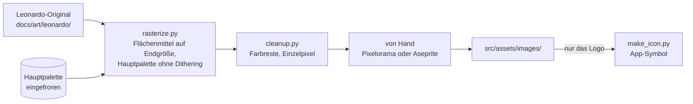

# Bilder

- **Worum es geht:** wie ein Bild aus Leonardo ins Spiel kommt: Palette, Rastern, Aufräumen,
  App-Symbol.
- **Laden, wenn:** ein neues Bild ins Spiel soll oder ein vorhandenes neu gerastert wird.
- **Code:** `tools/raster/` (Python 3, nur Standardbibliothek; Anleitung in
  `tools/raster/README.md`); Originale in `docs/art/leonardo/`, Palette `docs/art/hauptpalette.gpl`,
  Ebenen des Symbols `docs/art/app_icon/`; Ergebnisse in `src/assets/images/`, `src/assets/icon/`;
  Ablauf für Claude im Skill `.claude/skills/dcl-grafik/SKILL.md`, Protokoll jedes Bilds in
  `docs/art/leonardo/prompt-log.md`, nach Inhalt im Bildkatalog `docs/art/bildkatalog.md`
- **Herkunft:** `specs/001-hauptmenue/` (`research.md`, R5 bis R7), ICO aus
  `specs/007-build-export-selbsttest/` (`contracts/export.md`, `research.md` R14); Leonardo-Workflow
  im [Style-Guide](../style-guide/leonardo-workflow.md)
- **Stand:** Feature 007, 2026-10-28

## Stil

VGA-Pixel-Art nach dem Vorbild der deutschen Wirtschaftssimulationen der 90er wie „Das Amt“.
Stilanker ist Bild C2 aus der Leonardo-Stilprobe (Ladenbesitzer hinter der Theke). Konsistenz ist
oberstes Ziel. Szenen haben 320 × 180 Bildpixel, die Oberfläche 640 × 360 (siehe
[darstellung.md](darstellung.md)).

Claude erzeugt die Bilder in Leonardo.ai, über Claude in Chrome im Konto des Projekts; Klaus
wählt eins aus und gibt es frei (seit 2026-10-27, vorher erzeugte Klaus selbst). Der Prompt ist
englisch, endet mit dem Stilblock aus dem Style-Guide und steht vor dem Erzeugen in dessen
Prompt-Bibliothek. Ein echtes Vorbild wird nur in Worten beschrieben, ohne Markennamen und
Schrift.

## Ablauf

Aufruf immer vom Repo-Root mit `python3 -I`, denn die Bilder stammen aus dem Netz.

1. **Hauptpalette** (`make_palette.py`, einmal, dann eingefroren): Index 0 transparent, 1–15 die
   Oberflächenfarben, 16–255 Szenenfarben per Median-Cut aus C2, Titelbild T-01 und Cover C-01.
   Neu nur mit `--neu`; danach müsste jedes Bild neu gerastert werden.
2. **Rastern** (`rasterize.py`) mit `--groesse 320x180` oder `--faktor 6`. Zugeschnitten wird
   mittig, damit der Faktor ganzzahlig bleibt. Flächenmittel statt Nearest Neighbor, weil die
   gemalten Pixel in Leonardo-Bildern ungleich groß sind. Alpha unter 128 wird transparent.
   Muss ein Maß genau passen, etwa die Anzeige im Gehäuse, wird das Original vorher so skaliert,
   dass es ein Vielfaches des Faktors wird. Freistehende Geräte werden vorher freigestellt, per
   Füllung vom Rand aus. Ist ein Rand danach zu breit, kommen ganze Spalten und Zeilen aus
   gleichförmigen Flächen heraus, nie aus Tasten oder Kanten.
3. **Aufräumen** (`cleanup.py`): seltene Farben und Einzelpixel nach festen Regeln in OKLab;
   Lichter, Kanten und Schrift bleiben. Danach von Hand, nur mit Farben der Hauptpalette.
4. **App-Symbol** (`make_icon.py`) nach jeder Änderung am Logo: Monitor aus dem Logo ×32 auf ein
   Quadrat in `nacht`; schreibt `app_icon.png` und die Ebenen für Icon Composer. Seit Feature 007
   dazu `app_icon.ico` für Windows mit sechs Größen, 16, 32, 48, 64, 128 und 256 Pixel, als
   PNG-Einträge. Die kleinen Größen sind pixelgenau aus dem gerasterten Logo, der Monitor je Größe
   ganzzahlig vergrößert (bei 16 halb so groß); Godot würde ein PNG verwischt herunterrechnen.

## Bilder im Spiel

| Datei | Herkunft | Größe |
|---|---|---|
| `src/assets/images/title_t02.png` | Titelbild T-02, der Laden links, rechts Platz für den Communicator | 320 × 180, im Spiel ×2 |
| `src/assets/images/organizer_1991.png` | Gehäuse G-03 des Communicators nach dem Olivetti D2000, freigestellt | 196 × 134, Faktor 3 aus dem skalierten Original, im Spiel ×2 |
| `src/assets/images/title_t01.png` | Titelbild T-01, seit Feature 005 nicht mehr im Spiel | 320 × 180 |
| `src/assets/images/logo_ladenschild.png` | Ladenschild | 141 × 27, Faktor 6 aus dem Original, im Spiel ×2 |
| `src/assets/icon/app_icon.png`, `app_icon.icon` | Monitor aus dem Logo | 1024 × 1024 |
| `src/assets/icon/app_icon.ico` | Monitor aus dem Logo, für Windows | 16 bis 256, sechs Größen |

Zu jedem Bild gehört seine `.import`-Datei; sie wird mitcommittet.
