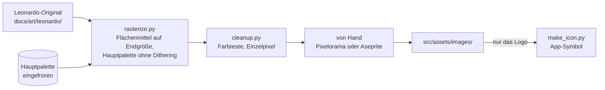

# Bilder

- **Worum es geht:** wie ein Bild aus Leonardo ins Spiel kommt: Palette, Rastern, Aufräumen,
  App-Symbol.
- **Laden, wenn:** ein neues Bild ins Spiel soll oder ein vorhandenes neu gerastert wird.
- **Code:** `tools/raster/` (Python 3, nur Standardbibliothek; Anleitung in
  `tools/raster/README.md`); Originale in `docs/art/leonardo/`, Palette `docs/art/hauptpalette.gpl`,
  Ebenen des Symbols `docs/art/app_icon/`; Ergebnisse in `src/assets/images/`, `src/assets/icon/`
- **Herkunft:** `specs/001-hauptmenue/` (`research.md`, R5 bis R7); Leonardo-Workflow im
  [Style-Guide](https://claude.ai/artifact/Hc5aS78T3fAzufkKnjrKRX)
- **Stand:** Feature 003, 2026-10-27

## Stil

VGA-Pixel-Art nach dem Vorbild der deutschen Wirtschaftssimulationen der 90er wie „Das Amt“.
Stilanker ist Bild C2 aus der Leonardo-Stilprobe (Ladenbesitzer hinter der Theke). Konsistenz ist
oberstes Ziel. Szenen haben 320 × 180 Bildpixel, die Oberfläche 640 × 360 (siehe
[darstellung.md](darstellung.md)).

Klaus erzeugt die Bilder in Leonardo.ai. Claude liefert den Prompt auf Englisch mit dem Stilblock
aus dem Style-Guide und trägt ihn in dessen Prompt-Bibliothek ein.

## Ablauf

Aufruf immer vom Repo-Root mit `python3 -I`, denn die Bilder stammen aus dem Netz.

1. **Hauptpalette** (`make_palette.py`, einmal, dann eingefroren): Index 0 transparent, 1–15 die
   Oberflächenfarben, 16–255 Szenenfarben per Median-Cut aus C2, Titelbild T-01 und Cover C-01.
   Neu nur mit `--neu`; danach müsste jedes Bild neu gerastert werden.
2. **Rastern** (`rasterize.py`) mit `--groesse 320x180` oder `--faktor 6`. Zugeschnitten wird
   mittig, damit der Faktor ganzzahlig bleibt. Flächenmittel statt Nearest Neighbor, weil die
   gemalten Pixel in Leonardo-Bildern ungleich groß sind. Alpha unter 128 wird transparent.
3. **Aufräumen** (`cleanup.py`): seltene Farben und Einzelpixel nach festen Regeln in OKLab;
   Lichter, Kanten und Schrift bleiben. Danach von Hand, nur mit Farben der Hauptpalette.
4. **App-Symbol** (`make_icon.py`) nach jeder Änderung am Logo: Monitor aus dem Logo ×32 auf ein
   Quadrat in `nacht`; schreibt `app_icon.png` und die Ebenen für Icon Composer.

## Bilder im Spiel

| Datei | Herkunft | Größe |
|---|---|---|
| `src/assets/images/title_t01.png` | Titelbild T-01 | 320 × 180, im Spiel ×2 |
| `src/assets/images/logo_ladenschild.png` | Ladenschild | 141 × 27, Faktor 6 aus dem Original, im Spiel ×2 |
| `src/assets/icon/app_icon.png`, `app_icon.icon` | Monitor aus dem Logo | 1024 × 1024 |

Zu jedem Bild gehört seine `.import`-Datei; sie wird mitcommittet.
