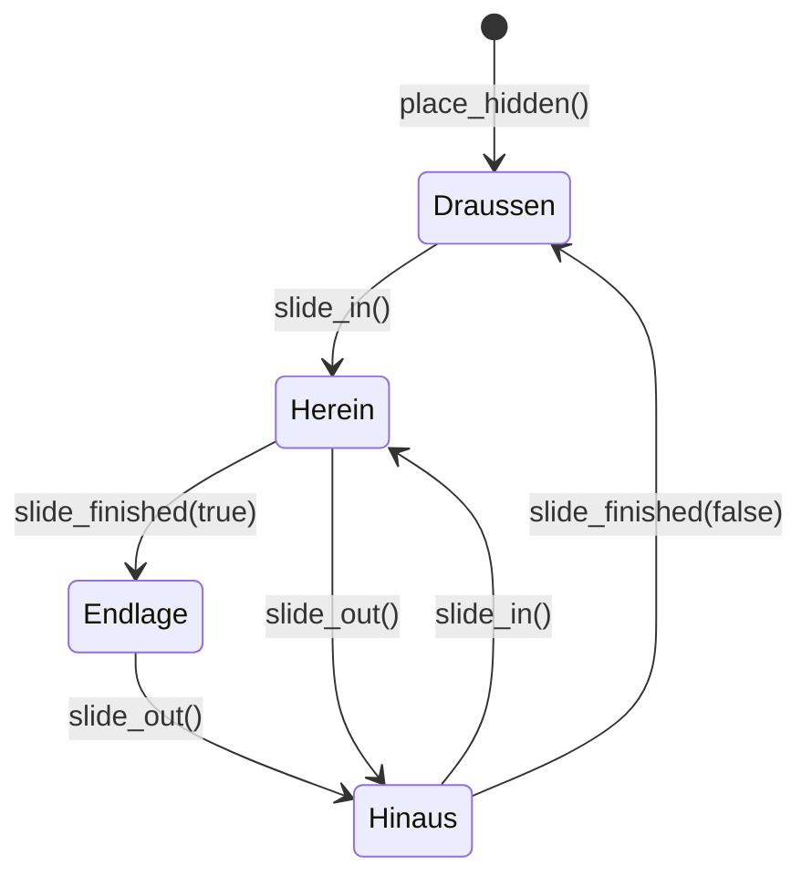

# Communicator

- **Worum es geht:** der Baustein Communicator, ein Taschengerät, das von unten ins Bild fährt und
  auf seiner Anzeige eine Seite zeigt, etwa ein Menü; dazu Menü und Liste in ihrer Fassung für die
  Anzeige.
- **Laden, wenn:** ein Bildschirm den Communicator braucht, eine Seite dazukommt, die Fahrt, der
  Hinweis neben dem Gerät oder ein Gehäuse geändert wird.
- **Code:** `src/ui/communicator/` (`communicator.gd`, `communicator.tscn`, `class_name
  Communicator`); die Seiten `MainMenu`, `SaveList`, `MenuPaper` und der Hinweis `MenuHint` liegen
  noch in `src/scenes/title/`; Gehäuse `src/assets/images/organizer_1991.png`; Tests
  `src/test/test_communicator.gd`, `test_lcd_theme.gd`, Probeszene
  `src/test/fixtures/communicator_probe.tscn`
- **Herkunft:** `specs/005-communicator/` (`contracts/communicator.md`, `research.md` R1 bis R11,
  `data-model.md`); Baustein Communicator im
  [Style-Guide](https://claude.ai/artifact/Hc5aS78T3fAzufkKnjrKRX)
- **Stand:** Feature 005, 2026-10-27
- **Nachbarn:** der Titel als erster Nutzer in [titel-und-hauptmenue.md](titel-und-hauptmenue.md),
  Farben und Theme in [darstellung.md](darstellung.md), das Gehäusebild in [bilder.md](bilder.md)

## Aufbau

```text
Communicator (Control, so groß wie das Gehäuse)   communicator.gd
├── Case (TextureRect)     Gehäuse auf dem Bildraster, STRETCH_KEEP, scale 2
├── Display (ColorRect)    Anzeige in lcd, Lage und Größe aus display_rect
├── Hint (menu_hint.tscn)  Hinweis oder Meldung links neben dem Gehäuse
└── … Seiten               vom Bildschirm in seiner Szene unter die Instanz gehängt
```

Ein Bildschirm hängt seine Seiten in der eigenen Szene direkt unter die Instanz. In `_ready()` stellt
der Communicator jede auf die Anzeige und verbirgt sie. Weil die Seiten nach Gehäuse, Anzeige und
Hinweis kommen, liegen sie darüber, und Pfade wie `$Communicator/MainMenu` bleiben gültig.

Das Gerät ist reine Grafik: Gehäuse, Anzeige und Hinweis lassen die Maus durch, bedienbar sind nur
die Seiten. Den Titel und die Signale seiner Seiten kennt der Communicator nicht. Was eine Seite
meldet, hört der Bildschirm selbst.

| Teil | Wert heute |
|---|---|
| Gehäuse | G-03 nach dem Olivetti D2000, 196 × 134 Bildpixel, gezeigt 392 × 268 |
| Anzeige | `display_rect` (36, 28), 320 × 160, für jedes Gehäuse gleich groß (`DISPLAY_SIZE`) |
| Farbe der Anzeige | `display_color`, Vorgabe `lcd` #b8c4a8 |
| Draußen | Oberkante bei y 360, der Unterkante des Bilds (`HIDDEN_Y`) |
| Endlage | die Lage, die der Bildschirm in seiner Szene gibt; x und y gerade, also auf dem Bildraster |

Lage, Größe und Farbe der Anzeige gehören zum Gehäuse; ein späteres Gehäuse setzt eigene. Hat
`Case` kein Bild, malt `_draw()` einen Platzhalter.

## Seiten

| Funktion | Wirkung |
|---|---|
| `add_page(page)` | stellt eine Seite auf die Anzeige, unsichtbar; hängt sie an, wenn sie noch kein Kind ist |
| `show_page(page)` | zeigt genau diese Seite; erst verbergen, dann zeigen, damit der Fokus richtig wandert |
| `current_page()` | die sichtbare Seite oder `null` |

Auf der Anzeige ist jede Seite so groß wie die Anzeige; was sie selbst an Größe setzt, gilt dort
nicht. Ein Seitenwechsel bewegt das Gerät nicht.

## Fahrt



- 200 ms (`SLIDE_SECONDS`), `TRANS_CUBIC`; herein `EASE_OUT`, hinaus `EASE_IN`. Cubic federt nicht
  über das Ziel hinaus.
- Ein angehaltener Tween schreibt in `slide_y`, das auf ganze Oberflächenpixel rundet. `_process()`
  taktet ihn mit `custom_step()`: im ersten Bild einer Fahrt höchstens 1/60 s, danach höchstens
  1/30 s. So springt das Gerät nach einem langen ersten Bild nicht gleich halb herein, und Tests
  rechnen die Fahrt Bild für Bild nach, ohne zu warten.
- Eine Umkehr beginnt in der jetzigen Lage, ohne Sprung; die abgebrochene Fahrt meldet sich nicht.
- `slide_finished(arrived_in)` kommt einmal je Fahrt. Mit `animate = false` springt jede Fahrt
  sofort ans Ziel und meldet sich gleich; das nutzen Tests, später „Bewegung reduzieren“.
- `place_hidden()` stellt ohne Fahrt nach draußen und meldet nichts.

**Eingabe:** Ab `slide_out()` nimmt keine Seite Fokus, Maus oder Tastatur an, bis `slide_in()` oder
`place_hidden()` kommt. Das regeln `focus_behavior_recursive` und `mouse_behavior_recursive` von
`Control` für den ganzen Teilbaum, auch für Zeilen, die erst zur Laufzeit entstehen.
`accepts_input()` sagt, ob gerade frei ist. Die Fahrt herein braucht keine Sperre: Godot meldet
`mouse_entered` nur bei Bewegung der Maus, eine Zeile unter dem ruhenden Zeiger wird nicht gewählt.

## Hinweis

`show_hint(text, row_rect)` und `show_warning(text, row_rect)` stellen den Hinweis oben bündig mit
der Zeile, die rechte Kante 4 Pixel vor der linken Kante des Gehäuses. Der Hinweis ist ein Kind des
Communicators und fährt mit. `hide_hint()` blendet ihn aus. Wie Hinweis und Meldung aussehen und wann
eine Meldung bleibt, regelt `MenuHint` (siehe [titel-und-hauptmenue.md](titel-und-hauptmenue.md)).

## Menü und Liste auf der Anzeige

`MainMenu` und `SaveList` haben `look`: `PAPER` ist das Endlospapier aus Feature 001 und 004,
`LCD` die Fassung für die Anzeige. Bedienung, Signale, Rollen, Löschmodus und Rollmarken sind in
beiden gleich; `look` gilt beim Bau der Zeilen.

- Auf der Anzeige gibt es kein Papier, keine Lochränder und keinen Schatten. Schrift und Kopfzeile
  stehen in `tusche` (Theme-Varianten `LcdRow`, `LcdHeader`), nicht verfügbare Zeilen in
  `gehaeuse-dunkel`.
- Die gewählte Zeile ist invertiert wie auf einem echten LCD: ein Balken in `tusche` über die ganze
  Zeile, Schrift, Spalten, Pfeil und Rollmarke darin in `lcd`; nicht verfügbar bleibt gedämpft
  (`MenuPaper.draw_lcd_selection()`).
- Die Liste zeigt auf der Anzeige 5 Spielstände, auf Papier 6 (`SaveList.visible_rows()`).

`PAPER` benutzt heute kein Bildschirm mehr; es bleibt für Seiten außerhalb des Communicators.
Menü, Liste, Papier und Hinweis ziehen nach `src/ui/` um, sobald ein Feature sie außerhalb des Titels
braucht (`docs/offene-punkte.md`).

## Einen Communicator einbauen

1. `communicator.tscn` instanziieren und auf die Endlage stellen, x und y gerade.
2. Die Seiten in der Szene direkt darunter hängen; Menü und Liste mit `look = LCD`.
3. Beim Erscheinen `place_hidden()`, Einträge und Auswahl setzen, dann `slide_in()`.
4. Vor einem Szenenwechsel `slide_out()` und erst in `slide_finished(false)` wechseln.
