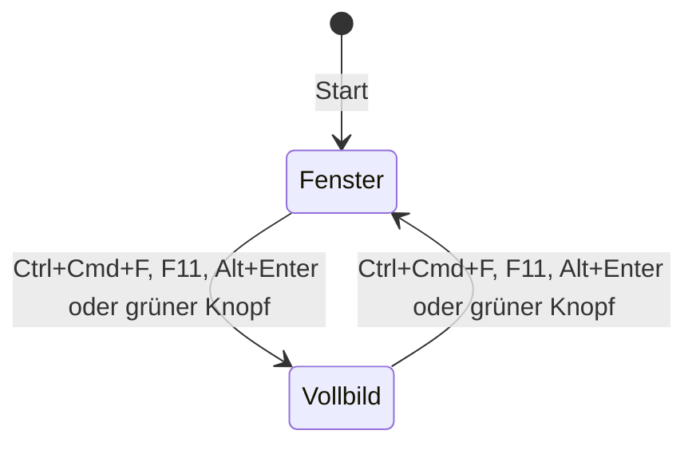

# Darstellung

- **Worum es geht:** Fenster, Raster und Skalierung, Theme, Farben und Schriften des Spiels.
- **Laden, wenn:** Oberfläche gebaut oder geändert wird, Farben oder Schriften gebraucht werden,
  oder das Fensterverhalten betroffen ist.
- **Code:** `src/core/game_window.gd` (Autoload `GameWindow`), `src/ui/ui_palette.gd`,
  `src/ui/computerladen_theme.tres`, `src/assets/fonts/`, Einstellungen in `src/project.godot`;
  Tests `src/test/test_game_window.gd`, `test_ui_palette.gd`, `test_lcd_theme.gd`,
  `test_projekt_einstellungen.gd`
- **Herkunft:** `specs/001-hauptmenue/` (Vertrag `contracts/titelbildschirm.md`, `research.md`),
  `specs/005-communicator/` (`lcd`, Theme für die Anzeige, `research.md` R1 bis R3),
  `specs/006-easter-egg-space-invaders/` (Spiel auf der Anzeige, `research.md` R7),
  `specs/007-build-export-selbsttest/` (`contracts/export.md`, `research.md` R13 bis R15),
  `specs/009-renderer-compatibility/` (`contracts/renderer.md`, `research.md` R1, R2)
- **Stand:** Feature 009, 2026-10-29
- **Maßstab:** der [Style-Guide](https://claude.ai/artifact/Hc5aS78T3fAzufkKnjrKRX). Er ist die
  einzige Quelle für Farben, Raster, Schriften und Bausteine. Was man sieht, kommt zuerst dort
  hinein, dann in den Code.

## Rahmen

Nur Desktop: Windows, macOS, Linux mit Maus und Tastatur. Hover, Tooltips, Rechtsklick,
Mauszeiger und Drag&Drop sind erwünscht. Keine Touch-Eingabe, keine Mobil- oder Web-Rücksichten.

**Renderer Compatibility auf allen drei Systemen** (Feature 009, Verfassung 3.0.0, Grundsatz I):
`rendering/renderer/rendering_method = "gl_compatibility"` in `project.godot`; Treiber und Rückfälle
stehen auf Godots Vorgabe und sind nicht eingetragen. Gezeichnet wird mit OpenGL 3.3: unter macOS
Apples OpenGL (auf Apple Silicon über Metal), unter Windows natives OpenGL, ohne brauchbares OpenGL
ANGLE über Direct3D 11 (fest in den Export eingebaut), unter Linux OpenGL über Mesa oder NVIDIA,
unter X11 notfalls OpenGL ES 3.0. Fehlt auch das, zeigt Godot „Unable to initialize video driver“
und endet. Mittel, die es nur in Forward+ gibt (HDR, Kantenglättung des Bildes in 2D, Compute),
nutzt das Spiel nicht. `test_projekt_einstellungen.gd` prüft die Einstellungen. Bis 2026-10-29
lief das Spiel mit Forward+ (Feature 007, R13); Anlass des Wechsels war ein Windows-Rechner in Boot
Camp, auf dem Forward+ ohne Meldung nicht startete (`docs/entscheidungen/renderer.md`).

## Raster und Skalierung

| Raster | Größe | Für |
|---|---|---|
| Oberfläche | 640 × 360 | Menüs, Texte, alles Bedienbare; Viewport des Projekts |
| Bild | 320 × 180 | Szenen und Titelbild, im Spiel genau doppelt |

- Stretch-Modus `viewport`, Skalierung `integer`: Das Bild wächst nur um ganze Faktoren, der Rest
  bleibt schwarz.
- Texturfilter Nearest, Transformationen und Ecken rasten auf Pixel ein.
- Das Titelbild ist ein `TextureRect` mit 320 × 180 Bildpixeln, genau ×2 gezeigt; ein
  SubViewport ist dafür nicht nötig.

## Fenster: GameWindow

- **Start im Fenster.** Im ersten Bild bekommt es den größten ganzzahligen Faktor f, bei dem
  f · 640 × f · 360 samt Titelleiste auf den aktuellen Bildschirm passt, mindestens 1 (`best_factor()`),
  und steht samt Titelleiste mittig im nutzbaren Bereich, also ohne Menüleiste und Dock
  (`centered_position()`; seit Feature 007, vorher mittig auf dem ganzen Bildschirm). Dasselbe geschieht bei jeder Rückkehr aus dem Vollbild, nach dem
  Übergang von macOS (bis 1 s Wartezeit).
- **Vollbild** über die Aktion `toggle_fullscreen` oder unter macOS den grünen Knopf. Die Aktion hat
  drei Tasten, auf jedem System gleich: Ctrl+Cmd+F (physische Taste F), F11 und Alt+Enter. Unter
  macOS fängt das System F11 meist selbst ab.
- **Abgefangen in `GameWindow._input()`**, vor der Oberfläche, nicht in `_unhandled_input()`: Für
  Godot ist Alt+Enter auch `ui_accept`, weil eine Aktion ohne Zusatztaste auch ein Ereignis mit Alt
  trifft. `is_action_pressed(…, false, true)` vergleicht mit `exact_match` genau die Zusatztasten:
  Alt+Enter schaltet, Enter allein geht weiter ans Menü. Jedes Ereignis des Kürzels, auch Loslassen
  und Wiederholung, wird als behandelt markiert; Alt+Enter löst im Menü also nichts aus.
- **Mindestgröße** 640 × 360 Bildschirmpixel. Im Fenster darf der Spieler die Größe frei ändern.
- Headless tut `GameWindow` nichts. Eingebettet im Editor setzt es keine Startgröße, der Rest
  gilt. Die Werkstatt und die Zusammenfassung des Selbsttests schalten es für ihren Prozess ab, mit
  `set_process(false)` und `set_process_input(false)`; dort wirkt das Vollbild-Kürzel nicht.

Das versteckte Spiel liest Tasten selbst; es lässt das Kürzel durch und fragt es dafür ebenfalls
mit `exact_match` ab (siehe [easter-egg.md](easter-egg.md)).

## Farben: UiPalette

Die 16 Oberflächenfarben des Style-Guides als Konstanten, mit Token-Namen:

| Token | Wert | Token | Wert |
|---|---|---|---|
| `tusche` | #1d1916 | `endlos-gruen` | #cfe2c3 |
| `nacht` | #18233b | `anzeige-grund` | #0d1716 |
| `nacht-hell` | #2c3d63 | `anzeige` | #6ff0cf |
| `gehaeuse-dunkel` | #6f6654 | `kassenrot` | #c0392b |
| `gehaeuse` | #bdb39a | `signalgelb` | #f2bf2f |
| `gehaeuse-hell` | #e4dcc6 | `petrol` | #1f6f75 |
| `papier` | #f5f0e2 | `holz` / `holz-dunkel` | #8b5a34 / #57351d |
| `lcd` | #b8c4a8 | | |

- Daten nennen Farben über Tokens, nicht über Werte; `UiPalette.by_token(&"petrol")` gibt die
  Farbe, ein unbekanntes Token gibt Magenta, damit es auffällt.
- `CATEGORY_TOKENS`: die sieben Farben, die Kategorien der Zeitleiste haben dürfen.
- `lcd` ist die Anzeige des Communicators und nur für die Oberfläche. Sie steht nicht in der
  Hauptpalette, die eingefroren ist; so kann kein Bild sie nutzen, das prüft `test_bilder.gd`.
- Bilder nutzen die Hauptpalette: Transparenz, die ersten 15 Farben und 240 Szenenfarben, siehe
  [bilder.md](bilder.md).

## Theme und Schriften

`src/ui/computerladen_theme.tres` ist projektweit gesetzt. Schrift ohne Kantenglättung:

| Rolle | Schrift | Für |
|---|---|---|
| `text` | Ark Pixel 10, Größe 10 | Standard, Hinweise |
| `menue` | Ark Pixel 12, Größe 12 | Menüzeilen |
| `drucker` | Doto, Gewicht 600, Größe 10, Laufweite 1 | Kopfzeile des Menüs, Untertitel, Versionszeile |

Ark Pixel ist je Größe pixelgenau gezeichnet und nur in seiner Entwurfsgröße zu benutzen. Doto
nicht unter 10. Beide Schriften stehen unter SIL OFL 1.1, die Lizenzen liegen daneben.

Theme-Varianten heute: `MenuRow`, `MenuHeader`, `LcdRow` und `LcdHeader` (Menü und Liste auf der
Anzeige, Schrift `tusche`, gedämpft `gehaeuse-dunkel`), `HintPanel`, `HintLabel`, `WarningPanel`
(die Meldung: `papier` mit Kontur in `kassenrot`), `Knopf`, `Subtitle`, `VersionLine`. Die Farben
von `LcdRow` und `LcdHeader` stehen im Theme als Werte; `test_lcd_theme.gd` prüft, dass sie
`UiPalette` gleichen.

Der harte `pixelschatten` (2 px nach rechts unten in `tusche`) wird von Hand in `_draw()` gemalt,
weil der Schatten einer `StyleBoxFlat` weich ist. Text auf einem Bild bekommt ihn auch: Logo,
Untertitel und Versionszeile auf dem Titelbild.

**Baustein Knopf** (`src/ui/knopf.gd`, `class_name Knopf`): Fläche `gehaeuse`, Kontur `tusche`,
Schrift `menue`; erhabenes Relief, gedrückt vertieft, beim Überfahren `signalgelb`. Relief und
Fokuslinie malt `_draw()`, denn eine `StyleBoxFlat` kennt kein Relief in zwei Farben. Mit
`on_dark` ist die Fokuslinie `papier` statt `tusche`, für dunklen Grund wie den Spielbildschirm.
Steht ein Knopf allein auf einem Bildschirm, zeigt der Bildschirm seinen Hinweis wie im Menü.

**Baustein Communicator** (`src/ui/communicator/`): Taschengerät mit Anzeige, das von unten ins
Bild fährt und Seiten zeigt; eigene Datei [communicator.md](communicator.md).

**Spiel auf der Anzeige:** Das versteckte Spiel liegt auf dem Bildraster, nicht auf dem
Oberflächenraster. Sein Feld ist die Anzeige, 160 × 80 Bildpixel, und `InvadersPage._draw()` malt
jedes Bildpixel als 2 × 2 Oberflächenpixel, also 320 × 160. Es gibt eine einzige Farbe: `tusche`
auf dem Grund `lcd`, den die Anzeige selbst hat. Alle Muster liegen auf ganzen Bildpixeln; die
Abstände `raster-2` bis `raster-16` gelten dort nicht. Texte in Kopfzeile und Ergebnisanzeige stehen
in `tusche` mit den Schriften von `LcdHeader` und `LcdRow`; die Ergebnisanzeige ist in
Oberflächenpixeln gesetzt. Mehr in [easter-egg.md](easter-egg.md).

Die Werkstatt hat ein eigenes Theme und läuft nicht im Pixelraster (siehe
[werkstatt.md](werkstatt.md)).

## App-Symbol

`src/assets/icon/app_icon.png`, dazu `app_icon.icon` als Liquid-Glass-Symbol für macOS und
`app_icon.ico` für Windows mit 16 bis 256 Pixeln. Motiv: der Monitor aus dem Ladenschild auf einem
abgerundeten Quadrat in `nacht`. Wie es entsteht, steht in [bilder.md](bilder.md).

Unter Windows kommt das Symbol an zwei Stellen aus der ICO: in der `.exe`, also im Explorer, über
`application/icon` im Preset; im Fenster und in der Taskleiste über
`application/config/windows_native_icon` in `project.godot`. Die ICO hat die kleinen Größen
pixelgenau, statt sie Godot aus dem PNG herunterrechnen zu lassen.
