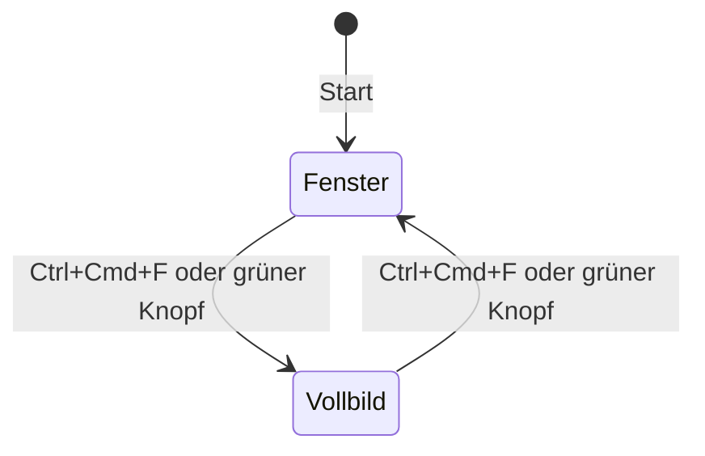

# Darstellung

- **Worum es geht:** Fenster, Raster und Skalierung, Theme, Farben und Schriften des Spiels.
- **Laden, wenn:** Oberfläche gebaut oder geändert wird, Farben oder Schriften gebraucht werden,
  oder das Fensterverhalten betroffen ist.
- **Code:** `src/core/game_window.gd` (Autoload `GameWindow`), `src/ui/ui_palette.gd`,
  `src/ui/computerladen_theme.tres`, `src/assets/fonts/`, Einstellungen in `src/project.godot`;
  Tests `src/test/test_game_window.gd`, `test_ui_palette.gd`, `test_lcd_theme.gd`
- **Herkunft:** `specs/001-hauptmenue/` (Vertrag `contracts/titelbildschirm.md`, `research.md`),
  `specs/005-communicator/` (`lcd`, Theme für die Anzeige, `research.md` R1 bis R3)
- **Stand:** Feature 005, 2026-10-27
- **Maßstab:** der [Style-Guide](https://claude.ai/artifact/Hc5aS78T3fAzufkKnjrKRX). Er ist die
  einzige Quelle für Farben, Raster, Schriften und Bausteine. Was man sieht, kommt zuerst dort
  hinein, dann in den Code.

## Rahmen

Nur Desktop: Windows, macOS, Linux mit Maus und Tastatur. Hover, Tooltips, Rechtsklick,
Mauszeiger und Drag&Drop sind erwünscht. Renderer ist Forward+. Keine Touch-Eingabe, keine
Mobil- oder Web-Rücksichten.

## Raster und Skalierung

| Raster | Größe | Für |
|---|---|---|
| Oberfläche | 640 × 360 | Menüs, Texte, alles Bedienbare; Viewport des Projekts |
| Bild | 320 × 180 | Szenen und Titelbild, im Spiel genau doppelt |

- Stretch-Modus `viewport`, Skalierung `integer`: Das Bild wächst nur um ganze Faktoren, der Rest
  bleibt schwarz.
- Texturfilter Nearest, Transformationen und Ecken rasten auf Pixel ein.
- Das Titelbild ist ein `TextureRect` mit 320 × 180 Bildpixeln, genau ×2 gezeigt; ein
  SubViewport ist dafür nicht nötig.

## Fenster: GameWindow

- **Start im Fenster.** Im ersten Bild bekommt es den größten ganzzahligen Faktor f, bei dem
  f · 640 × f · 360 samt Titelleiste auf den aktuellen Bildschirm passt, mindestens 1, und wird
  zentriert (`best_factor()`). Dasselbe geschieht bei jeder Rückkehr aus dem Vollbild, nach dem
  Übergang von macOS (bis 1 s Wartezeit).
- **Vollbild** über die Aktion `toggle_fullscreen` (Ctrl+Cmd+F, physische Taste F) oder den
  grünen Knopf.
- **Mindestgröße** 640 × 360 Bildschirmpixel. Im Fenster darf der Spieler die Größe frei ändern.
- Headless tut `GameWindow` nichts. Eingebettet im Editor setzt es keine Startgröße, der Rest
  gilt. Die Werkstatt schaltet es für ihren Prozess ab.

Kürzel für Windows und Linux kommen mit dem Export für diese Systeme (Feature-Idee 11-03).

## Farben: UiPalette

Die 16 Oberflächenfarben des Style-Guides als Konstanten, mit Token-Namen:

| Token | Wert | Token | Wert |
|---|---|---|---|
| `tusche` | #1d1916 | `endlos-gruen` | #cfe2c3 |
| `nacht` | #18233b | `anzeige-grund` | #0d1716 |
| `nacht-hell` | #2c3d63 | `anzeige` | #6ff0cf |
| `gehaeuse-dunkel` | #6f6654 | `kassenrot` | #c0392b |
| `gehaeuse` | #bdb39a | `signalgelb` | #f2bf2f |
| `gehaeuse-hell` | #e4dcc6 | `petrol` | #1f6f75 |
| `papier` | #f5f0e2 | `holz` / `holz-dunkel` | #8b5a34 / #57351d |
| `lcd` | #b8c4a8 | | |

- Daten nennen Farben über Tokens, nicht über Werte; `UiPalette.by_token(&"petrol")` gibt die
  Farbe, ein unbekanntes Token gibt Magenta, damit es auffällt.
- `CATEGORY_TOKENS`: die sieben Farben, die Kategorien der Zeitleiste haben dürfen.
- `lcd` ist die Anzeige des Communicators und nur für die Oberfläche. Sie steht nicht in der
  Hauptpalette, die eingefroren ist; so kann kein Bild sie nutzen, das prüft `test_bilder.gd`.
- Bilder nutzen die Hauptpalette: Transparenz, die ersten 15 Farben und 240 Szenenfarben, siehe
  [bilder.md](bilder.md).

## Theme und Schriften

`src/ui/computerladen_theme.tres` ist projektweit gesetzt. Schrift ohne Kantenglättung:

| Rolle | Schrift | Für |
|---|---|---|
| `text` | Ark Pixel 10, Größe 10 | Standard, Hinweise |
| `menue` | Ark Pixel 12, Größe 12 | Menüzeilen |
| `drucker` | Doto, Gewicht 600, Größe 10, Laufweite 1 | Kopfzeile des Menüs, Untertitel, Versionszeile |

Ark Pixel ist je Größe pixelgenau gezeichnet und nur in seiner Entwurfsgröße zu benutzen. Doto
nicht unter 10. Beide Schriften stehen unter SIL OFL 1.1, die Lizenzen liegen daneben.

Theme-Varianten heute: `MenuRow`, `MenuHeader`, `LcdRow` und `LcdHeader` (Menü und Liste auf der
Anzeige, Schrift `tusche`, gedämpft `gehaeuse-dunkel`), `HintPanel`, `HintLabel`, `WarningPanel`
(die Meldung: `papier` mit Kontur in `kassenrot`), `Knopf`, `Subtitle`, `VersionLine`. Die Farben
von `LcdRow` und `LcdHeader` stehen im Theme als Werte; `test_lcd_theme.gd` prüft, dass sie
`UiPalette` gleichen.

Der harte `pixelschatten` (2 px nach rechts unten in `tusche`) wird von Hand in `_draw()` gemalt,
weil der Schatten einer `StyleBoxFlat` weich ist. Text auf einem Bild bekommt ihn auch: Logo,
Untertitel und Versionszeile auf dem Titelbild.

**Baustein Knopf** (`src/ui/knopf.gd`, `class_name Knopf`): Fläche `gehaeuse`, Kontur `tusche`,
Schrift `menue`; erhabenes Relief, gedrückt vertieft, beim Überfahren `signalgelb`. Relief und
Fokuslinie malt `_draw()`, denn eine `StyleBoxFlat` kennt kein Relief in zwei Farben. Mit
`on_dark` ist die Fokuslinie `papier` statt `tusche`, für dunklen Grund wie den Spielbildschirm.
Steht ein Knopf allein auf einem Bildschirm, zeigt der Bildschirm seinen Hinweis wie im Menü.

**Baustein Communicator** (`src/ui/communicator/`): Taschengerät mit Anzeige, das von unten ins
Bild fährt und Seiten zeigt; eigene Datei [communicator.md](communicator.md).

Die Werkstatt hat ein eigenes Theme und läuft nicht im Pixelraster (siehe
[werkstatt.md](werkstatt.md)).

## App-Symbol

`src/assets/icon/app_icon.png`, dazu `app_icon.icon` als Liquid-Glass-Symbol für macOS. Motiv: der
Monitor aus dem Ladenschild auf einem abgerundeten Quadrat in `nacht`. Wie es entsteht, steht in
[bilder.md](bilder.md).
