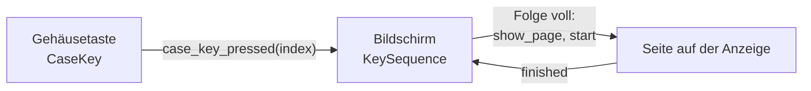
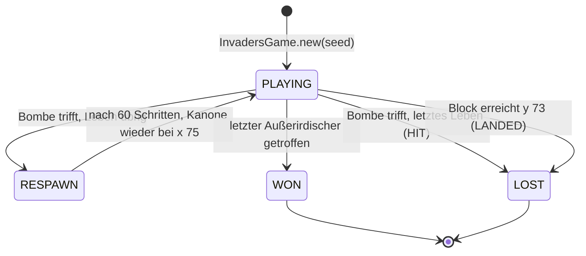

# Easter Eggs

- **Worum es geht:** versteckte Dinge im Spiel, die ein Spieler nur durch Ausprobieren findet.
  Bisher eins: das versteckte Spiel auf der Anzeige des Communicators, gestartet mit den drei grauen
  Gehäusetasten im Titel.
- **Laden, wenn:** am versteckten Spiel etwas geändert wird, ein weiteres Easter Egg dazukommt oder
  eine Seite auf der Anzeige selbst malt und Tasten liest.
- **Code:** `src/scenes/title/invaders/` (`invaders_game.gd`, `invaders_sprites.gd`,
  `invaders_page.gd`, `invaders_page.tscn`), Texte in `src/scenes/title/title_texts.gd`; Tests
  `src/test/test_invaders_game.gd`, `test_invaders_sprites.gd`, `test_invaders_page.gd`, Probeszene
  `src/test/fixtures/invaders_probe.tscn`
- **Herkunft:** `specs/006-easter-egg-space-invaders/` (`contracts/invaders.md`, `data-model.md`,
  `research.md` R6 bis R11); Baustein „Spiel auf der Anzeige“ im
  [Style-Guide](https://claude.ai/artifact/Hc5aS78T3fAzufkKnjrKRX) mit Maßen, Pixelmustern und
  Ergebnisanzeige
- **Stand:** Feature 006, 2026-10-28
- **Nachbarn:** Gehäusetasten in [communicator.md](communicator.md), Folge, Start und Rückweg im
  Titel in [titel-und-hauptmenue.md](titel-und-hauptmenue.md), die Töne in [ton.md](ton.md),
  Bildraster und Farben in [darstellung.md](darstellung.md)

## Wie ein Easter Egg gebaut ist



- Der **Communicator** meldet nur, welche Gehäusetaste gedrückt wurde. Was eine Folge bedeutet,
  weiß der **Bildschirm**; er zählt mit `KeySequence` (siehe
  [titel-und-hauptmenue.md](titel-und-hauptmenue.md)).
- Das Easter Egg selbst ist eine **Seite** des Communicators wie ein Menü. Sie meldet ihr Ende mit
  `finished`, der Bildschirm stellt danach alles wieder her.
- Ein Easter Egg speichert nichts und berührt weder `GameSession` noch einen Spielstand.

Das versteckte Spiel liegt unter `scenes/title/invaders/`, weil es zum Titel gehört und es nur eins
gibt. Braucht ein zweites Easter Egg denselben Rahmen, zieht beides um (R6).

## Das versteckte Spiel

Ein Block aus 32 Außerirdischen marschiert hin und her und rückt am Rand tiefer; die Kanone unten
fährt mit den Pfeilen und schießt mit der Leertaste. Drei Teile nach dem Muster Kern und Hülle:

| Klasse | Art | Aufgabe |
|---|---|---|
| `InvadersGame` | `RefCounted` | die Partie: Zustand, Regeln, ein Schritt je Aufruf |
| `InvadersSprites` | `RefCounted`, nur Konstanten und statische Funktionen | die Pixelmuster als Daten |
| `InvadersPage` | `Control`, Seite des Communicators | Tasten sammeln, takten, malen, Töne, Ergebnisanzeige |

## Kern: InvadersGame

- **Fester Schritt:** Jeder Aufruf von `step(left, right, fire)` ist 1/60 s Spielzeit (`STEP`). Der
  Kern kennt keine andere Zeit, braucht keinen Szenenbaum und läuft in Tests Schritt für Schritt.
  `left` und `right` sind gehalten, `fire` ein neuer Druck in diesem Schritt.
- **Zufall** nur für die Bomben, aus einem eigenen `RandomNumberGenerator` mit dem Seed aus
  `InvadersGame.new(seed)`. Gleicher Seed und gleiche Eingaben ergeben dieselbe Partie.
- **Ereignisse statt Signale:** `step()` gibt die Ereignisse des Schritts als Liste zurück, je
  `{ "event": Event, … }`: `SHOT`, `ALIEN_HIT` (mit `row`, `points`), `MARCH` (mit `note` 0 bis 3),
  `CANNON_HIT`, `WON`, `LOST`. Ein Schritt kann mehrere liefern.
- **Bild als Daten:** `drawables()` liefert je Teil `{ "sprite", "frame", "pos" }` in Bildpixeln;
  der Kern malt nicht und spielt keine Töne.
- Lesbar: `state`, `lost_reason`, `score`, `lives`, `cannon_x`, `march_frame`, `aliens_left()`.



In `RESPAWN` steht der Block, es gibt keinen Schuss und keine Bombe, an der Stelle der Kanone steht
die Explosion. In `WON` und `LOST` ändert `step()` nichts mehr und gibt eine leere Liste.

**Ein Schritt in `PLAYING`,** in dieser Reihenfolge: Explosionen altern, die Kanone fährt, der
Schuss fliegt (ein neuer Druck schießt, wenn keiner im Feld ist), Treffer am Block, Bomben fallen,
Treffer an der Kanone, Takt des Blocks. Endet die Partie oder trifft eine Bombe, endet der Schritt
dort.

### Feld, Tempo und Punkte

Alle Werte stehen als Konstanten oben in `invaders_game.gd`, abgeschrieben aus dem Style-Guide.
Lagen in Bildpixeln, gezählt einschließlich.

| Teil | Wert |
|---|---|
| Feld | 160 × 80 (`FIELD`), Innenrand 2: nichts außerhalb von x 2 bis 157 und y 0 bis 77; Kopfzeile y 0 bis 7, das Feld ab y 8 |
| Block | 8 Spalten × 4 Reihen, je 8 × 6, Abstand 4 und 3; Start bei (34, 12) |
| Takt | 2 zur Seite; steht die Außenkante der lebenden am Innenrand, 3 tiefer und umkehren |
| Abstand der Takte | `3 + round(27 · (n − 1) / 31)` Schritte bei n Übrigen: 30 (0,5 s) bei 32, 3 bei einem; ein Treffer kürzt den laufenden Takt |
| Kanone | 9 × 5 in y 73 bis 77, Start x 75; 1 je Schritt; links und rechts zugleich heben sich auf |
| Schuss | 1 × 4 aus der Spitze, 2 je Schritt nach oben, höchstens einer; trifft höchstens einen, bei mehreren den untersten |
| Bomben | 2 × 3, 1 je zwei Schritte nach unten, höchstens 3; je Takt mit Chance 1/4 vom untersten Lebenden einer zufälligen Spalte |
| Explosion | 8 × 6, 15 Schritte (0,25 s); hält nichts auf |
| Leben | 3, die Kanone im Feld mitgezählt; nach einem Treffer 60 Schritte (1 s) Pause |
| Gelandet | die unterste Zeile eines lebenden Außerirdischen erreicht y 73 oder tiefer |
| Punkte | je Reihe von oben 30, 20, 20, 10; höchstens 640 |

Gezielt gespielt ist die Partie in höchstens 3 Minuten zu gewinnen; ohne Schuss landet der Block
frühestens nach 1 Minute. Beides prüft `test_invaders_game.gd` (SC-002).

## Muster: InvadersSprites

`PATTERNS` hält je Muster eine Liste von Bildern, jedes eine Liste gleich langer Strings, `#`
gesetzt, `.` leer. Die Außerirdischen `alien_a`, `alien_b`, `alien_c` (8 × 6) haben zwei
Bewegungsbilder, die mit jedem Takt wechseln; `cannon` (9 × 5), `shot`, `bomb`, `explosion` und
`life` (7 × 4, Leben in der Kopfzeile) eins. Oben steht `alien_a`, in der Mitte zweimal `alien_b`,
unten `alien_c`.

`pixels(sprite, frame)` gibt die gesetzten Pixel relativ zur linken oberen Ecke; ein Bild über die
Zahl der Bilder hinaus zählt im Kreis, ein unbekanntes Muster ist leer. `size_of(sprite)` gibt die
Größe. Die Muster sind eigene Entwürfe und stammen Zeichen für Zeichen aus dem Style-Guide.

## Seite: InvadersPage

`invaders_page.tscn` ist ein `Control` mit `focus_mode` ALL und sechs `AudioStreamPlayer`n auf dem
Kanal `Effekte`. `start(seed = -1)` beginnt eine Partie, −1 heißt zufälliger Seed; der Titel ruft es
ohne Seed. Am Ende meldet die Seite `finished`.

### Takt

`_process()` gibt die Zeit an `advance(seconds)`. Ein Zeitspeicher sammelt sie und gibt sie in
Schritten von 1/60 s an den Kern, **höchstens 4 je Aufruf**; was darüber hinausgeht, verfällt. Nach
einem langen Bild springt das Spiel also nicht. Kein Takt ohne Fokus des Fensters, nach `finished`
und solange die Seite verborgen ist. Tests stellen `autoplay = false` und rufen `advance()` selbst.

### Eingabe

Die Seite nimmt beim Start den Fokus und bekommt die Tasten in `_gui_input()`. Jede Taste ohne Cmd,
Strg oder Alt verbraucht sie mit `accept_event()`, damit nichts zum Menü darunter durchdringt;
Kürzel mit Cmd, Strg oder Alt und die Aktion `toggle_fullscreen` lässt sie durch. Echo zählt nie als
neuer Druck. Verliert die Seite den Fokus an ein anderes Control, holt sie ihn nach diesem Bild
zurück, wenn sie dann noch läuft und zu sehen ist (`focus_exited`).

| Eingabe | läuft | Ende, gesperrt (0,5 s) | Ende, wartet |
|---|---|---|---|
| Pfeil links/rechts | fährt, solange gehalten | – | `finished` bei neuem Druck |
| Leertaste | Schuss bei jedem neuen Druck, höchstens einer je Bild | – | `finished` |
| andere Taste | nichts | – | `finished`; Shift, Strg, Alt, Cmd allein nicht |
| Esc | `finished` | `finished` | `finished` |
| Linksklick auf die Seite | nichts | – | `finished` |
| Rechts-, Mittelklick, Mausrad | nichts | nichts | nichts |

Die Seite hat keinen Fokusrahmen; der Zeiger ist der Pfeil.

### Bild

`_draw()` malt keinen Grund, das ist die Anzeige in `lcd`. Jedes Pixel aus `drawables()` wird ein
Quadrat von 2 × 2 Oberflächenpixeln in `tusche` (`PIXEL`). Die Kopfzeile zeigt links die Punkte ab
(2, 1) in der Schrift von `LcdHeader` (`drucker`), rechts je verbleibendem Leben ein Muster `life`
bei y 2, 2 auseinander, das letzte endet bei x 157 (`life_pos()`).

### Ende und Ergebnisanzeige

Ist die Partie `WON` oder `LOST`, bleibt vom Feld nur die Kopfzeile, darunter die Ergebnisanzeige:
drei Zeilen zu je 20 Oberflächenpixeln, als Block ab y 50 der Anzeige, jede waagrecht mittig.
Zeilen 1 und 2 in `LcdHeader` (`drucker`), Zeile 3 in `LcdRow` (`menue`). Sie heißt nicht Meldung,
weil die Meldung der Hinweis mit roter Kontur neben dem Gehäuse ist.

Die ersten 0,5 s nimmt sie nichts an außer Esc (`RESULT_LOCK`, gezählt in 30 Schritten, steht also
ohne Fokus des Fensters mit). Danach führt ein neuer Druck oder ein Linksklick weiter
(`is_waiting_for_key()`), eine gehaltene Leertaste nicht.

### Töne

| Ereignis | Player | Ton |
|---|---|---|
| `SHOT` | `ShotSound` | `schuss.wav` |
| `ALIEN_HIT` | `HitSound` | `treffer.wav` |
| `MARCH` | `MarchSound` | `marsch_1.wav` bis `marsch_4.wav` nach `note`, ein Player für alle vier |
| `CANNON_HIT` | `CannonSound` | `kanone.wav` |
| `WON` / `LOST` | `WonSound` / `LostSound` | `sieg.wav` / `niederlage.wav` |

`finished` und eine verborgene Seite stoppen alle Player; Sieg und Niederlage klingen in der
Ergebnisanzeige aus. Mehr in [ton.md](ton.md).

### Fokus des Fensters

`NOTIFICATION_APPLICATION_FOCUS_OUT`: kein Takt, die Pfeile gelten als losgelassen, alle Player
`stream_paused`. `…_FOCUS_IN`: weiter, wo es stand, ohne die Zeit nachzuholen. Das gilt für alle
Zeiten der Partie und für die Sperre der Ergebnisanzeige. Kommt die Benachrichtigung schon vor
`_ready()`, gilt sie ab dort auch für die Player.

## Texte

In `TitleTexts`, wie alle Texte des Titels:

| Konstante | Wortlaut | Wo |
|---|---|---|
| `INVADERS_SCORE` | `PUNKTE %04d`, etwa „PUNKTE 0380“ | Kopfzeile; führende Nullen nur hier |
| `INVADERS_WON` | „ALLE ERWISCHT.“ | Ergebnisanzeige, Zeile 1 nach einem Sieg |
| `INVADERS_LOST` | „GAME OVER“ | Zeile 1 nach beiden Niederlagen, wie beim Automaten von 1978 |
| `INVADERS_POINTS` | `%d PUNKTE`, etwa „380 PUNKTE“ | Zeile 2 |
| `INVADERS_CONTINUE` | „Weiter mit Taste oder Klick.“ | Zeile 3, Bedienung |

`test_title_texts.gd` prüft, dass jede Zeile der Ergebnisanzeige in 312 Pixel passt (Anzeige ohne
Innenrand) und „PUNKTE 0640“ links neben drei Leben.

## Probeszene

`src/test/fixtures/invaders_probe.tscn` zeigt einen Communicator in der Endlage des Titels auf
`nacht`, darauf die Seite, die gleich eine Partie beginnt; nach `finished` beginnt die nächste. Ohne
Titel, ohne Gehäusetasten, ohne `GameSession`: Die Seite ist allein spielbar.

```bash
/Applications/Godot.app/Contents/MacOS/Godot --path src res://test/fixtures/invaders_probe.tscn
```
