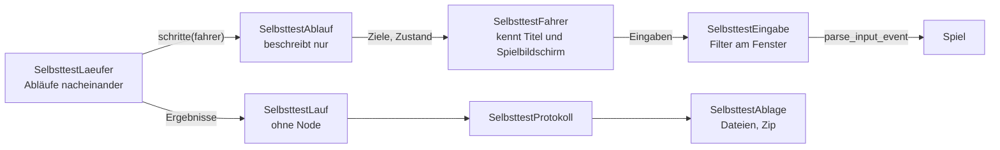

# Selbsttest

- **Worum es geht:** die Selbsttest-App, eine eigene Fassung des Spiels, die nach dem Start alle
  Abläufe des Titels von selbst durchspielt, jeden Schritt prüft und fotografiert und am Ende eine
  Zusammenfassung zeigt. Dazu der Vergleich der Fotos mit Referenzbildern und der Bau aller
  Exporte mit einem Befehl.
- **Laden, wenn:** ein Feature Seiten, Wege, Texte oder Eingaben des Titels oder Spielbildschirms
  ändert, ein Ablauf oder Schritt dazukommt, der Selbsttest gebaut, gestartet oder ausgewertet
  wird, oder ein Lauf von Windows oder Linux zu vergleichen ist.
- **Code:** `src/tools/selbsttest/` (Startszene `selbsttest_start.tscn`, `SelbsttestLaeufer`,
  `SelbsttestFahrer`, `SelbsttestEingabe`, `SelbsttestLauf`, `SelbsttestProtokoll`,
  `SelbsttestAblage`, `SelbsttestLogger`, `SelbsttestSystem`, `SelbsttestTexte`,
  `SelbsttestErgebnis`; `ablaeufe/` mit `SelbsttestAblauf` und `SelbsttestSzenario`; `szenarien/`,
  leer); `tools/selbsttest/vergleich.py` mit `README.md` und `referenz/macos/`;
  `tools/build/baue_alles.sh`; Overrides in `src/project.godot`, Presets in
  `src/export_presets.cfg`; Tests `src/test/test_selbsttest_*.gd`, `test_projekt_einstellungen.gd`,
  Fixtures `src/test/fixtures/selbsttest/`, Probeszene
  `src/test/fixtures/selbsttest_ergebnis_probe.tscn`
- **Herkunft:** `specs/007-build-export-selbsttest/` (`contracts/selbsttest-app.md`,
  `ablaeufe.md`, `protokoll.md`, `vergleich.md`, `export.md`; `research.md` R1 bis R27;
  `quickstart.md`); Regel in `docs/ki_workflow/ki_dev.md`, „Ablauf je Feature“, Punkt 11;
  umgebaut nach dem Architektur-Leitfaden in `specs/008-architektur/` (T036a, T036e)
- **Stand:** Feature 008, 2026-10-29
- **Nachbarn:** Presets und Bau in [build-und-tests.md](build-und-tests.md), Fenster und Vollbild in
  [darstellung.md](darstellung.md), was die Abläufe durchspielen in
  [titel-und-hauptmenue.md](titel-und-hauptmenue.md) und [easter-egg.md](easter-egg.md)

## Zweck und Rahmen

GUT-Tests laufen ohne Fenster; sie sehen weder Treiber noch echtes Fenster, Hover oder Fokus. Der
Selbsttest spielt das gebaute Spiel auf dem echten Rechner mit Maus und Tastatur durch, auf macOS,
Windows und Linux gleich. Er ist ein eigener Läufer, kein GUT (R1).

- Er ändert am Spiel nichts. Er stellt nur Felder des Spiels: `GameSession.folder`, `now`, `rng`,
  `quit_callback` und `SaveGame.time_zone_bias`; nur die letzte kam für ihn dazu.
- **Nähte** (AR-12): Die Startszene hat eine Variable `session`, leer heißt das Autoload
  `GameSession`; sie richtet darüber die Sitzung ein und reicht die Naht an Fahrer und Läufer
  weiter. Die Zusammenfassung hält `GameWindow` über die Naht `game_window` an, leer heißt das
  Autoload. Tests setzen eigene Knoten.
- Er gehört nicht ins Spiel: Die Presets des Spiels schließen `tools/*` aus. `baue_alles.sh` prüft
  das an jedem Paket.
- Er läuft nur als gebaute App. Im Editor und mit `--path src` startet immer das Spiel.

## Start: Feature-Tag `selbsttest`

Die Presets „Selbsttest macOS“, „Selbsttest Windows“ und „Selbsttest Linux“ setzen den Feature-Tag
`selbsttest` (`custom_features`). Dazu stehen in `project.godot` zwei Overrides, die nur mit diesem
Tag wirken (R3):

| Einstellung | Wert | Folge |
|---|---|---|
| `application/config/name.selbsttest` | „Der Computerladen Selbsttest“ | eigener Name, damit eigener Datenordner `app_userdata/Der Computerladen Selbsttest/`; echte Spielstände sieht er nicht |
| `application/run/main_scene.selbsttest` | `res://tools/selbsttest/selbsttest_start.tscn` | eigene Startszene |

Unter macOS hat die App dazu die Bundle-ID `de.klausmoster.dercomputerladen.selbsttest`. Das Spiel
trägt beide Zeilen auch in `project.binary`, ohne Tag wirken sie dort nicht. Wer im Selbsttest eine
überschriebene Einstellung liest, nimmt `ProjectSettings.get_setting_with_override()`.

Die Startszene (`selbsttest_start.gd`) richtet ein und tritt ab:
1. Ablage für den Lauf anlegen. Lässt sich dort nicht schreiben, gleich zur Zusammenfassung mit
   Meldung und Pfad; kein Ablauf läuft.
2. Logger anmelden (`OS.add_logger()`), Systemdaten erheben, sobald das Fenster seine Größe hat. Renderer und
   Grafikschnittstelle liest `SelbsttestSystem` so, wie sie nach jedem Rückfall laufen; die
   Anzeigenamen der Schnittstellen („OpenGL“, „ANGLE“, „OpenGL ES“ …) stehen in
   `SelbsttestTexte.GRAFIK_API` (Feature 009).
3. Feste Werte, damit die Fotos auf jedem Rechner gleich sind (R7): Spielstände nach
   `user://selbsttest/spielstaende/`, Uhrzeit fest auf 26.10.2026, 20:40 UTC (`FESTE_ZEIT`), Seed
   4711 für `GameSession.rng` und Godots globalen Würfel, `SaveGame.time_zone_bias` auf UTC+1.
4. Filter der Eingabe einschalten.
5. `SelbsttestLaeufer` an die Wurzel des Baums hängen, damit er jeden Szenenwechsel überlebt, und
   zum Titel wechseln.

Feste Werte stehen je einmal als Konstante (AR-04): der Seed als `SelbsttestFahrer.SEED`, der Pfad
des Titels als `SelbsttestFahrer.TITEL`, den Startszene und Läufer lesen, der Ordner
`user://selbsttest/` als `SelbsttestAblage.BASIS` (daraus `SelbsttestLaeufer.EIGENER_ORDNER` und
der Ordner der Spielstände). Zum Spielbildschirm wechselt der Fahrer mit `TitleScreen.GAME_SCENE`,
wie der Titel selbst; das Raster nimmt `SelbsttestSystem` aus `GameWindow.BASE_SIZE`.

## Die Abläufe

Neun Abläufe mit 45 Schritten, in dieser Reihenfolge (`SelbsttestLaeufer.ABLAEUFE`). Was jeder
Schritt eingibt und erwartet, steht in `contracts/ablaeufe.md`.

| Ablauf | Schritte | baut auf | prüft |
|---|---|---|---|
| `titel` | 4 | – | Start mit Fahrt herein; „Weiterspielen“ und „Einstellungen“ nicht verfügbar, „Beenden“ verfügbar, je mit Hinweis und ohne Auslösen |
| `neues_spiel` | 5 | – | Gradwahl über Enter und Klick, Esc zurück, Mittel beginnt Spiel 1, „Zum Hauptmenü“ speichert |
| `laden` | 5 | `neues_spiel` | „Weiterspielen“ und eine Zeile der Liste setzen Spiel 1 fort, jeweils zurück ins Hauptmenü |
| `loeschen` | 6 | `laden` | Löschmodus, Rückfrage, Abbrechen, dann Spiel 1 löschen mit der Tastatur |
| `easter_egg` | 5 | – | falsche Folge der Gehäusetasten tut nichts, richtige startet Invaders; spielen; Esc zurück |
| `bedienung` | 6 | – | Pfeile, Tab und Umschalt+Tab, Rechtsklick ohne Wirkung, Leertaste, „Zurück“, Mausrad in der Liste mit 7 Spielständen |
| `liste` | 6 | – | Wege in Liste und Rückfrage, die `laden` und `loeschen` nicht gehen: Esc, „Zurück“, Esc im Löschmodus und in der Rückfrage, Löschen per Klick |
| `fenster` | 4 | – | Startgröße mit größtem Faktor mittig im nutzbaren Bereich, Faktor 1, krumme Größe 1318 × 742 mit Rand, zurück; ohne Vollbild |
| `titel_echtzeit` | 4 | – | dieselben Schritte wie `titel`, ohne Zeitraffer; die Fotos müssen denen von `titel` gleichen |

Schritt-Kennungen heißen `<ablauf>.<nn_kurz>`, etwa `neues_spiel.04_grad_mittel`; sie sind fest und
auf jedem System gleich. Vor jedem Ablauf ohne `baut_auf` steht ein frischer Titel: Läuft ein Spiel,
beendet der Läufer es mit `GameSession.leave()`, leert den Ordner der Spielstände des Selbsttests
(nur unter `user://selbsttest/`) und lädt den Titel neu. Vorbereitungen ohne Eingabe, etwa
angelegte Spielstände oder eine gesetzte Fenstergröße, macht der Fahrer; im Protokoll stehen sie als
`eingaben: Vorbereitung: …` oder `eingaben: Fenster auf …`.

## Ein Lauf



- **Läufer** (`SelbsttestLaeufer`, Node): je Ablauf Zeitraffer setzen, frischer Titel, dann je
  Schritt Fenstertitel „Selbsttest · Schritt n von 45: Ablauf“, Eingaben über den Fahrer, jedes
  Bild die Erwartung prüfen, bis sie stimmt oder die Höchstzeit vorbei ist, Foto, Ergebnis. Alles
  ist eine Kette von `await`; das Spiel läuft dazwischen ganz normal. Sein Zustand (AR-11) ist
  `SelbsttestLaeufer.Zustand { BEREIT, LAEUFT, ABGEBROCHEN, GESCHRIEBEN, BEENDET }`, jeder nur
  einmal und in dieser Reihenfolge: `BEREIT` bis `starte()`, dann `LAEUFT`; nach dem Schließen
  kurz `ABGEBROCHEN`, bis alles geschrieben ist; nach dem Schreiben `GESCHRIEBEN`, beim normalen
  Ende wie beim Abbruch; nach einem Abbruch beendet er die App, `BEENDET`. Die angehaltene Kette
  fragt bei jedem Weiterlaufen `_hoert_auf()`, also „nicht mehr `LAEUFT`“.
- **Ablauf** (`SelbsttestAblauf`, RefCounted): kein Node, beschreibt nur. Ein Schritt ist ein
  Dictionary aus `neuer_schritt()` mit Kennung, Beschreibung, Eingaben als Callable, Erwartung als
  Callable (gibt `""`, wenn der Zustand stimmt, sonst den gefundenen Zustand), Höchstzeit und
  `foto_vergleichbar`.
- **Fahrer** (`SelbsttestFahrer`): findet Ziele über ihre Bedeutung, etwa den Eintrag `new_game` im
  Hauptmenü, und liest den Zustand: sichtbare Seite, gewählte Zeile, Hinweis, Spielstände, ob der
  Communicator steht (über `slide_finished`, weil `is_in()` schon während der Fahrt wahr ist).
  Rechtecke im Raster 640 × 360. Ändert sich die Oberfläche, ändert sich diese eine Datei. Fehlt
  ein Ziel, scheitert der Schritt sofort mit „Ziel nicht gefunden: …“. Jeder Titel bekommt einen
  eigenen `quit_callback`, damit „Beenden“ die App nicht mitten im Lauf schließt. Er ist die eine
  Stelle, die das Spiel über die Namen innerer Knoten bedient (Leitfaden, „Werkzeuge“); auch das
  Fenster fassen die Abläufe nur über ihn an: `fenster_rechteck()` liest Lage und Größe,
  `stelle_fenster(groesse, lage)` setzt sie.
- **Eingabe** (`SelbsttestEingabe`): jede Eingabe ist ein `InputEvent` mit `device = 4711` und geht
  durch `Input.parse_input_event()`, den Weg echter Eingaben; so entstehen Hover, Fokus und Klicks
  wie mit der Hand. Der **Filter** sitzt am Fenster
  (`DisplayServer.window_set_input_event_callback()`) und reicht nur Ereignisse mit diesem Gerät
  weiter; echte Maus und Tastatur ändern am Lauf nichts. Beim Weiterreichen bekommen sie das Gerät
  echter Ereignisse, sonst gälten `ui_accept` und Co. nicht. Drücken und Loslassen gehen in zwei
  Bildern hinaus, vor jedem Klick eine Bewegung aufs Ziel. Nach dem Lauf ist der Filter aus.
- Fahrer und Eingabe sind `RefCounted`, aber keine Kerne, sondern **Helfer der Hülle** (AR-01):
  Sie greifen auf den Baum und das Fenster zu und sagen das im Doku-Kommentar am Kopf.
- **Zeitraffer:** `Engine.time_scale = 8` je Ablauf, 1 für `fenster` und `titel_echtzeit` (R24).
  Der Communicator begrenzt seinen Schritt je Bild, das versteckte Spiel auf vier Schritte je Bild;
  im Zeitraffer laufen sie daher langsamer als achtfach.
- **Höchstzeit:** 5000 ms echte Zeit je Schritt (`HOECHSTZEIT_MS`), gemessen ab der ersten Eingabe.
  Dann scheitert der Schritt mit „Zeit abgelaufen, zuletzt: …“.
- **Fotos:** nach `RenderingServer.frame_post_draw` das Bild des Viewports, mit Stretch `viewport`
  immer 640 × 360, ohne Mauszeiger, unabhängig von der Fenstergröße (R8).
- **Folgen eines Fehlers** regelt `SelbsttestLauf`: Der Rest des Ablaufs und jeder Ablauf, der
  darauf aufbaut, gilt als `NICHT_GELAUFEN`. Status je Schritt: `OK`, `FEHLER`, `NICHT_GELAUFEN`.
- **Fokusverlust** wird beim Schritt vermerkt. **Fenster schließen** bricht ab: Protokoll, Ausgabe
  und Zip werden noch geschrieben, die übrigen Schritte gelten als nicht gelaufen.

Auf dem Mac dauert ein Lauf rund 5 s (Beleg vom 2026-10-28: 5260 ms).

## Ablage

Im Datenordner der Selbsttest-App unter `user://selbsttest/` (`SelbsttestAblage`):

```text
selbsttest/
├── spielstaende/                      Spielstände während des Laufs
├── <lauf-id>/                         etwa 2026-10-28_14-03-12
│   ├── protokoll.txt
│   ├── ausgabe.txt
│   └── fotos/<kennung>.png
└── <lauf-id>_<system>.zip             dasselbe gepackt, system: macos, windows, linux
```

- **`protokoll.txt`:** Zeilen `schlüssel: wert` mit festen Schlüsseln in fester Reihenfolge,
  Blöcke `# Lauf`, `# System`, `# Fokus`, dann je Schritt ein Block ab `schritt: <kennung>`; oben
  `ergebnis:` als Satz. UTF-8 ohne BOM, `\n`. Form in `contracts/protokoll.md`.
- **`ausgabe.txt`:** alles, was Godot und Spiel ausgeben, je Zeile mit der Kennung des Schritts
  davor (`SelbsttestLogger`). Warnungen und Fehler hängen zusätzlich als `meldung:` am Schritt;
  eigene Fehler des Selbsttests als `[selbsttest] …`.
- Jeder Lauf bekommt einen neuen Ordner; alte bleiben liegen und lassen sich löschen.

## Zusammenfassung

`SelbsttestErgebnis`, nach dem Schreiben im selben Fenster wie der Lauf, mit Größe und Lage aus
dem Lauf. Look der Werkzeuge wie die Werkstatt: `GameWindow` angehalten, Skalierung des Spiels aus,
Godots eingebaute Schrift, Theme `selbsttest_theme.tres`. Die Schrift setzt sie in eine eigene
Kopie des Themes (`theme.duplicate()`), weil Godot eine geladene Resource mit allen teilt (AR-04).
Von oben: Überschrift mit Datum und Zeit,
Systemzeile, Summe, „Was nicht stimmt“ mit Fehlern und nicht gelaufenen Schritten, Pfad, dann drei
Knöpfe:

| Knopf | tut |
|---|---|
| Kopieren | legt den Text des Protokolls ohne die Schritte mit `OK`, dafür mit dem Ordner, in die Zwischenablage; derselbe Formatierer wie `protokoll.txt`. Unter Linux: „Kopiert. Erst einfügen, dann beenden.“ |
| Ordner zeigen | zeigt das Zip im Dateimanager (`OS.shell_show_in_file_manager()`); gesperrt, wenn sich nicht schreiben ließ |
| Beenden | beendet die App |

Fokus beim Öffnen auf „Kopieren“, Tab wechselt, Esc tut nichts. Ab jetzt beendet Schließen
einfach. Ohne beschreibbaren Ordner steht an Stelle von Summe, Liste und Pfad die Meldung
„Kein Protokoll: In … lässt sich nicht schreiben.“

## Vergleich mit Referenzbildern

```bash
python3 -I tools/selbsttest/vergleich.py build/selbsttest/<lauf-id>_windows.zip --beleg
```

Immer mit `-I`, weil die Zips von fremden Rechnern kommen. Eingang ist das Zip oder der Ordner
eines Laufs; ein Zip wird nach `build/selbsttest/<name>/` entpackt, ein Pfad aus dem Ordner hinaus
oder ein symbolischer Link lehnt es ganz ab. Verglichen wird Pixel für Pixel in RGBA, ohne
Toleranz, mit den Referenzbildern unter `tools/selbsttest/referenz/macos/<kennung>.png` (43 Bilder:
alle Schritte außer `easter_egg.03_start` und `easter_egg.04_spielen`, die nach Zeit rechnen und
„nicht vergleichbar“ sind).

- Ergebnisse je Schritt: gleich, abweichend (Pixelzahl und Rechteck), nicht vergleichbar, Referenz
  fehlt, Foto fehlt. Bericht `vergleich.md` im Ordner des Laufs, abweichende Fotos mit Markierung in
  `kassenrot` unter `abweichungen/`.
- `--gegen <lauf>` vergleicht zwei Läufe; `--beleg` legt Protokoll, Bericht und Abweichungen unter
  `specs/007-build-export-selbsttest/belege/<system>_<lauf-id>/` ab (der Pfad steht fest im
  Skript); `--referenz-erneuern <kennung …|alle>` übernimmt Fotos eines Mac-Laufs, nur nach Klaus'
  Abnahme.
- Exit 0: alles gleich oder nicht vergleichbar; 1: Abweichungen oder fehlende Bilder; 2: Eingang
  unlesbar oder abgelehnt.

Aufrufe und Tabellen in `tools/selbsttest/README.md`.

## Bauen

```bash
tools/build/baue_alles.sh              # alle drei Systeme
tools/build/baue_alles.sh --nur macos  # nur eins: macos, windows oder linux
```

Je System: `build/<system>/` leeren, Spiel und Selbsttest headless bauen, im Spiel nach dem Läufer
suchen (im Spiel 0, im Selbsttest mehr), dann `build/abnahme/<version>_<system>.zip` mit beiden
packen. Mehr in [build-und-tests.md](build-und-tests.md).

## Einen Ablauf oder Schritt ergänzen

Wann: Regel „Selbsttest zur Gesamtabnahme“ in `docs/ki_workflow/ki_dev.md`, Punkt 11. Ändert ein
Feature Seiten, Wege, Texte oder Eingaben, die der Selbsttest durchspielt, passt vor der
Gesamtabnahme die Aufgabe „[A] Selbsttest-Abläufe anpassen“ die Abläufe an; danach baut Claude,
lässt ihn auf dem Mac laufen und vergleicht. Wie Schritte formuliert werden: `contracts/ablaeufe.md`,
„Gemeinsame Prüfungen“ und „Neue Abläufe“.

- Ein neuer Ablauf ist ein Skript unter `src/tools/selbsttest/ablaeufe/`, das von
  `SelbsttestAblauf` erbt: `kennung`, `name` aus `SelbsttestTexte.ABLAUF_NAMEN`, wahlweise
  `baut_auf` und `zeitraffer`; `schritte()` baut die Schritte mit `neuer_schritt()`. Er beginnt beim
  frischen Titel. Was er anlegt, räumt `aufraeumen()` weg.
- Eintragen in `SelbsttestLaeufer.ABLAEUFE`; wer aufbaut, gleich nach seinem Vorgänger;
  `titel_echtzeit` bleibt letzter.
- Ziele und Zustände nur über `SelbsttestFahrer`; braucht er eine neue Abfrage am Spiel, ist das eine
  eigene kleine Änderung mit Test. Texte in `SelbsttestTexte`, Wortlaute des Spiels aus `TitleTexts`.
- Nummern `nn` dürfen Lücken haben, damit ein Schritt dazukommen kann, ohne dass sich Kennungen
  ändern. Hängt ein Bild an der Bildrate, `foto_vergleichbar = false`.
- `SelbsttestLaeufer.VERSION` erhöhen; `test_selbsttest_ablaeufe.gd` schreibt die Schritte aus und
  muss mitgehen. Neue Referenzbilder erst nach Klaus' Abnahme.
- **Szenarien** (`SelbsttestSzenario`, R27): Rahmen für Abläufe, die ein Spiel mit Grad und Seed
  beginnen und an Spieldaten Entscheidungen eingeben oder Prüfpunkte prüfen. Es gibt noch keins,
  weil sich die Uhr im Spielbildschirm nicht bedienen lässt; der Fahrer meldet das als Fehler.
  Szenarien kommen nach `szenarien/` und vor `titel_echtzeit` in die Liste.

## Bewusst ohne Schritt

Diese Wege des Titels prüft kein Schritt (Klaus, Lückensuche T052): die Grade Leicht und Schwer;
beschädigte oder nicht fortsetzbare Zeilen der Liste; die Ergebnisanzeige von Invaders, weil sie an
Zeit hängt; Meldungen bei Fehlern beim Löschen, Anlegen und Speichern; Pfeiltasten, Tab und
Rechtsklick in der Liste; Mausrad hoch; Esc ohne Wirkung im Hauptmenü und im Spielbildschirm.
„Beenden“ auszulösen und das Vollbild bleiben nach der Spec draußen. Kommt einer dieser Wege in
einem Feature dazu oder ändert sich, bekommt er dort einen Schritt.

## Grenzen

- **Belegte Läufe mit Compatibility** (Feature 009, Belege unter
  `specs/009-renderer-compatibility/belege/`), alle 45 von 45, je 43 Fotos gleich den
  Referenzbildern und 2 nicht vergleichbar (das laufende Space Invaders): macOS (M1, OpenGL 4.1 über
  Metal), Windows in Boot Camp (AMD R9 M370X, OpenGL 3.3, Treiber von 2017), Linux (AMD R7 200,
  OpenGL 4.6 über Mesa), Windows in Parallels (OpenGL 3.3, und mit `--rendering-driver
  opengl3_angle` ANGLE über Direct3D 11). Die Läufe mit Forward+ aus Feature 007 liegen unter
  `specs/007-build-export-selbsttest/belege/`.
- **Die Fotos zeigen das Bild in 640 × 360**, nicht die Vergrößerung ins Fenster, die schwarzen
  Ränder und den Startgrund. Die prüft ein Blick ins echte Fenster (Prüfliste im `quickstart.md`
  von 009).
- **Ohne OpenGL 3.3** (und unter Windows ohne Direct3D 11 für ANGLE) zeigt Godot „Unable to
  initialize video driver“ und endet; das Protokoll entsteht dann nicht. Bis 2026-10-29, mit
  Forward+, endete das Spiel auf Rechnern, deren Direct3D 12 nur halb startete, ohne Meldung.
- Die Apps haben keine Developer-ID und keine Beglaubigung (macOS nur ad hoc signiert, Windows
  ohne Signatur): SmartScreen und macOS fragen beim ersten Start nach.
