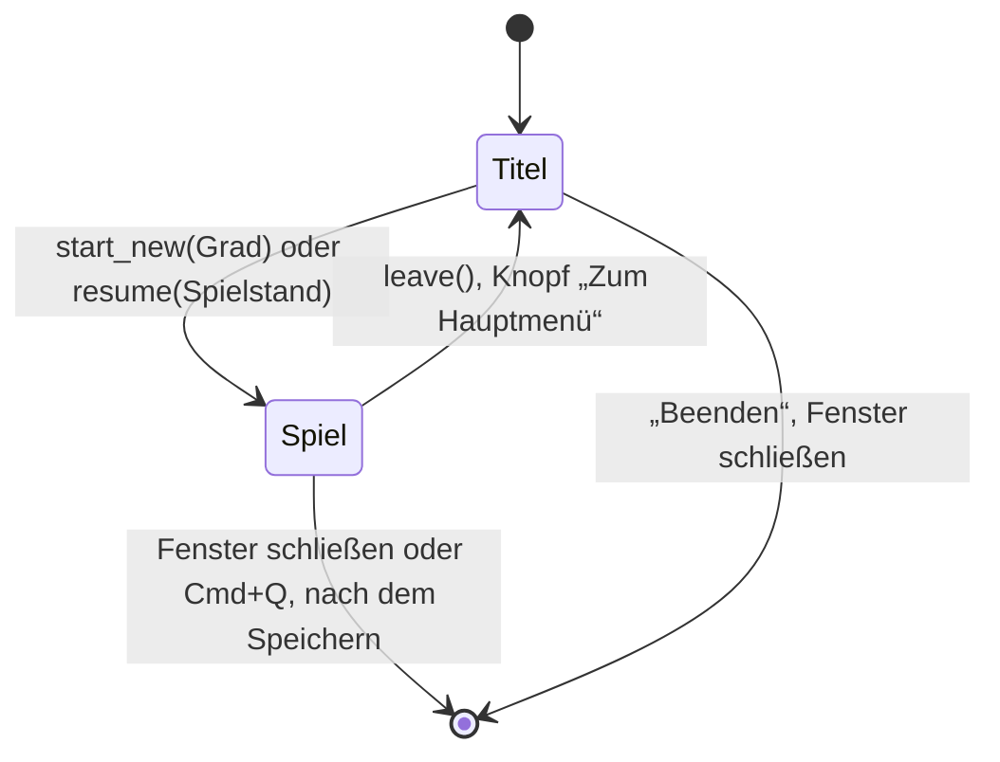

# Spielablauf

- **Worum es geht:** wie ein Spiel beginnt, fortgesetzt, gespeichert und verlassen wird, und der
  Spielbildschirm.
- **Laden, wenn:** Spielstart, Fortsetzen, Speichern, Szenenwechsel zwischen Titel und Spiel oder
  der Spielbildschirm betroffen sind; oder wenn ein neues System beim Beginnen oder Fortsetzen
  eines Spiels mitmachen muss.
- **Code:** `src/core/game_session.gd` (Autoload `GameSession`), `src/scenes/game/`; Tests
  `src/test/test_game_session.gd`, `test_game_screen.gd`
- **Herkunft:** `specs/004-neues-spiel/` (`contracts/spielablauf.md`, `data-model.md`,
  `research.md` R6 bis R9, R15)
- **Stand:** Feature 004, 2026-10-27
- **Nachbarn:** Dateien in [spielstaende.md](spielstaende.md), Menüs in
  [titel-und-hauptmenue.md](titel-und-hauptmenue.md), Zeitleiste in [zeitleiste.md](zeitleiste.md)

## GameSession

Ein Spiel beginnt und endet nur hier. `GameSession` hält das laufende Spiel (`current`, ein
`SaveGame`), setzt Uhr und Zeitleiste und speichert über `SaveStore`. Beim Start der App tut es
nichts; die Zeitleiste startet seit Feature 004 auch kein Spiel mehr von selbst. Auf dem
Titelbildschirm läuft also kein Spiel.

| Methode | Was geschieht |
|---|---|
| `start_new(difficulty, seed = -1)` | Seed würfeln (oder vorgegeben), Spielstand „Spiel N“ mit Kopie des Katalogs anlegen und **zuerst schreiben**; erst dann Uhr auf den 01.01.1985 und `Timeline.start_game(seed, grad)` |
| `resume(slot)` | nur fortsetzbare Spielstände; erst `Timeline.resume_game()` mit Katalog, Seed, Grad, Eingriffen und Spieldatum, dann `GameClock.set_date()`, damit bei einer Ablehnung die Uhr bleibt; danach gleich speichern |
| `save()` | Tag von der Uhr (höchstens 31.12.1999), Eingriffe aus dem Lauf, „zuletzt gespielt“ und Spielversion schreiben |
| `leave()` | speichern, dann `Timeline.stop_game()`, Uhr zurück auf den 01.01.1985, kein Spiel mehr |
| `is_running()`, `store()` | ob ein Spiel läuft; ein `SaveStore` für den Ordner |

**Erst schreiben, dann starten:** So meldet die Zeitleiste nie den 01.01.1985 eines Spiels, das es
nicht gibt. Hat ein zweites Fenster die Nummer gerade genommen, versucht `start_new()` bis zu fünf
Nummern. Ein zu großer Seed oder ein unbekannter Grad legt nichts an.

**Fortsetzen ist still:** Die Zeitleiste spielt die Tage bis zum Spieldatum ohne Signale nach
(`TimelineRun.replay()`), die Uhr springt ohne Signale dorthin. Das erste Signal kommt für den Tag
danach, genau wie in einem Spiel ohne Pause. Gespeichert wird sofort, damit das Spiel oben in der
Liste steht, auch wenn die App gleich danach abstürzt.

## Speichern beim Schließen

Solange ein Spiel läuft, schaltet `GameSession` `auto_accept_quit` ab und fängt das Schließen des
Fensters und Cmd+Q ab: erst speichern, dann beenden. Scheitert das Speichern, bleibt das Fenster
offen mit einer Meldung, und ein zweites Schließen beendet ohne Speichern. Ohne Spiel schließt das
Fenster normal; die Werkstatt regelt ihr Schließen selbst.

## Fehler beim Speichern

| Wann | Folge | Meldung |
|---|---|---|
| beim Anlegen | kein Spiel, die Gradwahl bleibt | „Speichern ging nicht. Es ist kein Spiel angelegt.“ |
| beim Fortsetzen, Speichern, Verlassen, Schließen | das Spiel läuft weiter | „Speichern ging nicht. Dein Spiel läuft weiter.“ |

Der Satz steht in `last_error`. Scheitert ein Speichern im laufenden Spiel, kommt außerdem das
Signal `save_failed(message)`; beim Anlegen nicht, dort liest die Gradwahl `last_error` selbst. Datei und
Schritt stehen nur im Protokoll. Die Meldung erscheint im Baustein Meldung an der Stelle des
Hinweises.

## Spielbildschirm

`res://scenes/game/game_screen.tscn` ist noch ein Platzhalter: ein Vollbild in `nacht` mit dem
Knopf „Zum Hauptmenü“ in der Mitte (Baustein Knopf, siehe [darstellung.md](darstellung.md)).
- Der Knopf hat von Anfang an den Fokus. Daneben steht wie im Menü sein Hinweis: „Speichert
  Spiel 2 und führt ins Hauptmenü.“
- Auslösen ruft `leave()` und wechselt zum Titelbildschirm. Scheitert das Speichern, steht die
  Meldung neben dem Knopf, und das Spiel läuft weiter.
- Scheiterte schon das Speichern beim Fortsetzen, zeigt der Bildschirm die Meldung beim
  Erscheinen.
- Esc tut nichts, damit niemand versehentlich das Spiel verlässt.
- Die Uhr steht: Ein neues Spiel bleibt am 01.01.1985. Dass Spielstände auch spätere Tage richtig
  festhalten, belegen Tests, die selbst vorspulen.

Szenen wechseln mit `change_scene_to_file()`. Titel- und Spielbildschirm haben dafür
`scene_callback`, damit Tests den Wechsel prüfen, statt ihn auszuführen.

## Für Tests

`GameSession` kennt Uhr, Zeitleiste und Ordner über Felder: `clock`, `timeline` (`null` heißt die
Autoloads), `folder`. Dazu `now` (Uhrzeit), `rng` (Seed) und `quit_callback`. So schreibt kein Test
in die echten Spielstände.
