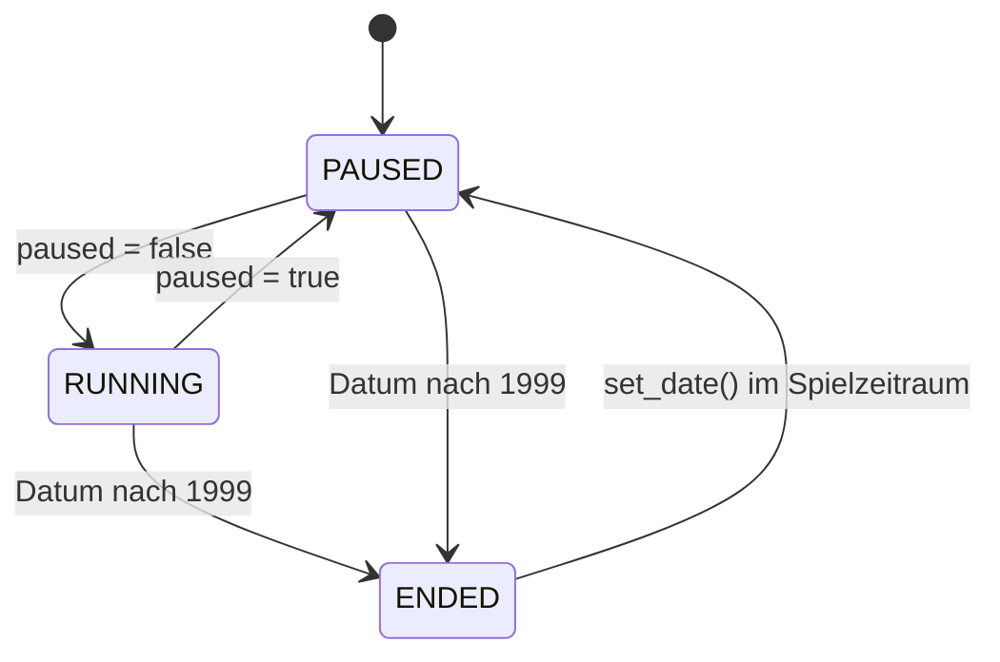

# Spielzeit

- **Worum es geht:** wie das Spiel Tage zählt und wie die Spieluhr die Zeit vorantreibt.
- **Laden, wenn:** etwas mit Datum, Tagen, Monaten, der Uhr oder dem Tempo zu tun hat.
- **Code:** `src/core/game_date.gd`, `src/core/game_clock.gd` (Autoload `GameClock`)
- **Herkunft:** `docs/features/archiv/01-01-spieluhr.md`, Feature 002 (negative Tage,
  Kalender-Ereignisse), Feature 004 (`set_date()`), Feature 008 (Zustand, Tage je Bild; T036a)
- **Stand:** Feature 008, 2026-10-29

## Spielzeitraum

Ein Spiel läuft vom 01.01.1985 bis zum 31.12.1999, 15 Jahre mit 5.478 Tagen. Alles im Spiel
rechnet in **Tagesindizes**:

| Tag | Index |
|---|---|
| 01.01.1985 | 0 |
| 31.12.1999 | 5477 (`TimelineRun.LAST_DAY`) |
| 31.12.1984 | −1 |
| 01.12.1984 | −31 |

Negative Indizes braucht nur die Zeitleiste: für jährliche Ereignisse, die vor Spielbeginn
anfangen, etwa den Winter 1984/85, und für den Tag −1, an dem ein Lauf vor dem ersten Spieltag
steht. Monate haben eigene Nummern, 0 (Januar 1985) bis 179 (Dezember 1999).

## GameDate

Ein Kalenderwert ohne Node (`RefCounted`) mit `year`, `month`, `day`. Intern rechnet alles über
den Tagesindex, das macht Vergleiche und Sprünge einfach. Schaltjahre stimmen.

- `to_day_index()` und `from_day_index()` rechnen in beide Richtungen, auch vor 1985.
- `from_iso("1993-03-22")` liest nur genau die Form `JJJJ-MM-TT` mit führenden Nullen, sonst
  `null`. So steht nach dem Speichern nie still ein anderes Format in einer Datei.
- `to_iso()` gibt `"1993-03-22"`, `str()` gibt `"22.03.1993"`, `to_label()` gibt `"März 1993"`.
- `is_valid(y, m, d)` prüft, ob es den Kalendertag gibt. Den 29.02.1989 gibt es nicht.

In Dateien stehen Tage immer als `"JJJJ-MM-TT"`, im Speicher als Index.

## GameClock

Autoload, das das aktuelle Datum hält und die Zeit vorantreibt. Andere Systeme messen keine Zeit
selbst, sie hängen sich an die Signale der Uhr.

| Signal | Wann |
|---|---|
| `day_passed(date)` | jeden neuen Tag |
| `month_passed(date)` | am Ersten eines Monats, nach `day_passed` |
| `year_passed(date)` | am 1. Januar, nach `month_passed` |
| `reached_end()` | wenn das Datum 1999 verlässt; die Uhr hält dann an |

**Zustand** (AR-11): `GameClock.State { RUNNING, PAUSED, ENDED }` in `_state`. Die Uhr läuft, ist
angehalten oder hat das Spielende überschritten.

- **Start:** 01.01.1985, angehalten (`PAUSED`).
- **`paused`** ist nur aus dem Zustand abgeleitet, ohne eigenen Speicher: Lesen gibt true, wenn
  die Uhr nicht läuft, auch am Ende. Setzen hält an oder lässt laufen; am Ende ändert Setzen
  nichts.
- **Laufen:** In `RUNNING` sammelt `_process()` die Zeit mit `days_per_second` (Vorgabe 2,0) in
  einem Akkumulator und ruft je vollem Tag `advance_day()` auf, höchstens
  `MAX_DAYS_PER_FRAME = 4` Tage je Bild (AR-10). Bis dahin bleibt ein angefangener Tag für das
  nächste Bild; was darüber hinausgeht, verfällt. Nach einem Hänger springt die Uhr also nicht
  viele Tage auf einmal.
- **Schritte:** `advance_day()`, `advance_one_month()` (bis zum nächsten Monatsersten),
  `advance_one_year()` (bis zum nächsten 1. Januar). Jeder übersprungene Tag sendet seine Signale.
- **Pause:** `set_paused()`, `toggle_paused()`. `is_finished()` sagt, ob die Uhr in `ENDED` steht.
- **Stellen:** `set_date(date)` setzt die Uhr ohne Signale auf ein Datum; die Pause bleibt, wie sie
  ist. Ein Datum nach 1999 setzt `ENDED`; ein Datum im Spielzeitraum holt die Uhr aus dem Ende,
  sie steht dann angehalten. `GameSession` stellt damit die Uhr beim Anlegen auf den 01.01.1985,
  beim Fortsetzen auf das Spieldatum und beim Verlassen zurück (siehe
  [spielablauf.md](spielablauf.md)).

Die Zeitleiste hängt an `day_passed` (siehe [zeitleiste.md](zeitleiste.md)). Wer die Uhr im
Spiel startet und anhält, ist noch nicht gebaut; bisher pausiert die Uhr dauerhaft, auch auf dem
Spielbildschirm.

Jahreszeiten und Weihnachtsgeschäft kennt die Uhr nicht. Sie sind seit Feature 002 jährliche
Ereignisse im Katalog, das Signal `season_changed` gibt es nicht mehr.
