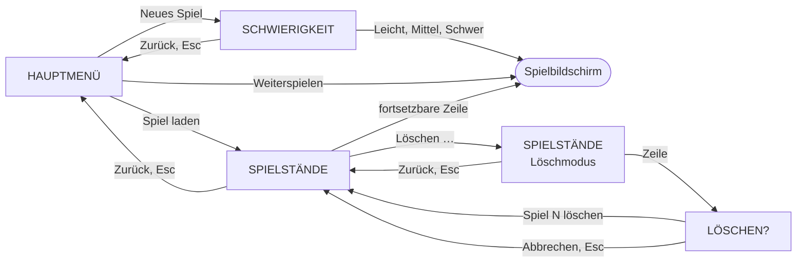
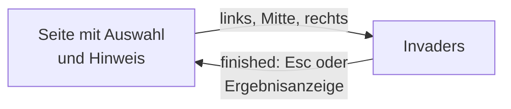

# Titelbildschirm und Hauptmenü

- **Worum es geht:** was vom Start der App bis zum Spiel auf dem Titelbildschirm passiert: das
  Hauptmenü, die Wahl des Grads, die Liste der Spielstände mit Löschen und die Rückfrage, alle als
  Seiten auf dem Communicator; dazu der Weg ins Easter Egg über die Gehäusetasten.
- **Laden, wenn:** Titelbildschirm, Hauptmenü, eine Seite, der Hinweis oder Texte im Titel
  geändert werden, ein Menüeintrag dazukommt oder verfügbar wird, oder die Folge der Gehäusetasten
  betroffen ist.
- **Code:** `src/scenes/title/` (`title_screen`, `main_menu`, `menu_entry`, `menu_hint`,
  `menu_paper`, `save_list`, `title_texts`, `key_sequence`); Tests `src/test/test_title_screen.gd`,
  `test_main_menu.gd`, `test_save_list.gd`, `test_menu_hint.gd`, `test_title_texts.gd`,
  `test_key_sequence.gd`
- **Herkunft:** `specs/001-hauptmenue/` (`contracts/titelbildschirm.md`), erweitert durch
  `specs/004-neues-spiel/` (`contracts/titelbildschirm.md`, `data-model.md`, `research.md` R11 bis
  R14), `specs/005-communicator/` (`contracts/titelbildschirm.md`, `research.md` R8 bis R10) und
  `specs/006-easter-egg-space-invaders/` (`contracts/titelbildschirm.md`, `research.md` R5, R10,
  R16)
- **Stand:** Feature 006, 2026-10-28
- **Nachbarn:** der Baustein Communicator in [communicator.md](communicator.md), was beim
  Beginnen und Fortsetzen passiert in [spielablauf.md](spielablauf.md), Spielstände in
  [spielstaende.md](spielstaende.md), Fenster, Farben und Schriften in
  [darstellung.md](darstellung.md), das versteckte Spiel in [easter-egg.md](easter-egg.md)

## Start

Die App startet per Doppelklick im Fenster (bis 2026-10-20 im Vollbild). Bis zum ersten Bild ist
der Grund `anzeige-grund`, ohne Splash-Bild. Hauptszene ist
`res://scenes/title/title_screen.tscn`. Ziel: höchstens 3 s bis zum bedienbaren Titelbildschirm.
Es läuft dabei kein Spiel; eins beginnt erst über das Menü.

Bei jedem Erscheinen, auch nach „Zum Hauptmenü“, steht der Communicator erst draußen. Der Titel
setzt die Einträge des Hauptmenüs und wählt vor, dann fährt das Gerät herein. Bis das Hauptmenü
seine Einträge hat, fängt die Wache `_ready_for_input` jede Eingabe ab, auch Esc. Während der
Fahrt herein lässt sich schon wählen und auslösen.

## Aufbau

```text
TitleScreen (Control, 640 × 360)
├── Background          Titelbild T-02, 640 × 360, genau doppelt aus dem Bildraster
├── LogoBlock           Ladenschild-Logo, darunter „WIRTSCHAFTSSIMULATION · 1985–1999“,
│                       bei (14, 12) bis y 83, mit pixelschatten
├── VersionLine         oben rechts, 16 vom Rand, „V0.1 · PROTOTYP“
└── Communicator        Gehäuse G-03, Endlage (244, 92) bis zum unteren Bildrand,
    │                   case_keys: die drei grauen Tasten
    ├── MainMenu        Seite HAUPTMENÜ        ┐
    ├── DifficultySheet Seite SCHWIERIGKEIT    │ auf der Anzeige (280, 120) bis (600, 280),
    ├── SaveList        Seite SPIELSTÄNDE      │ immer genau eine sichtbar
    ├── ConfirmSheet    Seite LÖSCHEN?         │
    └── Invaders        das versteckte Spiel   ┘
```

Alle Seiten stehen mit `look = LCD` auf der Anzeige des Communicators (siehe
[communicator.md](communicator.md)): dunkle Schrift auf `lcd`, die gewählte Zeile invertiert.
Hauptmenü, Gradwahl und Rückfrage sind Instanzen von `main_menu.tscn` mit `MenuEntry`s, die der
Titelbildschirm zur Laufzeit baut. Die Liste ist eine eigene Szene `save_list.tscn`. Auswahl und
Pfeil malen beide über `MenuPaper`. Der Schatten des Logos ist eine Silhouette des Logos in
`tusche` (`TitleScreen.silhouette()`), 2 Pixel nach rechts unten.

`TitleScreen` setzt nur zusammen und verbindet. Seiten und Communicator kennen einander nur so weit,
wie der Communicator sie hinstellt und zeigt: Eine Seite meldet per Signal, der Titelbildschirm
reicht weiter, entscheidet, was ein Eintrag bewirkt, und zeigt mit `Communicator.show_page()` die
nächste Seite. Ein Spiel beginnt oder setzt fort nur über `GameSession`, gelöscht wird nur über deren
`SaveStore`. Alle Texte stehen in `TitleTexts`.

## Wege



Esc führt eine Ebene zurück, im Hauptmenü tut es nichts. Zurück im Hauptmenü steht die Auswahl
auf dem Eintrag, der die Seite geöffnet hat. Ein Seitenwechsel bewegt den Communicator nicht.

**Spielstart:** Erst legt `GameSession` das Spiel an oder setzt es fort. Klappt das, sperrt
`_leaving` jede weitere Eingabe, der Communicator fährt hinaus, und erst `slide_finished(false)`
wechselt zum Spielbildschirm. Scheitert es, fährt nichts.

## Hauptmenü

Die Einträge entstehen aus den Spielständen im Ordner, bei jedem Erscheinen frisch gelesen:

| Eintrag | verfügbar | Wirkung |
|---|---|---|
| Weiterspielen | wenn ein Spielstand fortsetzbar ist | setzt den zuletzt gespielten fort; Hinweis „Weiter mit Spiel 2, Schwer, am 14.03.1986.“ |
| Neues Spiel | immer | öffnet die Gradwahl; „Einen neuen Laden aufmachen. Los geht es am 01.01.1985.“ |
| Spiel laden | wenn es irgendeinen Spielstand gibt, auch beschädigt | öffnet die Liste |
| Einstellungen | nein | „Noch nichts einzustellen. Kommt später.“ |
| Beenden | immer | schließt sofort, ohne Rückfrage und ohne Fahrt hinaus, auch während der Fahrt herein |

Vorgewählt ist „Weiterspielen“, wenn es verfügbar ist, sonst „Neues Spiel“. Nicht verfügbare
Einträge nennen im Hinweis den Grund, etwa „Noch kein Spiel angefangen.“

## Gradwahl

Leicht, Mittel, Schwer und Zurück, vorgewählt bei jedem Öffnen Mittel. Die Hinweise sagen ehrlich,
was ein Grad tut: „Das Glück ist eher auf deiner Seite.“, „Das Glück hält sich raus.“, „Das Glück
ist eher auf der Seite der anderen.“ Ein Grad startet das Spiel und wechselt zum Spielbildschirm.
Scheitert das Anlegen, steht die Meldung an der Zeile, und die Gradwahl bleibt.

## Liste der Spielstände

Je Spielstand eine Zeile mit vier Spalten: Name, Grad, Spieldatum, zuletzt gespielt. Bei einem
nicht fortsetzbaren steht statt Grad und Spieldatum „beschädigt“ oder „neuere Version“. Darunter
immer „Löschen …“ und „Zurück“. Reihenfolge wie in [spielstaende.md](spielstaende.md).

- Höchstens fünf Spielstände sind zu sehen. Die Liste rollt immer um ganze Zeilen; Rollmarken
  zeigen, dass es oben oder unten weitergeht. Sie liest den Ordner bei jedem Öffnen neu.
- Hinweis einer Zeile: „Steht am 14.03.1986. Gespielt am 26.10.2026, 21:40 Uhr.“, bei einem nicht
  fortsetzbaren der Grund.
- Eine fortsetzbare Zeile auslösen setzt fort. Eine nicht fortsetzbare lässt sich wählen, löst
  aber nichts aus.
- **Löschmodus:** „Löschen …“ schaltet ihn ein, die Kopfzeile heißt dann „WELCHES LÖSCHEN?“. Die
  dann ausgelöste Zeile führt zur Rückfrage. „Zurück“ und Esc beenden nur den Modus.

## Rückfrage

Seite „LÖSCHEN?“ mit „Abbrechen“ (vorgewählt) und „Spiel 2 löschen“. Die Hinweise nennen Name,
Grad und Spieldatum, etwa „Spiel 2 ist danach weg: Schwer, 14.03.1986. Für immer.“ Nach dem Löschen
zeigt die Liste die Zeile, die an die Stelle rückt; ist keiner mehr da, das Hauptmenü auf „Neues
Spiel“. Scheitert das Löschen, steht „Löschen ging nicht. Der Spielstand ist noch da.“ an seiner
Zeile.

## Bedienung

Die Auswahl ist Godots Fokus: Gewählt ist die Zeile, deren Button den Fokus hat. So gibt es genau
eine Auswahl, egal ob Maus oder Tastatur sie ändert.

| Eingabe | Wirkung |
|---|---|
| Maus über einer Zeile, Rechtsklick | wählt die Zeile, zeigt ihren Hinweis; Rechtsklick löst nie aus |
| Pfeil runter, Tab / Pfeil hoch, Shift+Tab | nächste / vorige Zeile, am Ende geht es am anderen Ende weiter |
| Mausrad | rollt die Liste der Spielstände |
| Enter, Leertaste, Linksklick | löst die gewählte Zeile aus, wenn sie verfügbar ist, sonst nichts |
| Esc | eine Ebene zurück |
| Maus verlässt die Seite | Auswahl und Hinweis bleiben |

Nicht verfügbare Einträge stehen in `gehaeuse-dunkel`, lassen sich aber wählen und zeigen ihren
Hinweis. Der Mauszeiger ist eine Hand nur, wo ein Klick etwas tut.

**Signale:** `MainMenu.entry_activated(id)` nur für verfügbare Einträge,
`selection_changed(entry, row_rect)` bei jedem Wechsel. `SaveList` meldet `resume_requested(slot)`,
`delete_requested(slot)`, `back_requested` und `selection_changed(hint, row_rect)`.

**Hinweis (`MenuHint`):** gehört zum Communicator; der Titel ruft `Communicator.show_hint()`,
`show_warning()` und `hide_hint()`. Er erscheint sofort, für Maus und Tastatur gleich, links neben
dem Gehäuse, oben bündig mit der Zeile, die rechte Kante bei x 240, also 4 vor dem Gehäuse,
höchstens 160 breit, mit Umbruch. Er fährt mit dem Gerät. Godots Tooltip passt nicht, er erscheint
nur für die Maus und mit Verzögerung. Mit `show_warning()` wird er zur Meldung (Theme-Variante
`WarningPanel`); sie bleibt, bis etwas anderes gewählt oder ausgelöst wird. Alle Hinweise und
Meldungen passen in höchstens zwei Zeilen, das prüft `test_title_texts.gd`.

## Easter Egg

Die drei grauen Gehäusetasten rechts unter der Anzeige, gedrückt links, Mitte, rechts, starten das
versteckte Spiel als fünfte Seite auf der Anzeige. Die Tasten selbst gehören zum Communicator (siehe
[communicator.md](communicator.md)); der Titel setzt sie in seiner Szene mit `case_keys` und hört
`case_key_pressed`. Das Spiel selbst steht in [easter-egg.md](easter-egg.md).

**Folge:** `EASTER_EGG_KEYS = [0, 1, 2]` in `KeySequence` (`key_sequence.gd`, `RefCounted`).
`press(index)` gibt true, wenn die Folge damit voll ist, und beginnt dann von vorn. Die richtige
nächste Taste zählt eins weiter; eine falsche setzt zurück, und ist sie die erste der Folge, zählt
sie gleich als neuer Anfang. So startet 1-1-2-3; 1-2-2-3 und 2-1-3 starten nicht. Dazwischen darf
der Spieler im Menü wählen. Jeder Titel bekommt eine neue Folge, auch nach „Zum Hauptmenü“.

Ein Druck zählt nur, wenn der Titel Eingaben annimmt (`_accepts_input()`: Einträge da, nicht beim
Hinausfahren) und das Spiel nicht schon auf der Anzeige steht. Sonst klickt die Taste nur und drückt
sich ein. Damit zählt die Folge auch schon während der Fahrt herein, wie die Seiten dann Eingaben
annehmen.



- **Start** (`_start_invaders()`): Folge zurücksetzen, die sichtbare Seite in `_return_page` und das
  Control mit dem Fokus in `_return_focus` merken, Hinweis und Meldung ausblenden (`_hide_hint()`),
  dann `show_page(Invaders)` und erst danach `Invaders.start()`; nur eine sichtbare Seite kann den
  Fokus nehmen. Zeile und Hinweis führt der Titel ohnehin in `_selected_row` und `_selected_hint`.
  Gerät, Logo und Versionszeile bewegen sich nicht.
- **Ende** (`_on_invaders_finished()`): Folge zurücksetzen, die gemerkte Seite zeigen, ohne eine
  das Hauptmenü; den Fokus zurückgeben (`_restore_focus()`): dem gemerkten Control, ist es noch
  nicht sichtbar, nach diesem Bild; fehlt es, wählt die Seite ihre gemerkte Zeile neu. Dann den
  Hinweis der Zeile wieder zeigen. Eine Meldung, die beim Start stand, etwa „Löschen ging
  nicht.“, kommt nicht zurück; an ihrer Stelle steht der Hinweis der Zeile.
- **Esc:** Im Spiel nimmt die Seite Esc selbst. Erreicht Esc trotzdem `_unhandled_input()` des
  Titels, etwa in dem Bild, in dem die Seite ihren Fokus zurückholt, markiert der Titel es als
  behandelt und führt keine Ebene zurück, solange `Invaders` sichtbar ist.
- **Kein Spielstand:** Das Spiel ruft `GameSession` nicht, braucht keinen Spielstand und legt keinen
  an, auch nicht, wenn das Fenster während des Spiels schließt. Es startet auch mit einem
  beschädigten Spielstand im Ordner. Nach dem Spiel läuft alles wie vorher.

## Versionszeile

Oben rechts im Himmel des Titelbilds, rechtsbündig, 16 vom Rand, mit `pixelschatten`.
`"V%s · %s" % [version, "PROTOTYP"]`. Die Nummer kommt aus `application/config/version` in
`project.godot` (heute `0.1`) und wird nur dort gepflegt. Ist sie leer, steht nur „PROTOTYP“ da.

## Für Tests

`scene_callback` und `quit_callback` ersetzen den Szenenwechsel und `get_tree().quit()`; ungültig
heißt der echte Aufruf. Tests stellen `Communicator.animate` auf `false` oder takten die Fahrt Bild
für Bild. Sie prüfen auch, dass Logo, Untertitel und Versionszeile weder Gehäuse noch Anzeige noch
Hinweis überschneiden und zwischen Logoblock und Gehäuse mindestens `raster-8` frei bleibt, gemessen
am Kasten des Logoblocks.
