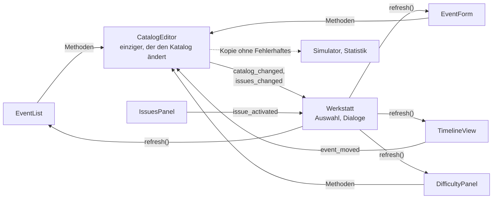

# Zeitleisten-Werkstatt

- **Worum es geht:** das Entwicklungswerkzeug, mit dem Klaus den Ereigniskatalog und die Profile
  der Grade pflegt, Spiele simuliert und Statistiken rechnet. Dazu die Textausgabe des Fahrplans.
- **Laden, wenn:** die Werkstatt benutzt, erweitert oder getestet wird, oder wenn eine Änderung am
  Katalog oder an der Zeitleiste auch in der Werkstatt sichtbar werden muss.
- **Code:** `src/tools/werkstatt/`; Tests `src/test/test_catalog_editor.gd`, `test_event_form.gd`,
  `test_timeline_view.gd`, `test_simulator.gd`, `test_statistics_panel.gd`,
  `test_difficulty_panel.gd`, `test_what_if_probe.gd`, `test_werkstatt_*.gd`,
  `test_fahrplan_ausgabe.gd`
- **Herkunft:** `specs/002-zeitleisten-werkstatt/contracts/werkstatt.md`, ergänzt durch
  `specs/003-schwierigkeitsgrade/contracts/werkstatt.md`
- **Stand:** Feature 004, 2026-10-27
- **Nachbarn:** Modell in [zeitleiste.md](zeitleiste.md), Dateiformat in
  [ereigniskatalog.md](ereigniskatalog.md), Grade in [schwierigkeitsgrade.md](schwierigkeitsgrade.md)

## Zweck und Rahmen

Ereignisse werden nicht im Code gepflegt, sondern in der Werkstatt. Sie ist Editor, Simulator
und Statistik in einem und arbeitet immer mit dem aktuellen, auch ungespeicherten Stand.

- Sie gehört nicht zum Spiel: Der Export des Spiels schließt `tools/*` aus, das Spiel lädt sie nie.
  In der Selbsttest-App steckt sie mit, weil deren Presets nur `addons/gut/*` und `test/*` ausschließen.
- Ihr Look folgt dem Abschnitt „Werkzeuge“ im Style-Guide, mit eigenem Theme
  `werkstatt_theme.tres` in den Farben des Computerladens. Sie läuft in voller Auflösung, nicht im
  Pixelraster des Spiels.
- Start im Editor mit F6 bei offener `werkstatt.tscn`, oder:

  ```bash
  /Applications/Godot.app/Contents/MacOS/Godot --path src res://tools/werkstatt/werkstatt.tscn
  ```

  Mit `-- --katalog res://test/fixtures/catalog_500.json` öffnet sie einen anderen Katalog.
- Beim Start schaltet sie die Skalierung des Spiels ab, nimmt den Skalierungsfaktor des Bildschirms
  (scharfe Schrift auf Retina), maximiert das Fenster und schaltet `GameWindow` für ihren Prozess
  ab.

## Aufbau

```text
Toolbar        Speichern, Verwerfen, Rückgängig, Wiederholen | Datei, „ungespeichert“, Fehler und Warnungen
Links          EventList: Suche, Filter nach Art und Kategorie, Liste, „Neu …“, „Duplizieren“, „Löschen“
Mitte oben     TimelineView: der Zeitstrahl
Mitte unten    Reiter „Prüfung“, „Simulator“, „Statistik“, „Schwierigkeitsgrade“
Rechts         EventForm: das gewählte Ereignis, darunter die Kategorien
```

Alle Teiler sind verschiebbar; ihre Lage merkt sich die Werkstatt in
`user://werkstatt_einstellungen.cfg`. In kleinen Fenstern rollen die Reiter.



## CatalogEditor

Der Kern der Werkstatt, ohne Oberfläche (`RefCounted`):
- Öffnen, Speichern (kanonisch), Verwerfen, neuer leerer Katalog mit den zehn Kategorien.
- Jede Änderung ist genau eine `UndoRedo`-Aktion mit lesbarem Namen, etwa „Datum von Intel Pentium
  erscheint“. Der Verlauf überlebt das Speichern, Öffnen und Verwerfen leeren ihn.
- Ereignisse anlegen, duplizieren, löschen (nennt Verweise, auch aus Profilen, und entfernt sie
  mit), umbenennen (Verweise ziehen mit), Felder und Art ändern. Beim Wechsel der Art bleiben
  Werte, die beide Arten haben.
- Kennungen entstehen aus dem Titel (`id_from()`: klein, Umlaute als ae/oe/ue/ss, sonst `_`),
  eindeutig gemacht mit `_2`, `_3` …
- Profile: Start-Modifikatoren anlegen, duplizieren, ändern, löschen.
- Nach jeder Änderung prüft er neu (`issues()`). Meldungen vom Lesen (V22) bleiben bis zum
  nächsten Speichern stehen; die zu einem Profil fallen weg, sobald eine Änderung dieses Profil
  ersetzt.
- **Speichern** fragt bei Fehlern nach und, wenn die Datei seit dem Öffnen von außen geändert
  wurde, noch einmal.
- **Sicherungskopie** alle 2 Minuten nach `user://werkstatt_sicherungen/`, je Katalog eine Datei.
  Nach einem Absturz bietet die Werkstatt beim Start „Übernehmen“, „Verwerfen“ oder „Später“ an.

Kürzel: Cmd+S Speichern, Cmd+Z Rückgängig, Shift+Cmd+Z Wiederholen (unter Windows/Linux Ctrl).
Solange ein Textfeld den Fokus hat, gehört Cmd+Z dem Feld.

## Liste, Formular, Prüfung

- **Liste:** Titel, Art und ein Zeichen für Fehler oder Warnung. Der Filter gilt auch für den
  Zeitstrahl.
- **Formular:** Die Art bestimmt die sichtbaren Felder. Dazu Listen für Wirkungen, Folgen und
  Bedingungen. Zahlen nehmen Komma oder Punkt, Prozente erscheinen in Prozent, Daten als
  `TT.MM.JJJJ`. Eine Eingabe gilt beim Verlassen des Felds oder mit Enter; bei einer ungültigen
  kehrt der alte Wert zurück, und ein Hinweis sagt, warum. Felder mit Fehler haben eine Kontur in `kassenrot`. Bei
  Ereignissen über Wahrscheinlichkeit zeigt die Zeile „Je Grad“ die Chance je Grad und Zeitraum.
- **Prüfung:** alle Meldungen mit Stufe, Ereignis, Feld und Text. Ein Klick führt zum Feld, bei
  Profilen in den Reiter „Schwierigkeitsgrade“.

## Zeitstrahl

1985 bis 1999 mit einer Zeile je Kategorie. Fixe Ereignisse sind Punkte oder mit Dauer Balken,
jährliche stehen in jedem ihrer Jahre, gesetzte als Rahmen über dem Zeitfenster, Ereignisse über
Wahrscheinlichkeit als Band mit der Chance; Ereignisse nur als Folge stehen nicht darauf.
Überlappendes stapelt sich.

- Datum und Dauer fixer Ereignisse sowie Zeitfenster lassen sich ziehen. Während des Ziehens zeigt
  eine Vorschau am Mauszeiger Datum und ersten Fehler. Beim Loslassen entsteht genau eine
  Änderung. Jährliche Ereignisse ändert nur das Formular.
- Mausrad und Wischen verschieben, Cmd+Mausrad, Kneifen und die Knöpfe „+“, „−“, „Alles“ zoomen,
  bis zu einem Monat.
- Klick wählt, Doppelklick auf freie Fläche öffnet „Neu …“ vorbelegt mit fix, Kategorie der
  Zeile und Tag, Rechtsklick öffnet Bearbeiten, Duplizieren, Löschen. Tooltips zeigen Titel, Art, Datum, Chance.

## Reiter „Schwierigkeitsgrade“

Je Grad mit Profil eine Tabelle der Start-Modifikatoren (Ereignis, Wert, von, bis, Grund,
Kennung) mit Feldern zum Ändern. „Neu“ nimmt das gewählte Ereignis, wenn es über
Wahrscheinlichkeit kommt.

## Simulator

Spielt ein Spiel auf einer Kopie des aktuellen Katalogs ohne Fehlerhaftes, ohne Spieluhr und
ohne den Katalog zu ändern.

- **Lauf:** Seed (oder „Würfeln“), Grad, „Fahrplan erzeugen“; dann „+1 Tag“, „+1 Monat“,
  „+1 Jahr“, „Bis …“ und „Bis zum Ende“. Ein Wechsel des Grads baut den Lauf mit denselben
  Eingriffen neu.
- **Anzeige:** der Fahrplan als Tabelle (Datum, Ereignis, Herkunft, Zustand), darunter die
  Begründung des gewählten Termins und seine verzögerten Wirkungen; rechts das Protokoll.
  Ausgenommene Ereignisse und Start-Modifikatoren nennt ein Hinweis. Ändert sich der Katalog, sagt
  ein Hinweis „Katalog geändert, neu starten“.
- **Eingriffe:** Modifikator setzen und entfernen, über das Menü am Termin absagen und
  verschieben, Ereignis einplanen. Abgelehnte zeigen ihren Grund.
- **Was wäre, wenn:** Mit Eingriffen rechnet der Simulator denselben Seed ohne Eingriffe mit und
  markiert Unterschiede (neu, verschoben, anderer Zustand, weggefallen durchgestrichen), auf Wunsch
  gegen Mittel statt gegen denselben Grad. „Neu starten mit“ und „ohne Eingriffe“ spielen bis
  zum selben Tag.

**Proben:** Seed, Grad, Endtag und Eingriffsprotokoll lassen sich als Probe speichern, als JSON
unter `src/tools/werkstatt/proben/<kennung>.json` (heute leer). Laden spielt das Protokoll mit
`WhatIfProbe.build_run()` über `TimelineRun.replay()` nach und ergibt denselben Fahrplan. Tage
schreibt `InterventionFile` wie im Spielstand. Eingriffe, deren Ereignis oder
Termin fehlt, nennt ein Hinweis.

## Statistik

Rechnet viele Spiele mit den Seeds 1 bis N (Vorgabe 1.000, höchstens 100.000) in Häppchen von
15 ms je Bild, abbrechbar. Wahlweise mit den Modifikatoren und Einplanungen aus dem Simulator.

- **Ein Grad:** je Ereignis Mittelwert, kleinste und größte Anzahl, Anteil der Spiele ohne und
  mit erreichter Obergrenze; für die gewählte Zeile die Verteilung auf die Jahre als Balken.
- **Alle drei vergleichen:** jeder Seed in Leicht, Mittel und Schwer; je Ereignis Mittelwert,
  Spanne und „ohne“ je Grad. Ein Abbruch verwirft den angefangenen Seed in allen Graden.

## Textausgabe

Fahrplan oder Protokoll ohne Fenster, für Vergleiche und Prüfungen:

```bash
/Applications/Godot.app/Contents/MacOS/Godot --headless --path src -s res://tools/werkstatt/fahrplan_ausgabe.gd -- --seed 4711 --grad schwer
```

Optionen: `--seed` (Vorgabe 1), `--grad leicht|mittel|schwer` (Vorgabe Mittel), `--bis
JJJJ-MM-TT`, `--katalog res://…`, `--protokoll`. Ausgabe nach stdout. Exit 1 bei Fehlern im
Katalog (die Ausgabe läuft trotzdem, ohne Fehlerhaftes) oder falschen Argumenten. Die Zeilen
baut `ScheduleText`.
