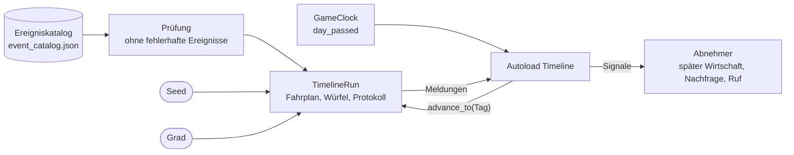
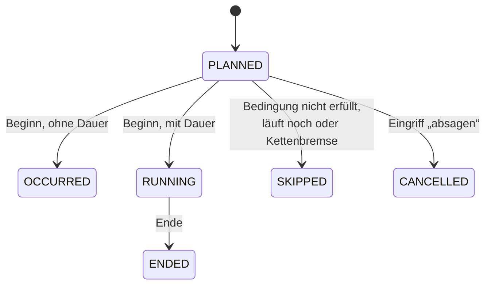

# Zeitleiste

- **Worum es geht:** wie aus dem Ereigniskatalog je Spiel ein Fahrplan entsteht, wie er
  abgespielt wird und was die Zeitleiste dabei meldet.
- **Laden, wenn:** Ereignisse, Zufall, Seed, Signale der Zeitleiste oder Eingriffe ins Spiel
  betroffen sind, oder wenn ein System (Wirtschaft, Nachfrage, Ruf) an die Zeitleiste angebunden
  wird.
- **Code:** `src/core/timeline.gd` (Autoload `Timeline`), `src/core/timeline/` (Kern ohne Node)
- **Herkunft:** `specs/002-zeitleisten-werkstatt/`, ergänzt durch `specs/003-schwierigkeitsgrade/`;
  Würfel `Timeline.rng` und `TimelineRun.format_points()` aus `specs/008-architektur/` (T036a,
  T036d)
- **Stand:** Feature 008, 2026-10-29
- **Nachbarn:** Dateiformat und Prüfregeln in [ereigniskatalog.md](ereigniskatalog.md), Grade in
  [schwierigkeitsgrade.md](schwierigkeitsgrade.md), Datum und Uhr in [spielzeit.md](spielzeit.md)

## Das Fahrplan-Modell

Die Zeitleiste ist das Herz der Simulation: Was zwischen 1985 und 1999 geschieht, steht als
Ereignis im Katalog. Aus Katalog, Seed und Grad entsteht beim Spielstart ein **Fahrplan**, eine
Liste von Terminen. Die Spieluhr spielt ihn Tag für Tag ab.



**Grundsatz:** Die Zeitleiste **wendet keine Wirkung an**, sie meldet nur. „Pentium erscheint,
486-Preise −30 %“ ist eine Meldung. Ob und wie Preise fallen, entscheidet das System, das sich an
das Signal hängt. So bleibt die Zeitleiste unabhängig von allem, was noch kommt.

**Wiederholbar:** Gleicher Katalog, gleicher Seed, gleicher Grad und gleiche Eingriffe ergeben
dasselbe Protokoll, egal ob die Uhr Tag für Tag läuft oder springt.

## Kern und Hülle

| Teil | Art | Aufgabe |
|---|---|---|
| `TimelineRun` | `RefCounted` | ein Spiel: legt den Fahrplan an, spielt Tage ab, gibt Meldungen zurück, nimmt Eingriffe an |
| `Timeline` | Autoload (Node) | Hülle: liest und prüft den Katalog, legt den Lauf an, hängt ihn an `GameClock`, macht aus Meldungen Signale |

Weil der Lauf kein Node ist, läuft er gleich im Spiel, in der Werkstatt, in der Textausgabe, in
der Statistik und in den Tests.

**Beim Programmstart** liest `Timeline` den Katalog `res://data/event_catalog.json`, prüft ihn
und behält ihn ohne fehlerhafte Ereignisse und Start-Modifikatoren. Jeden Fehler meldet sie mit
`push_error()`; ein fehlerfreier Katalog erzeugt keine Ausgabe. Fehlt die Datei, bleibt die
Zeitleiste leer und das Spiel startet trotzdem. Ein Spiel beginnt sie nicht von selbst (bis
Feature 004 startete sie am Ende des ersten Bilds eins mit Mittel); das tut `GameSession` (siehe
[spielablauf.md](spielablauf.md)). Ohne Spiel sendet sie nichts.

| Methode | Wirkung |
|---|---|
| `start_game(seed = -1, difficulty = Difficulty.DEFAULT) -> Error` | neuer Lauf auf dem Katalog der Zeitleiste, ersetzt einen laufenden; spielt den 01.01.1985 und sendet dessen Meldungen. `seed < 0` heißt würfeln aus 0 bis 2.147.483.647 (`MAX_SEED`) mit dem eigenen Würfel `Timeline.rng` |
| `resume_game(catalog, seed, difficulty, interventions, day) -> Error` | setzt ein gespeichertes Spiel fort: prüft den mitgegebenen Katalog wie den eigenen, legt den Lauf an und spielt die Eingriffe mit `TimelineRun.replay()` bis `day` nach, **ohne Signale**. Das erste Signal kommt für den Tag danach. Abgelehnte Eingriffe kommen als Warnung, der Rest gilt |
| `stop_game()` | beendet das laufende Spiel; danach kein Signal mehr |
| `is_running()`, `get_seed()`, `get_difficulty()`, `get_event(id)`, `running_entries()` | Abfragen; Seed und Grad −1 ohne Spiel |

Ein Seed außerhalb, ein unbekannter Grad oder ein Tag außerhalb des Spiels ergibt
`ERR_INVALID_PARAMETER`, das laufende Spiel bleibt.

`Timeline.rng` ist eine Naht (AR-08, AR-12): ein eigener `RandomNumberGenerator` statt Godots
globalem Würfel, nur für `start_game()` ohne Seed. Tests setzen einen mit festem Seed und wissen so
vorher, welcher Seed herauskommt. Ein Spiel bekommt seinen Seed immer von `GameSession`, die ihn aus
`GameSession.rng` zieht.

## Signale

| Signal | Wann |
|---|---|
| `event_fired(event, date)` | ein Termin beginnt |
| `effect_applied(effect, source, date)` | eine Wirkung beginnt, sofort oder verzögert |
| `event_ended(event, date)` | ein Termin mit Dauer endet |
| `effect_ended(effect, source, date)` | eine Wirkung „gilt nur während“ endet mit ihrem Termin |
| `entry_skipped(entry, date)` | ein Termin entfällt: Bedingung nicht erfüllt, Ereignis läuft noch, oder Kettenbremse (dann zusätzlich eine Warnung) |

Eingriffe und Start-Modifikatoren werden kein Signal, sie stehen nur im Protokoll des Laufs. Wer
später dazukommt, fragt `running_entries()`, statt auf die nächste Meldung zu warten.

## Ereignisse

Ein Ereignis (`TimelineEvent`) hat Kennung, Titel, Text, Kategorie, eine **Art** und dazu
Wirkungen, Folgeereignisse und Bedingungen. Die Art bestimmt, wie es in den Fahrplan kommt:

| Art (`Kind`) | In der Werkstatt | Kommt in den Fahrplan | Beispiel |
|---|---|---|---|
| `FIXED` | fix | an einem festen Datum | Windows 95 erscheint |
| `YEARLY` | fix, jährlich | jedes Jahr von–bis, mit Beginn und Ende im Jahr | Weihnachtsgeschäft, Winter, CeBIT |
| `PRESET` | beim Start gesetzt | beim Anlegen gewürfelt: Anzahl nach Gewichten, Tage im Zeitfenster mit Mindestabstand | — |
| `CHANCE` | über Wahrscheinlichkeit | monatlich gewürfelt mit einer Chance pro Monat | Reklamationswelle, Großkunde |
| `FOLLOW_ONLY` | nur als Folge | nur als Folgeereignis eines anderen | — |

Ein Ereignis kann eine **Dauer** haben (`duration_days`, 0 heißt Augenblick). Ein Ereignis läuft
nie zweimal gleichzeitig. Ereignisse über Wahrscheinlichkeit haben dazu eine Höchstzahl
(0 = unbegrenzt) und einen Mindestabstand zwischen zwei Beginnen.

**Wirkungen** (`EventEffect`): Art `PREIS`, `NACHFRAGE`, `REPUTATION` (angezeigt als „Ruf“),
`KUNDENSTROM` oder `PRESSE`, dazu ein Ziel (Warengruppe wie `cpu_486` oder `*`), eine Stärke
(relativ, −0,30 = −30 %), eine Verzögerung in Tagen und der Geltungsbereich: `ONCE` (einmaliger
Anstoß) oder `DURING` (gilt nur, solange das Ereignis läuft). Ein Ereignis ohne Wirkung ist eine
reine Meldung.

**Folgeereignisse** (`FollowUp`): Wenn ein Termin beginnt, kommt mit einer Wahrscheinlichkeit ein
anderes Ereignis nach, mit einer Verzögerung von–bis. Ziel darf nicht fix oder jährlich sein.

**Bedingungen** (`EventCondition`): „Ereignis X ist schon eingetreten“ oder „noch nicht
eingetreten“. Eingetreten heißt: Ein Termin von X hat bis zum Vortag begonnen. Fixe und jährliche
Ereignisse haben keine Bedingungen.

Was im Katalog heute steht: 31 Ereignisse, 19 fixe, 6 jährliche (Jahreszeiten,
Weihnachtsgeschäft, CeBIT) und 6 über Wahrscheinlichkeit (Großkunde, Konkurrent eröffnet,
Konkurrent gibt auf, Lieferengpass, Neubaugebiet, Reklamationswelle) in 10 Kategorien.

## Termine

Ein Termin (`ScheduleEntry`) ist ein Vorkommen eines Ereignisses im Fahrplan, mit laufender
Nummer (`serial`, ab 1), Beginn `day`, Ende `end_day` und Herkunft (`FIXED`, `YEARLY`, `PRESET`,
`ROLLED`, `FOLLOW_UP`, `INTERVENTION`). Gewürfelte Termine merken sich Wurf, Schwelle,
Grundchance und die Modifikatoren, die beim Wurf galten; `explain()` macht daraus einen Satz.

Termine werden nie gelöscht. Der Fahrplan ist zugleich die Geschichte des Spiels.



Angezeigt heißen die Zustände geplant, eingetreten, läuft, beendet, entfallen und abgesagt.

## Anlegen des Fahrplans

`TimelineRun.new(catalog, seed, difficulty)` kopiert den Katalog (der Lauf verändert ihn nie) und
geht die Ereignisse nach Kennung durch:
- **fix:** ein Termin am Datum;
- **jährlich:** ein Termin je Vorkommen aus `yearly_occurrences()`. Ein Vorkommen, das vor dem
  01.01.1985 beginnt, startet am Tag 0 und trägt `started_before_game`. Der Zeitstrahl der
  Werkstatt nutzt dieselbe Regel;
- **beim Start gesetzt:** Anzahl k = `count_min` + ein nach `count_weights` gezogener Index; dann
  k Tage im Zeitfenster, so verteilt, dass der Mindestabstand ohne neues Würfeln hält;
- **über Wahrscheinlichkeit:** noch kein Termin, nur ein eigener Würfel;
- danach die Start-Modifikatoren des Grads (siehe [schwierigkeitsgrade.md](schwierigkeitsgrade.md)).

## Würfel und Seed

Jede Zufallsentscheidung hat einen eigenen `RandomNumberGenerator` (`EventDice`). Sein Startwert
ist SHA-256 über `"<seed>|<zweck>|<schlüssel>"`:

| Zweck | Schlüssel | Würfe |
|---|---|---|
| `chance` | Kennung | ein Würfel je Ereignis für alle 180 Monate, genau zwei Würfe je Monat |
| `preset` | Kennung | einmal beim Anlegen |
| `follow` | `"<quelle>\|<index>\|<tag>"` | je Entscheidung über ein Folgeereignis |

Darum verschiebt ein neues Ereignis oder eine geänderte Chance nie die Würfe anderer Ereignisse,
und Modifikatoren ändern nur Schwellen, nie Würfe. Ein Ereignis über Wahrscheinlichkeit würfelt
seine zwei Würfe auch in Monaten, in denen es nicht in Frage kommt.

## Tagesablauf

`advance_to(tag)` springt von Stichtag zu Stichtag: Tage, an denen etwas beginnt, endet, fällig
wird oder ein Monat anfängt. An jedem Stichtag gilt diese feste Folge:

1. **Enden:** Termine, die heute enden, nach laufender Nummer; je Termin erst das Ende seiner
   laufenden Wirkungen „während“, dann das Ende des Ereignisses. So endet am 01.03. erst der
   Winter, dann beginnt der Frühling.
2. **Verzögerte Wirkungen**, die heute fällig sind.
3. **Würfelrunde** am Monatsersten: Jedes Ereignis über Wahrscheinlichkeit würfelt, nach Kennung.
   Ein Termin entsteht, wenn der Monat das Zeitfenster schneidet, der Wurf unter der wirksamen
   Chance liegt, Höchstzahl und Mindestabstand passen und die Bedingungen erfüllt sind. Der zweite
   Wurf bestimmt den Tag im Monat.
4. **Beginne:** Die geplanten Termine des Tags beginnen nach Herkunft, Kennung und Nummer. Je
   Termin wird geprüft: Bedingungen, läuft das Ereignis noch, Kettenbremse. Dann beginnen seine
   Wirkungen ohne Verzögerung, und über seine Folgeereignisse wird gewürfelt. Folgetermine ohne
   Verzögerung beginnen noch am selben Tag, hinten in der Reihe.

**Kettenbremse:** Höchstens 16 Glieder einer Folgekette am selben Tag, der Auslöser zählt als
erstes (`MAX_CHAIN`). Das 17.
entfällt mit der Meldung `CHAIN_STOPPED`.

`begin()` spielt den 01.01.1985 samt der ersten Würfelrunde. Nach dem 31.12.1999 meldet der Lauf
nichts mehr; Enden und Wirkungen danach stehen nur im Fahrplan.

## Meldungen und Protokoll

Jeder Aufruf gibt `TimelineMessage`s zurück und hängt sie an `run.protocol`. Arten:
`EVENT_STARTED`, `EVENT_ENDED`, `EFFECT_STARTED`, `EFFECT_ENDED`, `ENTRY_SKIPPED`,
`CHAIN_STOPPED`, `INTERVENTION` und seit Feature 003 `START_MODIFIER` (am Tag −1, nur im
Protokoll). `to_line()` gibt eine deutsche Zeile.

## Modifikatoren und Eingriffe

Die **wirksame Chance** eines Ereignisses über Wahrscheinlichkeit am Tag d ist

```text
clamp(Grundchance + Σ Start-Modifikatoren + Σ Modifikatoren aus Eingriffen, 0, 1)
```

jeweils die, deren Zeitraum d enthält. Ein **Modifikator** (`ChanceModifier`) hat Kennung,
Ereignis, Wert in Prozentpunkten als Anteil (+0,05 = +5 Prozentpunkte), Grund und `from_day` bis
`to_day`; ein Ende ist Pflicht, „unbegrenzt“ ist 5477. Beispiel: „Ware vom windigen Händler:
Reklamationswelle +5 ab 1990“. `chance_info(event_id, day)` zeigt die Rechnung.
`TimelineRun.format_points(share)` schreibt den Wert, wie er in der Begründung eines Termins steht:
Prozentpunkte mit Vorzeichen, deutschem Komma und einfachem Minus, etwa +0,05 als „+5“ und −0,025
als „-2,5“. Die Funktion ist öffentlich und statisch; die Werkstatt zeigt Werte genauso und liest
sie wieder.

**Eingriffe** sind die Stellen, an denen später Spielteile in die Zeitleiste greifen. `Timeline`
reicht sie an den Lauf durch:

| Methode | Wirkung |
|---|---|
| `add_modifier(modifier)` | Modifikator setzen; wirkt ab der nächsten Würfelrunde |
| `remove_modifier(id)` | Modifikator entfernen; Start-Modifikatoren lassen sich nicht entfernen |
| `cancel_entry(serial, reason)` | geplanten Termin absagen; seine Folgen kommen dann nicht |
| `move_entry(serial, new_day, reason)` | geplanten Termin verschieben, Dauer bleibt |
| `schedule_event(event_id, day, reason)` | Ereignis als neuen Termin einplanen |

Regeln: Eingriffe wirken erst nach dem heutigen Tag, vor Spielbeginn ab dem 01.01.1985. Fixe und
jährliche Termine lassen sich weder absagen, verschieben noch einplanen. Setzen, Absagen,
Verschieben und Einplanen brauchen einen Grund; beim Entfernen steht der Grund des entfernten
Modifikators im Protokoll. Rückgabe ist `OK` oder ein `Error`, der Grund steht in
`run.last_refusal`; ohne laufendes Spiel gibt `Timeline` `ERR_UNCONFIGURED`.

Jeder angenommene Eingriff steht mit seinem Tag (`at_day`) im **Eingriffsprotokoll**
`run.interventions`. Absagen und Verschiebungen merken sich Ereignis und Tag statt der Nummer,
denn Nummern ändern sich mit dem Katalog. Ein neuer Lauf mit demselben Seed, der das Protokoll
nach `at_day` geordnet nachspielt, ergibt denselben Fahrplan. Das macht
`run.replay(records, until_day)`: je Eintrag bis zu seinem Tag vorspielen
(`in_replay_order()`), dort `apply_intervention()`, danach bis `until_day`; zurück kommen die
abgelehnten Einträge mit Grund. Darauf bauen die Proben der Werkstatt und die Spielstände (siehe
[spielstaende.md](spielstaende.md)). In Dateien schreibt `InterventionFile` die Tage als
`"JJJJ-MM-TT"`.

## Weitere Klassen im Kern

| Klasse | Aufgabe |
|---|---|
| `ScheduleDiff` | vergleicht zwei Läufe und markiert Termine als neu, weggefallen, verschoben oder mit anderem Zustand |
| `ScheduleText` | Fahrplan und Protokoll als Textzeilen, für die Textausgabe |
| `TimelineStatistics` | spielt viele Seeds in Häppchen nach Zeitbudget, zählt je Ereignis (`EventStatistic`) |
