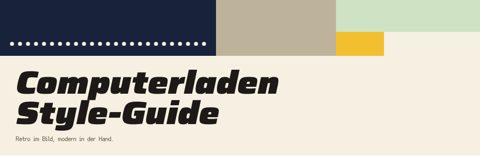

# Computerladen Style-Guide

*Retro im Bild, modern in der Hand.*

Verbindlicher Maßstab für alles Sichtbare und Hörbare im Spiel und in den Werkzeugen. Bis 2026-10-29
lag der Style-Guide als claude.ai-Artifact vor; seitdem ist dieser Ordner die einzige Quelle. Geändert
wird hier, im Repo, und erst dann gebaut.

| Datei | Inhalt |
|---|---|
| [README.md](README.md) | Leitbild, Raster und Auflösung, Bildaufbau, Farben, Schrift, Logo, App-Symbol, Oberfläche, Szenen und Figuren, Bewegung, Symbole |
| [tokens.md](tokens.md) | alle Werte mit Namen: Farben, Schriftstile, Abstände, Ecken, Schatten, Bildschirmmaße; maschinenlesbar in [tokens.json](tokens.json) |
| [sprache.md](sprache.md) | Sprache: Ton, Anrede, Zahlen, Wortschatz der Jahre 1985 bis 1999 |
| [ton.md](ton.md) | Ton: Format, Tonkanäle, Töne |
| [werkzeuge.md](werkzeuge.md) | Werkzeuge: Auflösung, Schrift, Farbrollen, Kategorienfarben, Bedienelemente, Texte |
| [leonardo-workflow.md](leonardo-workflow.md) | Leonardo-Workflow: Modelle, Stilblock, Formate, Nachbearbeitung, Hauptpalette, Prompts |
| [bausteine/](bausteine/) | Bausteine: [Anzeige](bausteine/anzeige.md), [Bedienleiste](bausteine/bedienleiste.md), [Bildrahmen](bausteine/bildrahmen.md), [Communicator](bausteine/communicator.md), [Hinweis](bausteine/hinweis.md), [Knopf](bausteine/knopf.md), [Liste](bausteine/liste.md), [Meldung](bausteine/meldung.md), [Menü](bausteine/menue.md), [Spiel auf der Anzeige](bausteine/spiel.md), [Zeitungsmeldung](bausteine/zeitungsmeldung.md) |
| [vorschau/](vorschau/) | Vorschau jedes Bausteins als HTML zum Öffnen im Browser (`bundle.css`, `tokens.css`) und als Bild unter `vorschau/bilder/` |

Im Text heißen die Teile weiter „Abschnitt Sprache“, „Baustein Menü“ und so fort; gemeint sind die
Dateien oben. Wer einen Token ändert, ändert `tokens.json` und `tokens.md` zusammen. Die Bilder unter
`vorschau/bilder/` entstehen aus den HTML-Dateien (Chrome ohne Fenster, `--screenshot`) und werden
neu erzeugt, wenn sich ein Baustein sichtbar ändert.

## Leitbild

Der Computerladen sieht aus wie ein VGA-Spiel vom Anfang der Neunziger und bedient sich wie ein Spiel von heute. Für Aufbau und Humor sind die deutschen Wirtschaftssimulationen das Vorbild, allen voran **Das Amt** (Greenwood, 1995), dazu Mad TV, Der Planer, Pizza Connection und Airline Tycoon: ein gerahmtes Bild, darunter eine Bedienleiste mit Geld und Datum, Nachrichten als Zeitung. Gezeichnet wird in Pixel-Art wie in den Adventures dieser Jahre. Modern sind Bildformat, Schärfe, Bewegung und Bedienung.

## Leitsätze

- **Retro im Bild, modern in der Hand.** Alles, was man sieht, könnte auf einem VGA-Monitor von 1992 laufen. Alles, was man tut, funktioniert wie heute: Überfahren, Tooltips, Rechtsklick, Tastenkürzel, automatisches Speichern. Gespielt wird mit Maus und Tastatur am Desktop.
- **Eine Quelle.** Farben, Schriften und Maße kommen aus diesem Guide. Was fehlt, wird erst hier ergänzt und dann gebaut.
- **Stimmigkeit vor Einzelglanz.** Jedes Bild wird am Stilanker gemessen. Was aus dem Stil fällt, wird nachgearbeitet oder neu erzeugt, auch wenn es für sich genommen gut aussieht.

## Raster und Auflösung

- Es gibt zwei Raster. Szenen, Figuren und Gegenstände liegen auf dem **Bildraster** von 320 × 180 Bildpixeln (`bildraster-breite`, `bildraster-hoehe`). Oberfläche und Schrift liegen auf dem **Oberflächenraster** von 640 × 360 Oberflächenpixeln (`bild-breite`, `bild-hoehe`). Ein Bildpixel ist genau 2 × 2 Oberflächenpixel groß (`bildpixel`).
- Feiner als das Bildraster ist nur die Oberfläche: Text und Bedienelemente dürfen auf dem Oberflächenraster stehen, Szenen nie. Kein Bild wird um krumme Faktoren skaliert, gedreht oder weichgezeichnet.
- Skaliert wird nur ganzzahlig: Das Oberflächenraster erscheint ×3 auf 1080p, ×4 auf 1440p und ×6 auf 4K. Andere Fenstergrößen bekommen schwarze Ränder statt krummer Faktoren.
- Texturfilter immer Nearest, keine Mipmaps, keine Unterpixel-Positionen. Szenenobjekte bewegen sich in ganzen Bildpixeln, die Oberfläche in ganzen Oberflächenpixeln.
- Godot: Renderer Compatibility (Verfassung, Grundsatz I). Die Szene in einem SubViewport mit 320 × 180, doppelt groß als TextureRect im Haupt-Viewport mit 640 × 360; die Oberfläche als Control-Nodes im Haupt-Viewport. Dazu `display/window/stretch/mode` = `viewport`, `display/window/stretch/scale_mode` = `integer`, `rendering/textures/canvas_textures/default_texture_filter` = `Nearest`, `rendering/2d/snap/snap_2d_transforms_to_pixel` und `rendering/2d/snap/snap_2d_vertices_to_pixel` an. Nicht genutzt werden HDR und damit Glühen über Weiß (Farbwerte über 1,0) sowie die Kantenglättung des Bildes (MSAA, FXAA); die Kantenglättung der Schrift regelt der Abschnitt Schrift.

## Bildaufbau

- **Spielbildschirm:** oben und seitlich der Endlospapier-Rahmen (`rahmen-breite`), darin die Szene (`szene-breite` × `szene-hoehe`: 624 × 288 Oberflächenpixel, also 312 × 144 Bildpixel), unten die Bedienleiste (`leiste-hoehe`). Bausteine: Bildrahmen, Bedienleiste.
- **Vollbild:** Titel, Zeitung, Zwischenbilder und Bilanzen nutzen den ganzen Bildschirm, 320 × 180 Bildpixel unter der Oberfläche.
- **Titel:** das Titelbild als Vollbild, links oben das Logo mit Untertitel, oben rechts die Versionszeile im freien Himmel, rechts unten der Communicator mit allen Seiten des Titels (Baustein Communicator). Auf T-02 steht der Laden links; rechts unten liegt das Bild unter dem Gerät, Hinweis und Meldung stehen links daneben über dem Laden. Logo und Untertitel stehen auf der Fassade und tragen deshalb den `pixelschatten` (Abschnitt Logo).
- **Spielbildschirm als Platzhalter:** Bis Bildrahmen und Bedienleiste kommen, ist der Spielbildschirm ein Vollbild in `nacht`. In der Mitte steht der Knopf „Zum Hauptmenü“ (101 × 20, also bei x 270, y 170), links daneben sein Hinweis (Baustein Knopf, allein auf einem Bildschirm).
- **Startgrund:** Bis das erste Bild steht, zeigt das Spiel nur `anzeige-grund`, kein Logo der Engine. Die Ränder der ganzzahligen Skalierung sind schwarz.
- Die Bedienleiste ist überall gleich: links das Ortsbild (führt zum Stadtplan), in der Mitte sechs Funktionsknöpfe, rechts die Leuchtanzeige mit Datum und Kontostand, das Porträt der sprechenden Figur und der Weiter-Pfeil.

## Farben

- Die Oberfläche benutzt nur die 16 Farben dieses Guides. Szenen benutzen die Hauptpalette aus dem Leonardo-Workflow, in der 15 davon reserviert sind. `lcd` fehlt dort mit Absicht: Es gibt sie nur in der Oberfläche, als Anzeige des Communicators über dem Gehäusebild, nie in einem Bild. Eine einzelne Figur kommt mit höchstens 16 Farben aus.
- Text steht nur in diesen Paaren: `tusche` auf `papier`, `endlos-gruen`, `lcd`, `gehaeuse`, `gehaeuse-hell` oder `signalgelb`; `papier` auf `nacht`, `nacht-hell`, `kassenrot` oder `petrol`; `lcd` auf `tusche` nur im Auswahlbalken auf der Anzeige des Communicators; `anzeige` nur auf `anzeige-grund`; gedämpfter Text in `gehaeuse-dunkel` nur auf `papier`, in nicht verfügbaren Menüeinträgen auch auf `endlos-gruen`, `signalgelb`, `lcd` und im Auswahlbalken `tusche` (Baustein Menü).
- `signalgelb` heißt immer „hier bist du gerade“: Überfahren, Auswahl, aktiver Menüpunkt. Es ist nie Schmuck. Auf der Anzeige des Communicators zeigt das ein Balken in `tusche` mit Schrift in `lcd`, denn ein LCD hat nur eine Farbe, wie die Leuchtanzeige.
- `kassenrot` heißt Geld und Gefahr: Preise, Sonderangebote, Verluste, Warnungen. Negative Beträge tragen zusätzlich ein Minus und das Wort SOLL, damit sie auch ohne Farbe erkennbar sind.
- `petrol` markiert das Aktive in Listen und Reitern.
- Keine Verläufe, keine weichen Schatten, keine Glas- oder Transparenzeffekte, weder in der Oberfläche noch in Szenen.

## Schrift

- **Saira** (`display`, Breite 125 %, kursiv, 800–900): Bildschirmtitel und Schlagzeilen (`ueberschrift`). Das Logo ist ein Bild, keine Schrift.
- **Ark Pixel** (`pixel-10`, `pixel-12`) von TakWolf, SIL OFL 1.1: alles Bedienbare und Lesbare, `text` in Ark Pixel 10 und `menue` in Ark Pixel 12. Jede Größe ist eine eigene, pixelgenau gezeichnete Schrift und wird nur in ihrer Größe gesetzt oder ganzzahlig vergrößert. Einen Wortabstand braucht sie nicht: Das Leerzeichen ist 5 und 6 Pixel breit.
- Pixelify Sans war zuerst vorgesehen. Sie liegt aber auf keinem Pixelraster: Bei 10 wirkt C wie O und 5 wie 9, auch bei 12 bleibt sie unsauber. Deshalb wird sie nicht verwendet.
- **Doto** (`matrix`, Punktmatrix): Leuchtanzeige (`anzeige-ziffern`), alles, was der Nadeldrucker ausgibt, die Kopfzeilen auf der Anzeige des Communicators, die ebenfalls eine Punktmatrix ist, und der Untertitel unter dem Logo (`drucker`), mit 1 Pixel Laufweite. Doto steht auf einem Punktraster und ist bei 10 sauber: ein Punkt je Oberflächenpixel. Bei 8 zerfallen die Buchstaben, bei 14 werden die Punkte ungleich groß. Für `anzeige-ziffern` ist die Größe deshalb noch offen, 10 oder 20; das klärt der Baustein Anzeige.
- Größen sind Oberflächenpixel. Ark Pixel und Doto werden ohne Kantenglättung gesetzt, nur in den genannten Größen.
- Zahlen deutsch: 12.450,00 DM, 14.10.1991, 09:30 Uhr. In Tabellen gleich breite Ziffern (`font-variant-numeric: tabular-nums`), Beträge rechtsbündig.
- Wie die Texte klingen, regelt der Abschnitt Sprache: Anrede, Ton, Wortschatz der Jahre 1985 bis 1999.

## Logo

- Das Logo ist ein Ladenschild in Pixel-Art: beiger Kunststoffrahmen, dunkelrotes Schildfeld, „DER“ klein zwischen zwei Zierlinien, darunter „COMPUTERLADEN“ in gelben Pixelbuchstaben mit oranger Schattierung, links ein kleiner beiger Monitor. Datei: `docs/art/leonardo/logo-ladenschild.png`, freigestellt, 850 × 164.
- Das Logo wird nur als Bild verwendet: nie nachgesetzt, nie neu eingefärbt, nie verzerrt. Rundherum bleibt mindestens `raster-8` frei.
- Auf ruhigem, dunklem Grund steht es frei, auf unruhigem Grund mit `pixelschatten` darunter.
- Der Untertitel „WIRTSCHAFTSSIMULATION · 1985–1999“ steht in `drucker` und `papier` direkt unter dem Schild, nie im Schild.
- Text, der direkt auf einem Bild steht, etwa Untertitel und Versionszeile im Titel, trägt wie das Logo auf unruhigem oder hellem Grund den `pixelschatten`, damit `papier` lesbar bleibt. Auf ruhigem, dunklem Grund wie `nacht` braucht er keinen.

Das Logo des Spiels als Ladenschild. `logo-ladenschild.png` ist freigestellt (transparenter Grund) und auf den Inhalt zugeschnitten, 850 × 164 Pixel; das Original mit Hintergrund liegt im Repo unter `docs/art/leonardo/`. Verwendung, Abstände und Untertitel regelt dieser Abschnitt.

## App-Symbol

- Das App-Symbol zeigt den beigen Monitor vom linken Ende des Ladenschilds, aufs Bildraster gebracht und ganzzahlig vergrößert, auf einem abgerundeten Quadrat in `nacht`. `kassenrot` taugt nicht als Grund, denn es steht für Geld und Gefahr.
- Fläche 1024 × 1024 nach Apples Symbolraster für macOS. Der Monitor bleibt mit seinen Pixeln erkennbar, auch in der Listenansicht des Finders.
- Für macOS 26 und neuer gibt es zusätzlich eine Liquid-Glass-Fassung aus Icon Composer: der freigestellte Monitor als Ebene über der Grundfarbe `nacht`.
- Dateien im Repo: `src/assets/icon/app_icon.png` und `src/assets/icon/app_icon.icon`, die Ebenen für Icon Composer unter `docs/art/app_icon/`.
- Für Windows gibt es zusätzlich `src/assets/icon/app_icon.ico` mit sechs Größen als PNG-Einträge: 16, 32, 48, 64, 128 und 256 Pixel. Jede Größe entsteht eigens aus dem gerasterten Monitor (18 × 16 Bildpixel), ganzzahlig vergrößert und mittig auf das abgerundete Quadrat in `nacht`, nie weichgezeichnet: 32 mit ×1, 48 und 64 mit ×2, 128 mit ×4, 256 mit ×8. Für 16 passt der Monitor nicht hinein; dort steht er in halber Größe aus jedem zweiten Bildpixel (9 × 8), kleine Details fallen weg, die Form bleibt.
- Godot rechnet ein PNG als Symbol selbst herunter und verwischt dabei die Pixel; deshalb kommt das Symbol für Windows immer aus der ICO, erzeugt von `tools/raster/make_icon.py`.

## Oberfläche

- Alles Bedienbare ist eckig (`ecke-0`), hat eine `tusche`-Kontur von einem Oberflächenpixel und Relief: `relief-erhaben` in Ruhe, `relief-gedrueckt` beim Drücken.
- Licht fällt immer von oben links, in der Oberfläche wie in den Szenen.
- Fenster, Menüs und die Zeitung liegen mit `pixelschatten` über der Szene.
- Abstände kommen aus `raster-2`, `raster-4`, `raster-8` und `raster-16`.
- Jede anklickbare Stelle reagiert beim Überfahren: Der Mauszeiger wechselt, die Fläche wird `signalgelb` oder bekommt einen `signalgelb`-Rand, ein Tooltip nennt Funktion und Tastenkürzel. Rechtsklick zeigt Infos, statt zu handeln. Im Menü übernimmt der Baustein Hinweis die Rolle des Tooltips, auch bei Auswahl per Tastatur. Ausgenommen sind die Gehäusetasten des Communicators, die versteckt sind (Baustein Communicator), und das Spiel auf der Anzeige (Baustein Spiel auf der Anzeige).
- Den Tastaturfokus zeigt eine `tusche`-Linie einen Oberflächenpixel neben dem Element, auf dunklem Grund wie `nacht` eine `papier`-Linie. Im Menü und in der Liste zeigt stattdessen die Zeile in `signalgelb` mit Pfeil die Auswahl, auf der Anzeige des Communicators der Balken in `tusche`.
- Eine Warnung zur Bedienung, etwa „Speichern ging nicht“, steht als Meldung an der Stelle des Hinweises (Baustein Meldung), nicht in einem eigenen Fenster.

## Szenen und Figuren

- VGA-Pixel-Art wie in den Adventures der frühen Neunziger: sichtbare, quadratische Pixel auf dem Bildraster, dunkle Konturen, keine Kantenglättung, Schattierung in wenigen Stufen mit von Hand gesetztem Dithering, warmes Licht von oben links.
- **Stilanker** ist das Bild C2 der Stilprobe vom 19.10.2026: der Ladenbesitzer hinter der Theke, warmes Holz, volle Regale. Jedes neue Bild wird an ihm gemessen und in Leonardo mit ihm als Stil-Referenz erzeugt.
- Die Geräte im Bild passen zum Spieljahr: 1985 Heimcomputer und Monochrom-Monitore, um 1990 beige Desktops mit 14-Zoll-Röhren, 1999 Tower und 17-Zoll-Röhren. Keine echten Markenlogos im Bild, Firmennamen nur erfunden.
- Kein Text im Szenenbild. Schilder, Plakate und Preise setzt die Oberfläche darüber, damit sie lesbar bleiben.
- Szenen werden auf die Hauptpalette gerechnet. Dithering ja, Rauschen und Verläufe nein.
- Der Ladenbesitzer ist überall dieselbe Figur: Ende dreißig, dunkles Haar, Schnurrbart, hellblaues Kurzarmhemd mit Namensschild, rot gestreifte Krawatte. Maßgeblich ist sein Figurenblatt (F-01).

## Bewegung

- Das Bild darf leben: Parallax in zwei bis vier Ebenen, flackernde Leuchtschrift, Regen, Monitorflimmern, Figuren mit wenigen, klaren Phasen wie bei VGA-Sprites, etwa vier bis acht für einen Schritt.
- Oberfläche: Übergänge 150–250 ms, Rückmeldung auf einen Klick unter 100 ms. Fenster gleiten oder klappen auf, nichts federt.
- Der Communicator fährt in 200 ms von unten herein und wieder hinaus, in ganzen Oberflächenpixeln, und kommt auf ganzen Bildpixeln zum Stehen (Baustein Communicator).
- Ausgenommen sind Seiten und Blätter: Eine Seite auf der Anzeige des Communicators ersetzt die vorige ohne Übergang, ebenso ein Blatt aus dem Drucker, wie ein neuer Ausdruck; eine Liste scrollt in ganzen Zeilen, ohne zu gleiten.
- Die Einstellung „Bewegung reduzieren“ schaltet alle Deko-Animationen ab, auch die Fahrt des Communicators: Er steht dann sofort da. Das Spiel auf der Anzeige ist keine Deko: Bewegungsbilder und Explosionen bleiben.
- Ton regelt der Abschnitt Ton.

## Symbole

- Eigene Pixel-Symbole auf 16 × 16 Oberflächenpixeln, im Symbolknopf auf 26 × 26. Gegenständlich und aus der Zeit: Telefon, Karton, Ordner, Zeitung, Kalender, Diskette.
- Kontur oder Umriss in `tusche`, höchstens vier Farben aus diesem Guide. Keine Emojis, keine modernen Linien-Symbole.
