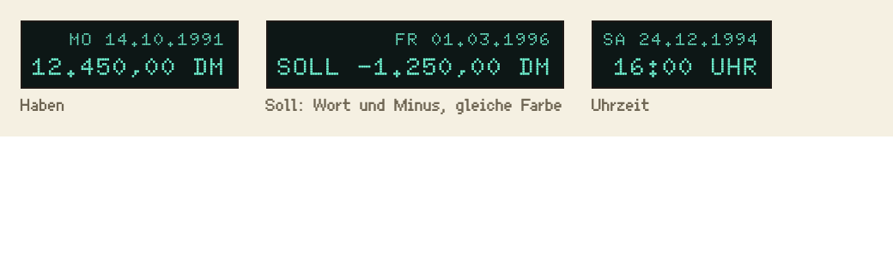

# Anzeige

Die Leuchtanzeige zeigt Datum, Uhrzeit und Kontostand wie das Display einer Registrierkasse der Neunziger.

## Einsatz

- Rechts in der Bedienleiste: oben das Datum (Zeile `zeile-klein`), darunter der Kontostand (`anzeige-ziffern`).
- Nur für Werte, die sich laufend ändern. Erklärender Text gehört in einen Tooltip.

## Aufbau

- Grund `anzeige-grund`, Ziffern `anzeige`, Kontur `tusche`, Schrift Doto, rechtsbündig, gleich breite Ziffern.
- Formate: `MO 14.10.1991`, `12.450,00 DM`, `16:00 UHR`.

## Zustände

- Negativer Kontostand: `SOLL` und ein Minus vor dem Betrag, als Bindestrich wie überall (Abschnitt Sprache): `-4.320,00 DM SOLL`; die Farbe bleibt `anzeige`. Rot wäre auf dem dunklen Grund zu schwach (3,4:1), und eine echte Anzeige kann nur eine Farbe.
- Ändert sich ein Wert, blinkt er einmal kurz (200 ms).

## Nicht

- Kein Leuchtschein, keine zweite Farbe, keine Wörter außer Wochentag, UHR, DM und SOLL.

## Vorschau

Haben, Soll, Uhrzeit · Oberflächenpixel ×2. Gruppe Bedienelemente. Zum Ansehen im Browser: [vorschau/anzeige.html](../vorschau/anzeige.html).
