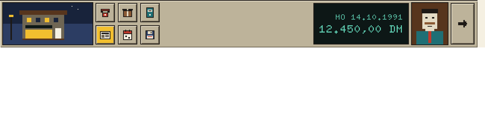

# Bedienleiste

Die Bedienleiste ist das Armaturenbrett des Ladens: Ort, Funktionen, Datum, Geld und die Figur, die gerade spricht.

## Einsatz

- Am unteren Rand jedes Spielbildschirms, `leiste-hoehe` hoch und `bild-breite` breit, direkt unter dem Bildrahmen.

## Aufbau, von links nach rechts

1. Ortsbild, 120 × 56: kleines Bild des aktuellen Orts. Ein Klick öffnet den Stadtplan.
2. Sechs Symbolknöpfe in zwei Reihen: Telefon (Lieferanten), Lager, Buchhaltung, Zeitung, Kalender, Diskette (Speichern). Tasten 1 bis 6.
3. Leuchtanzeige mit Datum und Kontostand (Baustein Anzeige).
4. Porträt, 48 × 56: wer gerade spricht oder berät. Der Verwender liefert das Bild.
5. Weiter-Pfeil, 32 × 56: beendet den Tag.

- Grund `gehaeuse` mit `relief-erhaben`, oben eine `tusche`-Linie; Ortsbild und Porträt mit `tusche`-Kontur; Abstände `raster-4`.

## Nicht

- Keine weiteren Knöpfe, ohne sie hier einzutragen. Keine Texte in der Leiste außer in der Anzeige; Erklärungen stehen im Tooltip.

## Vorschau

Ortsbild, sechs Funktionen, Anzeige, Porträt, Weiter · Oberflächenpixel ×2. Gruppe Bildschirm. Zum Ansehen im Browser: [vorschau/bedienleiste.html](../vorschau/bedienleiste.html).
