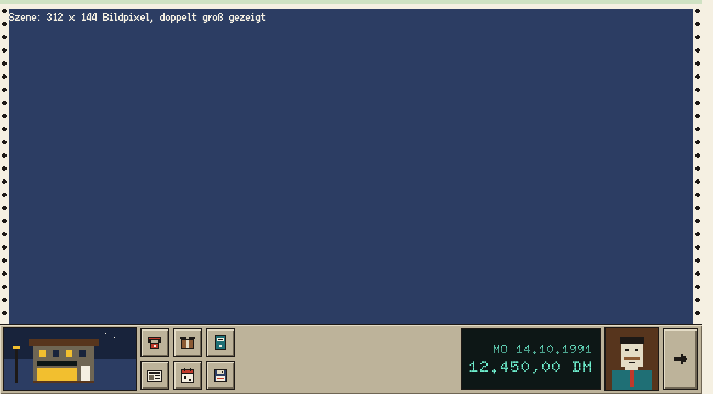

# Bildrahmen

Der Bildrahmen fasst die Szene wie ein Bogen Endlospapier: oben ein grüner Streifen, links und rechts die Lochränder.

## Einsatz

- In jedem Spielbildschirm, der eine Szene mit Bedienleiste zeigt.
- Vollbilder wie Titel, Zeitung und Zwischenbilder haben keinen Rahmen.

## Aufbau

- Gesamtbreite `bild-breite`, Rand `rahmen-breite` oben, links und rechts, darin die Szene in `szene-breite` × `szene-hoehe`.
- Grund `papier`, oberer Streifen `endlos-gruen` (4 Oberflächenpixel), Löcher in `tusche` mit `ecke-rund`: 4 Oberflächenpixel groß, alle 12 Oberflächenpixel. Die Reihe beginnt oben; ein Loch, das die Unterkante des Papiers berühren würde, entfällt, wie bei echtem Endlospapier, das zwischen den Löchern abgerissen wird. Das gilt auch für Menü und Liste. Die Lochränder sind zwei Elemente mit der Klasse `cl-lochrand` (`links`, `rechts`).
- Unten schließt die Bedienleiste direkt an; Rahmen, Szene und Leiste ergeben zusammen 640 × 360.
- Das Szenenbild liefert der Verwender: ein PNG mit 312 × 144 Bildpixeln auf der Hauptpalette, mit `bildpixel` doppelt groß gezeigt.

## Nicht

- Den Rahmen nicht einfärben, nicht animieren und nicht weglassen, um mehr Szene zu zeigen.

## Vorschau

Spielbildschirm 640 × 360: Rahmen, Szene, Bedienleiste · Oberflächenpixel ×2. Gruppe Bildschirm. Zum Ansehen im Browser: [vorschau/bildrahmen.html](../vorschau/bildrahmen.html).
