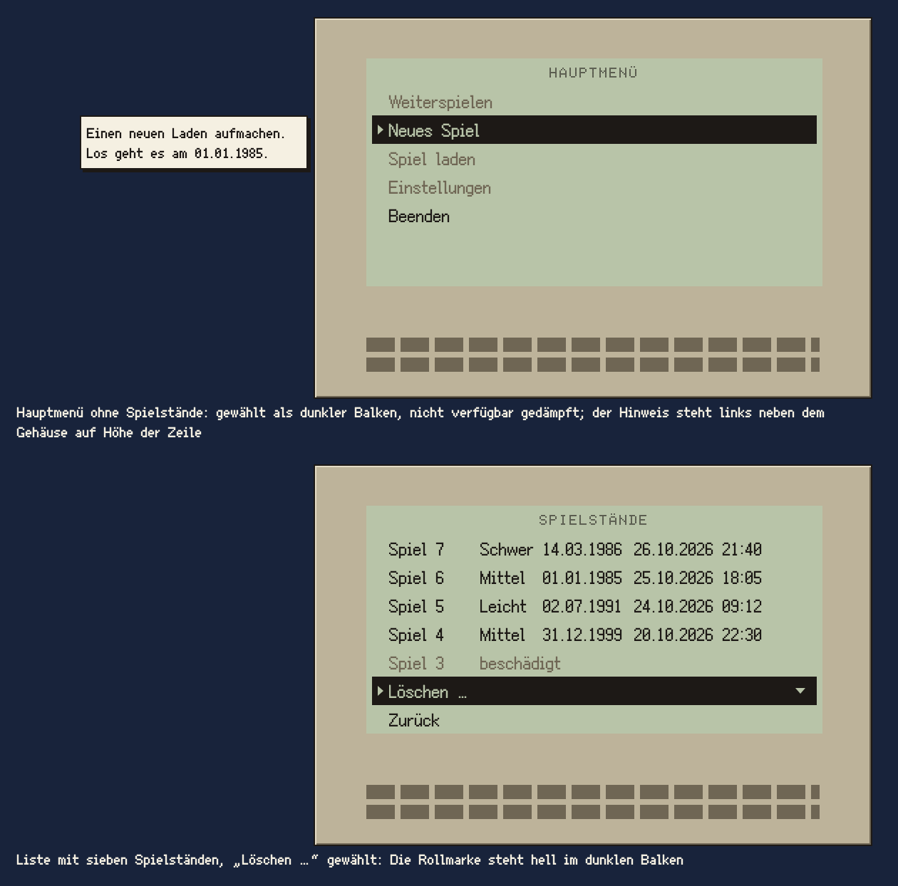

# Communicator

Der Communicator ist das Taschengerät, über das der Spieler das Spiel bedient: ein Gehäuse aus der Zeit mit einem LCD, auf dem Menüs und Listen stehen. Es fährt von unten ins Bild und wieder hinaus.

## Einsatz

- Im Titel für alle Seiten: Hauptmenü, Gradwahl, Spielstände, Rückfrage und das versteckte Spiel (Baustein Spiel auf der Anzeige). Endlospapier gibt es im Titel nicht mehr.
- Später auf dem Spielbildschirm mit eigenen Seiten; wie er dort geöffnet wird, regelt das Feature des Spielbildschirms.
- Der Name gilt für das Steuerelement, egal welches Gehäuse es gerade hat. Im Titel ist es fest der Organizer von 1991.

## Aufbau

- **Gehäuse:** ein Bild auf dem Bildraster, genau ×2 gezeigt, auf der Hauptpalette, Licht von oben links. Kein echter Markenname, kein Logo. Das Gehäuse ist Grafik bis auf seine Gehäusetasten (unten): Ein Klick daneben tut nichts, der Mauszeiger bleibt der Pfeil, nichts wird `signalgelb`.
- **Anzeige** (das LCD): 320 × 160 Oberflächenpixel (`geraet-anzeige-breite`, `geraet-anzeige-hoehe`), auf dem Oberflächenraster, für jedes Gehäuse gleich groß. Lage und Farbe gehören zum Gehäuse; beim Organizer ist die Anzeige `lcd`. Sie hat keine eigene Kontur, die Blende im Gehäusebild rahmt sie. Nicht zu verwechseln mit dem Baustein Anzeige, der Leuchtanzeige in der Bedienleiste.
- **Seite:** Auf der Anzeige steht immer genau eine Seite: ein Menü oder eine Liste mit Kopfzeile (Bausteine Menü und Liste, Abschnitt „Auf der Anzeige“) oder das Spiel mit eigenem Raster (Baustein Spiel auf der Anzeige). Sie füllt die Anzeige in der Breite und beginnt oben; was darunter frei bleibt, ist leeres LCD.
- Eine Seite passt immer ganz auf die Anzeige: höchstens 8 Zeilen zu 20, also Kopfzeile, 5 Einträge einer Liste und 2 feste Einträge. Bis zur Abnahme von Feature 005 war die Anzeige 384 × 192 mit 9 Zeilen; sie wurde kleiner, damit vom Gerät mehr als ein Rahmen um das LCD zu sehen ist.

## Lage im Titel

- Die Anzeige steht rechts unten, in der Endlage bei x 280 bis 600 und y 120 bis 280. Rechts bleibt wie bisher der Rand bis 616 frei vom Inhalt, also von Anzeige und Seiten. Das Gehäuse ist Grafik und darf rechts wie unten bis an den Bildrand reichen.
- Das Gehäuse beginnt oben bei y 92 und ragt unten aus dem Bild, als halte man das Gerät hoch; zu sehen sind Deckel, Scharnier, die Funktionstasten und die oberste Tastenreihe, der Rest der Tastatur liegt unter dem Bildrand. Beim Organizer (G-03, nach dem Vorbild eines elektronischen Notizbuchs von 1990) ist es 392 × 268 Oberflächenpixel, von x 244 bis 636 und bis zum unteren Bildrand, die Anzeige darin bei 36/28; hell cremebeige wie die Geräte im Stilanker, die Tasten hell auf einer dunklen Fläche, darüber mintgrüne Funktionstasten, eine rote Taste und rechts drei graue Tasten, die Gehäusetasten.
- Logo und Untertitel bleiben links oben frei (x 14 bis 296, y 12 bis 83); zum Gehäuse bleiben mindestens `raster-8`. Die Versionszeile steht oben rechts, rechtsbündig, `raster-16` vom oberen und vom rechten Bildrand, im freien Himmel über dem Gerät; so überdecken Hinweis und Meldung sie auch während der Fahrt nie. Bis Feature 005 stand sie unten links.
- Das Titelbild lässt rechts unten eine ruhige Fläche für das Gerät (T-02).

## Hinweis und Meldung

- Der Hinweis zur gewählten Zeile steht links neben dem Gehäuse, nicht neben der Zeile: seine rechte Kante 4 vor der linken Kante des Gehäuses, oben bündig mit der gewählten Zeile (Baustein Hinweis). Die Meldung steht an derselben Stelle (Baustein Meldung).
- Steht das Spiel auf der Anzeige, sind Hinweis und Meldung verborgen. Danach steht der Hinweis der gewählten Zeile wieder da; eine Meldung von vorher kommt nicht zurück.
- Hinweis und Meldung fahren mit dem Gerät. Fährt es herein, ist der Hinweis zu sehen, sobald seine Zeile es ist. Fährt es hinaus, fährt der Hinweis mit hinaus und verschwindet nicht vorher.

## Gehäusetasten

Ein Gehäuse kann Tasten haben, die man mit der Maus drücken kann. Beim Organizer G-03 sind es die drei grauen Tasten ganz rechts in der Reihe der Funktionstasten, direkt unter der Anzeige. Sie gehören zum Bild und sind versteckt: Im Titel starten sie in der Folge links, Mitte, rechts das Spiel auf der Anzeige (Feature 006). Ein Bildschirm gibt sie frei; von sich aus hat ein Communicator keine Gehäusetasten. Heute gibt es sie im Titel und in der Probeszene des Communicators.

| Taste | Bildpixel im Gehäuse | Oberflächenpixel im Gehäuse | im Titel |
|---|---|---|---|
| links | x 140 bis 150, y 114 bis 121 (11 × 8) | ab 280/228, 22 × 16 | ab 524/320 |
| Mitte | x 154 bis 165, y 114 bis 121 (12 × 8) | ab 308/228, 24 × 16 | ab 552/320 |
| rechts | x 169 bis 180, y 114 bis 121 (12 × 8) | ab 338/228, 24 × 16 | ab 582/320 |

Gezählt wird einschließlich. Zur Taste gehören ihre helle Oberseite (Zeilen 114 bis 117), die Vorderkante (118, 119) und ihr Schatten (120, 121); die Zeile 113 darüber ist der Rand der Fläche, nicht die Taste. Eine eigene helle Lichtkante haben die Tasten von G-03 nicht, auch links nicht (Vermessung vom 27.10.2026, Montage ×8).

- **Eingedrückt**, solange die linke Maustaste auf der Taste unten ist: Die Taste rückt eine Bildpixelzeile tiefer, ihre unterste Zeile fällt weg, und die frei werdende oberste Zeile hat die Farbe des Bildpixels links neben der Taste, des dunklen Spalts. Der Ausschnitt reicht nie über die Taste hinaus. Kein neues Bild und keine neue Farbe; ab dem nächsten Bild nach dem Drücken.
- **Klick:** Beim Drücken ertönt der Klick (Abschnitt Ton), auch wenn der Druck nichts bewirkt. Gezählt wird beim Loslassen über derselben Taste; lässt der Spieler woanders los, springt sie zurück und zählt nicht. Rechte und mittlere Maustaste tun nichts.
- **Ausnahme von den Regeln für anklickbare Stellen** (Abschnitt Oberfläche): kein Zeigerwechsel, kein `signalgelb` beim Überfahren, kein Tooltip, kein Hinweis, keine Kontur und kein `relief-gedrueckt`; kein Tastaturfokus, mit Tab und Pfeilen nicht erreichbar. Die einzige Rückmeldung sind Eindrücken und Klick. Grund: Die Tasten sind Teil des Gehäusebilds und ein Geheimnis; alles, was sie beim Überfahren verrät, nähme es weg.
- Fährt das Gerät herein, zählen die Tasten schon, wie die Seiten (Abschnitt Bedienung). Fährt es hinaus, nehmen auch die Tasten nichts an; eine gedrückte Taste springt zurück.
- Verliert das Fenster den Fokus, während eine Taste unten ist, springt sie ebenso zurück und zählt nicht.
- Probeszenen dürfen einen Druck zum Ausprobieren als Meldung zeigen; im Spiel gilt der Baustein Meldung nur für Fehler.

## Bewegung

- **Herein:** von unten, 200 ms, schnell los und sanft an (kubisch), ohne über die Endlage hinauszufahren. **Hinaus:** nach unten, 200 ms, sanft los und schnell weg. Nichts federt.
- Unterwegs steht das Gerät auf ganzen Oberflächenpixeln, in der Endlage auf ganzen Bildpixeln, damit das Gehäuse im Stand auf dem Raster des Hintergrunds liegt.
- Im ersten Bild einer Fahrt legt es höchstens ein Viertel seines Wegs zurück, auch wenn dieses Bild lange dauert, etwa beim Start.
- Wechselt die Seite, bleibt das Gerät stehen; die neue Seite ersetzt die vorige ohne Übergang.
- Die Fahrt ist eine Deko-Animation: Mit „Bewegung reduzieren“ steht das Gerät sofort da oder ist sofort weg.

## Bedienung

- Wie Menü und Liste: eine gemeinsame Auswahl für Maus und Tastatur, Pfeiltasten und Tab wählen, Enter, Leertaste und Linksklick lösen aus, Rechtsklick wählt nur, Esc führt eine Ebene zurück.
- Herein ist das Gerät sofort bedienbar. Die Maus wählt nur, wenn sie bewegt oder geklickt wird; eine Zeile, die unter dem ruhenden Zeiger durchfährt, wird nicht gewählt.
- Hinaus nimmt das Gerät keine Eingabe mehr an, weder Tastatur noch Maus. Fenster schließen und Vollbild wirken wie immer.

## Nicht

- Kein `signalgelb` und kein Papier auf der Anzeige; die Auswahl zeigt der Balken in `tusche` (Baustein Menü).
- Kein Gehäuse mit echtem Markennamen; Arbeitsnamen wie Zeitplaner, Organizer, Communicator.
- Keine zwei Seiten nebeneinander, kein Rollbalken, keine weichen Übergänge zwischen Seiten.

## Vorschau

Communicator mit Platzhalter für das Gehäuse G-03: oben das Hauptmenü mit Hinweis links neben dem Gehäuse, unten die Liste der Spielstände mit „Löschen …“ gewählt · Oberflächenpixel ×2. Gruppe Bedienelemente. Zum Ansehen im Browser: [vorschau/communicator.html](../vorschau/communicator.html).
