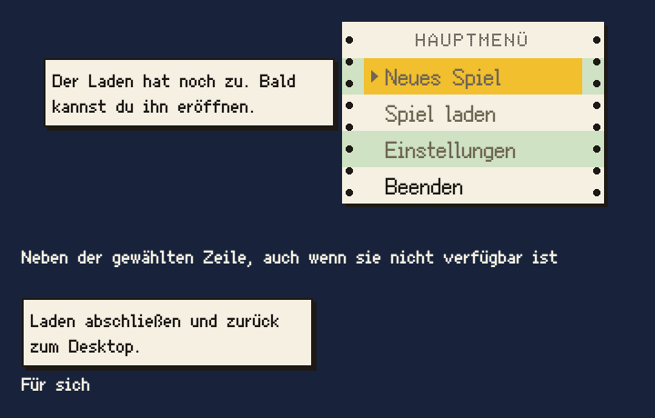

# Hinweis

Der Hinweis erklärt den gewählten Menüeintrag: ein kleiner Zettel neben der Zeile, der sagt, was der Eintrag tut oder warum er noch nicht verfügbar ist.

## Einsatz

- Im Menü neben der gewählten Zeile, für Maus und Tastatur gleich. Dort ersetzt er den Tooltip.
- Ebenso in der Liste (Baustein Liste) und neben einem Knopf, der allein auf einem Bildschirm steht (Baustein Knopf).
- Für eine Warnung gibt es die Meldung (Baustein Meldung) an derselben Stelle.
- Ein Hinweis je Eintrag, höchstens zwei Zeilen. Die Texte duzen den Spieler.

## Aufbau

- Feld in `papier` mit einem Oberflächenpixel `tusche` als Kontur, darunter `pixelschatten`.
- Text in `text` (Ark Pixel 10) in `tusche`, Innenabstand `raster-4`. Mit Kontur höchstens 160 Oberflächenpixel breit, also 150 für den Text.
- Lage: 4 Oberflächenpixel links neben der gewählten Zeile oder dem Knopf, oben bündig mit ihr. Auf dem Communicator steht er links neben dem Gehäuse, seine rechte Kante 4 vor dessen linker Kante, oben bündig mit der gewählten Zeile, und fährt mit dem Gerät (Baustein Communicator). Bei einem Knopf, der den Fokus von Anfang an hat, zählen die 4 ab seiner Fokuslinie, damit der Schatten des Hinweises nicht an sie stößt.

## Zustände

- Erscheint ohne Verzögerung mit der Auswahl und bleibt stehen, bis eine andere Zeile gewählt wird, auch wenn die Maus das Menü verlässt.
- Hat ein Eintrag ein Tastenkürzel, nennt der Hinweis es.
- Ein verfügbarer Eintrag hat immer denselben Satz als Hinweis, egal was gerade geht; nur Angaben darin wie Name und Datum ändern sich. „Spiel laden“ sagt „Zurück in einen deiner Läden.“, auch wenn sich gerade keiner fortsetzen lässt. Nur ein nicht verfügbarer Eintrag hat einen eigenen Satz: seinen Grund.

## Nicht

- Keine Verzögerung wie beim Tooltip, kein Ein- oder Ausblenden.
- Kein gedämpfter Text: Auch bei nicht verfügbaren Einträgen bleibt der Hinweis in `tusche`.

## Vorschau

Hinweis links neben der gewählten Zeile, darunter ein Hinweis für sich · Oberflächenpixel ×2. Gruppe Bedienelemente. Zum Ansehen im Browser: [vorschau/hinweis.html](../vorschau/hinweis.html).
