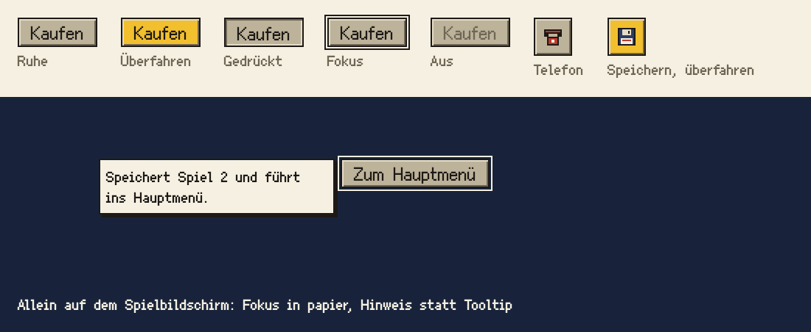

# Knopf

Der Knopf löst eine Handlung aus. Er ist beige, eckig und erhaben wie die Taster an einem PC-Gehäuse um 1990.

## Einsatz

- Mit Text für Aktionen in Fenstern und Dialogen („Kaufen“, „Abbrechen“).
- Als Symbolknopf (Klasse `symbol`, 26 × 26) in der Bedienleiste, mit einem Pixel-Symbol von 16 × 16.
- Immer ein echtes `<button>`; ein Symbolknopf trägt ein `aria-label` mit der Funktion.
- Allein auf einem Bildschirm, etwa „Zum Hauptmenü“ auf dem noch leeren Spielbildschirm: Er hat von Anfang an den Fokus, und statt eines Tooltips steht sein Hinweis daneben wie im Menü, ohne Verzögerung und auch bei Auswahl per Tastatur (Baustein Hinweis).

## Aufbau

- Grund `gehaeuse`, Kontur `tusche`, Relief `relief-erhaben`, Schrift `menue` in `tusche`.
- Innenabstand `raster-8` links und rechts, Höhe mindestens 20 Oberflächenpixel.

## Zustände

- Überfahren: Grund `signalgelb`, dazu ein Tooltip mit Funktion und Tastenkürzel; steht der Knopf allein, ersetzt ihn der Hinweis.
- Gedrückt oder eingeschaltet (`aria-pressed="true"`): `relief-gedrueckt`, der Inhalt rückt einen Oberflächenpixel tiefer.
- Fokus: `tusche`-Linie einen Oberflächenpixel neben dem Knopf, nur bei Bedienung mit der Tastatur (wie `:focus-visible`); nach einem Mausklick ist sie nicht zu sehen. Der Abstand des Hinweises zählt trotzdem ab ihrer Stelle, damit er nicht springt. Auf dunklem Grund wie `nacht` ist die Linie `papier` (Klasse `dunkel`), denn `tusche` auf `nacht` hat nur 1,1 : 1, `papier` 13,7 : 1.
- Aus (`disabled`): Schrift `gehaeuse-dunkel`, keine Reaktion beim Überfahren.

## Nicht

- Keine runden Ecken, keine Verläufe, keine farbigen Knöpfe außer dem Gelb beim Überfahren.
- Eine folgenreiche Aktion bekommt ein Bestätigungsfenster, keinen roten Knopf; im Titel ist das die Rückfrage als Blatt (Baustein Menü).

## Vorschau

Ruhe, überfahren, gedrückt, Fokus, aus; Symbolknöpfe; darunter allein auf dunklem Grund mit Hinweis · Oberflächenpixel ×2. Gruppe Bedienelemente. Zum Ansehen im Browser: [vorschau/knopf.html](../vorschau/knopf.html).
