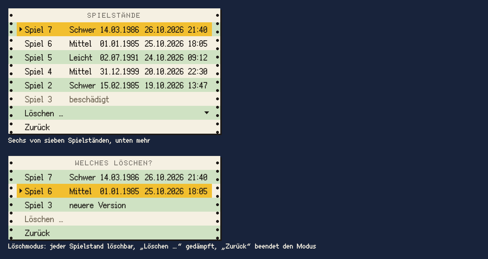

# Liste

Die Liste ist ein breiteres Blatt Endlospapier mit Spalten, etwa für die Spielstände im Titel: ein Menü, dessen Zeilen mehrere Angaben untereinander zeigen und das rollt, wenn es mehr Zeilen hat, als aufs Blatt passen.

## Einsatz

- Spielstände im Titel (Seite SPIELSTÄNDE auf dem Communicator), später andere Auswahllisten mit mehreren Angaben je Zeile, auf Papier oder auf der Anzeige.
- Für kurze Auswahllisten mit einer Angabe je Zeile bleibt es beim Menü.

## Aufbau

- Wie das Menü: Kopfzeile in `drucker`, Zeilen in `menue`, 20 Oberflächenpixel hoch, `papier` und `endlos-gruen` im Wechsel, Lochränder, `pixelschatten`, Auswahl in `signalgelb` mit Pfeil.
- Breite 304 Oberflächenpixel. Der Text einer Zeile beginnt 24 vom linken Rand des Papiers (Lochrand 8, Abstand 4, Pfeil 12), rechts bleiben 12 frei.
- Spalten mit festen Anfängen, gemessen ab dem Text der Zeile: Name bei 0, Grad bei 64, Spieldatum bei 108, zuletzt gespielt bei 172. Die letzte Spalte ist 90 breit, dahinter 6 Luft. Keine Spaltenköpfe; was eine Spalte bedeutet, sagt der Hinweis der Zeile, bei zwei Daten nebeneinander für beide: „Steht am 13.07.1985. Gespielt am 26.10.2026, 21:40 Uhr.“
- Passt ein Name nicht in seine Spalte, wird er mit „…“ gekürzt.
- Höchstens 6 Zeilen mit Einträgen sind zu sehen. Darunter stehen immer die festen Einträge des Blatts, etwa „Löschen …“ und „Zurück“; sie rollen nicht mit.

## Zustände

- Auswahl, Bedienung, Rechtsklick und Mauszeiger wie im Menü; neben der gewählten Zeile steht ihr Hinweis (Baustein Hinweis).
- Mehr Einträge als Zeilen: Die Liste rollt um je eine Zeile, mit der Auswahl und mit dem Mausrad. Nie steht eine halbe Zeile da. Das Zebra gehört zur Stelle auf dem Blatt, nicht zum Eintrag: Beim Rollen bleiben die Streifen stehen, und ein Eintrag kann die Farbe wechseln.
- Rollmarken: Ein Dreieck in `tusche`, 7 breit und 4 hoch wie der gedrehte Pfeil, rechts in der Kopfzeile zeigt nach oben, wenn oben mehr steht; eins rechts in der ersten festen Zeile („Löschen …“) zeigt nach unten, wenn unten mehr steht. Es hält 12 Abstand zum rechten Rand des Papiers. Die Rollmarken sind nur Anzeige: kein Klick, keine Hand, kein Gelb; gerollt wird mit Auswahl und Mausrad.
- Nicht verfügbare Einträge, etwa ein beschädigter Spielstand: gedämpft wie im Menü, wählbar, mit dem Grund im Hinweis. In den Spalten nach dem Namen steht dann ein Wort statt der Angaben, etwa „beschädigt“ oder „neuere Version“.
- Ein Modus, etwa der Löschmodus: Die Kopfzeile nennt ihn (WELCHES LÖSCHEN?), die Hinweise sagen, was die Zeile jetzt tut. „Zurück“ und Esc beenden nur den Modus; der Hinweis von „Zurück“ sagt das, etwa „Nicht löschen. Esc geht auch.“ Der Eintrag, der den Modus einschaltet, ist im Modus nicht verfügbar. Was im Modus etwas auslöst, ist verfügbar, auch ein Eintrag, der sonst gedämpft ist: Ein beschädigter Spielstand lässt sich löschen, steht im Löschmodus also normal da, mit seinem Wort in der Spalte. Gedämpft heißt immer: löst nichts aus.

## Auf der Anzeige

- Wie das Menü auf der Anzeige (Baustein Menü): ohne Papier, Zebra, Lochränder und `pixelschatten`, gewählte Zeile als Balken in `tusche` mit Schrift und Pfeil in `lcd`, gedämpft `gehaeuse-dunkel`.
- Die Liste ist so breit wie die Anzeige, 320. Der Text einer Zeile beginnt bei x 16; die Spalten haben dieselben Anfänge ab dem Text wie auf Papier (0, 64, 108, 172), was rechts frei bleibt, bleibt leer.
- Rollmarken stehen 8 vom rechten Rand der Anzeige. In der gewählten Zeile, etwa auf „Löschen …“, ist die Rollmarke `lcd`, auch wenn die Zeile gedämpft ist, denn sie gehört zur Liste, nicht zum Eintrag; in `tusche` verschwände sie im Balken.
- Auf der Anzeige sind höchstens 5 Zeilen mit Einträgen zu sehen, eine weniger als auf Papier: Kopfzeile, 5 Spielstände und die 2 festen Einträge sind 8 Zeilen zu 20 und füllen die 160 der Anzeige genau.

## Nicht

- Kein Rollbalken, keine Spaltenköpfe, keine Trennlinien zwischen Spalten.
- Keine Farben für Zustände außer dem Dämpfen; Gelb bleibt die Auswahl, auf der Anzeige der Balken in `tusche`.

## Vorschau

Liste der Spielstände: links mit Auswahl und Rollmarke, rechts im Löschmodus · Oberflächenpixel ×2. Gruppe Bedienelemente. Zum Ansehen im Browser: [vorschau/liste.html](../vorschau/liste.html).
