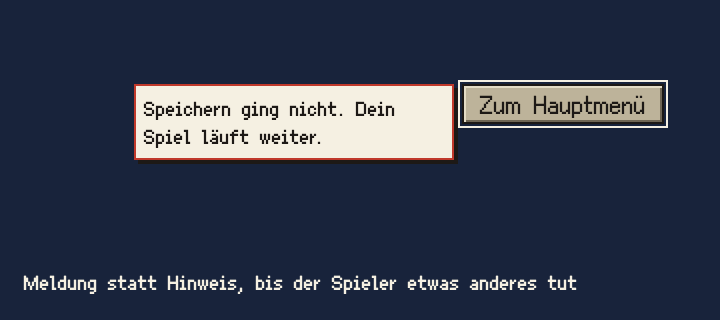

# Meldung

Die Meldung sagt, dass etwas nicht geklappt hat, etwa „Speichern ging nicht. Dein Spiel läuft weiter.“ Sie ist ein Hinweis mit roter Kontur an derselben Stelle.

## Einsatz

- Für Fehler bei der Bedienung, die der Spieler wissen muss: Speichern oder Löschen ging nicht.
- Nicht für Nachrichten aus dem Spiel; die kommen als Zeitungsmeldung.

## Aufbau

- Wie der Hinweis: Feld in `papier`, Text in `text` (Ark Pixel 10) in `tusche`, Innenabstand `raster-4`, höchstens 160 breit, höchstens zwei Zeilen, `pixelschatten`.
- Die Kontur ist `kassenrot` statt `tusche`, ein Oberflächenpixel; `kassenrot` heißt Gefahr. Der Text bleibt `tusche`, damit er auch ohne Farbe lesbar ist.
- Lage: an der Stelle des Hinweises, links neben der gewählten Zeile oder dem Knopf, auf dem Communicator links neben dem Gehäuse auf Höhe der Zeile.

## Zustände

- Erscheint sofort, ersetzt den Hinweis und bleibt, bis der Spieler einen anderen Eintrag wählt oder etwas auslöst.
- Die Meldung gehört zum Eintrag, nicht zur Stelle. Rollt eine Liste, wandert sie mit ihm; rollt er aus dem Fenster und die Auswahl rückt nach, ersetzt der Hinweis des neu gewählten Eintrags sie.
- Der Satz sagt ohne Witz, was ist, und was weiter gilt (Abschnitt Sprache): „Speichern ging nicht. Dein Spiel läuft weiter.“

## Nicht

- Kein eigenes Fenster, kein Ton, kein Blinken.
- Kein Text in `kassenrot`; nur die Kontur ist rot.

## Vorschau

Meldung an der Stelle des Hinweises, hier neben dem Knopf auf dem Spielbildschirm · Oberflächenpixel ×2. Gruppe Bedienelemente. Zum Ansehen im Browser: [vorschau/meldung.html](../vorschau/meldung.html).
