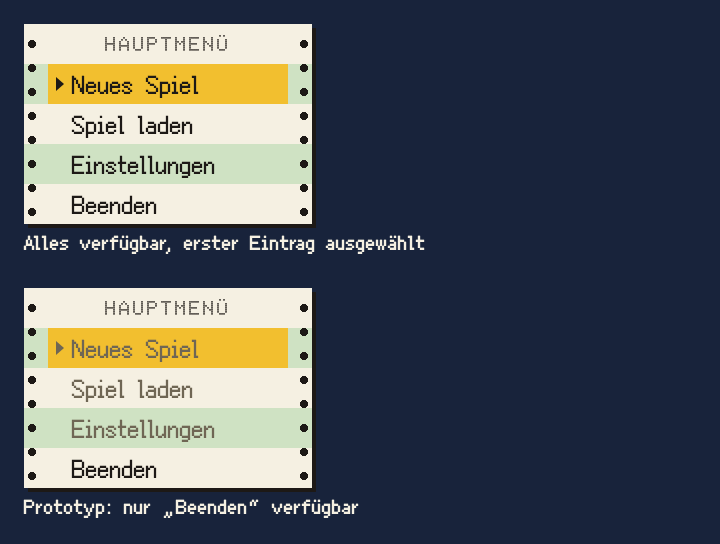

# Menü

Das Menü ist ein Streifen Endlospapier frisch aus dem Nadeldrucker: weiße und grüne Zeilen im Wechsel, Lochränder links und rechts.

## Einsatz

- Pausenmenü, kurze Auswahllisten bis etwa acht Einträge, auf Endlospapier oder als Seite auf der Anzeige des Communicators (unten, „Auf der Anzeige“).
- Im Titel als Seite auf dem Communicator: Hauptmenü, Gradwahl, Spielstände (Baustein Liste) und Rückfrage (unten).

## Aufbau

- Kopfzeile in `drucker` (Doto), darunter ein `<button>` pro Zeile in `menue` (Ark Pixel 12), `tusche` auf `papier` und `endlos-gruen` im Wechsel, Zeilenhöhe 20 Oberflächenpixel.
- Lochränder wie beim Bildrahmen (`cl-lochrand links` und `rechts`), darunter `pixelschatten`.

## Zustände

- Überfahren und Tastaturauswahl teilen sich eine Auswahl: Die gewählte Zeile ist `signalgelb`, davor steht ein Pfeil in `tusche`. Eine zusätzliche Fokuslinie gibt es nicht.
- Bedienung: Pfeiltasten oder Tab wählen, Enter oder Leertaste lösen aus. Ein Rechtsklick wählt die Zeile und zeigt ihren Hinweis, löst aber nichts aus.
- Nicht verfügbar: Text und Pfeil in `gehaeuse-dunkel`, in Ruhe wie ausgewählt. Die Zeile bleibt wählbar und zeigt ihren Hinweis, löst aber nichts aus. Kontrast 4,98 : 1 auf `papier`, 4,14 : 1 auf `endlos-gruen` und 3,31 : 1 auf `signalgelb`; das erfüllt die Regel für große Schrift (3 : 1), weil `menue` ab Faktor 2 mindestens 24 Bildschirmpixel hoch ist.
- Eine Zeile hat keinen eigenen Zustand „gedrückt“, weder auf Papier noch auf der Anzeige; die Auswahl ist die Rückmeldung. Das gilt auch für die Liste.
- Mauszeiger: die Hand nur über verfügbaren Einträgen, sonst der Pfeil.
- Neben der gewählten Zeile steht ihr Hinweis (Baustein Hinweis).

## Auf der Anzeige

- Auf der Anzeige des Communicators steht das Menü ohne Papier: kein Zebra, keine Lochränder, kein `pixelschatten`. Der Grund ist die Anzeige selbst, beim Organizer `lcd`.
- Die Seite ist so breit wie die Anzeige. Der Innenbereich der Zeilen beginnt 4 vom Rand der Anzeige und endet 4 davor; der Pfeil steht bei x 8, der Text beginnt bei x 16.
- Kopfzeile in `drucker` (Doto) in `tusche`, mittig; Zeilen in `menue` in `tusche`, Zeilenhöhe 20 wie auf Papier.
- Die gewählte Zeile ist ein Balken in `tusche` über den Innenbereich; Schrift und Pfeil darin sind `lcd` (9,6 : 1).
- Nicht verfügbar: Text und Pfeil in `gehaeuse-dunkel`, auf `lcd` 3,1 : 1 und im Balken `tusche` 3,08 : 1; auch gewählt bleibt die Zeile so gedämpft. Das erfüllt die Regel für große Schrift wie auf Papier.
- Unter der Maus ändert eine nicht gewählte Zeile ihre Farbe nicht; hell im Balken ist nur die gewählte.

## Seiten im Titel

- Hauptmenü, Gradwahl, Spielstände und Rückfrage stehen als Seiten auf der Anzeige des Communicators (Baustein Communicator); Titelbild, Logo und Versionszeile bleiben. Es ist immer genau eine Seite zu sehen. Bis Feature 005 waren es Blätter Endlospapier rechts bei y 150.
- Die Regeln dieses Abschnitts gelten für die Menü- und Listenseiten. Das versteckte Spiel ist auch eine Seite im Titel, folgt aber dem Baustein Spiel auf der Anzeige: ohne Eintrag „Zurück“, Esc beendet es.
- Jede Seite hat einen Eintrag, der eine Ebene zurückführt: „Zurück“, in der Rückfrage „Abbrechen“. Esc tut dasselbe. Im Hauptmenü selbst tut Esc nichts.
- Die Kopfzeile nennt die Seite, etwa SCHWIERIGKEIT oder SPIELSTÄNDE, und darf einen Modus nennen, etwa WELCHES LÖSCHEN? (Baustein Liste).

## Rückfrage

- Eine folgenreiche Aktion im Titel, etwa das Löschen eines Spielstands, fragt auf einer eigenen Seite nach statt in einem Fenster: Kopfzeile wie LÖSCHEN?, darunter zwei Einträge, „Abbrechen“ und die Aktion mit ihrem Gegenstand, etwa „Spiel 2 löschen“.
- Vorgewählt ist „Abbrechen“. Esc bricht ab.
- Die Hinweise beider Einträge nennen, worum es geht, etwa „Spiel 2 bleibt: Schwer, 14.03.1986. Esc geht auch.“ Der Name steht vorn, damit der Hinweis auch mit „Spiel 9999“ in zwei Zeilen passt. Lässt sich der Gegenstand nicht fortsetzen, steht sein Zustand nach dem Doppelpunkt: „Spiel 9 bleibt: neuere Version. Esc geht auch.“ Weil immer eine Zeile gewählt ist, steht der Gegenstand immer da.

## Nicht

- Keine Unterüberschriften, keine Symbole vor den Einträgen, keine Trennlinien.
- Kein Blatt und keine Seite neben einer anderen; eine neue ersetzt die vorige.
- Auf der Anzeige kein `signalgelb` und kein Papier.

## Vorschau

Hauptmenü auf Endlospapier: links alles verfügbar, rechts der Prototyp mit drei nicht verfügbaren Einträgen · Oberflächenpixel ×2. Gruppe Bedienelemente. Zum Ansehen im Browser: [vorschau/menue.html](../vorschau/menue.html).
