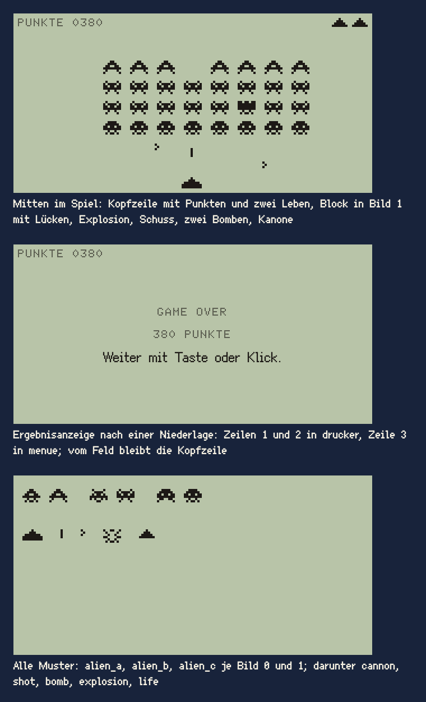

# Spiel auf der Anzeige

Das Spiel auf der Anzeige ist ein kleines Spiel, das auf dem LCD des Communicators läuft wie auf einem Taschenspiel der Achtziger. Heute gibt es eins: eine Welle Außerirdischer, die man mit einer Kanone abschießt, versteckt hinter den Gehäusetasten im Titel (Feature 006).

## Einsatz

- Als Seite auf der Anzeige des Communicators (Baustein Communicator), so groß wie die Anzeige. Titelbild, Logo, Versionszeile und Gerät bleiben stehen; Hinweis und Meldung neben dem Gerät sind verborgen.
- Nur für versteckte Extras. Der Name des Vorbilds erscheint nirgends, wo der Spieler ihn sehen oder hören könnte. Datei- und Klassennamen im Code dürfen ihn tragen, etwa `invaders_page.gd`.

## Raster

- Das Feld ist die Anzeige auf dem Bildraster: 160 × 80 Bildpixel, gezeigt ×2 als 320 × 160 Oberflächenpixel. Alles liegt und bewegt sich auf ganzen Bildpixeln, wie in einer Szene. Die Abstände `raster-2` bis `raster-16` gelten hier nicht, sie gehören zur Oberfläche.
- Gezählt wird einschließlich: „x 75 bis 83“ sind 9 Bildpixel.
- Innenrand 2 Bildpixel links, rechts und unten (4 Oberflächenpixel wie bei Menü und Liste); oben beginnt gleich die Kopfzeile. Nichts liegt außerhalb von x 2 bis 157 und y 0 bis 77.
- Eine einzige Farbe: `tusche` auf `lcd`. Kein `signalgelb`, kein Papier, keine Kontur, kein Schatten.

## Aufbau

| Teil | Maß und Lage in Bildpixeln |
|---|---|
| Kopfzeile | y 0 bis 7. Links ab x 2 die Punkte in `drucker` (Doto 10), mit dem Zeilenkasten ab y 1 wie ein Label (die Versalien stehen dann in den Oberflächenpixeln 5 bis 11 der Anzeige), mit vier Stellen: `PUNKTE 0380`. Rechts die Leben als Muster `life` (7 × 4) bei y 2 bis 5, 2 auseinander, das letzte endet bei x 157. Gezeigt werden alle verbleibenden, die Kanone im Feld eingeschlossen: drei zu Beginn. |
| Block | 8 Spalten × 4 Reihen Außerirdische, je 8 × 6, Abstand 4 waagrecht und 3 senkrecht; zusammen 92 × 33. Zu Beginn ab y 12, waagrecht mittig ab x 34. Oben `alien_a`, darunter zwei Reihen `alien_b`, unten `alien_c`. |
| Kanone | Muster `cannon`, 9 × 5, in den Zeilen 73 bis 77; zu Beginn und nach einem Treffer in der Mitte, x 75 bis 83. |
| Schuss | Muster `shot`, 1 × 4, aus der Spitze der Kanone. |
| Bombe | Muster `bomb`, 2 × 3, aus der Mitte der Unterkante eines Außerirdischen. |
| Explosion | Muster `explosion`, 8 × 6, an der Stelle des Getroffenen; an der Kanone über ihr, 8 breit über 9 und deshalb bündig links, mit der Unterkante auf Zeile 77. |

## Bewegung und Tempo

Ein Schritt ist 1/60 s; das Spiel rechnet in ganzen Schritten und holt nach einem langen Bild höchstens 4 nach.

| Was | Wert |
|---|---|
| Kanone | 1 Bildpixel je Schritt, solange Pfeil links oder rechts gehalten wird; bleibt im Innenrand |
| Schuss | 2 Bildpixel je Schritt nach oben; höchstens einer im Feld |
| Bombe | 1 Bildpixel je zwei Schritte nach unten; höchstens 3 im Feld; Schuss und Bombe fliegen aneinander vorbei |
| Takt des Blocks | 2 Bildpixel zur Seite; erreicht die Außenkante der lebenden Außerirdischen den Innenrand, im nächsten Takt 3 tiefer und Richtungswechsel |
| Abstand der Takte | `3 + round(27 · (n − 1) / 31)` Schritte bei n übrigen: 30 Schritte (0,5 s) bei 32, 3 Schritte (0,05 s) bei einem |
| Bewegungsbild | wechselt bei jedem Takt zwischen Bild 0 und 1 |
| Bomben | je Takt mit Chance 1/4, von einem zufälligen untersten Außerirdischen einer Spalte |
| Explosion | 15 Schritte (0,25 s); hält nichts auf |
| Treffer an der Kanone | ein Leben weniger; 60 Schritte (1 s) Pause: Explosion an der Kanone, alle Bomben weg, der Block steht, kein Schuss; dann die Kanone wieder in der Mitte |
| Punkte | oben 30, Mitte 20, unten 10; höchstens 640 |
| Gelandet | sobald die unterste Zeile eines lebenden Außerirdischen y 73 erreicht, die oberste Zeile der Kanone |

So dauert ein Durchgang über die Breite am Anfang rund 17 s; ohne einen Schuss landet der Block nach gut 2 Minuten, gezielt gewinnt man in 1 bis 3 Minuten. Die Werte sind ein Vorschlag bis zur Abnahme des Spiels; geändert wird erst hier, dann im Code.

„Bewegung reduzieren“ gilt für das Spiel nicht: Bewegungsbilder und Explosionen sind das Spiel selbst.

## Pixelmuster

Eigene Entwürfe, keine Kopien des Vorbilds. `#` ist `tusche`, `.` ist leer. Die Zeilen von oben nach unten.

| Muster | Bild 0 | Bild 1 |
|---|---|---|
| `alien_a` (oben, 30) | `...##...` `..####..` `.##..##.` `########` `..#..#..` `.#.##.#.` | `...##...` `..####..` `.##..##.` `########` `.#....#.` `#......#` |
| `alien_b` (Mitte, 20) | `.#....#.` `..####..` `.#.##.#.` `########` `#.#..#.#` `...##...` | `.#....#.` `#.####.#` `##.##.##` `########` `..#..#..` `.#....#.` |
| `alien_c` (unten, 10) | `..####..` `.######.` `##.##.##` `########` `.##..##.` `#......#` | `..####..` `.######.` `##.##.##` `########` `..#..#..` `.#.##.#.` |
| `cannon` | `....#....` `...###...` `.#######.` `#########` `#########` | – |
| `shot` | `#` `#` `#` `#` | – |
| `bomb` | `#.` `.#` `#.` | – |
| `explosion` | `#..##..#` `.#....#.` `..#..#..` `##....##` `..#..#..` `.#.##.#.` | – |
| `life` | `...#...` `..###..` `.#####.` `#######` | – |

## Ergebnisanzeige

- Am Ende steht mitten auf der Anzeige die Ergebnisanzeige; vom Feld bleibt nur die Kopfzeile.
- Drei Zeilen zu 20 Oberflächenpixeln, als Block mittig (y 50 bis 110 der Anzeige), jede Zeile waagrecht mittig, auf 1 Oberflächenpixel genau; die Laufweite nach dem letzten Zeichen zählt mit, ein Rest fällt nach links. Zeilen 1 und 2 in `drucker` (Doto) und Versalien wie eine Kopfzeile, Zeile 3 in `menue` (Ark Pixel 12) wie ein Eintrag.

| Fall | Zeile 1 | Zeile 2 | Zeile 3 |
|---|---|---|---|
| gewonnen | `ALLE ERWISCHT.` | `640 PUNKTE` | `Weiter mit Taste oder Klick.` |
| verloren, Kanone ohne Leben getroffen oder gelandet | `GAME OVER` | `380 PUNKTE` | `Weiter mit Taste oder Klick.` |

- „GAME OVER“ ist die einzige englische Zeile im Spiel: So stand es auf dem Automaten von 1978, den es in Deutschland nur mit englischen Texten gab, und es ist ein Computerwort der Zeit (Abschnitt Sprache). Ohne Punkt, wie dort.
- Führende Nullen nur, wo die Stellenzahl fest ist, also in der Kopfzeile (`PUNKTE 0380`); in der Ergebnisanzeige ohne (`380 PUNKTE`).
- Sie nimmt erst 0,5 s nach dem Ende einen neuen Druck an: jede Taste außer Shift, Strg, Alt und Cmd allein und außer Kürzeln mit Cmd, Strg oder Alt, oder einen Linksklick auf die Anzeige. Esc geht immer. Danach steht die Seite wieder da, auf der der Spieler war.
- Sie ist nicht der Baustein Meldung: kein Papier, keine rote Kontur, nicht neben dem Gehäuse.

## Bedienung

- Pfeil links und rechts fahren, die Leertaste schießt, Esc beendet sofort. Andere Tasten tun nichts; Kürzel mit Cmd, Strg oder Alt und Vollbild wirken wie immer.
- Die Seite hat den Tastaturfokus, zeigt aber keinen Fokusrahmen. Der Zeiger bleibt über der ganzen Anzeige der Pfeil, auch in der Ergebnisanzeige.
- Verliert das Fenster den Fokus, halten Spiel und Ton an, mit allen Zeiten; danach geht es weiter, ohne nachzuholen.

## Nicht

- Keine zweite Farbe, kein Graustufen-Schatten, kein Glanz; ein LCD kann nur eine.
- Keine Deckungen, kein Ufo, keine Bestenliste.
- Keine Grafik, kein Ton und kein Name aus dem Vorbild.

## Vorschau

Spiel auf der Anzeige: mitten im Spiel, Ergebnisanzeige, alle Pixelmuster · Bildpixel ×2 auf der Anzeige, Vorschau ×2. Gruppe Bedienelemente. Zum Ansehen im Browser: [vorschau/spiel.html](../vorschau/spiel.html).
