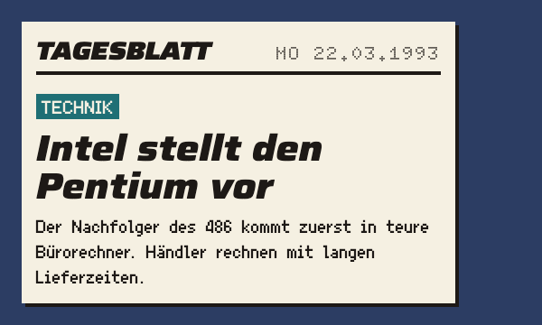

# Zeitungsmeldung

Die Zeitungsmeldung bringt ein Ereignis der Zeitleiste ins Bild: Zeitungskopf, Datum, Rubrik, Schlagzeile und ein bis zwei Sätze.

## Einsatz

- Für Ereignisse der Zeitleiste, die der Spieler erfahren soll. Mehrere Meldungen eines Tages ergeben eine Zeitungsseite im Vollbild.

## Aufbau

- Grund `papier`, `pixelschatten`; Zeitungskopf und Schlagzeile in `display` (Saira, Breite 125 %), Datum in `drucker`, Text in `text`.
- Rubrik als kleines Etikett in `text`: `kassenrot` für Wirtschaft und Preise, `petrol` (Klasse `technik`) für Technik, beide mit Schrift in `papier`.
- Der Verwender liefert Datum, Rubrik, Schlagzeile und Text.

## Nicht

- Keine Fotos: Bilder in der Zeitung sind gezeichnet wie die Szenen. Schlagzeilen höchstens sechs Wörter.

## Vorschau

Ereignis der Zeitleiste als Zeitungsausschnitt · Oberflächenpixel ×2. Gruppe Meldungen. Zum Ansehen im Browser: [vorschau/zeitungsmeldung.html](../vorschau/zeitungsmeldung.html).
