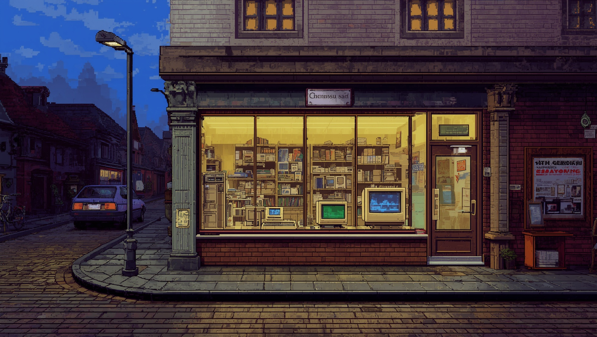

# 02 · Restart (2026-10-19)

On 2026-10-19 the project started again, on a new computer and with a new way of working. In a
single day the art direction, the style anchor, the logo and Spec Kit were set up.

### 2026-10-19 · Vobis price lists as source material `[Game content]`

- **Decision:** I added ten Vobis "Denkzettel" leaflets from 1993 to 1997 as unchanged PDFs. They
  are the basis for realistic prices and product ranges.
- **Why:** These leaflets are where the game started (see [Why this game](01-beginnings.md#why-this-game)).
  I no longer have my own copies, but scans exist as PDFs.
- **Evidence:** `8d054e8`.

### 2026-10-19 · Godot 4.7 and GUT 9.7.1 `[Tools]`

- **Decision:** I moved the project to Godot 4.7.2 and GUT 9.7.1.
- **Why:** The new computer has Godot 4.7.2, the current stable version. Godot migrated the
  project on import, and GUT 9.6.1 warned that it might not fit.
- **Evidence:** `94455d4`.

### 2026-10-19 · VGA pixel art, "Das Amt" as the model `[Graphics]`

- **Decision:** The game looks like a VGA game from the early nineties and is played like a game of
  today. For structure and humour the German business simulations of the nineties are the model,
  above all "Das Amt", along with Mad TV, Der Planer, Pizza Connection and Airline Tycoon.
- **Why:** "A cool retro style that still passes as a modern game"; consistency is the top goal.
- **Evidence:** `769630f`, `docs/ki_workflow/ki_dev.md` (Grafik), Style-Guide (README).

### 2026-10-19 · The style guide is an artifact `[Graphics]` `[Tools]`

- **Decision:** The binding style guide lives as a claude.ai artifact, not as a file in the repo:
  vision, colour tokens, fonts, building blocks, and the Leonardo workflow with its prompt library.
  Every change gets a new version; with feature 004 it reached version 33.
- **Evidence:** `docs/ki_workflow/ki_dev.md` (Grafik),
  [Style-Guide](https://claude.ai/artifact/Hc5aS78T3fAzufkKnjrKRX).

### 2026-10-19 · Leonardo, and Claude writes the prompts `[Graphics]`

- **Decision:** I create the images myself in Leonardo.ai. Claude writes every prompt in English,
  ending with the same style block, and picks model and aspect ratio. Settings: Lucid Origin,
  Prompt Enhance off, Style None. Every approved image goes into the prompt log with seed and
  generation ID, so it can be rebuilt.
- **Evidence:** `769630f`, [prompt-log.md](../art/leonardo/prompt-log.md).

### 2026-10-19 · Style anchor C2 for every image `[Graphics]`

- **Decision:** Image C2 from the first style test becomes the style anchor: the shopkeeper behind
  the counter, warm wood, full shelves. Every later image is generated with C2 as Style Reference
  (strength High) and measured against it.
- **Why:** Consistency comes before a single brilliant image. An image that falls out of the style
  is reworked or made again, even if it looks good on its own.
- **Evidence:** `769630f`, [prompt-log.md](../art/leonardo/prompt-log.md) (S-C).

### 2026-10-19 · First motifs: character sheet, title image, cover `[Graphics]`

- **Decision:** Three motifs with C2 as reference. T-01, the shop at dusk, is approved for the
  title screen; its prompt asks for an empty sky for the title and a calm, dark area on the right
  for the menu. C-01 is approved for the cover. F-01, the character sheet of the shopkeeper, is a
  base that still needs work: scribbled lettering, two foreign heads, the side view is missing.
- **Evidence:** `769630f`, [prompt-log.md](../art/leonardo/prompt-log.md).

### 2026-10-19 · The logo is a shop sign, made with Ideogram `[Graphics]`

- **Decision:** The logo is an illuminated shop sign: beige plastic frame, dark red face, "DER"
  small, "COMPUTERLADEN" in yellow pixel letters, a small beige monitor on the left. Made with
  Ideogram 4.5 inside Leonardo, from a quick draft to a final version with the draft as image
  reference, then cut out. The logo is only ever used as an image, never re-typeset.
- **Evidence:** `12938a4`, [prompt-log.md](../art/leonardo/prompt-log.md) (L-01).

### 2026-10-19 · Spec Kit as a pilot `[Workflow]` `[Tools]`

- **Decision:** I set up GitHub Spec Kit 1.2.0 with a constitution in German. Each feature gets a
  number `NNN`, its own branch and its own folder under `specs/`. Clarify, Checklist and Analyze
  always run. Whether it replaces `/dcl-feature` was to be decided after the first feature.
- **Alternatives:** Keep my own `/dcl-feature`.
- **Why:** I wanted to try a proven tool instead of maintaining my own process, and I wanted more
  checks that find gaps before any code exists.
- **Evidence:** `28248ba`, `.specify/memory/constitution.md`.

### 2026-10-19 · The agent builds, I decide (constitution 2.0.0) `[Workflow]`

- **Decision:** A Godot agent (`godot-entwickler`) does the Godot work. I decide and accept, Claude
  plans and reviews. Tasks carry an owner: `[K]` me, `[A]` the agent, `[C]` Claude. Work goes phase
  by phase, only when I release it, never `/speckit-implement` for everything. Code is committed
  only after I have seen it, and every task comes with a learning note.
- **Alternatives:** Keep building in Godot myself, as decided in August.
- **Why:** I gave up on building it myself. I want to make progress with the game and spend my time
  on all the small decisions, thinking up lovely details, rather than learning another programming
  language. And it is a way to test an AI workflow.
- **Evidence:** `62ce213`, `.claude/agents/godot-entwickler.md`.

### 2026-10-19 · The style guide comes first `[Workflow]`

- **Decision:** The very first analysis found a critical ordering problem: the palette and the raster
  script came before the style guide. Since then, whatever a feature needs is added to the style
  guide first and built afterwards; in features 001 and 004 that was the first phase.
- **Evidence:** `c2aa86b`, `.specify/memory/constitution.md` (principle IV).
