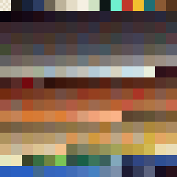
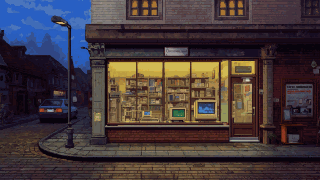

# 03 · Feature 001: Start up to the main menu (2026-10-19 to 2026-10-20)

The first Spec Kit feature: from launching the Mac app to a working title screen with menu. Most
of the graphics pipeline was built here.

### 2026-10-19 · Two rasters: 320 × 180 and 640 × 360 `[Graphics]`

- **Decision:** Scenes, figures and objects sit on an image raster of 320 × 180 pixels; interface
  and text on a UI raster of 640 × 360. One image pixel is exactly 2 × 2 UI pixels. Scaling is by
  whole numbers only (×3 at 1080p, ×4 at 1440p, ×6 at 4K), other window sizes get black borders.
  Texture filter Nearest, everything snapped to the pixel grid. This replaces "320 × 200 or
  640 × 480" from the game design document.
- **Alternatives:** Godot's stretch mode `canvas_items` (not pixel-exact) or fractional scaling
  (odd factors).
- **Why:** Godot's documentation on multiple resolutions recommends this combination for pixel
  art, and the style guide requires square, sharp pixels.
- **Evidence:** `769630f`, `79f4907`, `specs/001-hauptmenue/research.md` (R1).

### 2026-10-19 · Shrink by area average, not nearest neighbour `[Graphics]`

- **Decision:** A Leonardo image is shrunk to the raster by area average, mapped to the main
  palette without dithering, and then cleaned up.
- **Alternatives:** Nearest neighbour; generating the images again; ImageMagick or Pillow.
- **Why:** The "pixels" Leonardo paints vary in size (2 to 12 real pixels, plus JPEG artefacts),
  so nearest neighbour picks random pixels. New images would cost tokens and not solve the raster
  problem. ImageMagick and Pillow would be a new dependency.
- **Evidence:** `ad58872`, `specs/001-hauptmenue/research.md` (R6), `tools/raster/README.md`.

### 2026-10-19 · Our own raster tools in plain Python `[Tools]` `[Graphics]`

- **Decision:** The tools in `tools/raster/` use only the Python standard library plus `sips` for
  JPEG. Colour distances are measured in OKLab. They always run with `python3 -I`, because the
  images come from the internet.
- **Evidence:** `ad58872`, `tools/raster/README.md`.

### 2026-10-19 · One main palette of 256 colours, frozen `[Graphics]`

- **Decision:** One palette for all images: index 0 transparent, 1 to 15 the interface colours from
  the style guide, 16 to 255 scene colours by median cut from C2, T-01 and C-01. Then frozen.
- **Alternatives:** A palette per image; a palette only once scenes are built.
- **Why:** A palette per image breaks consistency. A later palette would mean rastering T-01 again.
- **Evidence:** `ad58872`, `specs/001-hauptmenue/research.md` (R7),
  [hauptpalette.gpl](../art/hauptpalette.gpl).

### 2026-10-19 · Ark Pixel instead of Pixelify Sans `[Graphics]`

- **Decision:** Ark Pixel 10 for text, Ark Pixel 12 for menus, Doto 10 (a dot-matrix font) for the
  printer style and the subtitle under the logo. All set without antialiasing or hinting. Pixelify
  Sans, first planned, was dropped.
- **Alternatives:** A custom bitmap font, Galmuri, Pixeloid.
- **Why:** A font test showed that at most 30 % of Pixelify's contour points lie on the pixel grid,
  at every size from 8 to 24. At 10, C looked like O and 5 like 9; "Beenden" read as "Geenden". Ark
  Pixel is drawn pixel by pixel for each size. Any antialiasing would stay visible as grey pixels.
- **Evidence:** `79f4907`, `46426d2`, `specs/001-hauptmenue/research.md` (R8).

### 2026-10-19 · The game says "du" `[Game content]`

- **Decision:** All texts in the game address the player as "du".
- **Alternatives:** "Sie", as in many business simulations of the nineties.
- **Evidence:** `c51169b`, `specs/001-hauptmenue/research.md` (R15).

### 2026-10-19 · App icon: the monitor from the logo `[Graphics]`

- **Decision:** The app icon is the beige monitor from the left end of the shop sign, enlarged by a
  whole number, on a rounded square in `nacht`. For macOS 26 there is also a Liquid Glass version
  built with Icon Composer. The script `make_icon.py` cuts the monitor out of the logo.
- **Alternatives:** A new Leonardo motif or the Godot icon; `kassenrot` as the background.
- **Why:** `kassenrot` means money and danger in the style guide. Since macOS 26, older icon
  formats are partly shown in a grey frame.
- **Evidence:** `c51169b`, `46426d2`, `8dc6482`, `specs/001-hauptmenue/research.md` (R5),
  [app_icon/README.md](../art/app_icon/README.md).

### 2026-10-19 · A hint box of our own instead of the tooltip `[Architecture]`

- **Decision:** The menu explains each entry in its own hint box instead of Godot's tooltip.
- **Why:** The built-in tooltip does not work with the keyboard.
- **Evidence:** `specs/001-hauptmenue/research.md` (R10).

### 2026-10-19 · Logic by tests, visuals by hand `[Tools]`

- **Decision:** GUT tests cover the logic and send input as real events. Display, full screen,
  icon and export are checked by hand with the quickstart.
- **Why:** Headless mode has no window and no image.
- **Evidence:** `specs/001-hauptmenue/research.md` (R14).

### 2026-10-19 · Title image and logo on the raster `[Graphics]`

- **Decision:** T-01 was cut to 16:9 and shrunk to 320 × 180, shown at ×2. The logo was shrunk by
  a factor of 6 to 141 × 27 image pixels and stays readable.
- **Evidence:** `46426d2`, `specs/001-hauptmenue/tasks.md` (T018, T019).

### 2026-10-20 · Rule-based cleanup `[Graphics]`

- **Decision:** At my request the rough cleanup is done by a script, `cleanup.py`: rare colours go
  to the nearest common one, single stray pixels take the colour of their neighbours, highlights
  and edges stay. Fine work is done by hand in Pixelorama or Aseprite, with palette colours only.
  The title image went from 209 to 183 colours, the logo from 111 to 70. I approved title image,
  logo and icon.
- **Evidence:** `8dc6482`, `specs/001-hauptmenue/research.md` (R6).

### 2026-10-20 · A gap search before the final acceptance `[Workflow]`

- **Decision:** After the last phase, `/speckit-converge` searches the whole feature for gaps
  between spec and code. The gaps become a phase of their own before I accept the feature.
- **Evidence:** `cd381a3`, `c4ca3db`, `docs/ki_workflow/ki_dev.md` (item 6).
