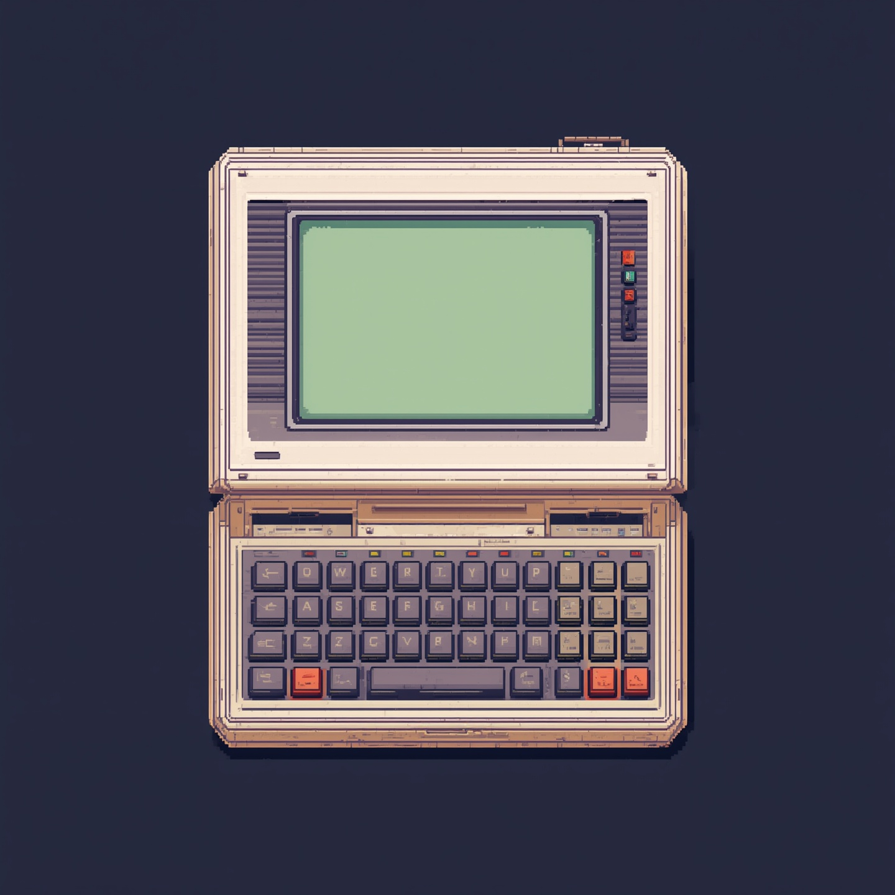

# 06 · Feature 004: Start a new game (2026-10-26 to 2026-10-27)

Starting, saving and continuing a game. Review 36 points, analysis 44 findings, 937 tests green at
acceptance. Around it: the reviewer agents' pilot, a description of the code by system, Spec Kit
for good, and a first look at a pocket device as the game's controls.

**Tokens and cost:** 2026-10-26 to 2026-10-27 on `feature/004-neues-spiel`: 2.0 M output, 3,226 input, 8.0 M cache write, 369.9 M cache read; 684 responses from Claude, 889 from sub-agents; about $162 at API list price.

### 2026-10-26 · One Claude session per feature, from the very start `[Workflow]`

- **Decision:** A feature's session now begins with `/speckit-specify`, not with the plan, and runs
  to the final acceptance. It is named "[NNN] Feature name", for example "[004] Neues Spiel".
- **Why:** The steps build on each other; a new session would have to read everything again. The
  independent view comes from the reviewer agents.
- **Evidence:** `104b77b`, `docs/ki_workflow/ki_dev.md` (item 7).

### 2026-10-26 · Saves named automatically, as many as you like `[Game content]`

- **Decision:** Saves are called "Spiel 1", "Spiel 2" and so on, with no limit. A new menu entry
  "Weiterspielen" is preselected once a save exists. Deleting works through a delete mode in the
  list.
- **Alternatives:** Typing a name; three fixed slots. For deleting, the Delete key, which was the
  recommendation.
- **Evidence:** `aec9766`, `specs/004-neues-spiel/spec.md` (Clarifications).

### 2026-10-26 · A save keeps its own catalog, not its schedule `[Architecture]`

- **Decision:** Each save is one JSON file in `user://spielstaende/` with its own copy of the event
  catalog. The schedule is not stored: it is rebuilt from seed, level, catalog and interventions
  and replayed silently up to the saved day.
- **Alternatives:** Godot's ConfigFile, `store_var` or a `.tres` resource; rebuilding from the
  current catalog.
- **Why:** A resource can run scripts when it is loaded. Seed, level, catalog and interventions
  define exactly one schedule, and a running game goes on with its own copy when I change the
  catalog in the Werkstatt.
- **Evidence:** `104b77b`, `specs/004-neues-spiel/research.md` (R1, R2).

### 2026-10-26 · Safe saving in five steps `[Architecture]`

- **Decision:** A save is written to a `.neu` file first and the old one kept as `.alt`, so a
  readable state exists at every moment.
- **Alternatives:** Writing directly; a plain rename.
- **Why:** On Windows a plain rename would leave a moment with no readable save.
- **Evidence:** `specs/004-neues-spiel/research.md` (R3).

### 2026-10-26 · A game session owns the running game `[Architecture]`

- **Decision:** The timeline no longer starts by itself. A new autoload, `GameSession`, starts a new
  game or continues a save, and saves when leaving and when the window closes.
- **Alternatives:** Passing the save between scenes; putting it all into `Timeline`.
- **Why:** Past events must not be reported twice, or the rent of 1985 would be paid twice.
- **Evidence:** `specs/004-neues-spiel/research.md` (R6, R7).

### 2026-10-26 · How the levels are described `[Game content]`

- **Decision:** Variant A: luck is rather on your side, keeps out of it, or is rather on the others'
  side.
- **Evidence:** `specs/004-neues-spiel/research.md` (R18).

### 2026-10-26 · The reviewers stay `[Workflow]`

- **Decision:** In their pilot, the text reviewer reported 11 findings and the style reviewer 2, all
  confirmed, none of them found by Claude's own check. The reviewers stay part of every phase that
  changes something visible or a text.
- **Evidence:** `e57d5f5`, `docs/ki_workflow/ki_pruefung.md`.

### 2026-10-26 · A pocket device as the game's controls `[Game content]`

- **Decision:** I had Claude research a pocket device through which the player controls the game.
  It is about controlling the game, not about moving between places; there is no city map page.
  The recommendation: one device with three cases over the years, a paper planner, an organizer
  and a communicator.
- **Evidence:** `8c981c2`, `75714d2`,
  [navigation-taschengeraet.md](../recherche/navigation-taschengeraet.md).

### 2026-10-27 · A description of the code, checked at the end of each feature `[Workflow]`

- **Decision:** `docs/spielbeschreibung/` describes the current state of the code, one file per
  system. Checking it is the last task of every feature; changes only with my OK.
- **Why:** It is the context every session loads first. If it goes stale, the AI works with wrong
  knowledge.
- **Evidence:** `119c19a`, `docs/ki_workflow/ki_dev.md` (item 9).

### 2026-10-27 · A rule built and then removed `[Workflow]`

- **Decision:** A rule "warn only once per start" was built and then taken out again.
- **Why:** About 50 lines of code and extra state for little gain.
- **Evidence:** `b6c5afa`, `specs/004-neues-spiel/tasks.md` (Phase 8, T044).

### 2026-10-27 · Spec Kit for good `[Workflow]` `[Tools]`

- **Decision:** After three features, Spec Kit replaces `/dcl-feature` permanently. The old feature
  documents went to the archive. Spec Kit was raised to 1.2.3, applied selectively instead of a
  full re-init.
- **Why:** A full re-init would have overwritten the constitution and our own templates.
- **Evidence:** `9d7bbfd`, `59bb08c`, `2502a5a`, `docs/offene-punkte.md`.

### 2026-10-27 · Effort with every build question `[Workflow]`

- **Decision:** When Claude asks me whether to build something, it states the rough effort.
  Loanwords like "scrollen" stay as they are.
- **Evidence:** `cbf0467`, `docs/ki_workflow/ki_dev.md`.

### 2026-10-27 · Spike: an organizer on the title screen `[Graphics]`

- **Decision:** Before specifying feature 005, I had a spike built: an organizer from 1991, in the
  manner of the Psion Series 3, slides into the title screen and carries the menu on its LCD. The
  image G-01 was generated with C2 as reference, cut out, rastered and cleaned up to 157 × 202
  pixels in 110 colours. The spike stays on its branch; only the findings and the image went to
  `main`.
- **Alternatives:** The 1996 communicator, which does not fit the title image and would give away
  the device from the end of the game; the 1985 paper planner, which would be paper again.
- **Why:** The main menu stands outside game time, T-01 and C2 show the early nineties, and an LCD
  stands apart from the continuous paper.
- **Findings:** The device covers the shop window, the yellow selection looks alien on an LCD, and
  the LCD green is missing from the main palette. The spike's recommendation was to keep the paper
  on the title screen and to build the device as a feature of the game screen. How I decided about
  that belongs to feature 005.
- **Evidence:** `481c7e0` (branch `claude/spike-communicator-625f4c`), `4501657`,
  [prompt-log.md](../art/leonardo/prompt-log.md) (G-01),
  [navigation-taschengeraet.md](../recherche/navigation-taschengeraet.md) (Nachtrag).

### 2026-10-27 · The reviewers become a principle `[Workflow]`

- **Decision:** The phase review is now principle VI of the constitution (version 2.2.0). Spec Kit's
  own tasks template adds the review task to every phase, and the reviewers already read the
  wording and states in spec and contract at `/speckit-checklist`, before anything is built.
- **Alternatives:** keep the review only as a rule in the workflow documents; Claude writes the
  task by hand from the plan, as in the pilot; reviewers only after building.
- **Why:** In the pilot 3 of 13 confirmed findings were already in the contract Claude had written.
  Every Spec Kit step reads the constitution, so `/speckit-analyze` now flags a missing review as
  critical.
- **Evidence:** [constitution.md](../../.specify/memory/constitution.md),
  [tasks-template.md](../../.specify/templates/overrides/tasks-template.md),
  [ki_pruefung.md](../ki_workflow/ki_pruefung.md).

### 2026-10-27 · Own templates must survive Spec Kit updates `[Workflow]` `[Tools]`

- **Decision:** Our own templates stay under `.specify/templates/overrides/`. After every Spec Kit
  update Claude checks with a diff that they and the constitution are unchanged before committing.
- **Alternatives:** keep our tasks out of the templates altogether.
- **Why:** I did not want an update to remove the review and description tasks without anyone
  noticing. Spec Kit looks in `overrides/` first and only reinstalls its own templates, so the
  diff is a safeguard, not a repair.
- **Evidence:** [ki_dev.md](../ki_workflow/ki_dev.md), "Werkzeuge und Pfade";
  `.specify/scripts/bash/common.sh` (order of template lookup).
