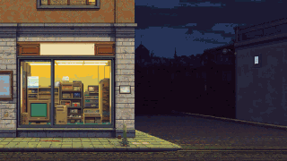
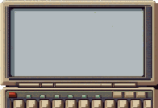

# 07 · Feature 005: The communicator as a control (2026-10-27)

The title screen moves from continuous paper onto a pocket device that slides into the picture and
carries the menus on its LCD. Built as a general control for later screens. Checklist 26 points,
analysis 26 findings, seven phases in one day.

**Tokens and cost:** 2026-10-27 on `feature/005-communicator`: 1.1 M output, 2,108 input, 6.1 M cache write, 327.8 M cache read; 606 responses from Claude, 338 from sub-agents; about $126 at API list price.

### 2026-10-27 · The title screen moves onto the device after all `[Game content]`

- **Decision:** All four pages of the title screen, main menu, level choice, saves and the
  question before deleting, sit on the device's LCD. There is no continuous paper on the title
  screen any more.
- **Alternatives:** Following the spike: keep the paper and start with the game screen; only the
  main menu on the device; title and game screen at once.
- **Why:** The spike's three objections are answered: a new title image instead of covering T-01,
  all pages on the device instead of switching between device and paper, and a fixed 1991 device
  on the title screen, because the change of devices over the years belongs to the game.
- **Evidence:** `fbffa10`, `specs/005-communicator/spec.md` (Clarifications).

### 2026-10-27 · A selected line like on a real LCD `[Graphics]`

- **Decision:** The selected line is inverted: a dark bar with the text in the LCD colour.
- **Alternatives:** Signal yellow as on paper, which looked alien in the spike; only the arrow,
  which shows the selection too weakly.
- **Why:** A real display can show only one colour.
- **Evidence:** `fbffa10`, `specs/005-communicator/spec.md` (Clarify).

### 2026-10-27 · A 16th colour, `lcd`, only for the interface `[Graphics]`

- **Decision:** The LCD background is a new colour, `lcd` = `#b8c4a8`, a matt grey-green. It is the
  16th colour of the interface but not part of the frozen main palette; no image contains it.
- **Alternatives:** `endlos-gruen` as the LCD background, which was the recommendation; adding the
  colour to the main palette, which would have meant re-rastering every image.
- **Why:** An organizer around 1991 is grey and matt, not fresh green. The interface paints the LCD
  over the case, so no image needs the colour. With this value even dimmed entries keep 3 : 1.
- **Evidence:** `9f676fb`, `specs/005-communicator/research.md` (R1, R2).

### 2026-10-27 · Code from placeholders first, images later `[Workflow]`

- **Decision:** The control and its pages were built with a placeholder case. The images came as a
  phase of their own, and only the title phase needed them. From the spike, code was taken over
  selectively, not merged.
- **Why:** That keeps the code independent of the time spent on images, and every phase stays
  testable on its own.
- **Evidence:** `5be78ca`, `specs/005-communicator/research.md` (R11, R14).

### 2026-10-27 · The device slides out before the game starts `[Game content]`

- **Decision:** When a game begins or continues, the device first slides out downwards, like
  putting it away, and input is blocked during the slide.
- **Alternatives:** Switching straight into the game, which was the recommendation.
- **Evidence:** `fbffa10`, `specs/005-communicator/spec.md` (Clarify), `research.md` (R8).

### 2026-10-27 · Claude generates the images in Leonardo, I choose `[Graphics]` `[Workflow]`

- **Decision:** Claude now drives Leonardo itself in the browser and writes the prompt log; I only
  choose from the results. The skill `dcl-grafik` describes the process.
- **Evidence:** `26abd2a`, `e7bde62`, `.claude/skills/dcl-grafik/`,
  [prompt-log.md](../art/leonardo/prompt-log.md) (G-02, T-02).

### 2026-10-27 · A new title image with room for the device `[Graphics]`

- **Decision:** T-02 shows the same world as T-01, with the shop in the left third and a calm area
  at the bottom right where the device stands. I chose image 3 of four, after a montage of all four
  with logo and device.
- **Alternatives:** Letting the device cover T-01, which was the recommendation; a smaller display.
- **Evidence:** `26abd2a`, [prompt-log.md](../art/leonardo/prompt-log.md) (T-02).

### 2026-10-27 · Smaller display, new case after the Olivetti D2000 `[Graphics]`

- **Decision:** At the acceptance of the title phase, the display shrank from 384 × 192 to 320 × 160,
  8 lines of 20, so that part of the keyboard shows. The case G-02 looked odd after cropping; I
  suggested an electronic notebook like the Olivetti D2000 (1990) as the model. G-03 describes it
  only in words, light instead of dark grey and without a brand; I chose image 2. It replaces G-02,
  the working name stays "organizer of 1991".
- **Alternatives:** Display 352 × 176 (little gained) or 288 × 144 (the save list would need
  narrower columns).
- **Evidence:** `e7bde62`, `specs/005-communicator/spec.md` (Abnahme Phase 5),
  [prompt-log.md](../art/leonardo/prompt-log.md) (G-03).

### 2026-10-27 · The version line moves to the sky `[Graphics]`

- **Decision:** The version line goes to the top right, into the free sky above the device.
- **Why:** The hint slides along with the device and briefly passed over the version line at the
  bottom left. My own suggestion.
- **Evidence:** `e7bde62`, `specs/005-communicator/spec.md` (Abnahme Phase 5).

### 2026-10-27 · Looking for gaps with `/speckit-converge` `[Tools]`

- **Decision:** Before the final acceptance, `/speckit-converge` compared the code with spec, plan
  and tasks; what was missing became an extra phase.
- **Evidence:** `534898b`, `specs/005-communicator/tasks.md` (Phase 7).
