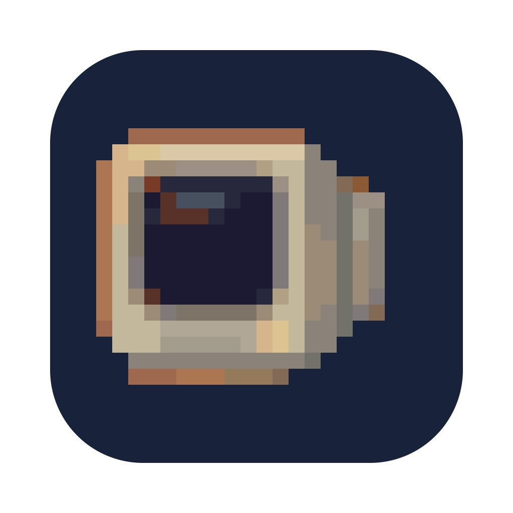

# 09 · Feature 007: Build, export and a self-test (2026-10-28)

One command now builds the game and a separate self-test app for macOS, Windows and Linux. The
self-test plays through every page of today's game with simulated mouse and keyboard, takes a photo
at each step, and ends with a summary and a protocol that Claude can read. A small Python tool
compares the photos pixel by pixel with reference images from the Mac. Checklist 39 points, analysis
19 findings, eight phases, the last one from a gap search after the build.

**Tokens and cost:** 2026-10-28 on `feature/007-build-export-selbsttest`: 2.1 M output, 3,606 input, 9.4 M cache write, 440.4 M cache read; 585 responses from Claude, 1,036 from sub-agents; about $182 at API list price.

### 2026-10-28 · A self-test for the final acceptance, not for every phase `[Workflow]`

- **Decision:** The self-test runs once per feature, before I accept the whole feature. Claude
  builds everything with one command and runs it on the Mac; I start it on Windows and Linux when a
  feature touches the window, input, graphics, files or the export, otherwise at least every third
  feature. Within a phase, the unit tests and the start check stay enough.
- **Alternatives:** Running the self-test after every phase; building three variants by hand.
- **Why:** I want to keep the way phases are built and reviewed. The self-test is for the end, and it
  may take a while. It runs in time-lapse, eight times faster than real time.
- **Evidence:** `1ccf924`, `94e1e0e`, `specs/007-build-export-selbsttest/research.md` (R24 to R26);
  rule in `docs/ki_workflow/ki_dev.md`, point 11 (`880fc27`).

### 2026-10-28 · Its own app through a feature tag, its own runner instead of GUT `[Architecture]`

- **Decision:** The self-test is a second export preset with the feature tag `selbsttest`. Project
  overrides give it its own name, its own data folder and its own main scene. Its code lives in
  `src/tools/selbsttest/`, which the normal export leaves out like the Werkstatt. A small runner of
  its own plays the steps; GUT stays for the tests without a window.
- **Alternatives:** A command line switch in the game; GUT in the exported app.
- **Why:** The game must not carry test code. A build check counts the runner in each package: zero
  in the game, more than zero in the self-test.
- **Evidence:** `94e1e0e`, `9cefe8b`, `specs/007-build-export-selbsttest/research.md` (R1 to R3).

### 2026-10-28 · Simulated input on the real path, real input filtered out `[Architecture]`

- **Decision:** Every mouse move, click and key goes through Godot's normal input path, marked with
  its own device number. A filter at the window drops everything without that mark, so my real mouse
  and keyboard change nothing while a run is going.
- **Alternatives:** Calling the game's functions directly; moving the real mouse pointer.
- **Why:** Hover, focus and clicks happen exactly as with a real hand, so the self-test checks what a
  player would see. Calling functions would skip exactly the parts that break.
- **Evidence:** `9cefe8b`, `specs/007-build-export-selbsttest/research.md` (R4).

### 2026-10-28 · A protocol written for Claude, tested blind `[Workflow]`

- **Decision:** The run writes a plain text protocol with fixed keys, the system data and every
  failed step with what was expected and what was found, plus the photos and a zip. A "Copy" button
  puts the same text on the clipboard for the chat. To test it, a separate agent built six faults
  into six copies of the game without telling Claude where; Claude matched all six protocols to the
  right fault.
- **Alternatives:** A JSON report; screenshots only.
- **Why:** I asked that the result has to be usable by Claude, not just readable by me. The blind
  test shows that the protocol alone is enough to find a fault.
- **Evidence:** `1ccf924`, `4a933bd`, `cea4370`, `specs/007-build-export-selbsttest/contracts/protokoll.md`.

### 2026-10-28 · The self-test found a bug: the window sat too low `[Architecture]`

- **Decision:** The game window now sits centred in the free area of the screen, title bar
  included, without menu bar and dock. The self-test had measured it 63 pixels too low, because
  Godot centres on the whole screen.
- **Alternatives:** Changing the self-test to accept the old position.
- **Why:** The contract asked for the centre of the free area, and the game should look right.
- **Evidence:** `cea4370`, `src/core/game_window.gd` (`centered_position()`).

### 2026-10-28 · Pixel-exact comparison against reference images from the Mac `[Tools]`

- **Decision:** `tools/selbsttest/vergleich.py` compares each photo of a run with a reference image,
  pixel by pixel, with no tolerance. The reference images come from a Mac run that I accepted; they
  change only after I accept a new run. Steps that depend on time, like the hidden game, are marked
  as not comparable.
- **Alternatives:** A tolerance per pixel; comparing inside Godot.
- **Why:** Fixed seed and fixed time make every photo repeat exactly, so any difference is a real
  one. Python runs without Godot and without a window, so Claude can check runs from other machines.
  The Linux run and the Windows run both matched all 35 comparable photos.
- **Evidence:** `3868cb6`, `4dd91f4`, `tools/selbsttest/referenz/macos/`,
  `specs/007-build-export-selbsttest/belege/`.

### 2026-10-28 · The summary stays in the window of the run `[Tools]` `[Graphics]`

- **Decision:** The summary uses the tool look from the style guide, like the Werkstatt, but does not
  maximise the window. It appears in the window the run used, at the same size and position.
- **Alternatives:** Maximising like the Werkstatt.
- **Why:** The self-test should keep a reproducible window size. The summary simply shows up in it.
- **Evidence:** `2a35437`, style guide section "Werkzeuge" (versions 58 to 61).

### 2026-10-28 · A Windows icon with six sizes, each from the pixels `[Graphics]`

- **Decision:** `make_icon.py` also writes `app_icon.ico` with 16, 32, 48, 64, 128 and 256 pixels.
  Each size comes from the rastered monitor at a whole-number zoom. At 16 the monitor does not fit,
  so it uses every second image pixel. Windows takes the icon for the file and, since the gap search,
  also for the window and the taskbar.
- **Alternatives:** Letting Godot shrink the PNG, which blurs the pixels; drawing the 16 by hand.
- **Why:** Pixel art must not be blurred. Every second pixel keeps the shape without extra work.
- **Evidence:** `4dd91f4`, `880fc27`, `tools/raster/make_icon.py`, style guide "App-Symbol" (version 62).

### 2026-10-28 · Forward+ without falling back to OpenGL, and a laptop that cannot run it `[Architecture]`

- **Decision:** The game does not fall back to OpenGL when Vulkan and Direct3D 12 are missing. On a
  MacBook Pro from 2015 with Windows via Boot Camp, Forward+ did not start at all, without a message.
  Forced to OpenGL by hand, the self-test passed every step with identical photos. I accepted the
  Windows run as provisional; whether the game should switch to the Compatibility renderer is a
  question for its own session.
- **Alternatives:** Allowing the fallback, which would not have helped on that laptop anyway;
  switching to Compatibility right away.
- **Why:** CLAUDE.md fixes Forward+. The finding needs a decision of its own, not a side note in the
  export feature.
- **Evidence:** `4dd91f4`, `specs/007-build-export-selbsttest/belege/windows_2026-10-28_18-50-20/hinweis.md`.

### 2026-10-28 · F11 and Alt+Enter for full screen, caught before the menu `[Architecture]`

- **Decision:** Full screen now also works with F11 and Alt+Enter, on every system. The window
  catches the shortcut before the interface sees it, with an exact check of the modifier keys, so
  Alt+Enter does not also start the selected menu entry.
- **Alternatives:** Different keys per system.
- **Why:** These are the usual keys on Windows and Linux; Enter alone has to keep working in the menu.
- **Evidence:** `4dd91f4`, `src/core/game_window.gd`.

### 2026-10-28 · The gap search adds steps and names what stays out `[Workflow]`

- **Decision:** After the gap search the self-test got a step for "Einstellungen" and a run through
  the save list with Esc, "Zurück", delete mode and the confirmation, 45 steps in all. The ways that
  stay without a step, like the easy and hard levels or error messages, are listed in the contract.
  A new rule asks every gap search to check that each new page and way has a step.
- **Alternatives:** Covering every way at once; leaving the gaps unnamed.
- **Why:** A self-test only helps where it looks. Naming the exceptions keeps them from being
  forgotten.
- **Evidence:** `880fc27`, `specs/007-build-export-selbsttest/contracts/ablaeufe.md` ("Bewusst ohne
  Schritt"), `docs/ki_workflow/ki_pruefung.md`.
