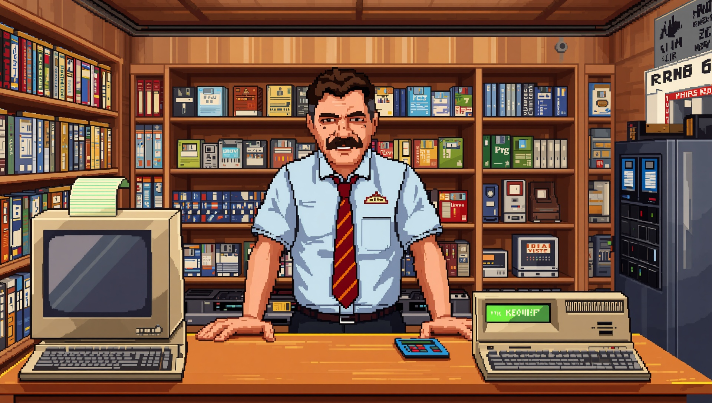

# Development diary

How I build "Der Computerladen" with AI: the decisions that shaped the project, from the first
commit on 2026-05-26 onwards. The focus is on how I work, the tools, the architecture, the game
content and above all the graphics. Implementation details belong in `specs/`, the current state
of the code in `docs/spielbeschreibung/`.

Written in English first; a German translation follows.

## Sections

| File | Period | Contents |
|---|---|---|
| [01-beginnings.md](01-beginnings.md) | 2026-05-26 to 2026-10-18 | Why this game, repository, Game Bible, prototype, desktop only, first workflow |
| [02-restart.md](02-restart.md) | 2026-10-19 | Godot 4.7, Leonardo and the style anchor, Spec Kit, the agent builds |
| [03-feature-001-main-menu.md](03-feature-001-main-menu.md) | 2026-10-19 to 2026-10-20 | Rasters, main palette, raster tools, fonts, logo, app icon |
| [04-feature-002-timeline-workshop.md](04-feature-002-timeline-workshop.md) | 2026-10-20 to 2026-10-21 | Schedule model, event catalog, Werkstatt |
| [05-feature-003-difficulty.md](05-feature-003-difficulty.md) | 2026-10-21 to 2026-10-26 | Difficulty levels, reviewer agents, no local memory |
| [06-feature-004-new-game.md](06-feature-004-new-game.md) | 2026-10-26 to 2026-10-27 | Saves, game session, Spec Kit for good, pocket device research and spike |

## Entry format

Every entry is one decision:

```markdown
### 2026-10-19 · Style anchor C2 for every image `[Graphics]`

- **Decision:** what I decided, in one or two sentences.
- **Alternatives:** what else was on the table.
- **Why:** the reason.
- **Evidence:** commit hash and file.


```

- Tags: `[Workflow]`, `[Tools]`, `[Architecture]`, `[Game content]`, `[Graphics]`.
- Only decisions backed by a commit or a file go in. If a field is missing, the sources do not
  record it.
- Images are linked by relative path from `docs/art/` or `src/assets/`.

## Keeping it up to date

With every merge to `main`, Claude writes the entries for that branch, I review them, and they go
into the merge. One entry per real decision, not per commit. Rule:
[ki_dev.md](../ki_workflow/ki_dev.md).

## Graphics at a glance

- [2026-10-19 · VGA pixel art, "Das Amt" as the model](02-restart.md#2026-10-19--vga-pixel-art-das-amt-as-the-model-graphics)
- [2026-10-19 · Leonardo, and Claude writes the prompts](02-restart.md#2026-10-19--leonardo-and-claude-writes-the-prompts-graphics)
- [2026-10-19 · Style anchor C2 for every image](02-restart.md#2026-10-19--style-anchor-c2-for-every-image-graphics)
- [2026-10-19 · First motifs: character sheet, title image, cover](02-restart.md#2026-10-19--first-motifs-character-sheet-title-image-cover-graphics)
- [2026-10-19 · The logo is a shop sign, made with Ideogram](02-restart.md#2026-10-19--the-logo-is-a-shop-sign-made-with-ideogram-graphics)
- [2026-10-19 · Two rasters: 320 × 180 and 640 × 360](03-feature-001-main-menu.md#2026-10-19--two-rasters-320--180-and-640--360-graphics)
- [2026-10-19 · Shrink by area average, not nearest neighbour](03-feature-001-main-menu.md#2026-10-19--shrink-by-area-average-not-nearest-neighbour-graphics)
- [2026-10-19 · One main palette of 256 colours, frozen](03-feature-001-main-menu.md#2026-10-19--one-main-palette-of-256-colours-frozen-graphics)
- [2026-10-19 · Ark Pixel instead of Pixelify Sans](03-feature-001-main-menu.md#2026-10-19--ark-pixel-instead-of-pixelify-sans-graphics)
- [2026-10-19 · App icon: the monitor from the logo](03-feature-001-main-menu.md#2026-10-19--app-icon-the-monitor-from-the-logo-graphics)
- [2026-10-20 · Rule-based cleanup](03-feature-001-main-menu.md#2026-10-20--rule-based-cleanup-graphics)
- [2026-10-20 · The Werkstatt gets its own, plainer style](04-feature-002-timeline-workshop.md#2026-10-20--the-werkstatt-gets-its-own-plainer-style-graphics)
- [2026-10-27 · Spike: an organizer on the title screen](06-feature-004-new-game.md#2026-10-27--spike-an-organizer-on-the-title-screen-graphics)
