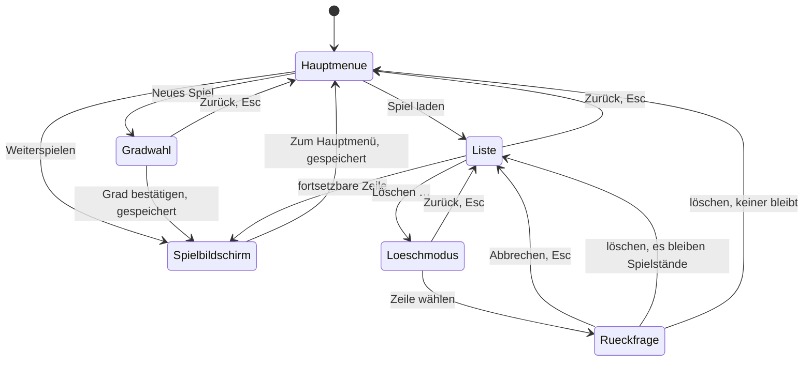

# Datenmodell: Neues Spiel starten

Klassen, Felder, Regeln und Zustände zu [spec.md](spec.md). Die Gründe stehen in
[research.md](research.md), die Signaturen in den Verträgen unter [contracts/](contracts/).
Bezeichner im Code sind englisch, Texte deutsch.

## Überblick

```text
Ordner user://spielstaende/
├── spiel_1.json            Spielstand „Spiel 1“
├── spiel_2.json            Spielstand „Spiel 2“
├── spiel_2.json.neu        übrig nach einem Abbruch beim Speichern (R3), wird übergangen
└── notizen.txt             fremde Datei: nie gelistet, nie gelöscht

SaveStore (Ordner)  ──liest──▶  SaveSlot je Nummer  ──fortsetzbar──▶  SaveGame
                                                                    ├── EventCatalog (Kopie)
                                                                    └── Eingriffsprotokoll

GameSession (Autoload)  hält das laufende Spiel = genau ein SaveGame
    └── setzt GameClock und Timeline, schreibt über SaveStore
```

| Begriff in der Spec | Klasse | Ort |
|---|---|---|
| Spielstand | `SaveGame` | `src/core/save/save_game.gd` |
| Eintrag der Liste, lesbar oder nicht | `SaveSlot` | `src/core/save/save_slot.gd` |
| Liste der Spielstände, Ordner | `SaveStore` | `src/core/save/save_store.gd` |
| Laufendes Spiel | `GameSession` (Autoload) | `src/core/game_session.gd` |

## SaveGame (Spielstand)

Ein Spiel, das sich fortsetzen lässt. Im Speicher sind Tage Tagesindizes wie im Lauf (0 =
01.01.1985); in der Datei stehen sie als „JJJJ-MM-TT“.

| Feld | Typ | Datei | Regel |
|---|---|---|---|
| `number` | int | aus dem Dateinamen, zusätzlich `"number"` | ≥ 1; der Dateiname gilt |
| `name` | String | `"name"` | nicht leer; beim Anlegen „Spiel N“ (FR-009) |
| `difficulty` | `Difficulty.Level` | `"difficulty"`: `"leicht"`, `"mittel"`, `"schwer"` | ein bekannter Grad (FR-013) |
| `seed` | int | `"seed"` | 0 bis 2.147.483.647 |
| `day` | int | `"day"`: `"1986-03-14"` | 0 bis 5477, also 01.01.1985 bis 31.12.1999 |
| `created_at` | int, Unix-Zeit | `"created_at"`: `"2026-10-26T20:40:12Z"` | UTC, lesbar |
| `last_played_at` | int, Unix-Zeit | `"last_played_at"` | UTC, lesbar; ≥ 0 |
| `game_version` | String | `"game_version"`: `"0.1"` | die Version, die zuletzt schrieb (FR-007) |
| `catalog` | `EventCatalog` | `"catalog"`: `EventCatalog.to_dict()` | lässt sich lesen; Fehler in Einträgen erlaubt (R2) |
| `interventions` | `Array[Dictionary]` | `"interventions"` | wie `TimelineRun.interventions`; jedes Datum gültig (R10) |
| — | — | `"format"`: 1 | Formatversion (FR-007, FR-014) |

Beispiel einer Datei, gekürzt:

```json
{
	"catalog": {
		"categories": [ … ],
		"events": [ … ],
		"format": 1,
		"profiles": { "leicht": [ … ], "schwer": [ … ] }
	},
	"created_at": "2026-10-26T20:40:12Z",
	"day": "1985-01-01",
	"difficulty": "schwer",
	"format": 1,
	"game_version": "0.1",
	"interventions": [],
	"last_played_at": "2026-10-26T20:40:12Z",
	"name": "Spiel 2",
	"number": 2,
	"seed": 1804289383
}
```

**Zeitpunkte:** In der Datei steht UTC mit „Z“ am Ende, damit die Ordnung auch nach einer Reise
oder der Zeitumstellung stimmt. Angezeigt wird Ortszeit: Unix-Zeit plus
`Time.get_time_zone_from_system().bias` Minuten, wie die Werkstatt ihre Sicherungskopien zeigt
(`werkstatt.gd`). Die Verschiebung gilt für heute; ein Spielstand aus dem Sommer zeigt im Winter
eine Stunde früher. Das reicht für „zuletzt gespielt“. Tests geben den Versatz vor
(`bias_minutes` in `time_text()` und `time_sentence()`, Analyse, C3).

**Spielversion:** `ProjectSettings` `application/config/version`, heute „0.1“.

**Pflichtfelder:** alle Schlüssel der Tabelle oben: `catalog`, `created_at`, `day`, `difficulty`,
`format`, `game_version`, `interventions`, `last_played_at`, `name`, `number`, `seed`. Ein leerer
`name` zählt wie ein fehlender. Unbekannte Schlüssel stören nicht; spätere Features fügen ihre
Daten hinzu (FR-007; Analyse, B3).

**Lesen:** `SaveGame.from_data(data, p_number, problems)` nimmt das gelesene JSON und die Nummer aus
dem Dateinamen und gibt `null` und einen Grund in `problems` zurück, wenn etwas nicht stimmt (Regeln
unter „SaveSlot“; Analyse, F14). Ältere Formatversionen bringt `_upgrade(data, from_format)` Schritt
für Schritt auf die aktuelle (FR-014); mit Format 1 hat sie nichts zu tun (Analyse, E4).

**Schreiben:** `SaveGame.to_json()` kanonisch: Schlüssel alphabetisch, Tabs, ein Zeilenumbruch am
Ende; Eingriffe über `InterventionFile.to_file()` mit Tagen als „JJJJ-MM-TT“ und Werten auf vier
Nachkommastellen. Gleicher Spielstand, gleiche Datei.

## SaveSlot (Eintrag der Liste)

Was die Liste über eine Nummer weiß, auch wenn sich die Datei nicht lesen lässt.

| Feld | Typ | Regel |
|---|---|---|
| `number` | int | aus dem Dateinamen |
| `state` | `SaveSlot.State` | `OK`, `DAMAGED`, `TOO_NEW` |
| `reason` | String | leer bei `OK`; sonst ein Satz für den Hinweis, höchstens zwei Zeilen (R10) |
| `game` | `SaveGame` | nur bei `OK`, sonst `null` |
| `path` | String | die Datei, die gelesen wurde: `.json`, `.json.neu` oder `.json.alt` |

`display_name()` ist `game.name` bei `OK`, sonst „Spiel N“. `can_resume()` ist `state == OK`.

**Zustand:** Geprüft wird in dieser Reihenfolge; der erste Treffer gilt.

| Prüfung | Zustand | Grund im Hinweis |
|---|---|---|
| kein gültiges JSON oder kein Objekt | `DAMAGED` | „Lässt sich nicht lesen: Die Datei ist beschädigt.“ |
| `"format"` ganze Zahl > 1 | `TOO_NEW` | „Stammt aus einer neueren Version des Spiels.“ |
| `"format"` fehlt, keine ganze Zahl oder < 1 | `DAMAGED` | „Lässt sich nicht lesen: Die Formatversion fehlt.“ |
| Pflichtfeld fehlt oder hat den falschen Typ | `DAMAGED` | „Lässt sich nicht lesen: Ein Eintrag fehlt.“ |
| Grad unbekannt | `DAMAGED` | „Der Schwierigkeitsgrad ist unbekannt.“ |
| Seed außerhalb | `DAMAGED` | „Der Seed liegt außerhalb von 0 bis 2.147.483.647.“ |
| Spieldatum kein Tag von 1985 bis 1999 | `DAMAGED` | „Das Spieldatum liegt außerhalb von 1985 bis 1999.“ |
| Zeitpunkt nicht lesbar | `DAMAGED` | „Lässt sich nicht lesen: Ein Zeitpunkt fehlt.“ |
| ein Eingriff mit falschem Datum oder kein Objekt | `DAMAGED` | „Lässt sich nicht lesen: Ein Eingriff ist falsch.“ |
| Katalog nicht lesbar (`EventCatalog.from_data()` gibt `null`) | `DAMAGED` | „Der Ereigniskatalog im Spielstand ist beschädigt.“ |
| sonst | `OK` | — |

Die Sätze sind Vorschläge, jeder gemessen auf höchstens zwei Zeilen im Hinweis; Feldnamen wie
„seed“ nennt nur das Protokoll. Der Text-Prüfer prüft sie in Phase 2. Zusätzlich meldet
`push_warning()` Datei, Feld und Stelle, etwa „Spielstand user://spielstaende/spiel_3.json: kein
gültiges JSON in Zeile 4.“ oder „… Schwierigkeitsgrad „extrem“.“ Dort darf Godots englischer Text
stehen, und dort stehen Werte aus der Datei; den Spieler erreicht beides nicht (Analyse, B4).

## SaveStore (Ordner der Spielstände)

| Feld | Typ | Regel |
|---|---|---|
| `folder` | String | Vorgabe `user://spielstaende/`; Tests setzen einen eigenen Ordner |
| `last_error` | String | Datei und Schritt des zuletzt gescheiterten Schreibens oder Löschens, für das Protokoll; den Satz für den Spieler wählt `GameSession` |

**Dateien eines Spielstands:** nur Namen nach dem Muster `spiel_<N>.json`, `spiel_<N>.json.neu` und
`spiel_<N>.json.alt`, wobei N eine Zahl ohne führende Null ist (1 bis 999.999.999). In die Spalte
der Liste passt der Name bis „Spiel 9999“; längere kürzt sie mit „…“ (R12). Alle anderen
Dateien im Ordner gehören nicht dazu: Sie erscheinen nie in der Liste und werden nie gelöscht.

**Liste:** Je Nummer ein `SaveSlot` nach der Regel „Lesen“ in R3: `.json` gilt, wenn sie
fortsetzbar oder zu neu ist; sonst die erste fortsetzbare von `.json.neu` und `.json.alt`; ist keine
fortsetzbar, der Zustand von `.json`, ohne sie der von `.alt`. Gibt es nur eine `.neu`, die nicht
fortsetzbar ist, erscheint die Nummer nicht (das erste Speichern eines neuen Spiels ist
gescheitert, einen Spielstand gab es nie). Geordnet nach R12. Fehlt der Ordner, ist die Liste leer
(Analyse, B2).

Liest die Liste einen Spielstand aus `.neu` oder `.alt`, meldet `push_warning()` das mit dem Pfad;
der Spieler sieht nichts Besonderes (Checkliste, CHK021).

**Nächste Nummer:** größte Nummer unter allen Dateien nach dem Muster, auch `.neu` und `.alt`,
plus 1; ohne Dateien 1 (R4). Ein neues Spiel schreibt nur, wenn es zu seiner Nummer keine Datei
gibt; sonst nimmt es die nächste (CHK002).

**Schreiben:** die fünf Schritte aus R3. Fehlt der Ordner, wird er angelegt. Schlägt ein Schritt
fehl, gibt es den Fehler zurück, `last_error` nennt Datei und Schritt, und der vorige Stand ist
lesbar. Geschrieben wird nur ein `SaveGame`, das aus einem fortsetzbaren Spielstand oder einem
neuen Spiel stammt; einen beschädigten oder zu neuen überschreibt das Spiel so nie (FR-013).

**Löschen:** entfernt `spiel_<N>.json`, `.neu` und `.alt` dieser einen Nummer, sonst nichts
(FR-018), in der Reihenfolge `.json`, `.neu`, `.alt`; scheitert eine, hört es dort auf. Fehlt alles,
`ERR_FILE_NOT_FOUND`.

## GameSession (laufendes Spiel)

| Feld | Typ | Regel |
|---|---|---|
| `current` | `SaveGame` | das laufende Spiel; `null`, solange keins läuft (FR-003) |
| `folder` | String | Ordner für `SaveStore`; Tests setzen ihren eigenen |
| `clock`, `timeline` | Node | `null` heißt die Autoloads `GameClock` und `Timeline`; Tests setzen eigene |
| `now` | Callable | liefert die Unix-Zeit; Vorgabe die Uhr des Rechners, Tests geben feste Zeiten vor |
| `rng` | `RandomNumberGenerator` | würfelt den Seed eines neuen Spiels; Tests setzen einen mit festem Seed (Analyse, C4) |
| `last_error` | String | Satz für die Meldung nach einem Fehler |

**Zustände:**

```mermaid
stateDiagram-v2
    [*] --> KeinSpiel: App startet
    KeinSpiel --> Laeuft: start_new() oder resume(), gespeichert
    KeinSpiel --> Laeuft: resume(), Speichern scheitert (Meldung)
    KeinSpiel --> KeinSpiel: start_new() scheitert beim Speichern
    Laeuft --> Laeuft: save(); leave() scheitert beim Speichern
    Laeuft --> KeinSpiel: leave(), gespeichert
    Laeuft --> [*]: Fenster schließen, gespeichert
    Laeuft --> Fehlversuch: Fenster schließen, Speichern scheitert
    Fehlversuch --> [*]: Fenster noch einmal schließen
    Fehlversuch --> KeinSpiel: leave(), gespeichert
```



- **Neues Spiel** (`start_new(difficulty)`), in dieser Reihenfolge (R7; Analyse, C6): Seed mit `rng`
  würfeln; ein neues `SaveGame` mit der nächsten Nummer, dem Katalog der Zeitleiste, Tag 0,
  angelegt und zuletzt gespielt = jetzt; schreiben mit `is_new`, bei `ERR_ALREADY_EXISTS` mit der
  nächsten Nummer noch einmal. Erst dann Uhr auf den 01.01.1985 und
  `Timeline.start_game(seed, difficulty)`. Scheitert das Schreiben, beginnt kein Spiel, `current`
  bleibt `null`, und es gibt den Fehler zurück.
- **Fortsetzen** (`resume(slot)`): nur bei `OK`. Uhr auf `day`, `Timeline.resume_game()` mit
  Katalog, Seed, Grad, Eingriffen und Tag; „zuletzt gespielt“ = jetzt; schreiben (R9). Scheitert das
  Schreiben, läuft das Spiel trotzdem: `resume()` gibt OK zurück, `last_error` hat den Satz
  „Speichern ging nicht. Dein Spiel läuft weiter.“, und der Spielbildschirm zeigt ihn beim
  Erscheinen (FR-011; Analyse, F5).
- **Speichern** (`save()`): `day` von der Uhr, höchstens `TimelineRun.LAST_DAY` (nach dem Spielende
  stünde die Uhr am 01.01.2000; Analyse, C11), Eingriffe aus `Timeline.run.interventions`,
  „zuletzt gespielt“ = jetzt, Spielversion = die laufende; schreiben.
- **Verlassen** (`leave()`): speichern; gelingt es, `Timeline.stop_game()`, Uhr zurück auf den
  01.01.1985, `current = null`.

Solange ein Spiel läuft, ist `get_tree().auto_accept_quit` aus (R8).

## Laufendes Spiel in Zeitleiste und Uhr

| Teil | Bisher | Neu |
|---|---|---|
| `Timeline._ready()` | liest den Katalog, startet ein Spiel mit Mittel | liest den Katalog; kein Spiel (FR-003) |
| `Timeline.run` | nach dem ersten Bild immer gesetzt | `null`, bis ein Spiel beginnt; wieder `null` nach `stop_game()` |
| `Timeline.resume_game()` | — | prüft die Kopie, legt den Lauf an, spielt Eingriffe nach und still bis zum Tag |
| `GameClock.set_date()` | — | setzt das Datum ohne Signale; `paused` bleibt, wie es ist |

Fortsetzen am 14.03.1986 heißt: Der Lauf hat den 14.03.1986 abgespielt (`run.today` = 437). Das
erste Signal kommt, wenn die Uhr zum 15.03.1986 geht. Das ist derselbe Zustand wie bei einem Spiel,
das ohne Pause bis zum 14.03.1986 lief (FR-008).

## Titelbildschirm: Blätter und Wege



- **Vorwahl im Hauptmenü** beim Erscheinen des Titelbildschirms: „Weiterspielen“, wenn es einen
  fortsetzbaren Spielstand gibt, sonst „Neues Spiel“ (FR-001a). Zurück aus einem Blatt steht die
  Auswahl auf dem Eintrag, der es geöffnet hat (Claude, 2026-10-26); nach dem Löschen des letzten
  Spielstands auf „Neues Spiel“ (US4, Szenario 5).
- **Weiterspielen** nimmt den ersten fortsetzbaren Spielstand der Liste, also den zuletzt
  gespielten.
- **Neu gelesen** wird der Ordner jedes Mal, wenn der Titelbildschirm erscheint, wenn „Spiel laden“
  die Liste öffnet und wenn das Hauptmenü aus einem Blatt zurückkehrt. So nennt „Weiterspielen“ nie
  einen Spielstand, der eben gelöscht wurde (Analyse, F2). Fortsetzen nimmt den Stand, den die
  Liste gelesen hat (CHK001).
- **Verfügbar** (FR-002): „Weiterspielen“ mit mindestens einem fortsetzbaren Spielstand, „Spiel
  laden“ mit mindestens einem Spielstand gleich welchen Zustands, „Einstellungen“ nie.
- **Vorwahl in Blättern:** Gradwahl „Mittel“; Liste die oberste Zeile; Rückfrage „Abbrechen“.
- **„Zurück“ im Löschmodus** beendet nur den Modus, wie Esc; die Liste bleibt. Sein Hinweis lautet
  dann „Nicht löschen. Esc geht auch.“ (Analyse, F3).
- **Im Löschmodus** bleibt die Auswahl, wo sie war. Nach dem Löschen steht sie auf der Zeile, die
  an die Stelle der gelöschten rückt, sonst auf der letzten.
- **Löschen scheitert:** Meldung, Liste neu gelesen, Löschmodus aus (CHK003).
- **Meldung:** Scheitert Anlegen oder Löschen, steht die Meldung auf dem Titelbildschirm an der
  Stelle des Hinweises; scheitert das Speichern beim Fortsetzen, Verlassen oder Schließen, auf dem
  Spielbildschirm. Sie bleibt, bis die Auswahl wechselt oder etwas ausgelöst wird (Analyse, F5).
