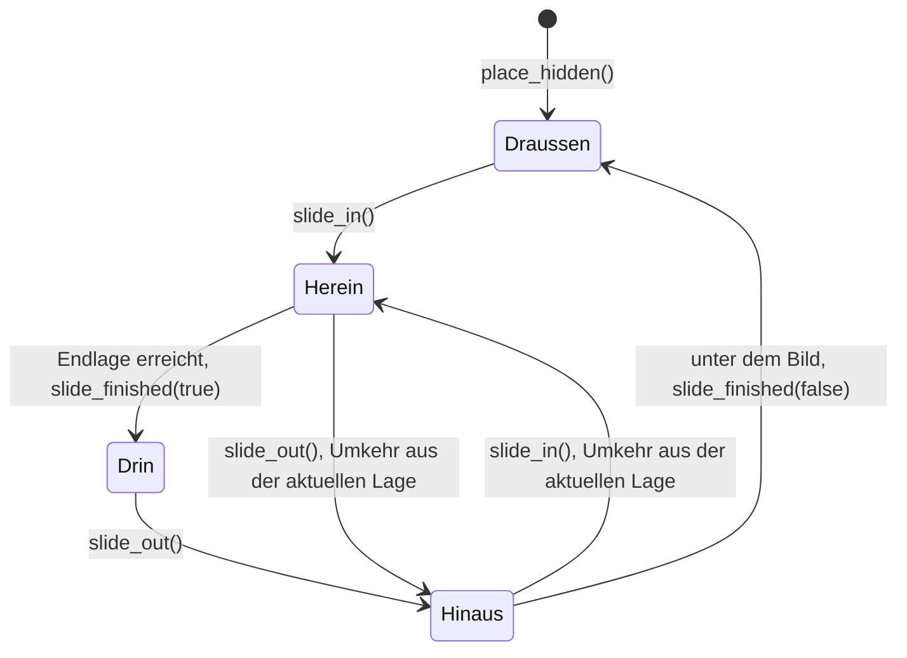
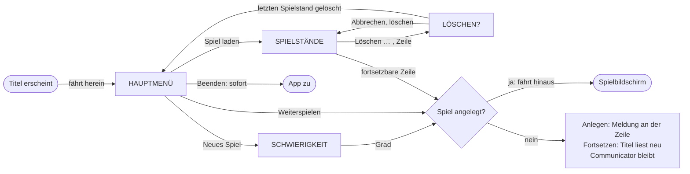

# Datenmodell: Communicator als Steuerelement

Das Feature speichert nichts: Spielstände und ihr Format bleiben wie in Feature 004. Dieses Dokument
beschreibt die Teile des Communicators, seine Zustände und die Wege im Titel. Entscheidungen in
[research.md](research.md), Schnittstellen in [contracts/communicator.md](contracts/communicator.md)
und [contracts/titelbildschirm.md](contracts/titelbildschirm.md).

## Teile

| Teil | Was | Herkunft der Werte |
|---|---|---|
| **Communicator** | das Steuerelement: Gehäuse, Anzeige, Seiten, Hinweis, Lage | Style-Guide, Baustein Communicator |
| **Gehäuse** | ein Bild auf dem Bildraster, ×2 gezeigt; heute der Organizer von 1991 (G-02), bis dahin ein Platzhalter (R11) | `src/assets/images/organizer_1991.png` |
| **Anzeige** | Rechteck fester Größe im Gehäuse, für jedes Gehäuse gleich groß (FR-001); Lage im Gehäuse und Farbe gehören zum Gehäuse, beim Organizer `lcd` (Analyse, C11) | Style-Guide; Vorschlag 384 × 192 (R9) |
| **Seite** | ein Control auf der Anzeige: `MainMenu` oder `SaveList` mit `look = LCD`; genau eine ist zu sehen | die Bildschirme, die den Communicator zeigen |
| **Hinweis** | `MenuHint` als Kind des Communicators, links neben dem Gehäuse auf Höhe der gewählten Zeile, auch als Meldung | Style-Guide, Baustein Hinweis |
| **Farbe `lcd`** | 16. Farbe der Oberfläche, nur Oberfläche (R1, R2) | `UiPalette.LCD`, Token `&"lcd"` |

Eine Seite meldet weiter selbst, was gewählt und ausgelöst wird (`MainMenu.selection_changed`,
`entry_activated`; `SaveList.selection_changed`, `resume_requested`, `delete_requested`,
`back_requested`). Der Communicator kennt diese Signale nicht; der Bildschirm verbindet sie und
reicht den Hinweis über den Communicator weiter.

## Lage des Communicators

| Zustand | Lage | Eingabe |
|---|---|---|
| Draußen | Oberkante des Gehäuses bei y 360, nichts zu sehen | nach `place_hidden()` nicht gesperrt, damit der Bildschirm schon wählen kann (Analyse, C5); nach einer Fahrt hinaus gesperrt bis `slide_in()` |
| Herein | unterwegs nach oben | ja: Tastatur und Klick wirken; die Maus wählt nur, wenn sie bewegt oder geklickt wird (FR-003) |
| Drin | Endlage | ja |
| Hinaus | unterwegs nach unten | keine: kein Fokus auf den Seiten, keine Maus, auch nicht über `mouse_entered` oder Mausbewegung (FR-013a, R8; Analyse, B2) |

- Jede Lage ist eine ganze Zahl von Oberflächenpixeln; nie über die Endlage hinaus (SC-003).
- Mit `animate = false` springt der Communicator ohne Zwischenlagen, für Tests und später
  „Bewegung reduzieren“.

## Titelbildschirm: Seiten und Wege

Die Wege bleiben wie in Feature 004 (`docs/spielbeschreibung/titel-und-hauptmenue.md`, „Wege“). Neu
ist, worauf die Seiten stehen und wann der Communicator fährt:

- Seitenwechsel innerhalb des Titels: Der Communicator bleibt stehen, die neue Seite ersetzt die
  alte ohne Übergang (FR-005).
- Bei jedem Erscheinen des Titels, auch nach „Zum Hauptmenü“ aus dem Spiel, beginnt er draußen und
  fährt herein (FR-010).
- Scheitert das Fortsetzen über die Liste oder „Weiterspielen“, gilt Feature 004: Der Titel liest
  Hauptmenü oder Liste neu, ohne Meldung; nichts fährt. Eine Meldung gibt es nur, wenn das Anlegen
  eines neuen Spiels scheitert.
- Bis das Hauptmenü seine Einträge hat, tut eine Eingabe nichts, auch Esc; erst kommen Einträge und
  Auswahl, dann beginnt die Fahrt (Analyse, C4, C5).
- Die gewählte Zeile merkt sich der Titel relativ zum Communicator; eine Meldung steht so neben der
  Zeile, wo sie gerade ist, auch wenn sie während der Fahrt gewählt wurde (Analyse, C3).

## Seiten auf der Anzeige (`look = LCD`)

| Was | auf Papier (`PAPER`, wie Feature 004) | auf der Anzeige (`LCD`) |
|---|---|---|
| Grund | Zebra `papier` / `endlos-gruen`, Lochränder, `pixelschatten` | nichts; die Anzeige darunter ist `lcd` |
| gewählte Zeile | `signalgelb`, Pfeil `tusche` | Balken `tusche`, Schrift und Pfeil `lcd` (R3); die Schrift setzt der Code, nicht das Theme (R15) |
| gewählt, nicht verfügbar | `signalgelb`, Schrift und Pfeil `gehaeuse-dunkel` | Balken `tusche`, Schrift und Pfeil `gehaeuse-dunkel` |
| Rollmarke in der gewählten Zeile | `tusche` | `lcd` (CHK001) |
| nicht verfügbar | `gehaeuse-dunkel` | `gehaeuse-dunkel` auf `lcd` |
| Breite | Menü 144, Liste 304 | volle Breite der Anzeige |
| Kopfzeile, Rollmarken, Zeilenhöhe 20, Bedienung | wie Feature 004 | gleich, Farben `tusche` auf `lcd` |

Die genauen Abstände legt der Style-Guide fest (R12, Punkt 3).
