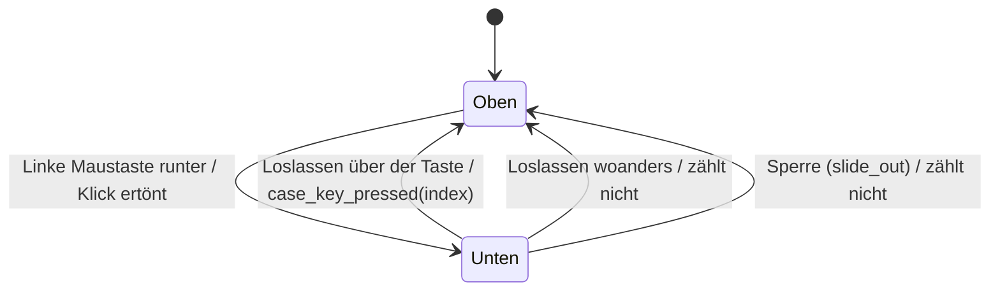
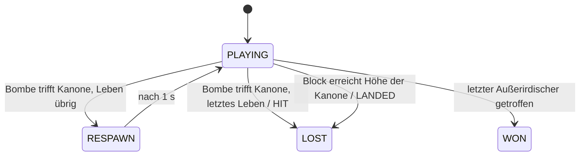

# Datenmodell: Easter Egg 01: Space Invaders

Zustände und Übergänge zu [spec.md](spec.md). Entscheidungen in [research.md](research.md), Signaturen
in den Verträgen unter [contracts/](contracts/). Nichts davon wird gespeichert (FR-007).

## Gehäusetaste (am Communicator)

| Feld | Bedeutung |
|---|---|
| `rect` | Lage im Gehäusebild in Bildpixeln (R2), aus `case_keys` |
| gedrückt | ob die linke Maustaste auf dieser Taste unten ist |

Gesperrt (ab `slide_out()`) nimmt keine Taste einen Druck an (Feature 005, R8).

## Folge (`KeySequence`)

| Feld | Bedeutung |
|---|---|
| `expected` | die Folge, für das Easter Egg `[0, 1, 2]` |
| `progress` | wie viele Tasten der Folge schon richtig kamen, 0 bis 2 |

| Druck | Wirkung |
|---|---|
| richtige nächste Taste, nicht die letzte | `progress + 1` |
| richtige letzte Taste | Folge vollständig, `progress = 0`, `press()` gibt true |
| falsche Taste, und sie ist `expected[0]` | `progress = 1` (neuer Anfang) |
| falsche Taste sonst | `progress = 0` |
| `reset()` | `progress = 0` |

Beispiele: 1-2-3 startet; 1-1-2-3 startet; 2-1-3 nicht; 1-2-2-3 nicht.

## Partie (`InvadersGame`)

| Feld | Bedeutung |
|---|---|
| `state` | `PLAYING`, `RESPAWN` (Pause nach einem Treffer), `WON`, `LOST` |
| `lost_reason` | `HIT` (keine Leben mehr) oder `LANDED` (Block auf Höhe der Kanone) |
| `cannon_x` | linke Kante der Kanone in Bildpixeln |
| `lives` | 3 zu Beginn |
| `score` | Punkte, 0 bis 640 |
| `aliens` | je Platz im Block: lebt oder nicht; Reihe bestimmt Art und Punkte |
| `block_origin` | linke obere Ecke des Blocks in Bildpixeln |
| `block_dir` | +1 rechts, −1 links |
| `march_timer` | Schritte bis zum nächsten Takt |
| `march_frame` | 0 oder 1, Bewegungsbild; wechselt mit jedem Takt |
| `march_note` | 0 bis 3, welcher der vier Marschtöne als Nächstes kommt |
| `shot` | eigener Schuss oder keiner |
| `bombs` | höchstens 3 |
| `explosions` | kurz sichtbare Treffer, mit Restzeit |
| `rng` | Zufall für Bomben, mit Seed |

**Ereignisse eines Schritts** (Rückgabe von `step()`, für Töne und Bild): `SHOT`, `ALIEN_HIT`,
`MARCH` (mit `march_note`), `CANNON_HIT`, `WON`, `LOST`. Ein Schritt kann mehrere liefern.

**Regeln:**
- Ein Schritt ist 1/60 s. Die Partie kennt keine Zeit außerhalb ihrer Schritte.
- Die Kanone bleibt im Feld; links und rechts zugleich heben sich auf.
- Ein neuer Schuss nur, wenn keiner im Feld ist. In `RESPAWN` gibt es keinen Schuss und keine Bombe.
- Treffer sind Überschneidungen von Rechtecken auf Bildpixeln; ein Schuss trifft höchstens einen.
- Der Takt rückt den Block; am Rand erst tiefer und Richtungswechsel, im nächsten Takt weiter.
- Abstand der Takte aus der Zahl der Übrigen (R7); der Block wird schneller, je weniger übrig sind.

## Seite (`InvadersPage`)

| Zustand | Was zu sehen ist | Eingabe |
|---|---|---|
| läuft | Kopfzeile, Block, Kanone, Schüsse, Bomben | Pfeile, Leertaste, Esc |
| angehalten (Fenster ohne Fokus) | das letzte Bild | keine; Töne angehalten |
| Ende, gesperrt (0,5 s) | Meldung | nur Esc |
| Ende, wartet | Meldung | jede neue Taste, Linksklick, Esc → `finished` |

## Titel

| Feld | Bedeutung |
|---|---|
| `_sequence` | `KeySequence` mit `[0, 1, 2]` |
| `_return_page` | die Seite, die beim Start der Folge zu sehen war |
| `_return_focus` | das Control mit dem Fokus beim Start |
| `_return_row`, `_return_hint` | Zeile und Hinweis beim Start, für den Hinweis danach |

Ablauf: `case_key_pressed(i)` → wenn der Titel Eingaben annimmt und das Spiel nicht läuft:
`_sequence.press(i)`; bei true merken, Hinweis aus, `InvadersPage.start()`, zeigen. Bei `finished`:
`_return_page` zeigen, Fokus und Hinweis wiederherstellen, `_sequence.reset()`.
