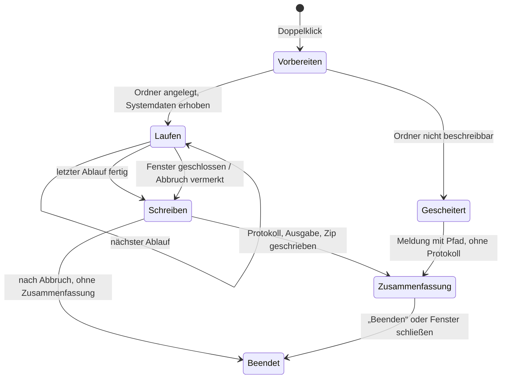
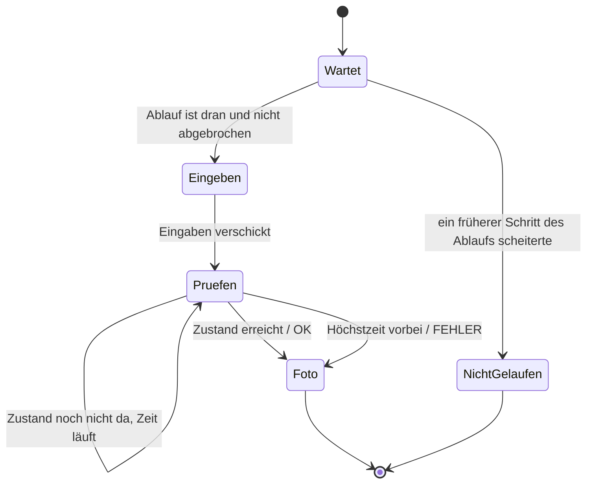

# Datenmodell: Build & Export mit Selbsttest

Zustände und Übergänge zu [spec.md](spec.md). Entscheidungen in [research.md](research.md),
Signaturen in den Verträgen unter [contracts/](contracts/). Gespeichert wird nur, was ein Lauf als
Ergebnis schreibt (Protokoll, Fotos, Ausgabe, Zip); das Spiel selbst bekommt keine neuen Daten.

## Lauf

Ein Start der Selbsttest-App bis zur Zusammenfassung.

| Feld | Bedeutung |
|---|---|
| `id` | Datum und Uhrzeit des Starts, lokal, `JJJJ-MM-TT_hh-mm-ss`; Name des Ordners und des Zips |
| `system` | die Systemdaten (unten), einmal beim Start erhoben, auch die Fenstergröße (Analyse, I6) |
| `zeitraffer` | der Faktor der Abläufe im Zeitraffer |
| `ablaeufe` | die Abläufe in fester Reihenfolge, je mit ihren Schritten und Ergebnissen |
| `fokusverluste` | je Verlust: Schritt-Kennung und Zeit seit dem Start in Millisekunden |
| `abbruch` | `keiner`, oder die Schritt-Kennung, in der das Fenster geschlossen wurde |
| `summe` | Zahl der Schritte je Ergebnis: in Ordnung, Fehler, nicht gelaufen |



Nach einem Abbruch schreibt die App Protokoll, Ausgabe und Zip noch, bevor sie sich beendet; das
Fenster ist dann schon zu.

## Systemdaten

Feste Schlüssel, gleich auf allen Systemen (FR-013, FR-014). Ein Wert, den das System nicht liefert,
heißt `unbekannt`, der Schlüssel fehlt nie.

| Schlüssel | Beispiel auf dem Mac |
|---|---|
| `system.os` | `macOS` |
| `system.os_version` | `26.0.0` |
| `system.cpu` | `Apple M3 Pro` |
| `system.gpu` | `Apple M3 Pro` |
| `system.gpu_vendor` | `Apple` |
| `system.gpu_driver` | Treiberversion, `unbekannt` wo nicht verfügbar |
| `system.renderer` | `forward_plus` (bis 2026-10-29; seit Feature 009 `gl_compatibility`) |
| `system.grafik_api` | `Metal`, `Vulkan`, `D3D12` oder `OpenGL` (seit Feature 009 auch `ANGLE` und `OpenGL ES`; Namen in `SelbsttestTexte.GRAFIK_API`) |
| `system.grafik_api_version` | Version der Schnittstelle |
| `system.bildschirm` | `3024x1964` |
| `system.bildschirm_skalierung` | `2.0` |
| `system.bildschirm_dpi` | `254` |
| `system.bildwiederholrate` | `120` |
| `system.fenster` | `1920x1080` nach dem Start, ohne Rahmen |
| `system.fenster_faktor` | `3` |
| `system.sprache` | `de_DE` |
| `system.tastatur` | Name der Belegung, etwa `German` |
| `computerladen.version` | aus `application/config/version`, etwa `0.1` |
| `godot.version` | `4.7.2.stable.official` |
| `selbsttest.version` | eigene Nummer der Abläufe, etwa `1` |
| `selbsttest.gebaut` | Änderungszeit der App-Datei, `JJJJ-MM-TT hh:mm` |
| `lauf.start` | Datum und Uhrzeit des Laufs |
| `lauf.feste_zeit` | die feste Uhrzeit, mit der das Spiel rechnet (R7) |
| `lauf.zeitraffer` | Faktor des Zeitraffers, etwa `8` (R24) |

## Ablauf

| Feld | Bedeutung |
|---|---|
| `kennung` | kurz, klein, ohne Leerzeichen: `titel`, `neues_spiel`, `laden`, `loeschen`, `easter_egg`, `bedienung`, `fenster`, `titel_echtzeit` |
| `name` | für Menschen, etwa „Neues Spiel“, „Spiel laden“ |
| `schritte` | in fester Reihenfolge |
| `baut_auf` | leer, oder die Kennung des Ablaufs, dessen Ende er voraussetzt (etwa `laden` auf `neues_spiel`) |
| `zeitraffer` | Faktor für die Zeit im Spiel, Vorgabe 8; 1 für `titel_echtzeit` und `fenster` (R24) |

Jeder Ablauf ohne `baut_auf` beginnt beim **frischen Titel**: leerer Ordner für Spielstände, kein
laufendes Spiel, Titel neu geladen, Communicator hereingefahren. Ist der Ablauf, auf den einer
aufbaut, gescheitert, gilt dieser ganz als „nicht gelaufen“, mit Vermerk.

## Szenario (Rahmen, R27)

Ein Ablauf mit drei Zusätzen; das erste kommt mit einem späteren Feature.

| Feld | Bedeutung |
|---|---|
| `start` | Grad und Seed des neuen Spiels |
| `entscheidungen` | je Eintrag ein Spieldatum und Schritte über die Oberfläche, etwa „am 01.03.1985: Ware nachbestellen“ |
| `pruefpunkte` | je Eintrag ein Spieldatum, eine Prüfung und ein Foto; der Läufer lässt die Uhr im Zeitraffer bis dahin laufen |

Prüfpunkte heißen wie Schritte, `<szenario>.<nn>_<kurz>`, etwa `leicht_1987.03_kontostand`.

## Schritt

| Feld | Bedeutung |
|---|---|
| `kennung` | `<ablauf>.<nn>_<kurz>`, etwa `neues_spiel.04_grad_mittel`; zugleich Name des Fotos |
| `beschreibung` | ein Satz, was der Schritt tut, beginnend mit der Eingabe, etwa „Enter auf „Neues Spiel“ öffnet die Gradwahl“ (contracts/ablaeufe.md, „Beschreibung“) |
| `eingaben` | die Folge von Eingaben mit Ziel, etwa „Enter auf Mittel“, „Linksklick auf Gehäusetasten links, Mitte, rechts“; „keine“ ohne Eingabe; Vorbereitung als „Vorbereitung: …“, Fenstergröße als „Fenster auf …“ (Review CHK001) |
| `erwartet` | der Zustand, auf den gewartet wird, als lesbarer Text und als Prüfung |
| `hoechstzeit` | Millisekunden bis „Zeit abgelaufen“, Vorgabe 5000 (R6) |
| `foto_vergleichbar` | ob das Foto auf jedem Rechner gleich sein muss; nein nur, wo das Bild von der Bildrate abhängt (R7) |

**Ergebnis je Schritt:**

| Feld | Bedeutung |
|---|---|
| `status` | `OK`, `FEHLER` oder `NICHT_GELAUFEN` |
| `gefunden` | bei `FEHLER`: der tatsächliche Zustand, lesbar, oder „Zeit abgelaufen, zuletzt: …“; bei `NICHT_GELAUFEN` der Grund, etwa „Fehler in Schritt …“ |
| `dauer_ms` | von der ersten Eingabe, bei Schritten ohne Eingabe vom Beginn des Schritts, bis zum Erreichen des Zustands oder zum Abbruch (Analyse, I1) |
| `zeitraffer` | Faktor, mit dem der Schritt lief, im Protokoll je Schritt (Analyse, U7) |
| `foto` | Dateiname, `<kennung>.png`; auch bei `FEHLER` wird fotografiert, bei `NICHT_GELAUFEN` nicht |
| `meldungen` | Fehler und Warnungen, die Godot oder das Spiel während des Schritts ausgegeben haben |



Geprüft wird jedes Bild aufs Neue, bis der Zustand da ist; feste Wartezeiten gibt es nicht. Eine
Bewegung wie die Fahrt des Communicators gilt erst als fertig, wenn der Communicator steht (FR-006).

## Ziel

Wohin eine Mauseingabe geht, gefunden über die Bedeutung, nicht über Koordinaten (FR-005, R5).

| Art | Gefunden über | Beispiel |
|---|---|---|
| Menüeintrag | Seite und Kennung des Eintrags | Hauptmenü, `new_game` |
| Zeile der Liste | Nummer des Spielstands oder Zeile „Löschen …“, „Zurück“ | Spiel 1 |
| Gehäusetaste | Index am Communicator | 1, die mittlere |
| Knopf | Name im Bildschirm | „Zum Hauptmenü“ |

Die Mitte des gefundenen Ziels wird aus seiner Lage im Oberflächenraster in Fensterpixel
umgerechnet. Fehlt das Ziel, scheitert der Schritt mit „Ziel nicht gefunden: HAUPTMENÜ, „Neues Spiel““.

## Ergebnis eines Laufs (Dateien)

Im Datenordner der Selbsttest-App unter `selbsttest/` (R11):

```text
selbsttest/
├── 2026-10-28_14-03-12/
│   ├── protokoll.txt        Systemdaten, Schritte, Summe (contracts/protokoll.md)
│   ├── ausgabe.txt          alles, was Godot und das Spiel während des Laufs ausgaben
│   └── fotos/<kennung>.png  ein Foto je gelaufenem Schritt, 640 × 360
└── 2026-10-28_14-03-12_macos.zip   derselbe Ordner als Zip
```

## Vergleich (Werkzeug außerhalb von Godot)

| Ergebnis je Schritt | Bedeutung |
|---|---|
| gleich | Foto und Referenzbild sind Pixel für Pixel gleich |
| abweichend | Zahl der Pixel, die abweichen, das umschließende Rechteck und ein Bild mit markierten Pixeln |
| nicht vergleichbar | der Schritt ist als nicht vergleichbar markiert; nur Größe 640 × 360 geprüft |
| Referenz fehlt | zum Foto gibt es kein Referenzbild |
| Foto fehlt | zum Referenzbild gibt es kein Foto, etwa weil der Schritt nicht lief |
