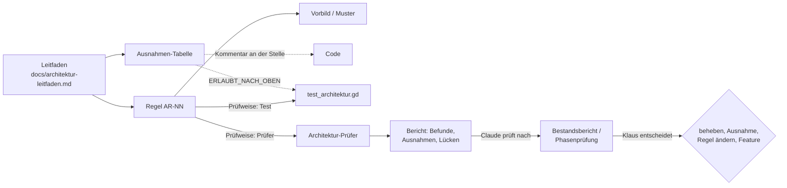

# Datenmodell: Godot- und Spielarchitektur mit Prüf-Agent

008 hat keine Spieldaten. Die „Daten“ sind Dokumente und Listen, die Menschen, Prüfer und Tests
lesen. Ihre Form legen die Verträge fest; hier stehen die Teile und wie sie zusammenhängen.

## Regel

| Feld | Werte | Regel |
|---|---|---|
| Nummer | `AR-01` … | fest, nie neu vergeben; AR-01 bis AR-05 sind die Godot-Prinzipien |
| Kurzname | Text | Überschrift |
| Aussage, Grund, Beispiel, Gegenbeispiel, Quelle | Text | alle Pflicht (FR-005) |
| Schicht | alle, Kern, Oberfläche, Adventure, Wirtschaft, Werkzeuge | mindestens eine |
| Prüfweise | Prüfer \| Test mit Funktion | messbar ⇒ Test (FR-008) |
| Stand | Vorschlag → gilt seit … \| gilt ab Schicht … \| gestrichen | nur „gilt“ zählt für Prüfer und Tests |

Übergänge: `Vorschlag → gilt` (Klaus übernimmt oder ändert), `Vorschlag → gestrichen` (Klaus
streicht), `gilt → gilt` mit neuem Wortlaut (alter in „Geschichte“), `gilt → gestrichen` (mit Grund
in „Geschichte“).

## Vorbild

Spiel, Schicht, was übernommen wird, was nicht, Quelle. Kein eigener Stand; es gilt mit den Regeln
seiner Schicht.

## Muster

Name (deutsch und englisch), Kern, Godot-Entsprechung, wo im Spiel, Regeln (AR-Nummern).

## Begründete Ausnahme

Ort (Datei, Zeile oder Knoten), Regel, Grund, Freigabe (Klaus, Datum). Gültig mit Kommentar an der
Stelle **und** Zeile in der Tabelle; hat die Stelle kein Skript, etwa ein Knoten ohne Skript oder eine
Resource, reicht die Zeile mit Datei und Knoten (research.md, R3; CHK010). Für Regeln mit Test
zusätzlich ein Eintrag in `ERLAUBT_NACH_OBEN` im Test.

## Vorgemerkte Abweichung

Eine bestätigte Abweichung, die Klaus als eigenes Feature vormerkt: Ort, Regel, Verweis auf den
Eintrag in `docs/features/Feature_Ideas.md`. Für Regeln mit Test ein Eintrag in `VORGEMERKT` im Test;
er verschwindet mit dem Feature, das die Abweichung behebt.

## Befund

Schwere (kritisch, hoch, mittel, niedrig), Ort, Regel mit Wortlaut, Beleg; nach Claudes Nachprüfung:
Urteil (bestätigt oder verworfen) mit Grund. Im Bestand heißt ein bestätigter Befund **Abweichung**
und bekommt Klaus' Entscheidung: beheben (in 008 oder als Feature), Ausnahme, Regel ändern.

## Lücke im Leitfaden

Frage, Ort, Claudes Empfehlung, Klaus' Entscheidung. Ergebnis ist eine neue oder geänderte Regel oder
ausdrücklich „bleibt offen“ in `docs/offene-punkte.md`.

## Bestandsbericht

`specs/008-architektur/bestandsbericht.md`: Kopf mit Stand (Commit), drei Teile Kern, Spiel und
Oberfläche, Werkstatt; je Teil die geprüften Dateien, Abweichungen mit Claudes Urteil und Klaus'
Entscheidung, Ausnahmen, Lücken; am Ende die Zählung für `ki_pruefung.md` und die Liste der
Behebungen für Phase 5 und der Einträge für `Feature_Ideas.md`.

## Zählung

Je Lauf eine Zeile in `ki_pruefung.md`, „Nachmessen“: Lauf, Prüfer, Befunde, bestätigt, verworfen,
Lücken, nur er fand (FR-024).
