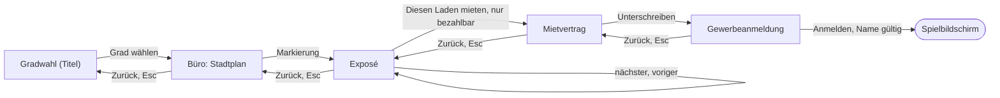

# Vertrag: Ladenwahl im Büro des Maklers

Technischer Vertrag zur Ladeneröffnung: der Weg vom Titel ins Büro, die vier Schritte Stadtplan,
Exposé, Mietvertrag, Gewerbeanmeldung und der Weg in den Laden. Entscheidungen in
[research.md](../research.md) (R1, R2, R7 bis R9, R11, R14), Kerne und Zustände in
[data-model.md](../data-model.md). Rümpfe stehen hier bewusst nicht (Verfassung, Grundsatz II).

**Vorbedingung:** Die Abschnitte aus R14 stehen im Style-Guide, und Klaus hat sie freigegeben.
Farben, Schriften, Maße, Lagen und Zustände kommen von dort, aus `UiPalette` und dem Theme, nicht
aus diesem Vertrag. Braucht der Agent etwas, das der Style-Guide nicht regelt, hält er an und
fragt.

## Dateien

```text
src/
├── core/
│   ├── shop/
│   │   ├── shop_rules.gd           # neu: class_name ShopRules, Stellschrauben (Konstanten)
│   │   ├── money.gd                # neu: class_name Money, Pfennig → „25.680,00 DM“
│   │   ├── shop_offer.gd           # neu: class_name ShopOffer extends Resource
│   │   ├── city_data.gd            # neu: class_name CityData extends Resource
│   │   ├── figure_data.gd          # neu: class_name FigureData extends Resource
│   │   ├── shop_name.gd            # neu: class_name ShopName, Regeln des Namens
│   │   ├── shop_opening.gd         # neu: class_name ShopOpening, Kern der Eröffnung
│   │   ├── shop_lease.gd           # neu: class_name ShopLease, Daten im Spielstand
│   │   └── shop_account.gd         # neu: class_name ShopAccount, Kern des Kontos
│   ├── save/
│   │   ├── save_game.gd            # geändert: shop, account
│   │   └── save_game_factory.gd    # neu: class_name SaveGameFactory
│   └── game_session.gd             # geändert: opening, account, start_new(), leave()
├── data/
│   ├── stadt.tres                  # erzeugt vom Importer
│   ├── laeden/<id>.tres            # erzeugt vom Importer, vier Dateien
│   └── figuren/<id>.tres           # erzeugt vom Importer
├── ui/
│   ├── adventure/
│   │   ├── hotspot.tscn / .gd      # neu: class_name Hotspot, anklickbare Stelle
│   │   └── speech_bubble.tscn / .gd # neu: class_name SpeechBubble
│   └── paper/
│       └── paper_sheet.tscn / .gd  # neu: class_name PaperSheet, Blatt mit Zurück und Handlung
├── scenes/
│   ├── title/
│   │   └── title_screen.gd         # geändert: Gradwahl beginnt die Eröffnung, Rückkehr
│   └── opening/
│       ├── broker_office.tscn / .gd # neu: class_name BrokerOffice, das Büro
│       ├── city_map.tscn / .gd     # neu: Stadtplan mit Markierungen
│       ├── expose.tscn / .gd       # neu: Exposé eines Ladens
│       ├── lease_contract.tscn / .gd # neu: Mietvertrag
│       ├── registration.tscn / .gd # neu: Gewerbeanmeldung mit Namensfeld
│       └── opening_texts.gd        # neu: class_name OpeningTexts
├── assets/images/
│   ├── buero/buero.png, makler.png, stadtplan.png   # Platzhalter, dann Bilder
│   └── laeden/<id>_aussen.png, <id>_innen.png      # Platzhalter, dann Bilder
└── test/
    ├── test_shop_rules.gd, test_money.gd, test_shop_name.gd
    ├── test_shop_opening.gd, test_shop_account.gd
    ├── test_save_game.gd           # geändert: shop, account, Pflicht
    ├── test_game_session.gd        # geändert: Eröffnung, Konto, Mieten über Speichern
    ├── test_fahrplan_laden.gd      # neu: Fahrplan bytegleich mit jedem Laden (SC-005)
    ├── test_daten_laeden.gd        # neu: erzeugte Daten lesbar, bezahlbar je Grad (SC-002)
    ├── test_hotspot.gd, test_speech_bubble.gd, test_paper_sheet.gd
    ├── test_broker_office.gd       # neu: Wege, Esc, Zurück, nichts geschrieben (SC-007)
    └── fixtures/                   # Probeszenen für Hotspot, Blatt, Büro
```

## Wege



- Das Büro erscheint mit herangeholtem Stadtplan; der Makler sagt seinen Satz zu `betreten`.
- Esc und „Zurück“ gehen je einen Schritt zurück (FR-002). Esc im Eingabefeld der Anmeldung geht
  ebenso zurück; die Eingabe bleibt stehen, wenn der Spieler wiederkommt.
- Vom Stadtplan zurück: Szenenwechsel zum Titel; der Titel zeigt die Gradwahl mit dem gewählten Grad
  vorgewählt, ruft `GameSession.end_opening()`, und der Communicator fährt herein wie bei jedem
  Erscheinen.
- „Anmelden“: `GameSession.start_new(name)`. Gelingt es, wechselt das Büro zum Spielbildschirm.
  Scheitert das Speichern, steht `GameSession.MESSAGE_NOT_CREATED` als Meldung an der Anmeldung,
  Name und Unterschrift bleiben, der Spieler kann es noch einmal versuchen.
- Mit der Maus: Klick auf Stadtplan, Schreibtisch oder Makler an der Wand holt heran bzw. lässt ihn
  sprechen; Klick auf eine Markierung öffnet das Exposé. Mit der Tastatur: Tab und Pfeiltasten
  wählen der Reihe nach, Enter löst aus (FR-001a, FR-004).
- Während eines Szenenwechsels nimmt das Büro keine Eingabe an (ein `enum` für die Phase wie im
  Titel, AR-11).

## Blätter

Jedes Blatt ist ein `PaperSheet` mit dem Knopf „Zurück“ und höchstens einer Handlung. Werte kommen
aus `ShopOpening` und `Money`, nie als Zahl aus der Szene.

| Blatt | Inhalt | Handlung |
|---|---|---|
| Stadtplan | Bild der Stadt, je Laden eine Markierung; grau, wenn nicht bezahlbar; Tooltip: Viertel und Monatsmiete | keine; Markierung öffnet das Exposé |
| Exposé | Foto außen, Titel, Anschrift, Viertel, Fläche, Monatsmiete, Kaution, Laufkundschaft, Sichtbarkeit, Parkplätze in Worten, Beschreibung, Kleingedrucktes klein am Fuß; bei nicht bezahlbar der Vermerk des Maklers | „Diesen Laden mieten“, fehlt bei nicht bezahlbar |
| Mietvertrag | Vermieter, Mieter (Platzhalterlinie), Anschrift, Fläche, Monatsmiete, Kaution, Mietbeginn 01.01.1985, „Erster Monat mietfrei für den Ausbau.“, Unterschriftszeile | „Unterschreiben“ |
| Gewerbeanmeldung | amtliches Formular, Anschrift der Betriebsstätte, Tätigkeit „Handel mit Computern und Zubehör“, Feld „Name des Betriebs“, darunter der Grund, wenn der Name nicht passt | „Anmelden“, gesperrt, solange der Name nicht passt |

## Wortlaute (vorläufig, Text-Prüfer bei der Checkliste)

Bedienung duzt, Papiere und der Makler siezen (Style-Guide, „Sprache“). Namen von Stadt, Straßen
und Makler kommen aus R17.

| Stelle | Text |
|---|---|
| Knopf | „Zurück“, „Diesen Laden mieten“, „Unterschreiben“, „Anmelden“ |
| Hotspot Stadtplan | „Stadtplan“ |
| Hotspot Makler | „{Name des Maklers}“ |
| Tooltip Markierung | „{Viertel}, {Miete} im Monat“ |
| Vermerk nicht bezahlbar | „Der Vermieter verlangt einen Kapitalnachweis über {Nachweis}. Sie haben {Kapital}.“ |
| Hinweis „Diesen Laden mieten“ | „Weiter zum Mietvertrag. Noch ist nichts unterschrieben.“ |
| Hinweis „Unterschreiben“ | „Unterschreibt den Vertrag. Fest ist er erst mit der Anmeldung.“ |
| Grund, Name leer | „Der Laden braucht einen Namen.“ |
| Grund, Zeichen | „Dieses Zeichen nimmt das Gewerbeamt nicht.“ |
| Hinweis „Anmelden“ | „Meldet {Name} an und eröffnet den Laden. Die Kaution von {Kaution} geht ab.“ |
| Stufen | Laufkundschaft „wenig“, „mittel“, „viel“; Sichtbarkeit und Parkplätze „schlecht“, „mittel“, „gut“ |

## Sätze des Maklers

Aus `FigureData.lines` (data-model.md). Die Sprechblase steht neben dem Makler, solange der
Spieler nichts tut, höchstens 4 s, oder bis zum nächsten Klick. Je Anlass der nächste Satz der
Reihe nach. Beispiele für den Ton, endgültig nach R17:
- `betreten`: „Setzen Sie sich. Ich habe da ein paar Objekte, die sind praktisch schon weg.“
- `expose_gewerbegebiet`: „Viel Platz, viele Parkplätze. Kunden bringen Sie selbst mit.“
- `expose_zu_teuer`: „Da müsste ich die Bank fragen. Die Bank fragt dann Sie.“

## Feste Größen

- Vor der Anmeldung liegt keine Datei im Ordner der Spielstände, an keiner Stelle des Wegs, auch
  nicht nach dem Schließen des Fensters (SC-007).
- Auf Schwer ist genau die Fußgängerzone grau, auf Mittel und Leicht keine (SC-002, Tabelle in
  data-model.md).
- Das Büro kennt `ShopOffer` nur über `ShopOpening`; die Bausteine unter `src/ui/` kennen weder Büro
  noch Laden (AR-05, AR-18).
