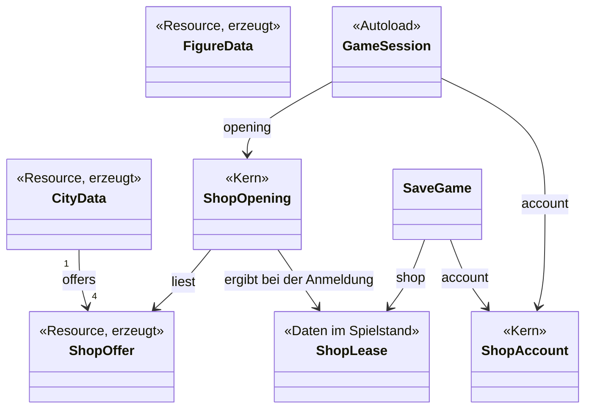
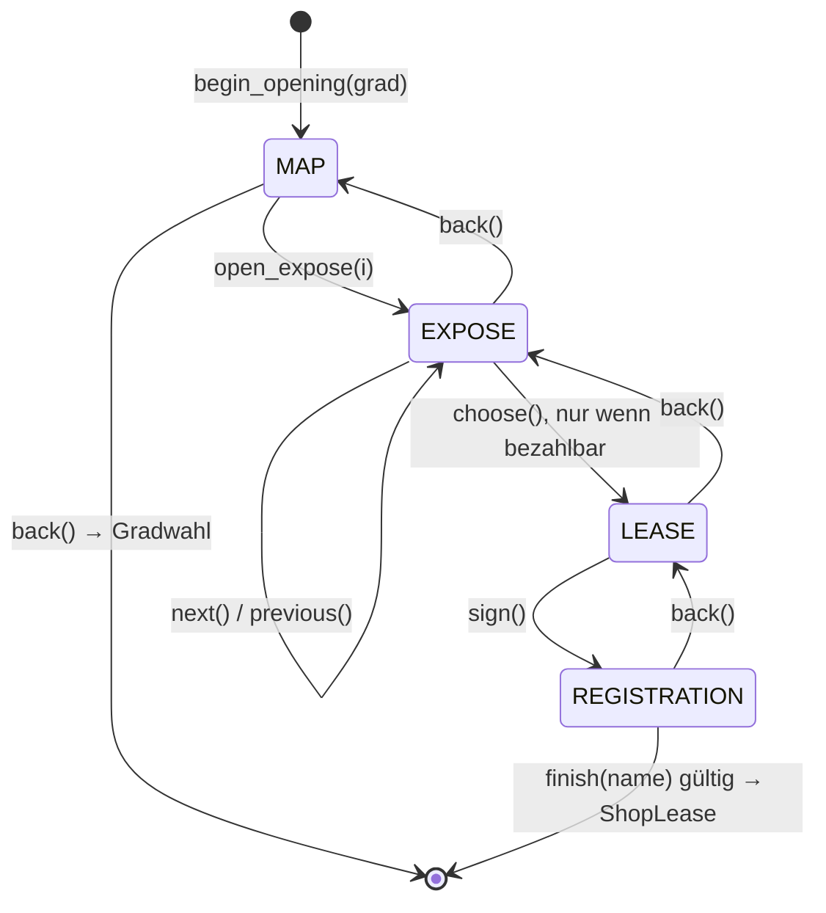

# Datenmodell: Ladeneröffnung

Die Begriffe aus der Spec ([spec.md](spec.md), „Key Entities“) mit ihren Feldern, Regeln und
Zuständen. Entscheidungen dazu in [research.md](research.md). Beträge sind ganze Zahlen in Pfennig
(AR-16), Tage Tagesindizes wie im Lauf (0 = 01.01.1985), Monate Monatsindizes (0 = Januar 1985).

## Übersicht

## Erzeugte Daten (aus der game_bible, nur lesen)

Geschrieben nur vom Importer `tools/bible/importiere.py` (research.md, R6). Im Spiel nur lesen;
Godot teilt geladene Resources zwischen allen Nutzern (AR-04).

### CityData — `src/data/stadt.tres`

| Feld | Typ | Inhalt | Quelle (Frontmatter) |
|---|---|---|---|
| `name` | String | Name der Stadt | `grunddaten_name` |
| `population` | int | Einwohner, rund 150.000 | `grunddaten_einwohner` |
| `quarters` | PackedStringArray | Viertel: Innenstadt, Wohngebiet, Gewerbegebiet | `viertel` |
| `offers` | Array[ShopOffer] | die Läden in fester Reihenfolge (`order`) | Notizen unter `Läden/` |

### ShopOffer — `src/data/laeden/<id>.tres`

| Feld | Typ | Regel | Quelle (Frontmatter) |
|---|---|---|---|
| `id` | StringName | aus dem Dateinamen, klein, ohne Umlaute: `fussgaengerzone`, `bahnhof`, `stadtteilzentrum`, `gewerbegebiet`; nie geändert, steht im Spielstand | Dateiname |
| `order` | int | Reihenfolge auf Plan und beim Blättern | `grunddaten_reihenfolge` |
| `title` | String | „Ladenlokal Fußgängerzone“ | `grunddaten_titel` |
| `address` | String | Straße und Hausnummer, erfunden | `grunddaten_anschrift` |
| `quarter` | String | eines der Viertel der Stadt | `grunddaten_viertel` |
| `area_m2` | int | > 0 | `flaeche_qm` |
| `rent` | int | Pfennig; aus `preise_miete`, Eintrag `datum: "1985-01"`, `von == bis` | `preise_miete` |
| `walk_in` | `ShopOffer.Level` | `LOW`, `MEDIUM`, `HIGH` | `lage_laufkundschaft` (`niedrig`, `mittel`, `hoch`) |
| `visibility` | `ShopOffer.Level` | wie oben | `lage_sichtbarkeit` |
| `parking` | `ShopOffer.Level` | wie oben; nur gespeichert und angedeutet | `lage_parkplaetze` |
| `description` | String | zwei, drei Sätze des Maklers | `text_beschreibung` |
| `fine_print` | String | Kleingedrucktes, fester Text (FR-012) | `text_kleingedrucktes` |
| `exterior` | Texture2D | `<id>_aussen.png`, Größe nach Style-Guide (R14) | aus der ID |
| `interior` | Texture2D | `<id>_innen.png`, 312 × 144 Bildpixel | aus der ID |
| `location` | Texture2D | `<id>_ort.png`, 60 × 28 Bildpixel, Ausschnitt aus dem Foto ohne Skalierung, fürs Ortsbild (CHK028) | aus der ID |

Kaution und Kapitalnachweis stehen nicht in der Datei; sie folgen aus der Miete (`ShopRules`).
Die Bildpfade unter `res://assets/images/laeden/` gibt `ShopOffer.image_path(id, art)` an einer
Stelle (CHK041). Einen Laden nach seiner ID lädt `ShopOffer.load_by_id(id)`; Spielstand und
Spielbildschirm nutzen beide diese eine Funktion (CHK044). `ShopOffer.Level` (`LOW`, `MEDIUM`,
`HIGH`) mit den Schlüsseln `niedrig`, `mittel`, `hoch` steht ebenso nur dort.

### FigureData — `src/data/figuren/<id>.tres`

| Feld | Typ | Inhalt | Quelle |
|---|---|---|---|
| `id` | StringName | `makler`, `ladenbesitzer` | Dateiname |
| `display_name` | String | wie die Figur sich nennt, etwa „Herr Brandt“ | `grunddaten_name` |
| `lines` | Dictionary[StringName, PackedStringArray] | Anlass → Sätze | `saetze` (Liste aus `anlass`, `text`) |
| `portrait` | Texture2D | Bild der Figur in der Szene | `bild_szene` |

Steckbrief und Sätze bleiben in der game_bible, Aussehen und Referenzbild im Bildkatalog
(`docs/art/bildkatalog.md`; FR-001c, R16); ins Spiel kommt nur, was das Spiel braucht.

**Anlässe des Maklers** (`FigureData.OCCASIONS`, eine Stelle, CHK041): `betreten`, `stadtplan`, `expose_<id>` je Laden, `expose_zu_teuer`,
`mietvertrag`, `unterschrieben`, `anmeldung`, `abschied`, `klick`. Fehlt ein Anlass, sagt er
nichts; der Importer meldet das als Fehler, bevor es ins Spiel kommt.

## Stellschrauben — `ShopRules` (Konstanten, `src/core/shop/shop_rules.gd`)

| Konstante | Wert | Bedeutung |
|---|---|---|
| `START_CAPITAL` | Leicht 10.000.000, Mittel 6.000.000, Schwer 3.000.000 | Startkapital je Grad (FR-020) |
| `DEPOSIT_MONTHS` | 3 | Kaution in Monatsmieten (FR-022) |
| `PROOF_MONTHS` | 6 | Kapitalnachweis: Kaution plus so viele Monatsmieten (FR-021) |
| `LEASE_START_DAY` | `TimelineRun.FIRST_DAY` (01.01.1985), daraus abgeleitet, nicht als Zahl (CHK040) | Mietbeginn |
| `RENT_FREE_MONTHS` | 1 | Januar mietfrei, erste Miete 01.02.1985 (FR-023); `rent_paid_through` beim Öffnen = Monat des Mietbeginns + `RENT_FREE_MONTHS` − 1 |

Abgeleitet: `deposit(offer) = rent · 3`, `proof(offer) = rent · (3 + 6)`, `affordable(offer, grad) =
START_CAPITAL[grad] >= proof(offer)`.

| Laden | Miete | Kaution | Nachweis | Leicht | Mittel | Schwer |
|---|---|---|---|---|---|---|
| Fußgängerzone | 480.000 | 1.440.000 | 4.320.000 | ja | ja | **nein** |
| Nähe Bahnhof | 224.000 | 672.000 | 2.016.000 | ja | ja | ja |
| Stadtteilzentrum | 144.000 | 432.000 | 1.296.000 | ja | ja | ja |
| Gewerbegebiet | 135.000 | 405.000 | 1.215.000 | ja | ja | ja |

## ShopOpening — Kern der Ladeneröffnung (`src/core/shop/shop_opening.gd`)

Lebt von `GameSession.begin_opening()` bis zur Anmeldung oder `end_opening()`; wird nie
gespeichert.

| Feld | Typ | Inhalt |
|---|---|---|
| `difficulty` | Difficulty.Level | Grad aus der Gradwahl. Nur lesen. |
| `capital` | int | Startkapital des Grads, Pfennig. Nur lesen. |
| `offers` | Array[ShopOffer] | Läden der Stadt in `order`. Nur lesen. |
| `step` | `Step` | `MAP`, `EXPOSE`, `LEASE`, `REGISTRATION`. Nur lesen. |
| `selected` | int | Index in `offers`; auf dem Plan vorgewählt der erste bezahlbare. Nur lesen. |
| `typed_name` | String | was im Namensfeld steht; bleibt, solange die Eröffnung offen ist (CHK008). Nur lesen. |
| `signed` | ergibt sich aus `step`: unterschrieben heißt `step == REGISTRATION`; kein eigener Schalter (AR-11) | |

| Methode | Ergebnis |
|---|---|
| `is_affordable(i)`, `deposit(i)`, `proof(i)` | aus `ShopRules` |
| `open_expose(i)`, `next()`, `previous()` | Schritt `EXPOSE`; blättern im Kreis über alle Läden, auch graue |
| `choose()` | `OK` nach `LEASE`; `ERR_UNAVAILABLE`, wenn nicht bezahlbar |
| `sign()` | `LEASE` → `REGISTRATION` |
| `back()` | einen Schritt zurück; aus `MAP` gibt es `false` zurück: die Hülle geht zur Gradwahl |
| `check_name(text)` | Grund als Satz oder leer (`ShopName`) |
| `finish(text)` | `ShopLease` oder `null`, wenn der Name ungültig ist |

## ShopName — Regeln des Ladennamens (`src/core/shop/shop_name.gd`)

| Regel | Wert |
|---|---|
| säubern | Leerzeichen am Anfang und Ende weg, mehrere Leerzeichen zu einem |
| Länge | 1 bis `MAX_LENGTH` = 24 Zeichen nach dem Säubern (vorläufig, research.md R7) |
| Zeichen | `ALLOWED`: A–Z, a–z, ÄÖÜäöüß, 0–9, Leerzeichen, `. , - & ' / + ( )`; ohne „!“ und „?“, damit ein Name mitten im Satz nicht wie ein Satzende wirkt (CHK026). Kleinschreibung ist erlaubt, der Name gilt als Name |
| Gründe | `REASON_EMPTY` „Der Laden braucht einen Namen.“, `REASON_SIGN` „Nur Buchstaben, Ziffern und einfache Satzzeichen.“ (CHK023); er erscheint, wenn eingefügter Text unerlaubte Zeichen hat |

## ShopLease — der gemietete Laden im Spielstand

Ein reines Datenobjekt (`RefCounted`), das `ShopOpening.finish()` füllt und `SaveGame` schreibt.
Kopie der Werte bei der Anmeldung (FR-030): Ändert Klaus später die game_bible, bleibt ein
laufendes Spiel, wie es war.

| Feld | JSON-Schlüssel | Typ |
|---|---|---|
| `offer_id` | `id` | String |
| `title`, `address`, `quarter` | `title`, `address`, `quarter` | String |
| `area_m2` | `area_m2` | int |
| `rent`, `deposit` | `rent`, `deposit` | int, Pfennig |
| `walk_in`, `visibility`, `parking` | `walk_in`, `visibility`, `parking` | `"niedrig"`, `"mittel"`, `"hoch"` |
| `lease_start` | `lease_start` | `"JJJJ-MM-TT"` |

Die Bilder des Spielbildschirms kommen über `id` aus `src/data/laeden/<id>.tres`; fehlt die ID dort
(Laden umbenannt), ist der Spielstand beschädigt (kein Sonderweg, FR-031).

## ShopAccount — das Konto (`src/core/shop/shop_account.gd`)

| Feld | Typ | Inhalt |
|---|---|---|
| `balance` | int | Kontostand in Pfennig, darf negativ werden (FR-025). Nur lesen. |
| `rent` | int | Monatsmiete in Pfennig. Nur lesen. |
| `rent_paid_through` | int | Monatsindex, bis zu dem die Miete gebucht ist; nach der Anmeldung 0 (Januar 1985, mietfrei). Nur lesen. |

| Methode | Ergebnis |
|---|---|
| `ShopAccount.opened(capital, lease)` | neues Konto: `balance = capital − lease.deposit`, `rent_paid_through` nach `ShopRules` (CHK040) |
| `month_begins(date)` | ist `date` ein Erster und sein Monat > `rent_paid_through`: bucht die Miete, setzt den Monat, gibt den Betrag zurück; sonst 0 |
| `to_dict()`, `from_data()` | JSON `{"balance": int, "rent_paid_through": "JJJJ-MM"}` |

Überspringt die Uhr Monate, bucht `month_begins` nur den gemeldeten Monat. Die Uhr meldet jeden
Monatsersten einzeln (`GameClock.advance_day()`), also fehlt keiner; beim Fortsetzen springt sie
still, und dann ist nichts zu buchen, weil der Spielstand schon bis dahin gebucht hat.

**Rechnung für SC-003:** Ein Spiel bis 31.12.1999 bucht die Mieten Februar 1985 bis Dezember 1999,
das sind 11 + 14 · 12 = 179. Stadtteilzentrum auf Schwer: 3.000.000 − 432.000 − 179 · 144.000 =
−23.208.000 Pfennig, angezeigt mit Minus und SOLL nach dem Baustein Anzeige.

## SaveGame — Änderungen

| Schlüssel | Neu | Inhalt |
|---|---|---|
| `name` | Bedeutung | der Ladenname, nie leer; „Spiel N“ gibt es nicht mehr für neue Spiele |
| `shop` | ja, Pflicht | `ShopLease` als Objekt |
| `account` | ja, Pflicht | `ShopAccount` als Objekt |
| `format` | nein | bleibt 1 (research.md, R5) |

`REQUIRED_KEYS` bekommt `shop` und `account`. Fehlt einer, hat er den falschen Typ, ist ein Betrag
keine ganze Zahl, eine Stufe unbekannt, `rent_paid_through` kein Monat von 1985 bis 1999 oder
später als das Spieldatum, oder steht der Laden nicht in `src/data/laeden/`, dann gilt
`REASON_FILE_PART` (Tabelle „Lesen und Zustand“ in `docs/spielbeschreibung/spielstaende.md`). Der
Ladenname wird beim Lesen nicht gegen `ShopName` geprüft, nur auf „nicht leer“, wie bisher.

## GameSession — Änderungen

| Neu | Was |
|---|---|
| `opening: ShopOpening` | die offene Eröffnung oder `null`. Nur lesen. |
| `account: ShopAccount` | das Konto des laufenden Spiels oder `null`. Nur lesen. |
| `begin_opening(grad) -> Error` | baut `ShopOpening` mit den Daten der Stadt; `ERR_INVALID_PARAMETER` bei unbekanntem Grad, `ERR_ALREADY_IN_USE`, wenn ein Spiel läuft (CHK046) |
| `end_opening()` | verwirft die offene Eröffnung |
| `start_new(shop_name: String, seed: int = -1) -> Error` | statt `start_new(grad, seed)`: nimmt Grad und Laden aus `opening`, prüft den Namen mit `opening.finish()`, baut den Spielstand über `SaveGameFactory`, schreibt erst und startet dann; danach ist `opening` `null`. Ohne offene Eröffnung `ERR_UNCONFIGURED`, mit ungültigem Namen `ERR_INVALID_PARAMETER` |
| `signal account_changed(balance: int)` | nach jeder Buchung |
| `leave()` | hält zusätzlich die Uhr an |

Das Konto gibt es nur einmal, als Kern in `GameSession.account`. `SaveGame` hält nur die Werte für
die Datei und bekommt sie beim Speichern, wie Tag und Eingriffe; beim Fortsetzen baut `GameSession`
daraus das Konto neu (CHK046).

## Texte

Neue Texte stehen als Konstanten in `OpeningTexts` (`src/scenes/opening/opening_texts.gd`) und, für
den Spielbildschirm, in `GameScreenTexts` (`src/scenes/game/game_screen_texts.gd`); Gründe der
Kerne am Kopf des Kerns (AR-04). Wortlaute im Vertrag [contracts/ladenwahl.md](contracts/ladenwahl.md).
